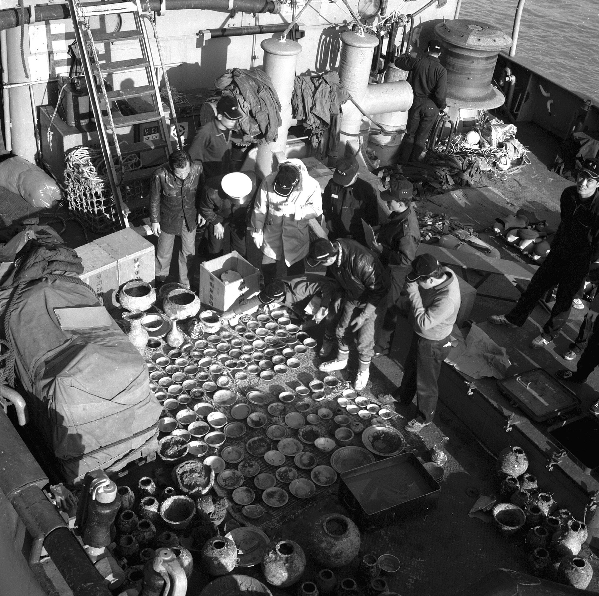
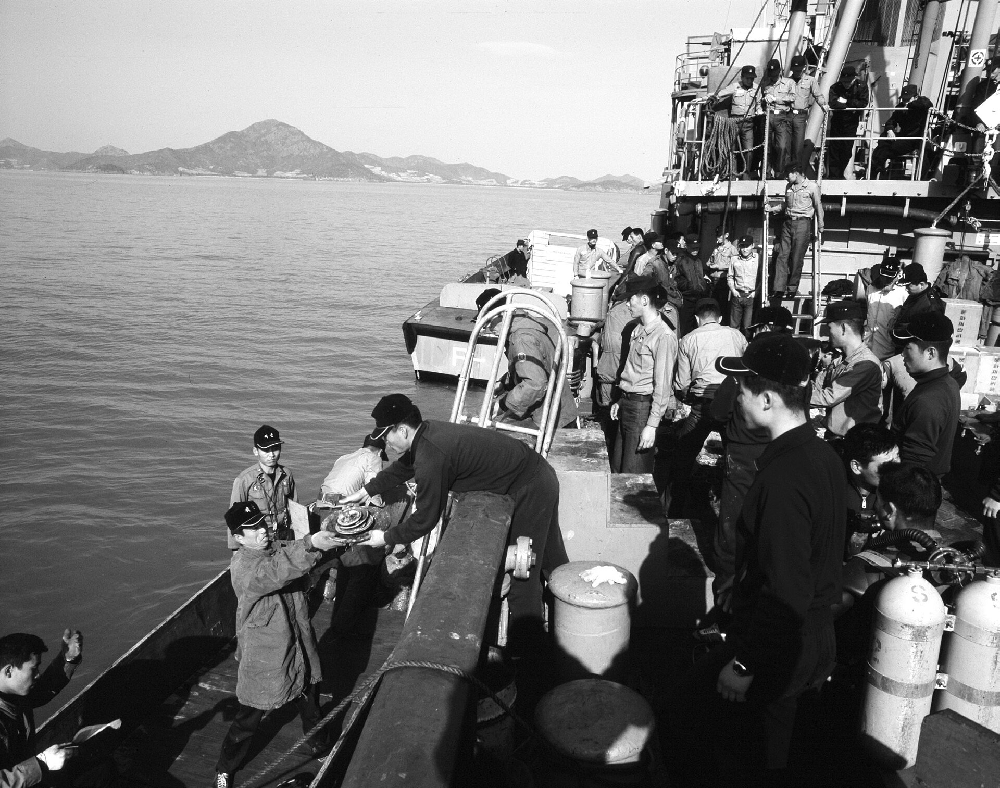

50년 전 오늘, 1976년 11월 2일. 전남 신안군 앞바다 해저에서 송나라와 원나라의 보물 115점이 모습을 드러냈습니다. 심한 풍랑을 이겨내고 해군 해난구조대와 문화재관리국이 건져 올린 도자기들은 수백 년의 세월이 무색할 만큼 생생한 빛깔을 자랑했습니다.

## 풍랑을 뚫고 시작된 해저 조사

1976년 10월 27일부터 문화재관리국 조사단은 전남 신안군 지도면 방축리 도덕도 앞 서부 해상에서 본격적인 발굴에 들어갔습니다. 바다 밑바닥에 도자기들이 묻혀 있다는 사실이 확인된 뒤 국가 차원의 정밀 조사가 펼쳐진 것입니다.

하지만 남해의 가을 바다는 호락호락하지 않았습니다. 며칠 동안 이어진 거센 풍랑 탓에 잠수요원들이 물속으로 들어가지 못하고 발을 굴러야 했습니다. 날씨가 잦아들기를 기다리던 조사단은 11월 1일 마침내 첫 인양 작업을 개시했습니다.

## 아침부터 오후 5시까지 건져 올린 115점

11월 1일 아침 9시, 해군 해난구조대의 지원을 받아 잠수 작업이 본격적으로 시작되었습니다. 잠수요원들이 차가운 펄 바닥을 훑으며 유물을 하나씩 건져 올릴 때마다 조사선 위에서는 탄성이 터져 나왔습니다.

오후 5시까지 바다 밑에서 건져낸 유물은 청자와 백자, 토기, 항아리, 동전 등 모두 115점에 달했습니다. 청자 꽃병과 사발, 화분, 접시와 잔을 비롯해 백자 항아리까지 종류도 무척 다양했습니다.

*신안 앞바다 중국 송-원대 도자기 인양작업 현장 — 사진: 대한민국 정부 / Public domain*

## 동전에 새겨진 순화와 경원, 시대를 밝히다

이날 인양된 유물 가운데 특히 눈길을 끈 것은 세 점의 금속 동전이었습니다. 글자가 닳아 있었지만 전문가들의 정밀 감정을 거쳐 양각된 문자가 판독되었습니다.

하나는 서기 990년부터 994년 북송 태종 순화 연간에 주조된 '순화원보'였고, 또 다른 동전은 서기 1195년부터 1196년 남송 영종 때 만들어진 '경원통보'였습니다. 이를 통해 조사단은 침몰선에 실린 유물들이 송나라에서 원나라(1271~1368년) 시기에 걸치는 귀중한 문화재임을 과학적으로 확인했습니다.

*신안 앞바다 중국 송-원대 도자기 인양작업 현장 02 — 사진: 대한민국 정부 / Public domain*

## 수백 년 해저에서도 완벽히 보존된 원형

바다 밑에서 수백 년 동안 잠들어 있던 유물들은 해초와 조개껍데기가 겉면에 달라붙어 있었지만, 놀랍게도 형태는 거의 온전했습니다. 당시 1차 감정을 맡은 맹인재 한국민속박물관장은 색감과 조형미가 매우 뛰어나며 모두 문화재로 지정할 가치가 충분하다고 평가했습니다.

이전에 도굴 암매단이 불법으로 건져냈던 129점에 이날 인양된 115점을 더해 확인된 유물은 244점으로 늘어났습니다. 조사단은 바닷속에 여전히 수백 점 이상의 보물이 더 묻혀 있을 것으로 내다보았습니다.

![[1107호] 전남 도덕도 문화재 발굴 전남 신안군 도덕도 앞바다 문화재 발굴 모습 (1976.11.08) 장면 1](../images/2026-11-02-03-4.jpg)
*[1107호] 전남 도덕도 문화재 발굴 전남 신안군 도덕도 앞바다 문화재 발굴 모습 (1976.11.08) 장면 1 — 사진: KTV 국민방송 e영상역사관 (대한뉴스) / KTV 공공저작물 — 영상 저작물 전면 개방(대통령실 2025-07-09), 출처 표시*

## 목포에서 서울로, 세계적인 보물선의 서막

1차 인양을 마친 조사단은 인양된 유물들을 목포경찰서로 옮겨 철저한 보안 속에 보관했습니다. 유물들은 11월 2일과 3일에 걸쳐 서울로 안전하게 옮겨졌고, 유물이 발굴된 해상에는 부표를 띄워 현장을 지켰습니다.

조사단은 장비와 인원을 보강한 뒤 11월 중순에 2차 조사 작업을 이어가기로 결정했습니다. 1976년 11월 초 신안 앞바다에서 건져 올린 이 115점의 유물은 이후 동아시아 해상 교류사를 새롭게 쓰는 거대한 해저 발굴 신화의 첫 장이 되었습니다.

### 참고 자료

- <https://newslibrary.naver.com/viewer/index.naver?articleId=1976110200329201004&editNo=2&printCount=1&publishDate=1976-11-02&officeId=00032&pageNo=1&printNo=9569&publishType=00020>
- <https://commons.wikimedia.org/wiki/File:%EC%8B%A0%EC%95%88_%EC%95%9E%EB%B0%94%EB%8B%A4%EC%97%90%EC%84%9C_%EC%9D%B8%EC%96%91%ED%95%9C_%EC%A4%91%EA%B5%AD_%EC%86%A1-%EC%9B%90%EB%8C%80_%EB%8F%84%EC%9E%90%EA%B8%B0.jpg>
- <https://commons.wikimedia.org/wiki/File:%EC%8B%A0%EC%95%88_%EC%95%9E%EB%B0%94%EB%8B%A4_%EC%A4%91%EA%B5%AD_%EC%86%A1-%EC%9B%90%EB%8C%80_%EB%8F%84%EC%9E%90%EA%B8%B0_%EC%9D%B8%EC%96%91%EC%9E%91%EC%97%85_%ED%98%84%EC%9E%A5.jpg>
- <https://commons.wikimedia.org/wiki/File:%EC%8B%A0%EC%95%88_%EC%95%9E%EB%B0%94%EB%8B%A4_%EC%A4%91%EA%B5%AD_%EC%86%A1-%EC%9B%90%EB%8C%80_%EB%8F%84%EC%9E%90%EA%B8%B0_%EC%9D%B8%EC%96%91%EC%9E%91%EC%97%85_%ED%98%84%EC%9E%A5_02.jpg>
- <https://www.ehistory.go.kr/view/movie?mediasrcgbn=KV&mediaid=10084&mediadtl=20424&mediagbn=DH#t=0.3>
