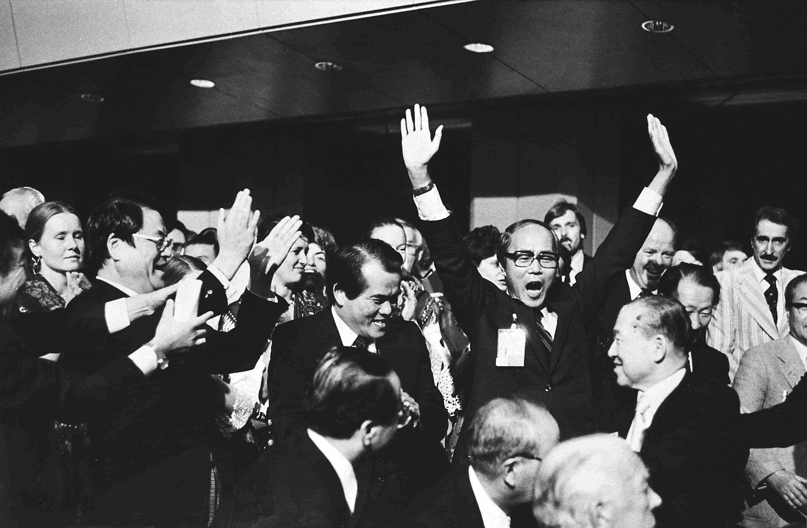
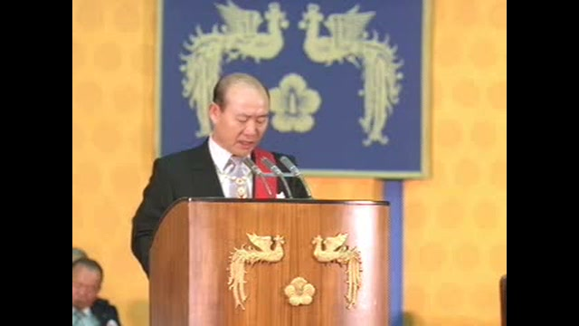

45년 전 오늘, 1981년 11월 2일 서울올림픽을 준비할 공식 집행 기구인 서울올림픽조직위원회가 정식으로 발족했습니다. 이날 서울 세종문화회관 소회의실에서 열린 총회를 통해 대한민국은 올림픽이라는 지구촌 최대 스포츠 축제를 치러내기 위한 역사적인 첫발을 내디뎠습니다.

## 세종문화회관에 모인 29명의 발기인

1981년 11월 2일 오전, 서울 세종문화회관 소회의실에서 제1차 위원총회 겸 발기인 총회가 열렸습니다. 회의에는 조상호 대한올림픽위원회 위원장을 포함해 사회 각계를 대표하는 발기인 29명이 참석했습니다.

발기인들은 총회를 통해 올림픽 개최를 위한 실질적 집행기구인 조직위원회를 구성하고 정식 업무를 시작하기로 결의했습니다. 전두환 대통령을 명예총재로 추대하고, 대한적십자사 총재였던 김용식 씨를 초대 조직위원장으로 선출하며 기구의 체계를 세웠습니다.

## 각계 지도자들이 모인 의장단과 집행위원회

이날 총회에서는 조직위원회를 이끌어갈 부위원장단과 집행위원들의 선임도 함께 이루어졌습니다. 부위원장에는 박영수 서울시장, 조상호 대한올림픽위원장, 정주영 전국경제인연합회장, 이원경 대한올림픽위원회 상임고문 등 네 명이 선출되었습니다.

집행위원으로는 김택수 국제올림픽위원회 위원, 한병채 국회 문공위원장, 이규호 문교부 장관, 노태우 정무제2장관, 이원홍 한국방송협회 회장이 위원장단과 함께 선출되었습니다. 실질적인 실무 집행을 담당할 사무처가 마련되었고, 이원경 고문이 사무총장직을 겸임 인준받았습니다.

*제24회 하계올림픽 서울 유치가 확정되자 환호하는 박영수 서울시장 (1981.09.30) — 사진: 서울역사박물관 / KOGL Type 1*

## 체육·경제·문화계 인사들의 대거 참여

이날 구성된 29명의 조직위원 명단에는 대한민국을 대표하는 여러 분야의 주요 인사들이 대거 포함되었습니다. 특히 베를린올림픽 마라톤 금메달 수상자인 손기정 씨가 조직위원으로 참여해 체육계의 큰 상징성을 더했습니다.

이외에도 김운용 세계태권도연맹 총재, 최원석 대한탁구협회 회장, 박종규 대한사격연맹 회장 등 경기 단체 수장들이 참여했습니다. 경제계에서는 조중훈 대한항공 사장, 정수창 대한상공회의소 회장, 유창순 한국무역협회 회장이 합류했으며, 정의숙 이화여대 총장과 신영균 한국예총 회장, 문태갑 한국신문협회 회장 등 교육, 문화, 언론계 인사들도 힘을 모았습니다.

*전두환 대통령의 취임 잠실 실내체육관에서 전두환 대통령의 취임식이 열림. (1981.00.00) 장면 1 — 사진: KTV 국민방송 e영상역사관 (대통령기록영상) / KTV 공공저작물 — 영상 저작물 전면 개방(대통령실 2025-07-09), 출처 표시*

## 정부 차원의 전폭적인 지원 체제 마련

조직위원회 발족과 더불어 정부 또한 각 행정기관이 조직위를 체계적으로 지원할 수 있도록 서울올림픽 지원위원회를 설치했습니다. 지원위원회 위원장은 남덕우 국무총리가 맡았으며, 부위원장에는 노태우 정무제2장관이 선임되었습니다.

지원위원회는 전 국무위원과 서울시장, 대통령 비서실장 등으로 구성되어 국가적 역량을 총동원하는 구조를 갖추었습니다. 또한 실무 보좌를 위해 국무총리실 행정조정실장을 위원장으로 하는 서울올림픽 실무위원회를 두고, 기획, 재정, 경기, 시설환경, 통신, 교통관광 등 11개 분과위원회를 설치하여 각 부처 공무원들이 직접 참여하도록 했습니다.

![[1306호] 국가보위 입법회의 발족 ... 입법회의 발족 (1980.11.05) 장면 1](../images/2026-11-02-04-4.jpg)
*[1306호] 국가보위 입법회의 발족 ... 입법회의 발족 (1980.11.05) 장면 1 — 사진: KTV 국민방송 e영상역사관 (대한뉴스) / KTV 공공저작물 — 영상 저작물 전면 개방(대통령실 2025-07-09), 출처 표시*

## 범국민적 참여와 올림픽을 향한 7년의 준비

조직위원회는 대회 준비 과정에서 전국적인 의견을 모으기 위해 범국민적 자문위원단을 구성하기로 했습니다. 체육계와 국회, 군, 종교, 법률, 언론, 경제, 노동, 여성계는 물론 해외 동포 대표까지 아우르는 500명 이내의 자문위원을 위촉하기로 했습니다.

아울러 분야별 세부 준비를 위해 조직위원회 내에 10개의 전문위원회를 설치하기로 결정했습니다. 이로써 1988년 대회가 열리기까지 남은 7년 동안 경기장 시설 건립부터 문화 행사, 안전 대책까지 치밀한 준비 작업을 수행할 기틀이 마련되었습니다.

## 한국 현대사에 남긴 서울올림픽의 발자취

국제올림픽위원회가 감독하는 근대 올림픽은 세계 각국의 수천 명 선수가 모여 기량을 겨루는 지구촌 최대의 행사입니다. 1981년 11월 2일 출범한 서울올림픽조직위원회는 대한민국이 국제 무대에서 역량을 발휘하는 중요한 디딤돌이 되었습니다.

당시 출범한 조직위원회의 체계적인 준비는 1988년 하계 올림픽의 성공적 개최로 이어졌으며, 같은 해 서울에서 패럴림픽까지 동시 개최되는 성과를 남겼습니다. 서울 세종문화회관에서 시작되었던 올림픽 준비의 첫걸음은 지금도 대한민국 체육사와 현대사에 뜻깊은 역사로 남아 있습니다.

### 참고 자료

- <https://newslibrary.naver.com/viewer/index.naver?articleId=1981110200329201013&editNo=2&printCount=1&publishDate=1981-11-02&officeId=00032&pageNo=1&printNo=11106&publishType=00020>
- <https://commons.wikimedia.org/wiki/File:1988%EB%85%84_%EC%84%9C%EC%9A%B8%EC%98%AC%EB%A6%BC%ED%94%BD_%EC%9C%A0%EC%B9%98_%EB%8C%80%ED%91%9C%EB%8B%A8%EC%9D%98_%EC%9C%A0%EC%B9%98_%EC%84%B1%EA%B3%B5_%EA%B8%B0%EC%9E%90%ED%9A%8C%EA%B2%AC_(1981.10.04).jpg>
- <https://commons.wikimedia.org/wiki/File:%EC%A0%9C24%ED%9A%8C_%ED%95%98%EA%B3%84%EC%98%AC%EB%A6%BC%ED%94%BD_%EC%84%9C%EC%9A%B8_%EC%9C%A0%EC%B9%98%EA%B0%80_%ED%99%95%EC%A0%95%EB%90%98%EC%9E%90_%ED%99%98%ED%98%B8%ED%95%98%EB%8A%94_%EB%B0%95%EC%98%81%EC%88%98_%EC%84%9C%EC%9A%B8%EC%8B%9C%EC%9E%A5_(1981.09.30).jpg>
- <https://www.ehistory.go.kr/view/movie?mediasrcgbn=KV&mediaid=2433&mediadtl=9330&mediagbn=DT#t=0.3>
- <https://www.ehistory.go.kr/view/movie?mediasrcgbn=KV&mediaid=10301&mediadtl=21657&mediagbn=DH#t=0.3>
