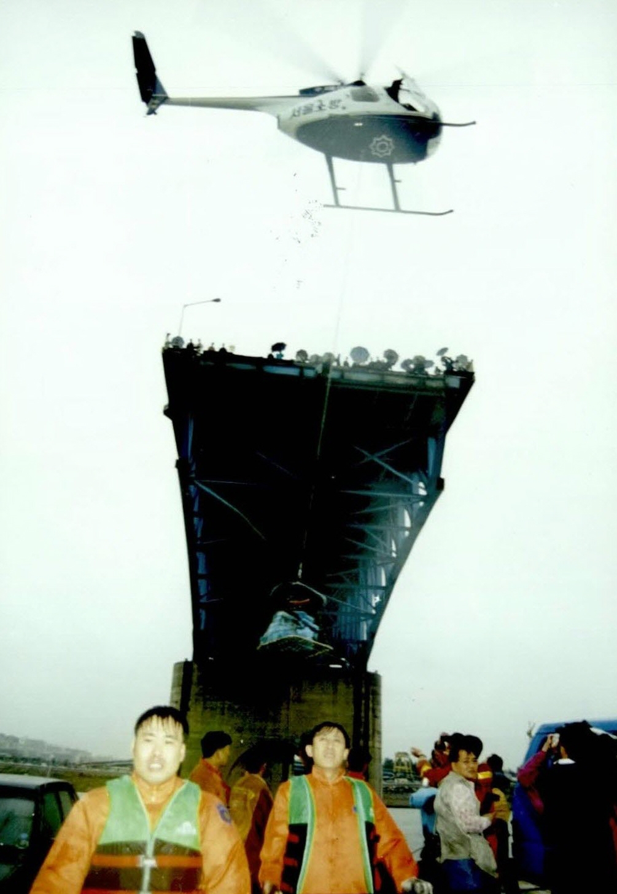
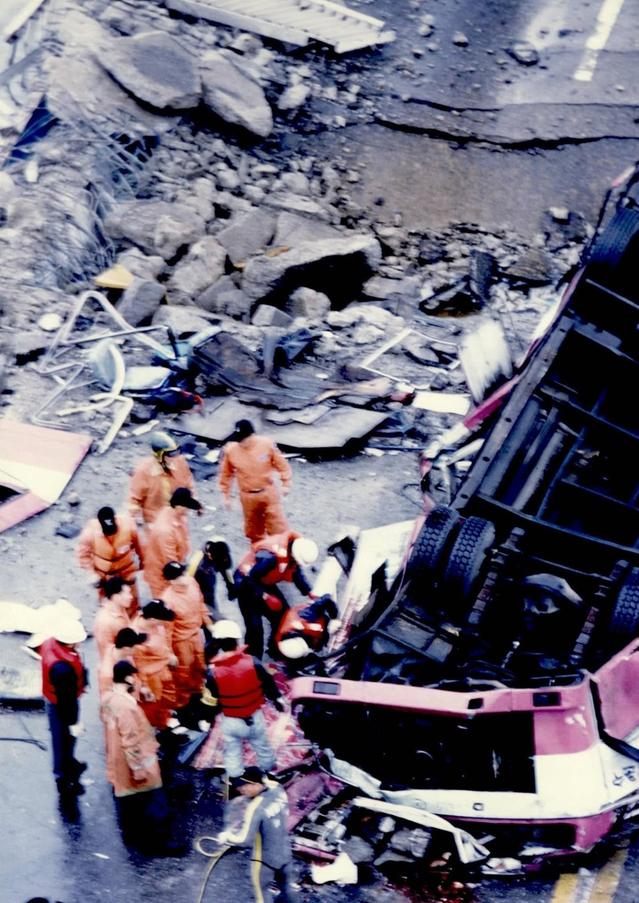
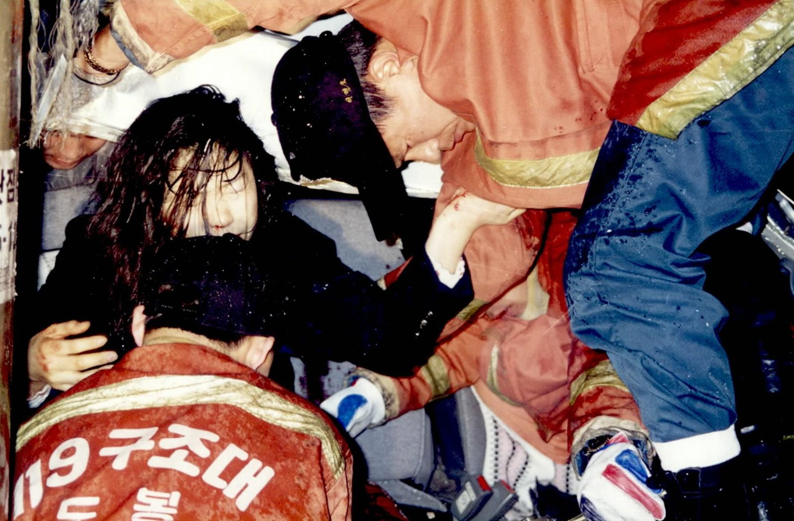

32년 전 오늘, 1994년 11월 2일 조간신문 1면에는 성수대교 붕괴 참사 수습을 위해 임명됐던 우명규 서울특별시장이 취임 열하루 만에 전격 사퇴했다는 소식이 일제히 실렸습니다. 온 나라를 비통에 빠뜨린 대형 참사 속에서 수습의 지휘봉을 잡았던 시장마저 사법 처리 대상에 오르며 시민들의 충격과 분노는 더욱 커졌습니다.

## 성수대교 붕괴와 서울시장의 전격 경질

1994년 10월 21일 오전 7시 38분, 성수대교 제10번과 11번 교각 사이 상부 트러스 48미터가 한강으로 무너져 내리는 참사가 발생했습니다. 출근길 승용차들과 등굣길 승객을 태운 16번 시내버스가 추락하면서 무학여자고등학교 학생 8명을 포함해 32명이 사망하고 17명이 부상을 입었습니다. 믿기 힘든 인재에 국민적 공분이 일자 정부는 사고 당일 오후 7시 이원종 서울시장을 전격 경질했습니다.

## 구원투수로 발탁된 기술 관료 우명규

이원종 시장의 후임으로 발탁된 인물은 당시 경북도지사로 재직 중이던 우명규 시장이었습니다. 우 시장은 서울시에서 20년 넘게 몸담으며 도로국장과 종합건설본부장, 부시장 등 주요 요직을 거친 베테랑 기술 관료였습니다. 붕괴된 교량 안전망을 점검하고 흐트러진 서울시정을 빠르게 정상화할 적임자로 평가받으며 10월 22일 임명장을 받았습니다.

*1994년 자료 — 사진: 최광모 / CC BY-SA 4.0*

## 수습 책임자에서 수사 대상으로

하지만 우 시장의 취임 직후 거센 역풍이 불기 시작했습니다. 성수대교가 완공된 1979년 이후 지속적인 유지와 보수가 부실했던 원인이 드러나면서, 과거 서울시 도로와 건설 행정을 총괄했던 우 시장 본인 역시 참사의 책임에서 자유로울 수 없다는 지적이 쏟아졌습니다. 특히 전년도 부시장 재직 시절 동부건설사업소 등으로부터 교량 손상과 위험 보고를 받았는지에 대한 의혹이 제기되었고, 서울지방검찰청은 부실 보고 여부에 따라 우 시장을 직접 소환 조사하겠다고 밝혔습니다.

*1994년 자료 — 사진: 최광모 / CC BY-SA 4.0*

## 열하루 만의 사퇴 선언과 기자회견

검찰 소환 위기에 몰리자 우명규 시장은 결국 취임 11일 만인 11월 1일 전격 사퇴를 결정했습니다. 우 시장은 이날 오전 제74회 서울시의회 임시회에 참석한 데 이어 서울시청 기자실에서 기자회견을 가졌습니다. 그는 서울시에 20년 이상 몸담은 공직자로서 성수대교 붕괴에 큰 책임을 통감하며, 시장직을 계속 수행하는 것이 사고 수습에 도움이 되지 않는다고 판단해 사직서를 냈다고 밝혔습니다. 아울러 검찰이 부를 경우 기꺼이 응하겠다는 뜻을 덧붙였습니다.

*1994년 자료 — 사진: 최광모 / CC BY-SA 4.0*

## 졸속 인사가 남긴 역대 두 번째 단명 시장 기록

우명규 시장의 사퇴로 그는 1993년 문민정부 출범 직후 임명됐다가 재산 문제 등으로 7일 만에 물러난 김상철 전 시장에 이어 역대 두 번째로 짧은 재임 기간을 남긴 서울시장이 되었습니다. 대형 참사의 충격이 가시기도 전에 과거 책임자를 다시 시장에 앉힌 정부의 안이한 인사 검증은 거센 비판을 받았습니다. 김영삼 대통령은 사표를 즉각 수리하고 11월 3일 후임으로 최병렬 전 장관을 임명했습니다.

## 안전 불감증의 경종이 된 1994년의 교훈

성수대교 참사와 우 시장의 단명 사퇴는 압축 성장기 한국 사회를 지탱하던 '빨리빨리' 문화와 안전 불감증의 민낯을 적나라하게 드러냈습니다. 이후 성수대교는 전면 철거 후 재건설되어 1997년에야 다시 연결되었고, 같은 트러스 공법으로 지어졌던 당산철교 또한 전면 철거 후 다시 시공되는 등 도시 인프라 점검의 전면적인 개편으로 이어졌습니다. 기본과 원칙을 무시한 결과가 어떤 대가를 치르는지 여전히 뼈아픈 기억으로 남아 있습니다.

### 참고 자료

- <https://newslibrary.naver.com/viewer/index.naver?articleId=1994110200289101001&editNo=5&printCount=1&publishDate=1994-11-02&officeId=00028&pageNo=1&printNo=2055&publishType=00010>
- <https://commons.wikimedia.org/wiki/File:1994%EC%84%B1%EC%88%98%EB%8C%80%EA%B5%90_%EB%B6%95%EA%B4%B4_%EC%82%AC%EA%B3%A003.jpg>
- <https://commons.wikimedia.org/wiki/File:1994%EC%84%B1%EC%88%98%EB%8C%80%EA%B5%90_%EB%B6%95%EA%B4%B4_%EC%82%AC%EA%B3%A002.jpg>
- <https://commons.wikimedia.org/wiki/File:1994%EC%84%B1%EC%88%98%EB%8C%80%EA%B5%90_%EB%B6%95%EA%B4%B4_%EC%82%AC%EA%B3%A004.jpg>
- <https://commons.wikimedia.org/wiki/File:1994%EC%84%B1%EC%88%98%EB%8C%80%EA%B5%90_%EB%B6%95%EA%B4%B4_%EC%82%AC%EA%B3%A010.jpg>
