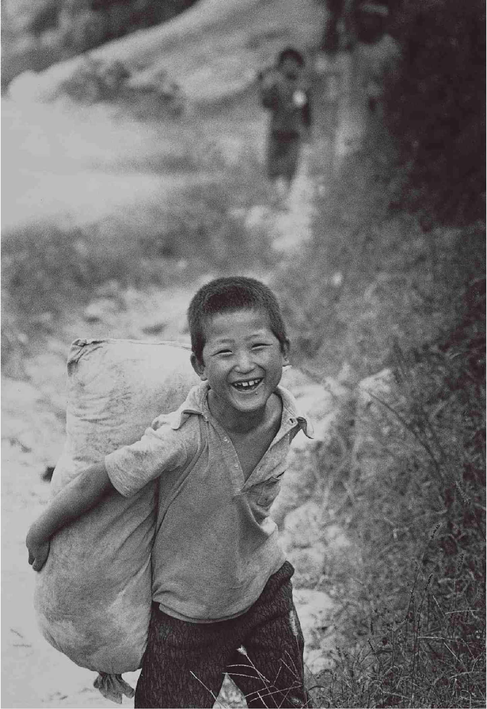
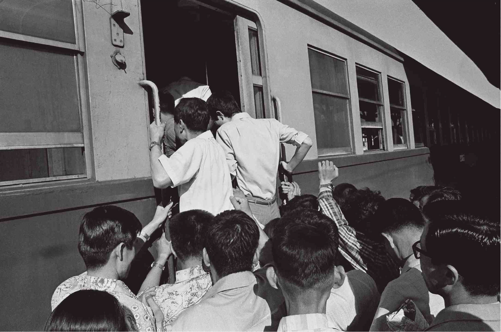
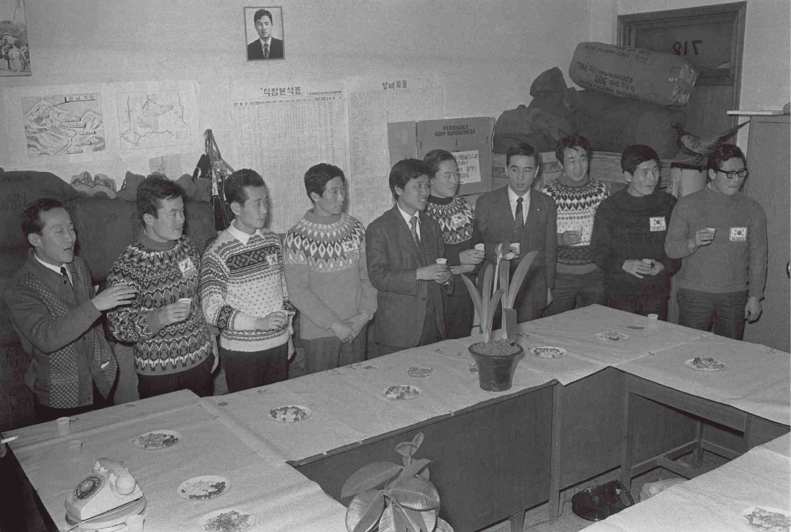

54년 전 오늘, 1972년 11월 2일. 이후락 남북조절위원회 공동위원장이 제2차 남북조절위원장 회의에 참석하기 위해 평양에 도착했습니다. 7·4 남북공동성명 발표 이후 남과 북의 최고위급 당국자들이 분단 체제를 넘어 평양 한복판에서 마주 앉은 역사적인 날이었습니다.

## 극비 방북에서 공식 방문으로

1972년 남북 관계는 격변의 한가운데에 있었습니다. 그해 5월 2일, 중앙정보부장이던 이후락 위원장은 죽음을 각오하고 판문점을 넘어 극비리에 평양을 방문했습니다. 그 비밀 접촉의 결과물이 바로 자주, 평화, 민족대단결의 3대 원칙을 담은 7·4 남북공동성명이었습니다.

공동성명 발표 이후 남북 사이에는 합의 사항을 구체적으로 실천하기 위한 상설 협의 기구인 남북조절위원회가 필요했습니다. 이번 11월 2일의 평양 방문은 지난 5월의 비밀 방북과 달리, 공식 보좌단과 정부 수행원, 그리고 취재 기자단까지 대동한 공식적인 행보였습니다.

## 판문점 회견과 '체제 정비' 논란

11월 2일 오전 8시 18분 정부종합청사 앞을 출발한 이후락 위원장 일행은 판문점 자유의집에 들러 기자회견을 가졌습니다. 이 자리에서 이 위원장은 "이번 평양 회담에서는 남북조절위원회 구성 문제가 가장 초점이 된다"며 "상대방과 합의만 된다면 실질적인 문제도 폭넓게 논의될 수 있다"고 밝혔습니다.

당시 국내외의 뜨거운 관심사였던 체제 문제에 대한 질의도 이어졌습니다. 유신헌법안 공포와 북한의 개헌 작업이 남북 간 사전 양해하에 이뤄진 것이냐는 내외신 기자의 질문에 이 위원장은 단호하게 선을 그었습니다. 그는 "우리 유신헌법안은 우리 나름의 체제 정비이지, 북한과 사전에 상의하거나 양해를 구한 일은 전혀 없으며 있을 수도 없다"고 강조했습니다.

*Children in an island 1972-10-09 — 사진: Photos taken by 전민조 and hosted by the National Museum of Kor / Public domain*

## 소련제 헬기를 타고 평양 사과밭으로

오전 9시 55분 북측 승용차로 갈아탄 대표단은 판문각을 거쳐 개성으로 향했습니다. 개성 남쪽 하천둑에 마련된 임시 헬리포트에서 일행 24명은 북한 측이 제공한 소련제 헬리콥터 석 대에 분승했습니다. 보좌단과 기자가 1·2호기에 나누어 타고 3호기에는 짐이 실렸습니다.

헬리콥터는 서울과 평양을 잇는 도로와 경의선 상공을 저공 비행하며 북진했습니다. 가을걷이가 한창인 들녘과 계단식으로 개간된 구릉지의 과수원을 지나, 오전 11시 6분 평양 근교 사과밭에 조성된 헬리포트에 안착했습니다. 이곳은 지난 5월 이후락 위원장이 비밀리에 내렸던 바로 그 자리로, 김일성의 지시로 영구 헬리콥터장으로 정비된 곳이었습니다.

*Pickpocket caught by camera 1972-07 — 사진: Photos taken by 전민조 and hosted by the National Museum of Kor / Public domain*

## 옥류교를 건너 대동강 기슭 내각초대소로

헬기장에는 건강 문제로 불참한 김영주 위원장을 대리한 박성철 제2부수상과 김중린, 양형섭 비서 등 북한 고위 요인 17명이 나와 남측 일행을 맞았습니다. 대표단은 대기 중이던 독일제 벤츠 600 승용차에 나누어 타고 평양 시내로 들어섰습니다.

동평양 옥류교를 건너는 연도에는 앞선 남북적십자회담 때보다 훨씬 많은 평양 주민들이 나와 남측 차량 행렬을 지켜보았고, 아파트 창문을 열고 내려다보는 이들도 많았습니다. 대표단이 여장을 푼 곳은 을밀대 아래 능라도가 내려다보이는 대동강 기슭의 내각초대소였습니다. 인도네시아 수카르노 전 대통령과 캄보디아 시아누크 공이 묵었던 3호각에 이 위원장이 머물렀습니다.

*The last toast 1972-02-01 — 사진: Photos taken by 전민조 and hosted by the National Museum of Kor / Public domain*

## 만수대의사당에서 열린 제2차 회의

숙소에서 점심을 마친 남측 대표단은 오후 3시 30분 만수대의사당으로 박성철 부수상을 예방했고, 오후 4시부터 본격적인 제2차 남북조절위원장 회의를 시작했습니다. 남측에서는 장기영 전 부총리, 최규하 대통령 외교담당특별보좌관, 강인덕 중앙정보부 제9국장, 정홍진 협의조정국장이 배석했습니다.

북측에서는 유장식 노동당 조직지도부 부부장, 이경석 내각 참사, 한웅식 당 책임지도원, 김덕현 직속책임지도원이 마주 앉았습니다. 양측은 조절위원회의 공동규정을 만들고 운영 기구를 구성하기 위한 구체적인 협의를 이어갔으며, 저녁 8시에는 옥류관에서 공식 연회가 열렸습니다.

## 분단의 벽 앞에 멈춰 선 대화의 기록

당시 남측 취재기자단은 숙소인 평양여관에 직통 전화회선과 사진 전송 회선을 설치해 평양의 생생한 소식을 서울로 송고했습니다. 라디오와 신문을 통해 전해진 평양 방문 소식은 전쟁의 상흔과 반공의 그늘 속에 살아가던 국민들에게 통일에 대한 실낱같은 기대를 품게 했습니다.

하지만 남북조절위원회를 통한 대화는 오래 지속되지 못했습니다. 남북 양측 모두 대화를 국내 정치 체제 강화에 이용했다는 비판과 함께, 1973년 이후 남북 관계가 다시 경색되면서 조절위 회담은 중단되고 말았습니다. 헬기를 타고 평양 사과밭에 내렸던 1972년 11월 2일의 기록은 분단사에서 대화와 화해를 모색했던 귀중한 첫 발자국으로 남아 있습니다.

### 참고 자료

- <https://newslibrary.naver.com/viewer/index.naver?articleId=1972110200209201004&editNo=2&printCount=1&publishDate=1972-11-02&officeId=00020&pageNo=1&printNo=15719&publishType=00020>
- <https://commons.wikimedia.org/wiki/File:1990%EB%85%84%EB%8C%80_%EC%B4%88%EA%B8%B0_%EC%84%9C%EC%9A%B8%EC%86%8C%EB%B0%A9_%ED%99%9C%EB%8F%99_%EC%82%AC%EC%A7%84%EC%8A%A4%EC%BA%940018.jpg>
- <https://commons.wikimedia.org/wiki/File:Children_in_an_island_1972-10-09.png>
- <https://commons.wikimedia.org/wiki/File:Pickpocket_caught_by_camera_1972-07.png>
- <https://commons.wikimedia.org/wiki/File:The_last_toast_1972-02-01.png>
