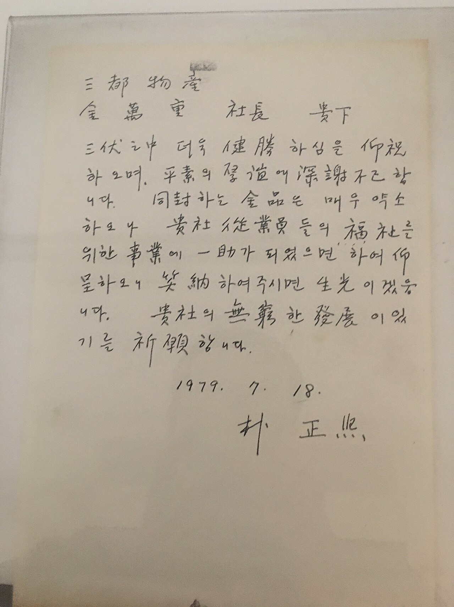
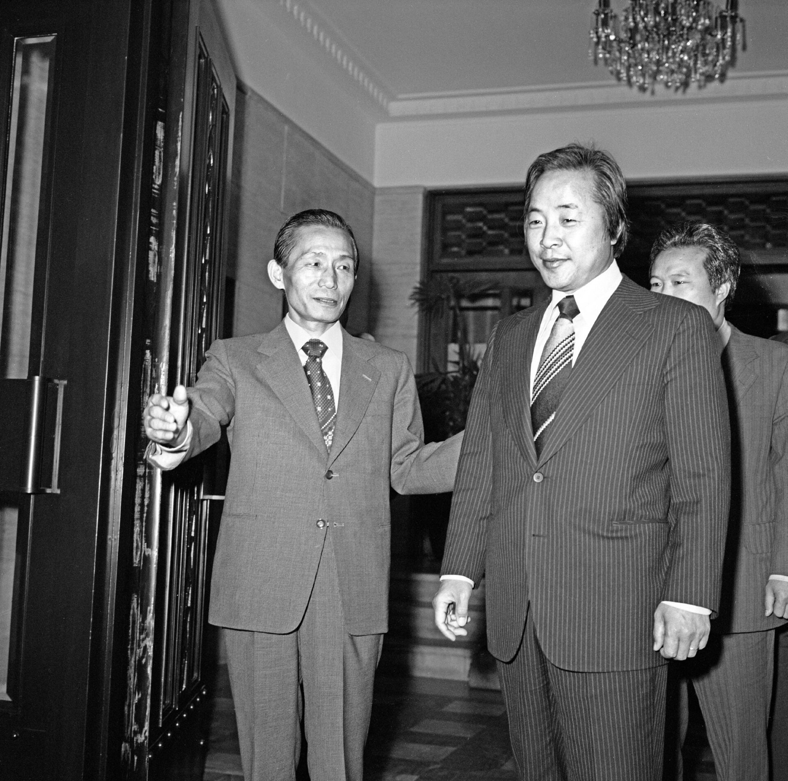
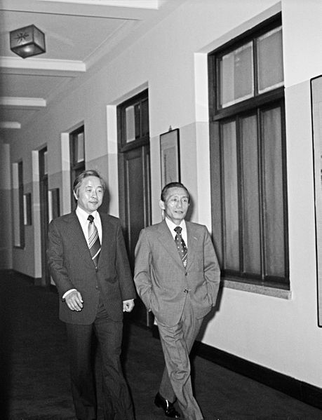

47년 전 오늘, 1979년 11월 3일. 대한민국 건국 이래 처음으로 치러진 고 박정희 대통령의 국장 영결식이 엄수되었습니다. 10·26 사건으로 서거한 뒤 치러진 이날 장례는 온 국민의 비탄과 애도 속에 역사 속 한 페이지로 남았습니다.

## 15년 10개월 머문 청와대를 뒤로하고

이날 서울 일대는 이른 아침부터 짙은 안개에 휩싸여 있었습니다. 오전 8시, 육사 정복 차림의 상주 박지만 생도와 소복을 입은 박근혜, 박근영 양 등 유족들은 청와대 본관 빈소에서 마지막 상식 제례를 올렸습니다. 김영삼 신민당 총재를 비롯한 정계 요인들과 친족 70여 명이 분향과 재배를 마쳤습니다. 오전 9시 10분, 유해가 영구차에 안치되면서 발인제인 견전제가 엄숙히 거행되었습니다.

대형 태극기로 뒤덮인 영구차는 밖에서 안을 볼 수 있도록 대형 유리를 끼우고 노랑, 연분홍, 하얀색의 국화 7만여 송이로 장식되었습니다. 영구차가 움직이자 10여 년간 청와대 본관 등에서 일해온 직원들은 눈물을 터뜨렸습니다. 1963년 12월 집무를 시작한 이래 15년 10개월 16일 만에 청와대를 떠나는 순간이었습니다. 오전 9시 26분, 영구차가 정문을 통과해 영결식장으로 향하는 동안 고인의 나이를 기리는 62발의 조포가 서울 시내에 울려 퍼졌습니다.

## 중앙청 광장에 울려 퍼진 1분간의 전국 묵념

오전 9시 56분, 3군 조악대의 조악이 울리는 가운데 영구는 중앙청 동문을 통해 영결식장에 도착했습니다. 영결식에는 유족과 최규하 대통령 권한대행, 백두진 국회의장, 이영섭 대법원장 등 3부 요인을 비롯해 사이러스 밴스 미국 국무장관, 기시 노부스케 전 일본 총리 등 40여 개국에서 온 외교 사절과 각계 인사 3천여 명이 참석했습니다.

오전 10시 정각, 김창식 총무처 소청심사위원장의 개식 선언과 함께 애국가 제창과 국기에 대한 경례가 이어졌습니다. 오전 10시 2분이 되자 전국에 사이렌이 울렸고, 전 국민은 일제히 일손을 놓고 1분간 묵념을 올리며 고인의 명복을 빌었습니다. 신현확 부총리의 약력 보고가 있은 뒤, 최규하 대통령 권한대행은 고인에게 건국훈장 대한민국장을 추서하고 조사를 낭독했습니다.

*SamdoPresidentPark — 사진: Kim J / CC BY-SA 4.0*

## 광장을 울린 6분간의 생전 육성

종교의식에서는 불교 조계종 종정 윤고암 스님의 법어와 독경, 김수환 추기경의 축도, 새문안교회 강신명 목사의 기도가 차례로 이어졌습니다. 종교의식이 끝난 뒤 영결식장에는 1975년 4월 29일 특별담화와 1978년 한국정신문화연구원 개원식 치사 등에서 발췌한 박 대통령의 생전 육성 녹음이 약 6분간 울려 퍼졌습니다.

"앞으로 국민 여러분들은 정부와 군을 믿어주시기 바라고, 우리 정부는 슬기롭고 용감한 국민 여러분들을 믿고 일치단결하여 모든 사태에 대처해 나가야겠다"는 생전의 단호한 목소리가 광장에 다시 울리자, 유족들과 조문객들은 참았던 울음을 터뜨렸습니다. 연도에서 라디오 중계방송을 듣던 시민들도 눈시울을 붉혔습니다.

*1975년 자료 — 사진: 대한민국 정부 / Public domain*

## 눈물 속의 운구 행렬과 국립묘지 안장

낮 12시 17분, 영결식을 마친 운구 행렬은 중앙청 광장을 떠나 광화문과 시청 앞, 서울역으로 이어지는 도로를 따라 서서히 이동했습니다. 유족과 조객들은 도보로 운구차의 뒤를 따랐고, 길가에 늘어선 수많은 시민들은 경건하게 머리를 숙이거나 눈물을 흘리며 마지막 길을 배웅했습니다.

서울역에서 차량으로 이동한 운구 행렬은 삼각지와 제1한강교를 거쳐 오후 2시 동작동 국립묘지에 도착했습니다. 안장식이 끝난 뒤 고 박정희 대통령의 유해는 1974년 먼저 흉탄에 서거한 영부인 고 육영수 여사의 묘소 바로 옆 유택에 나란히 하관되었습니다. 이로써 5·16 군사정변 이후 18년 5개월간 이어진 박정희 시대는 역사의 뒤안길로 접어들었습니다.

*1975년 자료 — 사진: 대한민국 정부 / Public domain*

## 그때 그 시절의 기억과 오늘

1979년 11월 3일의 국장은 대한민국 정부 수립 이후 처음으로 엄수된 최고 예우의 장례식이었습니다. 격동의 현대사 속에서 강력한 경제 개발과 유신 체제의 명암을 남긴 채 홀연히 떠난 지도자의 장례식은 당시를 살았던 많은 국민들에게 지울 수 없는 기억으로 남아 있습니다.

전국에 울려 퍼졌던 정적의 묵념 사이렌과 중앙청 앞을 가득 메웠던 검은 상복의 물결, 그리고 라디오 너머로 들려오던 고인의 육성을 지금도 생생하게 기억하는 분들이 적지 않습니다.

### 참고 자료

- <https://newslibrary.naver.com/viewer/index.naver?articleId=1979110300329201004&editNo=2&printCount=1&publishDate=1979-11-03&officeId=00032&pageNo=1&printNo=10491&publishType=00020>
- <https://commons.wikimedia.org/wiki/File:Reporting_on_a_rooftop_1979-11-03.png>
- <https://commons.wikimedia.org/wiki/File:SamdoPresidentPark.jpg>
- <https://commons.wikimedia.org/wiki/File:%EB%B0%95%EC%A0%95%ED%9D%AC_%EB%8C%80%ED%86%B5%EB%A0%B9_%EA%B9%80%EC%98%81%EC%82%BC_%EC%8B%A0%EB%AF%BC%EB%8B%B9_%EC%B4%9D%EC%9E%AC_%EC%A0%91%EA%B2%AC.jpg>
- <https://commons.wikimedia.org/wiki/File:%EB%B0%95%EC%A0%95%ED%9D%AC_%EB%8C%80%ED%86%B5%EB%A0%B9_%EA%B9%80%EC%98%81%EC%82%BC_%EC%8B%A0%EB%AF%BC%EB%8B%B9_%EC%B4%9D%EC%9E%AC_%EC%A0%91%EA%B2%AC_02.jpg>
