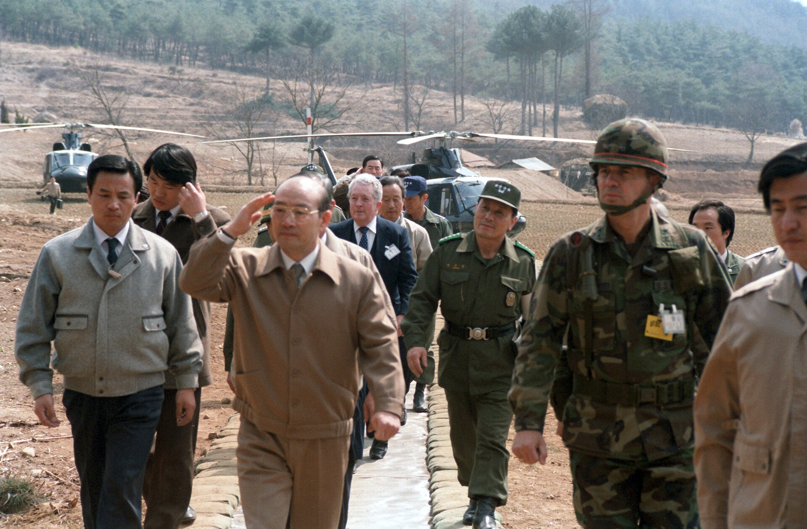
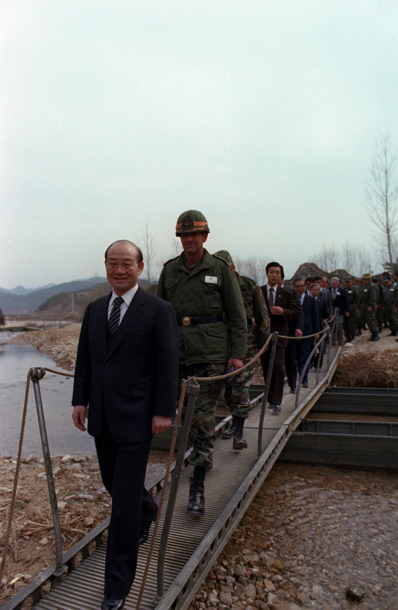
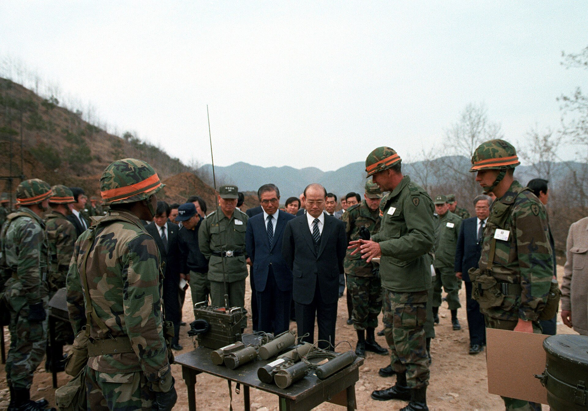

38년 전 오늘, 1988년 11월 3일 대한민국 헌정사상 처음으로 국회 청문회가 열렸습니다. 국회 5공비리조사특위가 증인을 선서시켜 일해재단 관련 비리 의혹을 집중 신문하며 본격적인 특위 활동에 돌입한 날이었습니다.

## 헌정사상 처음으로 선서대에 선 증인들

1988년 11월 3일 오전, 국회는 의정사상 처음으로 증인들을 상대로 선서를 진행하며 일해재단 청문회를 개최했습니다. 국회 5공비리조사특위는 일해재단(세종연구소)의 기금 조성 과정과 전두환 씨의 재단 사유화 시도 의혹을 파헤치기 위해 청문회를 열었습니다. 이날 청문회는 단순한 서면 조사가 아니라, 국회에 관계자들을 직접 불러 증언을 청취하는 방식으로 진행되어 전국적인 관심을 모았습니다. 같은 시기 광주특위도 간사회의를 소집해 최규하, 전두환, 김대중 씨의 증인 채택 문제를 협의하는 등 국회 차원의 비리 진상 규명이 본격화되었습니다.

## 국회 145호실에 출석한 11명의 핵심 증인

이날 국회 145호실 청문회장에는 김기환 세종연구소 소장을 비롯해 모두 11명의 증인이 출석했습니다. 김인배 전 사무처장, 임소혁 공인회계사(세종연구소 고문회계사), 신동원 외무부 차관, 이종원 세종연구소 감사(변호사), 조성희 전 총무부장 등이 증인석에 앉아 차례로 신문을 받았습니다. 여야 특위 위원들은 재단 기금을 대기업으로부터 강제로 모금했는지 여부와, 이 기금이 전두환 씨의 정치자금과 관련이 있는지를 집중적으로 따졌습니다. 또한 재단 설립 당시 총무부장을 맡았던 조성희 씨가 현역 보안사 대령 신분이었다는 점을 들어 권력에 의한 강압 모금이었는지를 날카롭게 추궁했습니다.

*사건 당시 사진 아님 · 1985년 — 사진: AL CHANG / Public domain*

## "강요에 의해 작성했다" 고문회계사의 증언

청문회에서 가장 큰 파장을 일으킨 대목은 회계장부 조작 의혹이었습니다. 특위 위원들은 일해재단이 84년, 85년, 86년 3년 동안 정상적인 회계장부를 만들지 않다가 87년 1월에야 임소혁 공인회계사를 통해 한꺼번에 3년 치 장부를 만든 사실을 지적했습니다. 해마다 감사를 한 것처럼 위장한 것은 공익법인 설립 운영에 관한 법률 위반이라는 추궁이 이어졌습니다.

첫 증언에 나선 임소혁 회계사는 87년 1월 3년 치를 한꺼번에 감사한 사실을 인정하며 법률적으로 문제가 있음을 시인했습니다. 그는 "당초 3년 치 회계장부를 통합해 한 건의 결산보고서로 만들었으나, 재단 감사인 이종원 전 법무장관의 저항하기 힘든 강요에 따라 세 가지로 나누었다"고 밝혔습니다. 또한 전체 기부금 규모를 파악하지 못한 채 재단이 제공한 자료 범위 안에서 장부를 정리한 것에 대해 도의적 책임을 느낀다고 증언했습니다.

*사건 당시 사진 아님 · 1983년 — 사진: AL CHANG / Public domain*

## 35억 원 익명 기탁과 자금 관리 의혹

야당 의원들은 전두환 씨가 익명으로 기탁한 35억 원의 출처에 대해서도 집중적으로 문제를 제기했습니다. 의원들은 이 자금이 기업인들이 자발적으로 낸 성금이 아니라 은밀히 제공된 정치자금일 가능성이 높으며, 퇴임 후 재단을 사유화하려 한 명백한 증거라고 주장했습니다.

또한 재단 시재금 기록에 나타난 거액의 별도 관리 자금도 도마 위에 올랐습니다. 특위 위원들과 임소혁 회계사의 증언에 따르면 재단에서 정상적으로 관리하지 않는 3백8억 원(또는 3백80억 원) 규모의 예금이 별도로 표기되어 있었으며, 이 기부금과 입출금을 청와대 측에서 직접 관리해 온 것이 아니냐는 의혹이 제기되었습니다.

*사건 당시 사진 아님 · 1983년 — 사진: Al CHANG / Public domain*

## K16 기지 화기 배치와 특수 무전 설비 논란

청문회장에서는 일해재단 시설의 호화성뿐 아니라 경호와 관련된 석연치 않은 정황들도 함께 드러났습니다. 특위 위원들은 87년 일해재단 인근 K16 기지의 대공화기를 이동 배치한 것이 재단과 전두환 씨를 경호하기 위한 목적이 아니었냐고 추궁했습니다. 재단의 문서관리대장에는 87년 6월 20일 군부대로부터 'K16 기지 대공화기 후진 배치를 위한 관계관 회의 소집' 공문을 접수하고, 7월 14일 관련 공사 분담 협의 문서를 발송한 기록이 남아 있었습니다.

또한 일해재단이 80년 7월 5일 무선국 허가를 신청하고 7월 29일 서울체신청으로부터 허가를 받아 무전 설비를 갖춘 점에 대해서도, 학술재단에 왜 이러한 군사·경호 수준의 장비가 필요했는지 질문이 쏟아졌습니다.

## 안방극장으로 이어진 5공 비리 청문회 정국

1988년 11월 3일 열린 첫 청문회는 시작에 불과했습니다. 특위는 1차 청문회에 이어 11월 7일에도 제2차 청문회를 열고 장세동 전 안기부장, 안현태 전 청와대 경호실장, 정주영 현대그룹 명예회장 등 증인 9명을 소환하기로 했습니다.

이날 국회에서 시작된 일해재단 청문회는 텔레비전을 통해 생생히 전해지며 전 국민의 이목을 집중시켰습니다. 굳게 닫혀 있던 권력 내부의 비리와 정경유착의 민낯이 국회 증언대에서 공개 증언으로 터져 나오면서, 대한민국 헌정사에 큰 전환점을 마련했습니다.

### 참고 자료

- <https://newslibrary.naver.com/viewer/index.naver?articleId=1988110300209201003&editNo=2&printCount=1&publishDate=1988-11-03&officeId=00020&pageNo=1&printNo=20645&publishType=00020>
- <https://commons.wikimedia.org/wiki/File:Chun_Doo-hwan,_1985-Mar-22.jpg>
- <https://commons.wikimedia.org/wiki/File:Chun_Doo-hwan_and_Claude_M._Kicklighter,_Chung_ho-yong,_1985-Mar-22.jpg>
- <https://commons.wikimedia.org/wiki/File:Chun_Doo-hwan_1983-March-11-01.JPEG>
- <https://commons.wikimedia.org/wiki/File:Chun_Doo-hwan,_1983-March-11-05.jpg>
