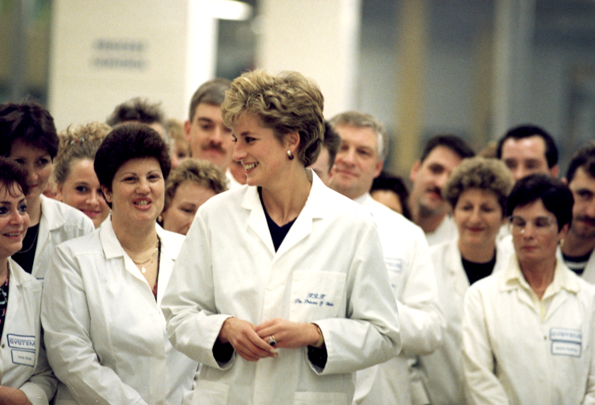

34년 전 오늘, 1992년 11월 3일. 영국의 찰스 왕세자와 다이애나 왕세자비가 한국을 공식 방문해 서울에서 공식 일정을 이어갔습니다. 당시 전 세계의 주목을 받던 영국 왕실 부부의 방한은 한국 사회에서도 큰 관심을 불러일으켰습니다.

## 서울공항에서 시작된 3박 4일간의 공식 방문

1992년 11월 2일 오후, 영국의 찰스 왕세자와 다이애나 왕세자비가 탑승한 특별기가 서울공항에 착륙했습니다. 이번 방한은 노태우 대통령의 공식 초청으로 성사되었으며, 3박 4일 동안 다양한 일정이 예정되어 있었습니다.

공항 트랩을 내려선 왕세자 부부는 공항 환영식에서 화동들로부터 꽃다발을 받으며 따뜻한 환대를 받았습니다. 찰스 왕세자 부부의 모습을 직접 보기 위해 많은 관계자들과 취재진이 공항에 몰렸습니다.

## 국립묘지 헌화와 주한 영국대사관 개관식

서울공항에 도착한 왕세자 부부는 첫 일정으로 곧바로 국립묘지를 방문했습니다. 두 사람은 순국선열과 참전용사들의 넋을 기리며 엄숙하게 헌화했습니다.

헌화를 마친 왕세자 내외는 새로 마련된 주한 영국대사관 개관식과 기념 리셉션에 참석했습니다. 한국과 영국의 외교 관계를 새롭게 다지는 상징적인 자리에서 두 사람은 관계자들을 격려하며 도착 첫날의 일정을 마무리했습니다.

*058792 Visit by Diana Princess of Wales 1992 (4087038134) — 사진: Newcastle Libraries from Newcastle upon Tyne, England / Public domain*

## 청와대 예방과 파주 설마리 전적비 참배

방한 이틀째인 11월 3일, 찰스 왕세자는 단독 일정으로 바쁜 하루를 보냈습니다. 왕세자는 청와대를 방문하여 노태우 대통령을 예방하고 양국 간의 우호 협력에 대해 대화를 나누었습니다.

이어 찰스 왕세자는 경기도 파주군 적성면 설마리에 있는 영국군 전적비를 찾았습니다. 6·25전쟁 당시 치열했던 격전지에서 산화한 영국군 장병들의 희생을 기리며 전적비 앞에 헌화하고 묵념을 올렸습니다.

![[1930호] 영국 찰스 왕세자 내외분 방한 영국 찰스 왕세자 내외분 방한 (1992.11.04) 장면 1](../images/2026-11-03-05-3.jpg)
*[1930호] 영국 찰스 왕세자 내외분 방한 영국 찰스 왕세자 내외분 방한 (1992.11.04) 장면 1 — 사진: KTV 국민방송 e영상역사관 (대한뉴스) / KTV 공공저작물 — 영상 저작물 전면 개방(대통령실 2025-07-09), 출처 표시*

## 다이애나 왕세자비의 상품전 개막식과 복지시설 방문

같은 날 다이애나 왕세자비는 찰스 왕세자의 동선과는 별도로 독자적인 일정을 소화했습니다. 다이애나비는 11월 3일 롯데백화점에서 열린 영국상품전시장 개막식에 직접 참석해 테이프를 끊었습니다.

개막식 일정을 마친 뒤 다이애나비는 아동보호시설을 방문했습니다. 평소 사회적 약자와 어린이에 대한 관심이 높았던 왕세자비는 시설 현장을 직접 둘러보며 아이들과 관계자들을 만나는 뜻깊은 시간을 가졌습니다.

![[1937호] 청와대 개방 청와대 개방 5년 (1992.12.21) 장면 1](../images/2026-11-03-05-4.jpg)
*[1937호] 청와대 개방 청와대 개방 5년 (1992.12.21) 장면 1 — 사진: KTV 국민방송 e영상역사관 (대한뉴스) / KTV 공공저작물 — 영상 저작물 전면 개방(대통령실 2025-07-09), 출처 표시*

## 영국 왕세자 직함 '웨일스 공'의 역사적 배경

찰스 왕세자가 지닌 '웨일스 공'이라는 직함은 영국 왕위 계승 서열 1위인 법정추정상속인을 의미하는 유서 깊은 작위입니다. 1301년 잉글랜드 국왕 에드워드 1세가 웨일스를 병합한 뒤 장남 에드워드에게 이 작위를 내린 것에서 시작되었습니다.

이후 1343년 에드워드 3세가 맏아들인 흑태자 에드워드에게 웨일스 공 칭호를 부여하면서 차기 왕위 계승자에게 내려지는 전통으로 확립되었습니다. 찰스 왕세자 역시 이러한 왕실 전통에 따라 오랜 세월 차기 계승자로서의 직함을 유지해 왔습니다.

## 한국과 서양의 왕세자 제도와 방한의 기억

조선 시대에도 왕비가 낳은 적장자를 원자로 정하고 이후 왕세자로 책봉하여 동궁에서 생활하게 하였습니다. 세자의 교육을 담당하는 세자시강원과 호위를 맡은 세자익위사를 두고 차기 군주로서의 엄격한 훈련을 거치게 했습니다.

유럽에서도 프랑스의 도팽이나 스페인의 아스투리아스 공처럼 후계자에게 특정 영지의 명칭을 부여하는 제도가 이어져 왔습니다. 1992년 11월, 서울 한복판에서 펼쳐진 영국 왕세자 부부의 3박 4일은 양국의 역사와 문화를 잇는 특별한 순간으로 지금도 기억되고 있습니다.

### 참고 자료

- <https://newslibrary.naver.com/viewer/index.naver?articleId=1992110300329101006&editNo=15&printCount=1&publishDate=1992-11-03&officeId=00032&pageNo=1&printNo=14573&publishType=00010>
- <https://commons.wikimedia.org/wiki/File:Princess_of_Wales_1992_(Colorized).jpg>
- <https://commons.wikimedia.org/wiki/File:058792_Visit_by_Diana_Princess_of_Wales_1992_(4087038134).jpg>
- <https://www.ehistory.go.kr/view/movie?mediasrcgbn=KV&mediaid=12330&mediadtl=28895&mediagbn=DH#t=0.3>
- <https://www.ehistory.go.kr/view/movie?mediasrcgbn=KV&mediaid=11123&mediadtl=24688&mediagbn=DH#t=0.3>
