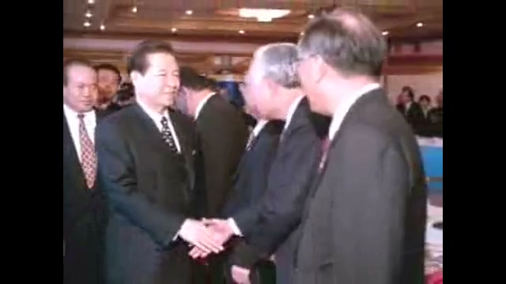
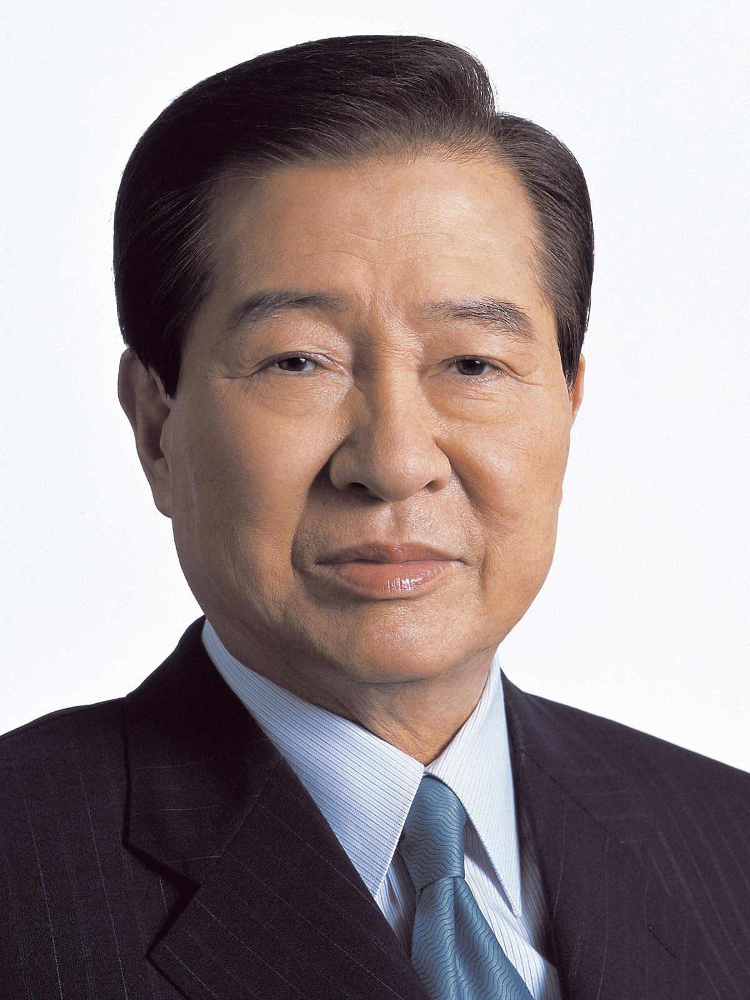
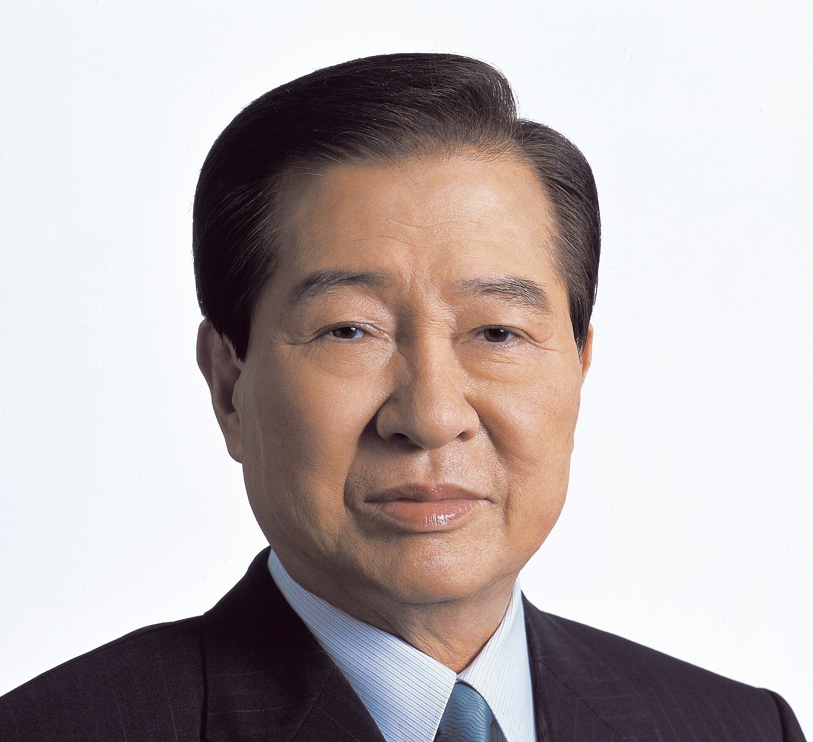

1998년 11월 3일, 미국 프로야구 메이저리그를 뒤흔들던 '코리안 특급' 박찬호 선수가 대한민국 정부로부터 체육훈장 맹호장을 받았습니다. 김대중 대통령은 11월 2일 낮 청와대에서 박찬호 선수를 직접 맞이하여 훈장을 수여하고 그동안의 눈부신 활약을 격려했습니다. 태평양 너머 미국 무대에서 당당히 공을 던지며 한국 야구의 위상을 드높인 청년 투수가 국가적인 영예를 안은 순간이었습니다.

## 공주고 에이스에서 메이저리그 최초의 한국인으로

1973년 충남 공주에서 태어난 박찬호는 일찍부터 남다른 야구 재능을 보였습니다. 공주고등학교 시절 3년 연속 팀 내 최우수선수(MVP)에 선정되었고, 전국 고교 야구 대회에서도 네 차례나 MVP를 차지하며 이름을 떨쳤습니다. 1992년과 1993년에는 대한민국 국가대표로 선발되어 아시아 야구 선수권 대회와 하계 유니버시아드에서 잇달아 은메달을 목에 걸었습니다.

한양대학교 2학년에 재학 중이던 1994년, 박찬호는 메이저리그 명문 구단 로스앤젤레스 다저스와 계약을 맺었습니다. 대한민국 국적 선수로는 역사상 처음으로 미국 프로야구 메이저리그 무대에 발을 들이는 역사적인 순간이었습니다.

## 마이너리그의 담금질과 감격의 빅리그 첫 승

1994년 4월 8일, 박찬호는 애틀랜타 브레이브스를 상대로 구원 등판하며 메이저리그 데뷔전을 치렀습니다. 하지만 세계 최고 선수들이 모인 무대에서 살아남기 위해 그는 더블A 샌안토니오 미션스로 내려가 실전 감각을 익혀야 했습니다. 박찬호는 그해 더블A에서 20경기에 선발로 나서 100개의 탈삼진을 기록하며 기본기를 탄탄히 다졌습니다.

1995년 트리플A 앨버커키 듀크스에서는 101개의 삼진을 잡아냈고, 9이닝당 탈삼진 8.26개로 트리플A 투수 전체 1위를 기록했습니다. 강력한 패스트볼을 인정받은 그는 마침내 1996년 4월 6일 시카고 컵스를 상대로 메이저리그 첫 승을 거두었습니다. 그해 그는 48경기에 등판해 5승 5패, 평균자책 3.64를 기록하며 풀타임 메이저리거로 확실히 자리 잡았습니다.

*김대중 대통령 선거 운동, 취임식 ... 총재 접견, 보도 사진전 (1998.00.00) 장면 1 — 사진: KTV 국민방송 e영상역사관 (대통령기록영상) / KTV 공공저작물 — 영상 저작물 전면 개방(대통령실 2025-07-09), 출처 표시*

## 14승에서 15승으로, 팀을 대표하는 에이스로 도약

본격적인 풀타임 선발 투수로 나선 1997년, 박찬호의 잠재력이 활짝 피어났습니다. 32경기에 등판해 29경기를 선발로 책임지며 14승 8패, 평균자책 3.38의 빼어난 성적을 올렸습니다. 14승은 그해 로스앤젤레스 다저스 팀 내 다승 공동 1위에 해당하는 뛰어난 기록이었습니다.

1998년에는 활약이 더욱 눈부셨습니다. 정규시즌 34경기에 모두 선발로 등판하여 220.2이닝을 던졌고, 15승 9패, 평균자책 3.71에 191개의 삼진을 솎아냈습니다. 188센티미터의 키와 95킬로그램의 탄탄한 체구에서 뿜어져 나오는 강속구로 메이저리그 타자들을 압도하며 명실상부한 다저스의 에이스로 우뚝 섰습니다.

*Kim Dae-jung presidential portrait (3x4) — 사진: 대한민국 국가기록원 / KOGL Type 1*

## 청와대에서 수여된 체육훈장 맹호장과 아시안게임 금메달

1998년 11월 2일 낮, 성공적인 시즌을 마치고 고국으로 돌아온 스물다섯 살의 박찬호는 청와대를 방문했습니다. 김대중 대통령은 메이저리그에서 눈부신 활약으로 국위를 떨친 박찬호에게 체육훈장 맹호장을 직접 수여했습니다. 11월 3일 조간신문 1면에는 김대중 대통령이 박찬호 선수에게 훈장을 걸어주는 사진과 함께 관련 기사가 대대적으로 보도되었습니다.

훈장을 받은 박찬호는 곧바로 국가대표팀에 합류해 방콕 아시안게임에 출전했습니다. 박찬호는 대회 결승전에서 숙적 일본을 꺾고 대표팀의 금메달 획득을 이끌며 국민들의 뜨거운 성원에 최고의 결과로 보답했습니다.

*Kim Dae-jung presidential portrait (cropped) — 사진: 대한민국 국가기록원 / KOGL Type 1*

## 18승 달성과 한국인 최초 메이저리그 올스타 선정

박찬호의 질주는 멈추지 않았습니다. 1999년 세인트루이스 카디널스의 페르난도 타티스에게 한 이닝에 만루홈런 두 개를 허용하는 시련과 경기 중 난투극을 겪기도 했지만, 2000년에 다시 폭발적인 활약을 펼쳤습니다. 2000년 시즌 18승 10패, 평균자책 3.27, 탈삼진 217개를 기록하며 생애 최고의 성적을 올렸고, 9월 29일 샌디에이고 파드리스전에서는 메이저리그 첫 완봉승을 따냈습니다.

2001년에는 다저스의 개막전 선발 투수로 등판해 1981년 이후 구단 최초의 개막전 완봉승을 거두었으며, 한국인 선수 최초로 메이저리그 올스타전에 출전하는 영예를 안았습니다. 그해 그는 15승 11패, 평균자책 3.50을 기록하며 메이저리그 최정상급 투수로 인정받았습니다.

## 아시아 출신 최다 124승과 오늘날까지 남은 발자취

박찬호는 로스앤젤레스 다저스를 시작으로 텍사스 레인저스, 샌디에이고 파드리스, 뉴욕 메츠, 필라델피아 필리스, 뉴욕 양키스, 피츠버그 파이리츠를 거치며 미국 무대를 누볐습니다. 이후 일본 프로야구 오릭스 버펄로스와 한국의 한화 이글스에서도 활약하며 팬들의 환호를 받았습니다. 특히 2010년에는 일본의 노모 히데오를 제치고 메이저리그 통산 124승을 달성하며 아시아 출신 투수 최다승이라는 역사를 썼습니다.

2015년 광주 하계 유니버시아드에서는 체조선수 양학선과 함께 개막식 성화를 점화하며 한국 스포츠를 대표하는 전설로 자리를 지켰습니다. 1998년 가을 청와대에서 맹호장을 목에 걸었던 청년 투수의 땀방울은, 대한민국 야구가 세계를 향해 나아가는 튼튼한 디딤돌이 되었습니다.

### 참고 자료

- <https://newslibrary.naver.com/viewer/index.naver?articleId=1998110300209101003&editNo=45&printCount=1&publishDate=1998-11-03&officeId=00020&pageNo=1&printNo=24029&publishType=00010>
- <https://commons.wikimedia.org/wiki/File:Kim_Dae-jung_presidential_portrait.jpg>
- <https://www.ehistory.go.kr/view/movie?mediasrcgbn=KV&mediaid=2303&mediadtl=9173&mediagbn=DT#t=0.3>
- <https://commons.wikimedia.org/wiki/File:Kim_Dae-jung_presidential_portrait_(3x4).jpg>
- <https://commons.wikimedia.org/wiki/File:Kim_Dae-jung_presidential_portrait_(cropped).jpg>
