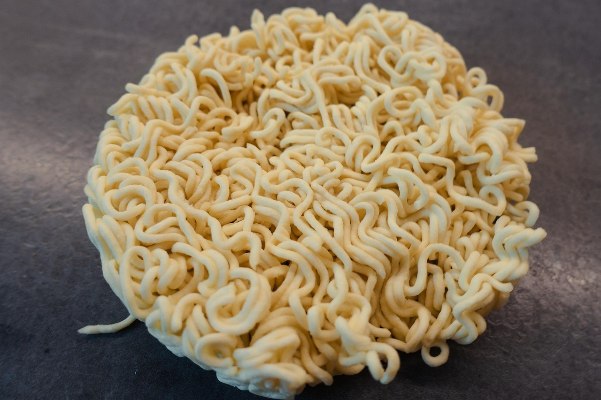
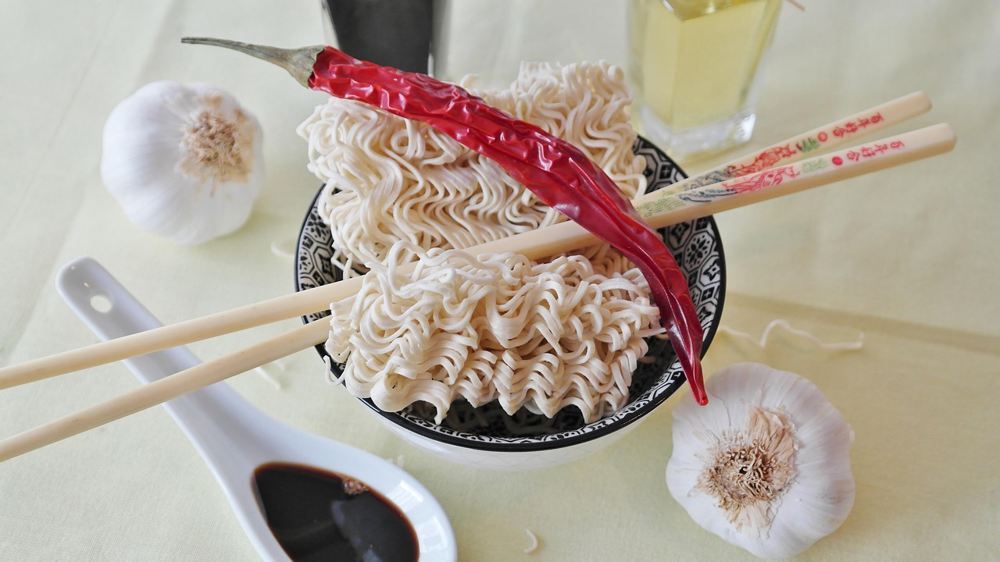
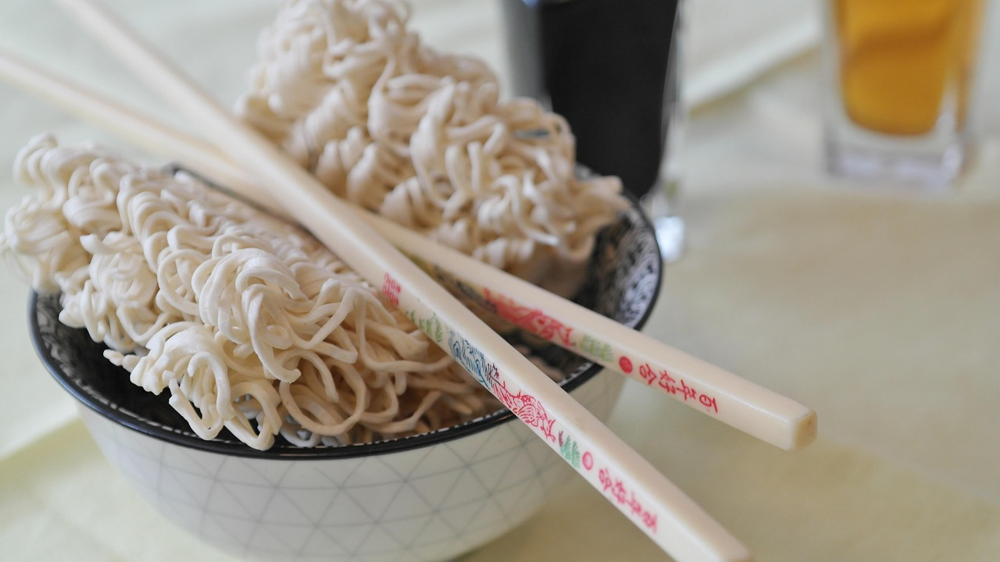

37년 전 오늘, 1989년 11월 4일. 비누나 윤활유 원료로 쓰는 공업용 쇠기름으로 라면과 쇼트닝을 만들어 판 국내 대형 식품회사 대표들이 무더기로 구속됐습니다. 매일 식탁에 오르던 국민 간식 라면의 실체에 온 나라가 경악했습니다.

## 서민의 가장 친숙한 한 끼를 덮친 충격

라면은 1963년 한 봉지 10원으로 처음 선보인 이래 서민들의 든든한 끼니이자 국민 간식이었습니다. 배고픈 시절 혼분식 장려 정책과 맞물려 성장한 라면은 1980년대 후반에 이르러 골드라면, 장수면, 육개장 등 다양한 제품으로 식탁을 지키고 있었습니다. 1988년 당시 라면 한 봉지 가격은 약 100원으로, 주머니가 가벼운 학생과 노동자에게 없어서는 안 될 소중한 음식이었습니다. 그런 라면을 사람이 먹어서는 안 되는 비식용 기름으로 튀겨 왔다는 검찰의 발표는 전 국민에게 엄청난 배신감과 공포를 안겼습니다.

## 검찰 특수부의 전격 수사와 10명 구속

서울지검 특수2부는 1989년 11월 3일, 보건범죄단속에 관한 특별조치법 위반 혐의로 삼양식품공업 부회장 서정호 씨와 상무 안인수 씨 등 5개 회사 관계자 10명을 구속했습니다. 구속 명단에는 서울하인즈 대표 서성훈 씨, 삼립유지 대표 계응환 씨, 오뚜기식품 대표 함태호 씨, 부산유지화학공업 대표 석상억 씨 등 굴지의 식품업계 수장들이 포함됐습니다. 검찰은 이들이 미국에서 식품 원료로 사용할 수 없는 공업용 등급의 쇠기름을 수입해 대량으로 가공·유통했다고 밝혔습니다. 보사부가 1989년 1월부터 시행한 식품공전 규정을 정면으로 위반했다는 것이 수사의 요지였습니다.

*사건 당시 사진 아님 · 이미지 사진 — 사진: viarami / Pixabay Content License*

## 7억 봉지의 라면과 불법 유지 제품들

수사 결과 드러난 숫자는 충격적이었습니다. 삼양식품은 1989년 1월부터 공업용 우지인 '톱 화이트 탈로'와 '엑스트라 팬시 탈로' 8천9백 톤을 들여와 라면 7억 6백만여 개를 튀겨 냈습니다. 시가로는 744억 원에 달하는 규모였습니다. 서울하인즈와 삼립유지는 같은 쇠기름에 어유나 팜유를 섞어 각각 15억여 원, 5억여 원어치의 쇼트닝과 마가린을 판매했습니다. 오뚜기식품 역시 '슈프림 그레이드' 우지를 들여와 제과용 쇼트닝 등 1백22만 킬로그램을 제조해 시판한 혐의를 받았습니다.

*사건 당시 사진 아님 · 이미지 사진 — 사진: RitaE / Pixabay Content License*

## 비닐용기 용해 의혹과 국회의원 소유 회사

충격은 여기서 그치지 않았습니다. 부산유지화학공업은 국회 보사위 소속 민주당 석준규 의원이 실제 소유한 회사로 드러났습니다. 검찰은 이 회사가 수거한 소뼈와 비식용 원료를 녹이는 과정에서 비닐용기까지 함께 녹여 제과회사에 쇼트닝을 납품했다고 발표했습니다. 빵과 과자에서 시커먼 찌꺼기가 검출되기도 했다는 수사 결과가 전해지자 공분은 걷잡을 수 없이 커졌습니다. 정기국회 회기 중이라는 이유로 의원 본인 대신 회사를 맡아 운영하던 아들이 구속됐지만, 정치권과 유착된 불량 식품 비리라는 비판이 쏟아졌습니다.

*사건 당시 사진 아님 · 이미지 사진 — 사진: RitaE / Pixabay Content License*

## 8년 뒤 대법원의 무죄 판결, 그러나 남겨진 상처

사건 이후 정부는 수습 과정에서 해당 우지가 인체에 유해하지 않다고 밝혔으나 이미 돌아선 민심을 되돌릴 수는 없었습니다. 국내 라면 시장의 원조였던 삼양식품은 점유율이 곤두박질치고 직원 1천여 명이 회사를 떠나는 극심한 경영난을 겪었습니다. 치열한 법정 공방 끝에 1997년 8월, 대법원은 공업용으로 분류된 우지라도 정제 과정을 거치면 유해하다고 볼 수 없다는 취지로 피고인 전원에게 무죄 판결을 내렸습니다. 그러나 8년에 걸친 재판 끝에 남은 것은 폐허가 된 기업의 위상과 씻을 수 없는 불신의 기억뿐이었습니다.

## 팜유 시대로의 전환과 오늘날의 식탁

1989년 우지 파동은 한국 라면 산업의 지형을 송두리째 바꾼 일대 사건이었습니다. 구수하고 기름진 맛을 내던 쇠기름 튀김 방식은 소비자들의 거센 기피 속에 완전히 사라졌고, 그 자리를 식물성 팜유가 대신하게 됐습니다. 한때 서민들의 배를 든든하게 채워 주던 노란 라면 국물 뒤에 자리했던 커다란 혼란과 의혹. 37년의 세월이 흐른 지금도 1989년 11월의 우지 파동은 대한민국 식품 안전사에서 가장 쓰라린 기억의 한 페이지로 남아 있습니다.

### 참고 자료

- <https://newslibrary.naver.com/viewer/index.naver?articleId=1989110400209201006&editNo=2&printCount=1&publishDate=1989-11-04&officeId=00020&pageNo=1&printNo=20952&publishType=00020>
- <https://pixabay.com/photos/food-ramen-noodles-cooking-japan-1216048/>
- <https://pixabay.com/photos/ramen-noodles-instant-noodles-cook-6806423/>
- <https://pixabay.com/photos/noodles-instant-noodles-instant-3201642/>
- <https://pixabay.com/photos/noodles-instant-noodles-instant-3201631/>
