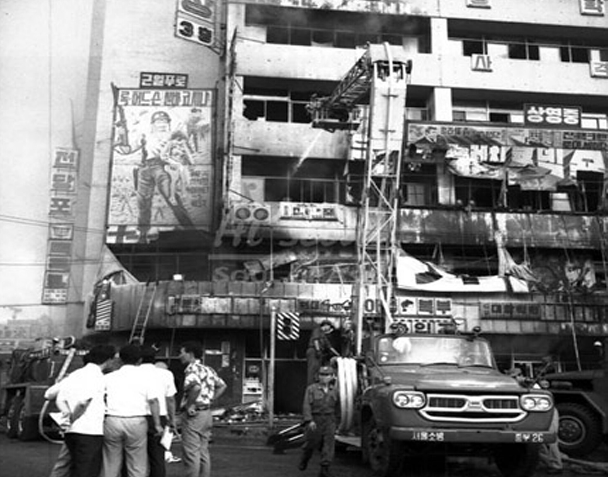
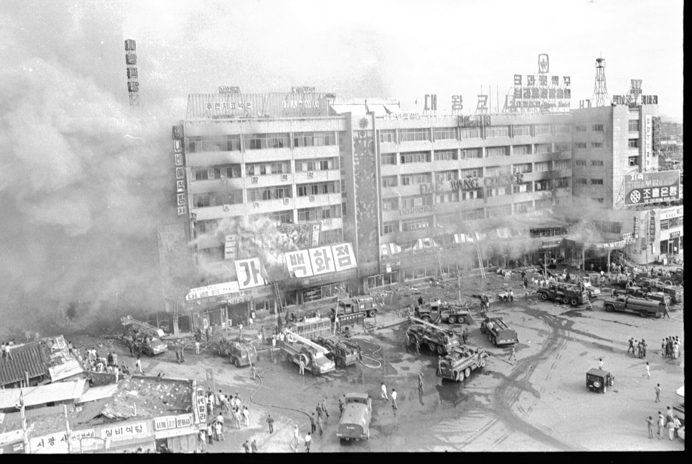
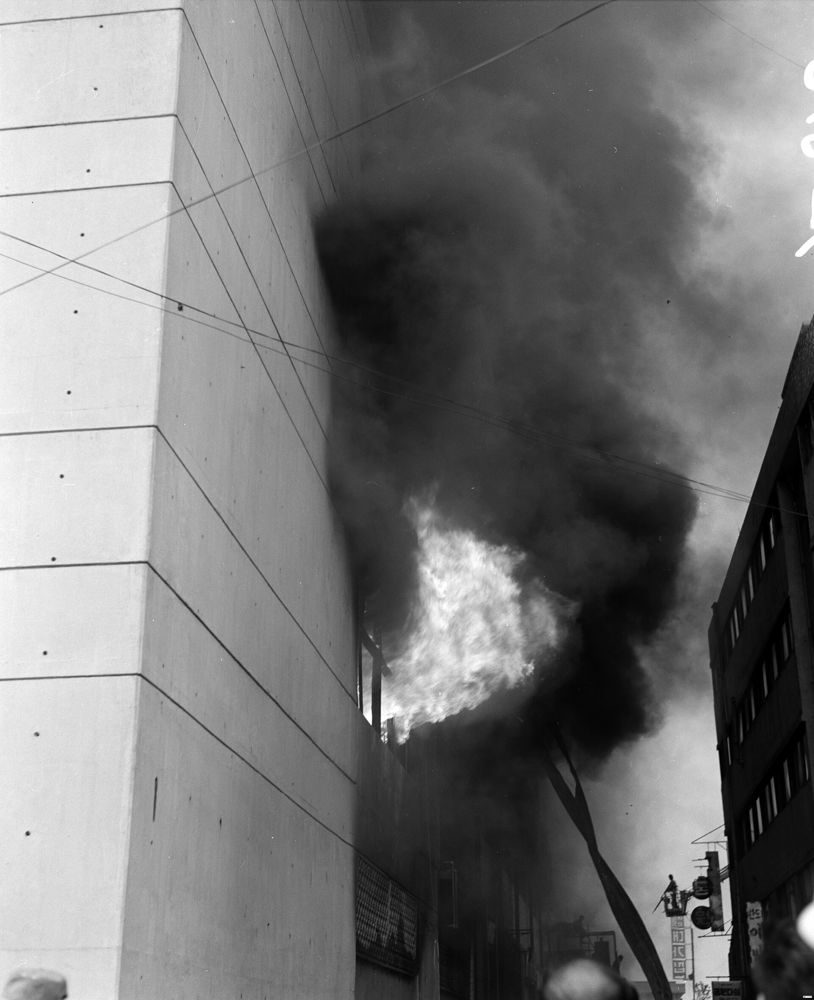

52년 전 오늘인 1974년 11월 4일, 서울 동대문구 전농동 대왕코너에서 일어난 참혹한 화재 소식이 전국을 충격에 빠뜨렸습니다. 휴일이던 11월 3일 새벽 발생한 불로 꽃다운 청년들을 포함해 무려 88명이 목숨을 잃고 30여 명이 중경상을 입었습니다.

## 청량리의 상징이던 종합 빌딩 대왕코너

1968년 준공된 대왕코너는 지하 1층, 지상 7층, 연건평 1만 900여 평 규모의 현대식 대형 복합건물이었습니다. 백화점과 호텔, 아파트, 예식장, 극장, 학원 등 다양한 시설이 들어서 있어 청량리역 일대를 오가는 수많은 인파로 붐비던 곳이었습니다.

하지만 대왕코너의 비극은 이번이 처음이 아니었습니다. 참사 2년 전인 1972년 8월 5일에도 1층 분식점에서 프로판가스가 폭발해 불이 났고, 건물 상당 부분이 타들어가며 6명이 숨지고 104명이 다쳤습니다. 건물을 보수해 다시 문을 연 지 2년도 채 되지 않아 또다시 대형 참사가 되풀이된 것입니다.

## 새벽 2시 47분, 6층 복도에서 시작된 불길

화재는 1974년 11월 3일 일요일 새벽 2시 47분경, 6층 브라운호텔 618호실 앞 비상계단 복도 천장에서 일어났습니다. 조사 결과 천장에 설치된 20와트짜리 조명등 전선이 합선되면서 불꽃이 튀었고, 인화성이 강한 비닐 벽지에 불이 옮겨붙었습니다.

당시 허용 규격인 10암페어 퓨즈 대신 60암페어 퓨즈를 끼워 넣은 탓에 과전류가 흘러도 차단기가 떨어지지 않았습니다. 불길은 가연성 자재로 가득 찬 복도를 따라 맹렬한 속도로 번져나갔습니다.

*1974년 자료 — 사진: 서울특별시 소방재난본부 / Public domain*

## 닫혀버린 유일한 문, 6층 고고클럽의 비극

가장 큰 참변이 빚어진 곳은 6층에 입주해 있던 타임고고클럽이었습니다. 당시 자정부터 새벽 4시까지 야간 통행금지가 시행되던 시절이었지만, 업소는 셔터를 내리고 불법으로 철야 영업을 이어가고 있었습니다. 현장에는 120여 명의 손님과 20여 명의 종업원이 머물고 있었습니다.

불이 나자마자 전기가 끊겨 칠흑 같은 암흑이 찾아왔습니다. 손님들은 비상구를 찾지 못한 채 유일한 출입구로 몰려들었습니다. 하지만 그 문은 한 사람씩 통과하는 회전문이었습니다. 탈출하려는 사람들이 양쪽에서 서로 밀쳐대면서 문은 완전히 끼어 멈춰 섰습니다.

*1974년 자료 — 사진: 서울특별시 소방재난본부 / CC BY-SA 4.0*

## "술값 내고 나가라" 충격적인 탈출 방해

탈출자들의 증언은 온 국민을 더욱 경악하게 만들었습니다. 불길과 유독가스가 닥쳐오는 위급한 상황에서 일부 종업원들이 "술값을 내라"며 온몸으로 출입구를 막아섰다는 생존자들의 생생한 증언이 이어졌습니다.

문을 빠져나가지 못한 손님들은 연기를 피해 유리창 쪽으로 몰려들었습니다. 창문을 깨려 애쓰던 40여 명의 젊은이들은 결국 창가 주변에서 서로 엉킨 채 질식하고 불에 타 숨졌습니다. 고고클럽 안에서만 전체 사망자의 대다수인 72구의 시신이 수습되었습니다.

*1974년 자료 — 사진: 서울특별시 소방재난본부 / CC BY-SA 4.0*

## 추락사와 호텔 투숙객의 피해

고고클럽 옆 브라운호텔에 머물던 투숙객들의 피해도 컸습니다. 화염과 연기가 복도를 가득 채우자 객실 창문을 깨고 구조를 요청하던 투숙객 10여 명이 불길을 견디지 못하고 뛰어내렸고, 이 중 6명이 추락사했습니다.

불은 3시간 만인 새벽 5시 50분경에 진화되었지만 참사의 현장은 처참했습니다. 희생자 중에는 그룹 사운드 '애드 포(Add 4)' 출신의 보컬 서정길 씨 등 젊은 예술인과 학업과 생업을 위해 상경했던 20대 청년들이 많아 주위를 더욱 안타깝게 했습니다.

## 5번의 소방 개선 명령을 무시한 인재

사후 조사 과정에서 업주와 건물 관리자들의 안전 불감증이 낱낱이 드러났습니다. 소방당국은 사고 전까지 타임고고클럽에 인화성 내부 장식을 철거하고 스프링클러와 비상 방송 설비를 갖추라고 다섯 차례나 개수 명령을 내렸으나 업소 측은 이를 묵살했습니다.

1971년 크리스마스 대연각호텔 화재로 166명이 숨진 지 불과 3년 만에 또다시 터진 최악의 다중이용시설 참사였습니다. 비상구를 걸어 잠근 불법 영업과 값싼 안전 의식이 얼마나 무서운 결과를 낳는지 보여준 뼈아픈 역사의 한 페이지입니다.

### 참고 자료

- <https://newslibrary.naver.com/viewer/index.naver?articleId=1974110400209201005&editNo=2&printCount=1&publishDate=1974-11-04&officeId=00020&pageNo=1&printNo=16338&publishType=00020>
- <https://commons.wikimedia.org/wiki/File:Seoul_Metro_1974-001.JPG>
- <https://commons.wikimedia.org/wiki/File:1974%EB%85%84_%EC%84%9C%EC%9A%B8%EB%8C%80%EC%99%95%EC%BD%94%EB%84%88%ED%99%94%EC%9E%AC.jpg>
- <https://commons.wikimedia.org/wiki/File:1974%EB%85%84_11%EC%9B%94_3%EC%9D%BC_%EB%8C%80%EC%99%95%EC%BD%94%EB%84%88_%ED%99%94%EC%9E%AC_%EC%82%AC%EA%B3%A02.jpg>
- <https://commons.wikimedia.org/wiki/File:1974%EB%85%84_11%EC%9B%94_3%EC%9D%BC_%EB%8C%80%EC%99%95%EC%BD%94%EB%84%88_%ED%99%94%EC%9E%AC_%EC%82%AC%EA%B3%A04.jpg>
