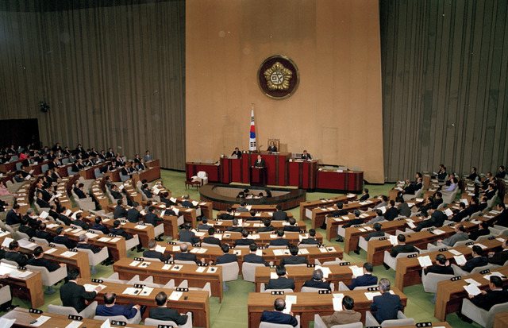
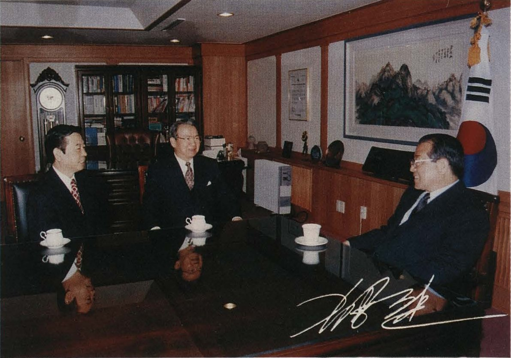
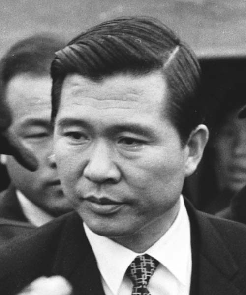

29년 전 오늘, 1997년 11월 4일. 새정치국민회의 김대중 총재와 자유민주연합 김종필 총재의 후보 단일화 합의 소식이 온 나라를 뒤흔들었습니다. 평생 민주화 운동에 투신했던 지도자와 군사정권의 설계자가 하나의 깃발 아래 서는 순간이었습니다.

## 극과 극의 두 정치 거물이 마주앉다

1997년 가을, 제15대 대통령 선거를 불과 한 달여 앞둔 정치권은 한 치 앞을 내다볼 수 없는 안갯속이었습니다. 야권 진영에서는 정권 교체를 위해 힘을 합쳐야 한다는 목소리가 높았지만, 그 주역들의 이력은 물과 기름처럼 섞이기 힘들어 보였습니다.

군부 정권의 탄압을 견디며 민주 진영을 이끌어온 국민회의 김대중 총재와 5·16 군사정변의 중심인물이자 오랜 보수 세력의 상징이었던 자민련 김종필 총재가 그들이었습니다. 전혀 다른 정치적 궤적을 밟아온 두 사람이 권력 구조 개편과 정권 교체라는 공통의 명분을 두고 전격적인 협상을 이어갔습니다.

## "기적 같은 일 해냈다" 국회 의원회관의 서명식

11월 3일 오후, 서울 여의도 국회 의원회관에서 열린 '야권후보단일화 합의문 선언 및 서명식'에서 두 사람은 김대중 총재를 양당의 단일후보로 공식 추대했습니다. 집권 후 내각제 개헌을 추진하고 공동정부를 구성한다는 합의였습니다.

서명을 마친 김대중 총재는 감격에 찬 목소리로 "우리는 정말 기적과 같은 일을 해냈다"며 "야권의 후보 단일화는 지금까지 우리를 짓눌러온 지역적 대립, 계층 간 대립에 종지부를 찍는 계기가 될 것"이라고 선언했습니다. 또한 민주화 세력과 산업화 세력의 결합이자 개혁과 보수의 연대임을 강조했습니다.

김종필 총재 역시 "시대적 과업을 수행하려는 저의 고뇌와 그 결단이 후보 사퇴이며 내각제 실현"이라며 "우리 헌정사 최초로 야권 단일후보가 탄생했고 공동정부의 출범이 기다리고 있다"고 밝히며 전폭적인 지지를 호소했습니다.

*강택민 중국 국가주석 국회 지도자 면담 및 연설 — 사진: 대한민국 국가기록원 / KOGL Type 1*

## 거세게 일어난 반발과 '야합' 공세

두 거물의 연합 발표는 즉각 정치권을 뒤흔들며 거센 후폭풍을 불러왔습니다. 신한국당 이회창 총재는 이날 대전에서 기자회견을 열고 DJP 연대를 '3김 정치 연장을 위한 야합의 산물'로 규정하며 정면 대결을 선포했습니다.

이회창 총재는 "대통령 직선제를 규정한 현행 헌법은 국민 모두가 합의해 만든 것"이라며 "그러한 헌법을 권력 나눠먹기의 수단으로 전락시킬 수 없으며, 헌법 수호를 위해 단호히 맞서 싸우겠다"고 비판했습니다. 신한국당 초선의원 20여 명도 별도의 투쟁위원회를 결성해 내각제 반대 서명운동에 돌입했습니다.

다른 정치 세력들의 반발도 거셌습니다. 국민신당(가칭)은 권력 나눠먹기식 반역사적 야합이라며 비난 논평을 냈고, '국민승리21'은 서울 명동성당 앞에서 결의대회를 열고 직선제 헌법 수호를 외쳤습니다.

*Kim Jong-pil TW meeting — 사진: Ministry of Foreign Affairs / Attribution*

## DJT 연대 구축과 헌정사 첫 수평적 정권 교체

거센 공세 속에서도 두 당은 곧바로 공동선거대책위원회 구성과 대선 공약 작성 등 실질적인 공조에 들어갔습니다. 이어 자민련에 입당한 포항제철 창업자 박태준 의원까지 가세하면서, 호남과 충청, TK 지역 기반을 아우르는 이른바 'DJT 연대'가 완성되었습니다.

이 연합 전선은 1997년 12월 18일 치러진 제15대 대통령 선거에서 김대중 후보의 당선이라는 역사적 결과를 낳았습니다. 대한민국 헌정사에서 여야 간 평화적인 수평적 정권 교체가 처음으로 실현되는 결정적 전환점이었습니다.

*Kim Dae-jung in 1970 — 사진: 서울역사박물관 / KOGL Type 1*

## 타협과 연정의 기억이 남긴 것

선거 승리 이후 김종필 총재는 국민의 정부 초대 국무총리에 취임하며 사상 초유의 공동정부 실험을 이끌었습니다. 비록 합의문에 담겼던 내각제 개헌은 실현되지 못했고 연정 또한 우여곡절 끝에 마침표를 찍었지만, 극단적 대립 대신 정치적 타협을 모색했던 시도로 기록됩니다.

IMF 외환위기의 거센 파고 속에서 온 나라가 숨죽이며 텔레비전 뉴스 속 단일화 서명식을 지켜보던 그 늦가을의 풍경은, 한국 현대사를 살아온 많은 시민의 기억 속에 여전히 선명한 장면으로 남아 있습니다.

### 참고 자료

- <https://newslibrary.naver.com/viewer/index.naver?articleId=1997110400209101001&editNo=45&printCount=1&publishDate=1997-11-04&officeId=00020&pageNo=1&printNo=23699&publishType=00010>
- <https://www.ehistory.go.kr/view/movie?mediasrcgbn=KV&mediaid=12131&mediadtl=28295&mediagbn=DH#t=0.3>
- <https://commons.wikimedia.org/wiki/File:%EA%B0%95%ED%83%9D%EB%AF%BC_%EC%A4%91%EA%B5%AD_%EA%B5%AD%EA%B0%80%EC%A3%BC%EC%84%9D_%EA%B5%AD%ED%9A%8C_%EC%A7%80%EB%8F%84%EC%9E%90_%EB%A9%B4%EB%8B%B4_%EB%B0%8F_%EC%97%B0%EC%84%A4.jpg>
- <https://commons.wikimedia.org/wiki/File:Kim_Jong-pil_TW_meeting.jpg>
- <https://commons.wikimedia.org/wiki/File:Kim_Dae-jung_in_1970.jpg>
