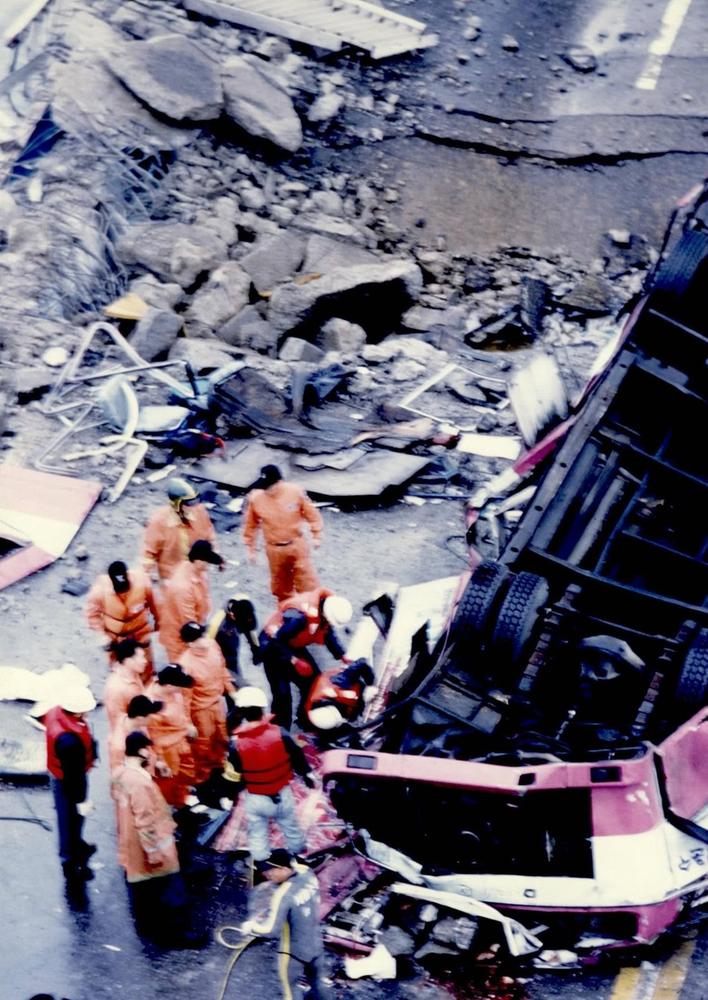
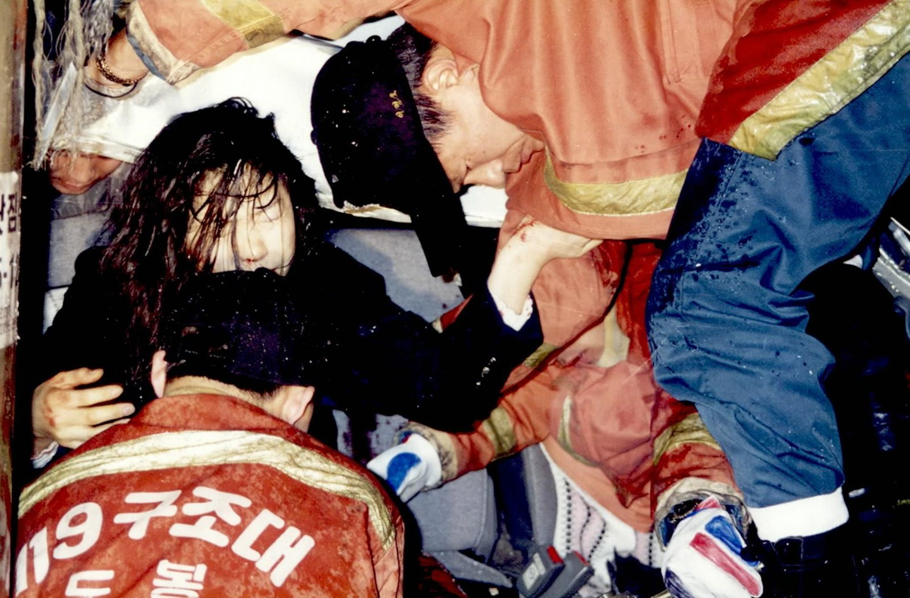
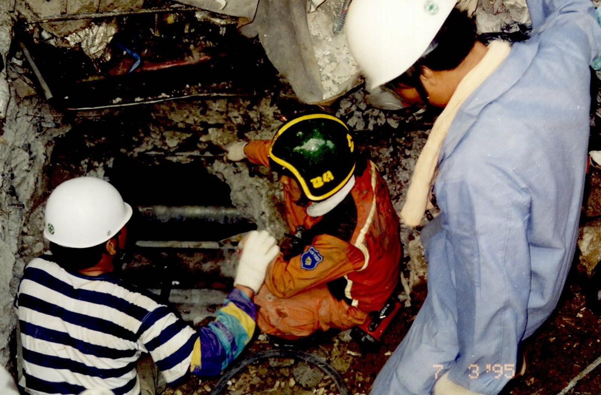

32년 전 오늘, 1994년 11월 4일. 성수대교 붕괴 참사를 수사하던 검찰이 이원종 전 서울시장을 소환해 밤샘 조사를 벌였습니다. 출근길 한강 다리가 무너져 내린 지 2주 만에, 교량 관리 감독의 총책임자와 다리를 시공했던 건설사 최고위층을 향한 사법 처리가 본격화되었습니다.

## 출근길에 무너져 내린 한강 다리

1994년 10월 21일 아침, 서울 성동구와 강남구를 잇던 성수대교의 상판 일부가 갑자기 끊어져 한강으로 추락했습니다. 버스와 승용차 등이 그대로 떨어지면서 32명이 목숨을 잃고 17명이 다치는 참사가 벌어졌습니다. 1979년 10월 15일에 준공되어 통행을 시작한 지 겨우 15년 만에 일어난 비극이었습니다.

길이 1,160미터, 왕복 4차로의 번듯한 다리가 대낮도 아닌 출근길에 주저앉았다는 소식에 온 국민은 경악을 금치 못했습니다. 서울시는 애초 3개월 안에 다리를 보수해 재개통하겠다는 방안을 검토했으나, 시민들의 거센 분노와 비판에 부딪혀 결국 전면 철거 후 재시공을 결정하게 되었습니다.

## 이원종 전 서울시장의 검찰 출두와 철야 조사

사고 직후 전격 경질되었던 이원종 전 서울시장은 1994년 11월 3일 오후 2시 서울 서초동 서울지검 청사로 소환되었습니다. 서울지검 수사본부는 이 전 시장을 상대로 한강 교량 안전관리 체계와 예산 편성, 구체적인 지휘감독 이행 여부를 밤새워 집중 추궁했습니다.

특히 쟁점이 된 것은 1993년 4월 이후 서울 동부건설사업소가 성수대교의 심각한 위험을 알리는 보고서를 서울시 도로국에 6차례나 제출했다는 사실이었습니다. 검찰은 이 전 시장이 결재선과 지휘계통을 통해 이 위험 보고를 전달받았는지, 그리고 대통령과 국무총리의 특별안전점검 지시 이후 실질적인 후속 조치를 확인했는지를 철저히 캐물었습니다.

*1994년 자료 — 사진: 최광모 / CC BY-SA 4.0*

## 드러난 시공 비리, "트러스 불량" 보고 묵살

검찰 수사는 관리 소홀뿐만 아니라 다리를 건설할 당시의 구조적 비리로도 뻗어나갔습니다. 조사 결과, 1978년 성수대교 건설 당시 시공사인 동아건설의 최원석 회장이 현장소장 등으로부터 '철골 트러스가 불량 제작되어 다시 만들어야 한다'는 보고를 받고도 이를 묵살한 채 공사를 강행하라고 지시한 사실이 드러났습니다.

당시 동아건설은 '최단 공기 내 완공'을 주요 실천 항목으로 내걸고 있었습니다. 최 회장은 공사 현장에 직접 서너 차례 방문해 공기 단축을 독려했던 것으로 확인되었습니다. 완공을 재촉하느라 불량 부품 사용을 눈감았던 과거의 시공 방식이 15년 뒤 수많은 목숨을 앗아간 비극의 씨앗이었음이 확인된 순간이었습니다.

*1994년 자료 — 사진: 최광모 / CC BY-SA 4.0*

## 사법 처리의 기로와 법적 논란

검찰은 이원종 전 시장에 대해 하급자의 과실에 최종 책임을 져야 하는 한강 교량 안전관리의 최고 명령권자로서 지휘감독을 게을리했다며 업무상 과실치사상 혐의를 적용하기로 방침을 정했습니다. 직무유기 혐의와 더불어 독일 판례 등에서 다루어지는 과실범 법리를 폭넓게 검토하며 사법 처리 수위를 높였습니다.

동시에 검찰은 당시 동아건설 부사장과 전무 등을 차례로 불러 조사하며 최원석 회장의 소환 일정을 확정했습니다. 불량 용접과 취약한 이음새, 녹슨 힌지 등 시공과 관리 양쪽 모두에서 빚어진 총체적 부실은 결국 공무원과 건설 관계자 등 16명이 형사 처벌을 받는 결과로 이어졌습니다.

*1994년 자료 — 사진: 최광모 / CC BY-SA 4.0*

## 성수대교가 남긴 상처와 교훈

붕괴된 옛 성수대교는 완전히 헐리고 1995년 4월 현대건설에 의해 새 다리 공사가 시작되었습니다. 780억 원의 공사비가 투입된 새 성수대교는 1997년 7월 3일 조순 서울시장이 참석한 가운데 완공되어 다시 차량 통행을 맞이했습니다.

빨리 짓는 것만을 미덕으로 삼고, 위험을 경고하는 현장의 목소리를 번번이 묵살했던 대가는 너무나 가혹했습니다. 32년 전 오늘 검찰 조사실에서 낱낱이 파헤쳐지던 그날의 부실과 관리 소홀은 지금도 우리 사회가 안전을 다룰 때 잊지 말아야 할 엄중한 경고로 남아 있습니다.

### 참고 자료

- <https://newslibrary.naver.com/viewer/index.naver?articleId=1994110400209101001&editNo=45&printCount=1&publishDate=1994-11-04&officeId=00020&pageNo=1&printNo=22675&publishType=00010>
- <https://commons.wikimedia.org/wiki/File:1994%EC%84%B1%EC%88%98%EB%8C%80%EA%B5%90_%EB%B6%95%EA%B4%B4_%EC%82%AC%EA%B3%A002.jpg>
- <https://commons.wikimedia.org/wiki/File:1994%EC%84%B1%EC%88%98%EB%8C%80%EA%B5%90_%EB%B6%95%EA%B4%B4_%EC%82%AC%EA%B3%A004.jpg>
- <https://commons.wikimedia.org/wiki/File:1994%EC%84%B1%EC%88%98%EB%8C%80%EA%B5%90_%EB%B6%95%EA%B4%B4_%EC%82%AC%EA%B3%A010.jpg>
- <https://commons.wikimedia.org/wiki/File:1994%EC%84%B1%EC%88%98%EB%8C%80%EA%B5%90_%EB%B6%95%EA%B4%B4_%EC%82%AC%EA%B3%A011.jpg>
