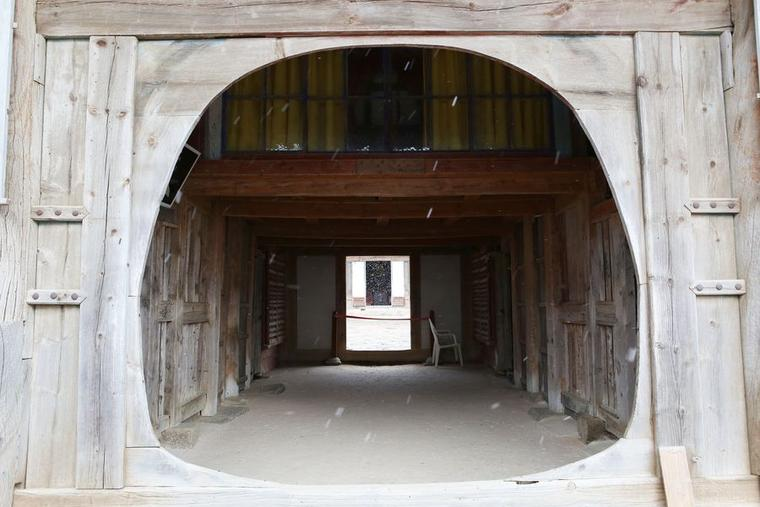
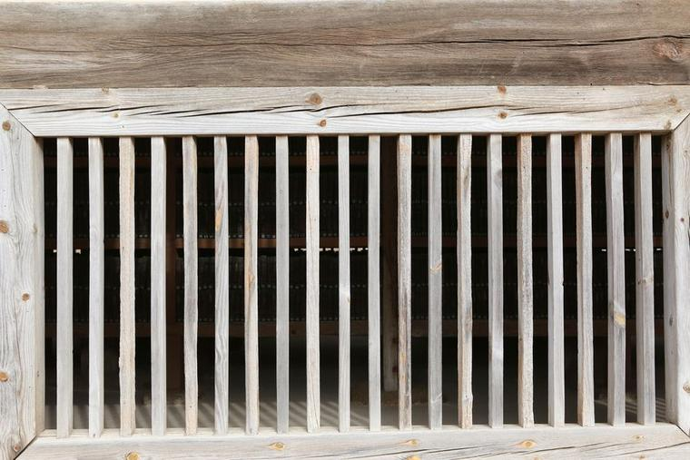
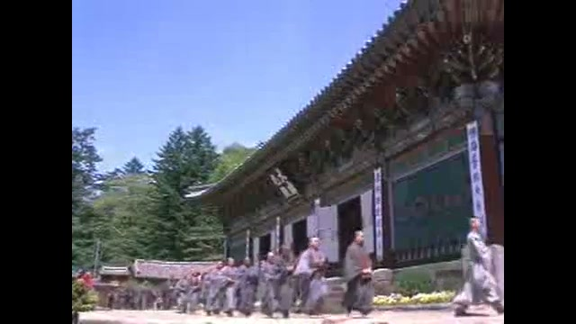

33년 전 오늘, 1993년 11월 4일. 가야산 해인사에 오랜 세월 보관되어 온 국보 제32호 팔만대장경 경판이 서울 나들이를 시작했다는 소식이 전간 신문 1면을 장식했습니다. 수백 년 동안 깊은 산골 사찰에 안치되어 있던 귀중한 목판이 꽃가마를 타고 도심 전시를 위해 길을 나선 진귀한 장면이었습니다.

## 책문화특별전 출품을 위한 특별한 결정

1993년 11월 8일부터 12월 19일까지 서울 국립중앙박물관에서는 우리 인쇄와 출판 문화를 집중 조명하는 '책문화특별전'이 기획되었습니다. 이 특별전의 핵심 전시물로 고려의 혼과 기술이 집약된 팔만대장경 경판이 선정되었습니다. 고려 재조대장경이라 불리는 팔만대장경은 글꼴이 한 사람이 새긴 듯 정교하고 오탈자가 거의 없어 그 자체로 세계적인 예술품이자 학술적 보물로 꼽히는 유물입니다.

## 엄숙한 이운법회와 꽃가마에 실린 대장경판

서울로 향하기 전날인 1993년 11월 3일, 경남 합천 해인사 경내에서는 경판을 정성스럽게 모셔내는 '이운법회'가 엄숙하게 거행되었습니다. 법회를 마친 뒤 특별전에 출품될 '대반야바라밀다경'을 비롯한 석 장의 경판은 귀하게 꾸며진 꽃가마에 정중히 태워졌습니다. 스님들과 수많은 불자들의 배웅을 받으며 경판은 해인사 입구까지 가마로 안전하게 이동했습니다.

*사건 당시 사진 아님 — 사진: 한국관광공사 / KOGL Type 1 attribution*

## 가야산에서 서울 국립중앙박물관 수장고까지

꽃가마에서 내려진 대장경판 석 장은 진동과 온습도 변화를 최소화할 수 있는 안전 차량에 실려 곧장 서울로 향했습니다. 긴 여정 끝에 서울에 도착한 경판들은 전시장소인 국립중앙박물관 수장고에 무사히 안치되었습니다. 수백 년간 가야산 자락을 떠난 적이 없던 대장경판이 수도 서울의 박물관 수장고에 들어서는 순간은 현장 관계자들에게도 숨죽이는 긴장의 연속이었습니다.

*사건 당시 사진 아님 — 사진: 한국관광공사 / KOGL Type 1 attribution*

## 전란과 화마를 이겨내고 지켜낸 민족의 보물

해인사에 보관된 팔만대장경은 역사 속 수많은 위기 속에서도 온전히 지켜져 온 기적의 유산입니다. 조선 시대를 거치며 사찰에 여러 차례 화재가 발생했음에도 대장경판을 보관한 장경판전은 무사히 화마를 피했습니다. 또한 1951년 6·25 전쟁 당시에는 해인사 폭격 명령이 내려졌으나, 공군 편대장 김영환 대령이 문화재 훼손을 막기 위해 명령에 불복하고 폭탄을 투하하지 않아 대장경판이 잿더미가 될 뻔한 위기를 넘긴 역사가 있습니다.

*불교 불교 (1986.00.00) 장면 1 — 사진: KTV 국민방송 e영상역사관 (문화영화) / KTV 공공저작물 — 영상 저작물 전면 개방(대통령실 2025-07-09), 출처 표시*

## 세계기록유산으로 빛나는 천 년의 유산

1993년 가을 서울 나들이를 통해 대중과 만났던 팔만대장경은 이후에도 그 가치를 세계적으로 공인받았습니다. 장경판전 건물은 1995년 유네스코 세계문화유산으로 등재되었고, 고려대장경판 및 제경판은 2007년 유네스코 세계기록유산에 이름을 올렸습니다. 꽃가마에 실려 서울 박물관으로 향하던 1993년 11월의 그날은, 우리 민족의 위대한 기록 유산이 온 국민의 곁으로 한 걸음 다가왔던 뜻깊은 날로 기억되고 있습니다.

### 참고 자료

- <https://newslibrary.naver.com/viewer/index.naver?articleId=1993110400209101002&editNo=40&printCount=1&publishDate=1993-11-04&officeId=00020&pageNo=1&printNo=22334&publishType=00010>
- <https://www.kogl.or.kr/recommend/recommendDivView.do?division=img&recommendIdx=32849>
- <https://www.kogl.or.kr/recommend/recommendDivView.do?division=img&recommendIdx=123>
- <https://www.ehistory.go.kr/view/movie?mediasrcgbn=KV&mediaid=1521&mediadtl=8125&mediagbn=MH#t=0.3>
