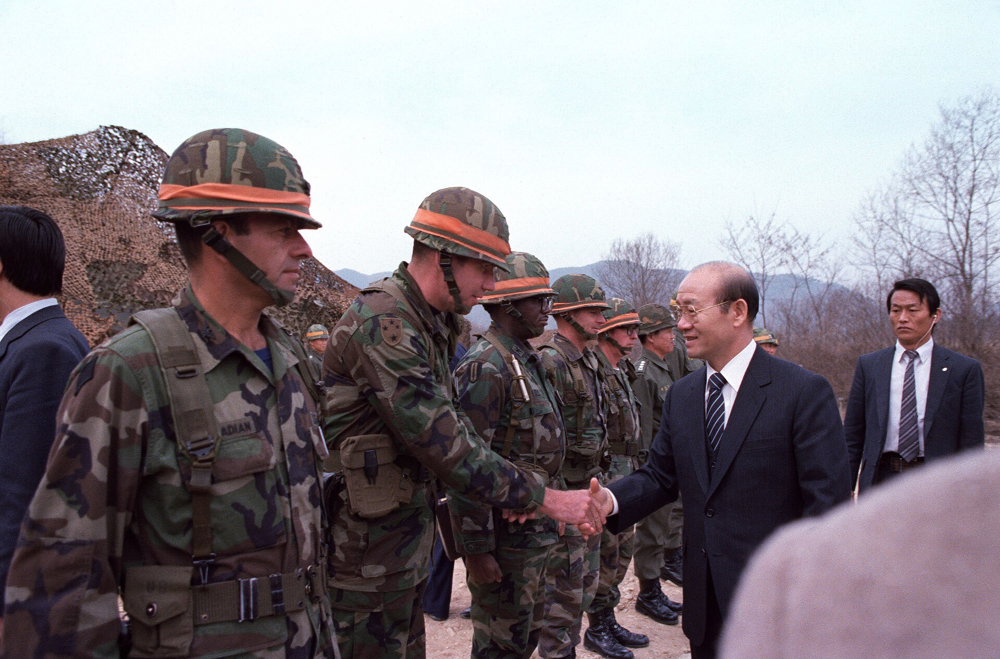
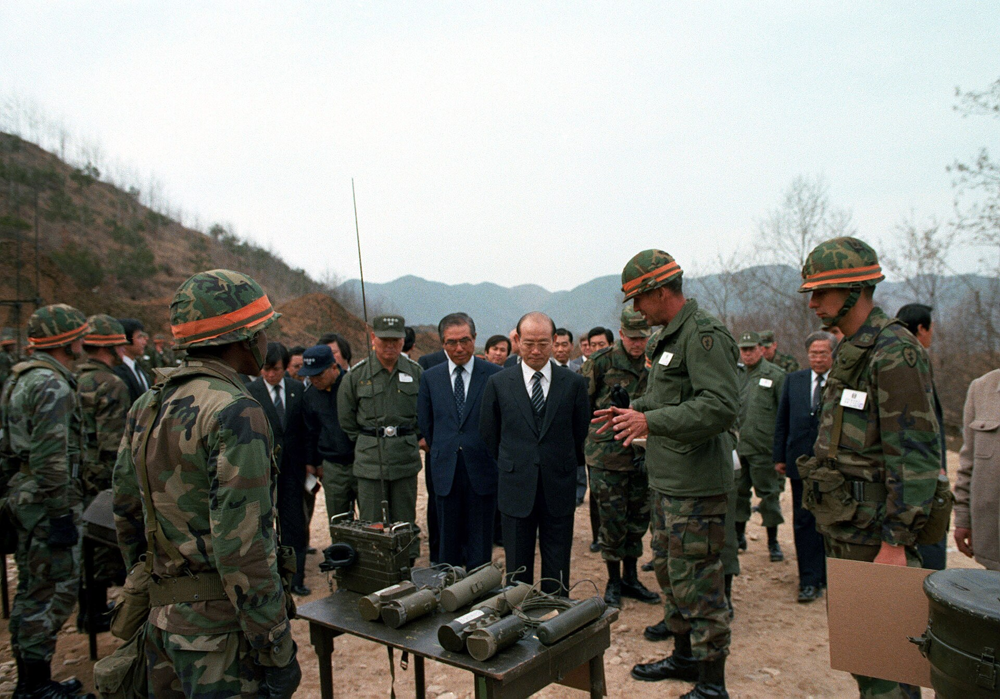
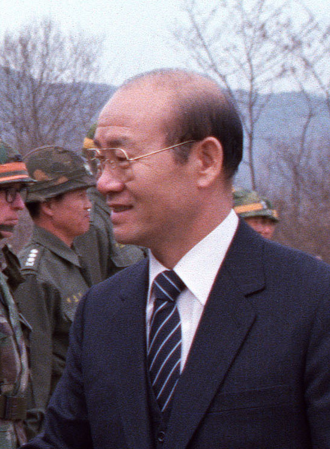

43년 전 오늘, 1983년 11월 5일 조간신문 1면은 버마 정부의 충격적인 발표로 일제히 채워졌습니다. 버마 정부는 아웅산 묘소 폭파 테러 사건이 북한 정규군 특공대의 범행임을 밝혀내고, 북한과의 외교관계를 완전히 단절하며 북한 정권에 대한 승인을 취소한다고 공식 선언했습니다.

## 아웅산 묘소의 비극과 26일간의 수사

1983년 10월 9일, 버마(현 미얀마) 랭군의 아웅산 묘소에서 끔찍한 폭발이 일어났습니다. 대한민국 대통령의 공식 방문 행사 직전 터진 폭탄으로 인해 한국 정부의 부총리와 장관 등 수행원과 기자단, 버마 현지인 등 모두 21명이 고귀한 목숨을 잃었습니다. 국가적 비극 앞에서 한국민은 물론 전 세계가 경악을 금치 못했습니다. 비동맹 외교 노선을 견지하며 남북한 모두와 수교하고 있던 버마 정부는 즉각 특별조사위원회를 꾸리고 범인 추적과 증거 수집에 착수했습니다.

## 북한 정규군 장교들의 범행, 명백히 입증되다

버마 특별조사위원회의 수사는 치밀하고 신중하게 진행되었습니다. 버마 당국은 폭파 현장에서 수거된 폭발물 잔해와 각종 물품, 그리고 도주 과정에서 체포되거나 사살된 특공대원 3명의 소지품을 정밀 감식했습니다. 조사 결과 이들은 북한 정규군 소좌(소령) 1명과 상위(대위) 2명으로 확인되었습니다. 사살된 1명 외에 생포되어 버마 군병원에서 치료를 받던 상위 2명에 대한 심문은 11월 3일 저녁 모두 완료되었으며, 이들의 구체적인 자백을 통해 북한의 지령에 의한 테러임이 확고히 입증되었습니다.

*Chun Doo-hwan, 1983-March-11-02 — 사진: AL CHANG / Public domain*

## 48시간 내 출국 명령과 북한 정권 승인 취소

자백과 증거를 확보한 버마 정부는 11월 4일 오전 긴급 각의를 소집해 단호한 외교적 조치를 결정했습니다. 이어 11월 4일 오후 1시(한국시간 오후 3시 30분), 버마 외무성의 유홀라슈웨 외무차관은 송영식 주버마 한국 대사대리를 외무성으로 불러 수사 결과를 공식 전달했습니다. 버마 정부는 곧바로 랭군 주재 북한 대사관 폐쇄를 선언하고, 48시간 이내에 대사관원 10여 명과 그 가족 전원이 버마 영토를 떠나도록 명령했습니다. 특히 단순한 단교에 그치지 않고 북한 정권에 대한 국가 승인 자체를 취소하는 전례 없는 중대 결단을 내렸습니다.

*Chun Doo-hwan, 1983-March-11-05 — 사진: Al CHANG / Public domain*

## 버마 군경의 희생과 숨겨졌던 수사 뒷이야기

테러범 검거 과정에서는 버마 군경의 숭고한 희생도 있었습니다. 10월 12일 오전 도주하던 북한 공작원을 포위했을 때, 공작원이 수류탄 안전핀을 뽑고 저항하자 현장 지휘관은 생포를 지시했습니다. 이에 버마 경찰관 3명이 총과 칼을 내려놓고 맨몸으로 공작원을 덮쳤고, 공작원이 터뜨린 수류탄에 세 사람 모두 목숨을 잃었습니다. 한편 현장에 파견되었던 한국 수사요원들은 사살된 테러범 시신의 극도로 두꺼운 손바닥과 발바닥을 보고 특수훈련을 받은 북한 공작원임을 직감했다고 전했습니다. 생포된 공작원 중 한 명은 버마 수사관이 전두환 대통령이 중상을 입었다고 거짓 답변하자 손을 치켜올리며 임무를 완수했다고 외치기도 했습니다.

*Chun Doo-hwan, 1983-March-11-02 (cropped) — 사진: AL CHANG / Public domain*

## 국제사회의 규탄과 북한의 억지 반발

버마 정부의 공식 발표가 나오자 대한민국 외무부는 즉시 성명을 내고 매우 적절하고 당연한 조치라며 적극적인 환영의 뜻을 표했습니다. 미국 정부 역시 국무성 존 휴즈 대변인을 통해 성명을 발표하고, 문명사회의 국제 규범을 무너뜨린 북한의 야만적인 테러 행위를 강력히 규탄하며 국제적인 응징 조치를 논의하겠다고 밝혔습니다. 반면 북한은 버마 발표 후 10여 시간이 지난 11월 5일 아침 평양방송을 통해 외교부 담화를 내놓았습니다. 북한은 사전 협의도 없이 일방적 조치를 취했다며 근거 없는 모함이라고 발뺌하는 등 적반하장의 태도를 보였습니다.

## 역사에 남은 교훈과 지울 수 없는 기억

비동맹 운동의 주요 국가였던 버마가 북한의 테러 행위를 단죄하며 단교와 승인 취소라는 최고 수위의 제재를 내린 것은 북한 외교에 치명적인 고립을 가져왔습니다. 대한민국 헌정사상 유례없는 참사로 수많은 유능한 인재들을 한자리에서 잃어야 했던 그날의 슬픔은 온 국민의 가슴에 씻을 수 없는 상처로 남았습니다. 잔혹한 범죄를 낱낱이 파헤쳐 외교적 응징으로 단죄했던 1983년 11월 버마의 단호한 선언은 지금도 우리 현대사의 준엄한 기록으로 남아 있습니다.

### 참고 자료

- <https://newslibrary.naver.com/viewer/index.naver?articleId=1983110500329201004&editNo=2&printCount=1&publishDate=1983-11-05&officeId=00032&pageNo=1&printNo=11725&publishType=00020>
- <https://commons.wikimedia.org/wiki/File:Chun_Doo-hwan_1983-March-11-01.JPEG>
- <https://commons.wikimedia.org/wiki/File:Chun_Doo-hwan,_1983-March-11-02.jpg>
- <https://commons.wikimedia.org/wiki/File:Chun_Doo-hwan,_1983-March-11-05.jpg>
- <https://commons.wikimedia.org/wiki/File:Chun_Doo-hwan,_1983-March-11-02_(cropped).jpg>
