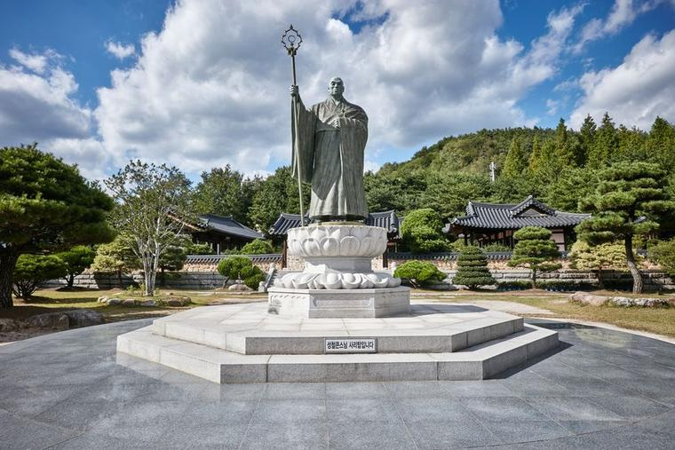

33년 전 오늘, 1993년 11월 5일. 대한불교 조계종 종정이자 현대 한국 불교의 큰 기둥이었던 성철 큰스님의 열반 소식이 일제히 전해졌습니다. 스님은 전날인 11월 4일 오전 7시 30분, 경남 합천 해인사 퇴설당에서 세수 82세(법랍 59세)를 일기로 조용히 입적에 들었습니다.

## 가야산 해인사에서 울린 열반의 타종

1993년 11월 4일 이른 아침, 가야산 해인사에 성철 큰스님의 열반을 알리는 타종 소리가 길게 울려 퍼졌습니다. 성철 스님은 지병이었던 심장질환으로 지난 4월부터 해인사 백련암 등에서 요양을 이어오고 있었습니다.

그러나 11월 3일 저녁부터 병세가 급격히 위독해졌고, 제자들은 스님을 해인사 퇴설당으로 모셨습니다. 그리고 4일 오전 7시 30분, 스님은 제자들이 지켜보는 가운데 평생의 수행처였던 퇴설당에서 조용히 숨을 거두었습니다.

## 10년 장좌불와와 서릿발 같은 '3천 배' 가풍

1912년 경남 산청군 단성면 묵곡리에서 태어난 성철 스님은 1935년 해인사에서 동산 대종사를 은사로 득도했습니다. 스님의 일생은 철저한 계율 준수와 혹독한 자기 수행으로 채워졌습니다.

대구 팔공산 파계사 성전암에서는 무려 10년 동안 등을 바닥에 대지 않고 앉아서 참선하는 장좌불와(長坐不臥)를 실천했습니다. 또한 자신을 찾아오는 사람들에게는 지위의 고하를 막론하고 부처님 앞에 3천 배를 올리게 한 뒤에야 접견을 허락한 일화로도 유명했습니다. 세속적 명리나 권위에 기대지 않고 오직 불법의 본분을 닦게 하려는 준엄한 가르침이었습니다.

*사건 당시 사진 아님 — 사진: 한국관광공사 / KOGL Type 1 attribution*

## "산은 산이요, 물은 물이로다" 세상을 깨운 법어

성철 스님은 1968년 해인총림의 초대 방장에 취임하며 교단의 수행 기풍을 바로세웠습니다. 이어 1981년 조계종 제6대 종정으로 추대되었고, 1991년 제7대 종정으로 다시 추대되었습니다.

1981년 종정 취임 당시 스님이 발표한 종정수시(宗正垂示) 가운데 "산은 산이요, 물은 물이로다"라는 법어는 불교 신자뿐만 아니라 온 국민의 마음에 커다란 파문을 일으켰습니다. 일상의 사물을 있는 그대로 바라보며 분별심과 집착을 내려놓으라는 이 짧고 강렬한 가르침은 현대 한국 사회를 관통하는 명구로 각인되었습니다.

![[1698호] 석가 탄신일 각종 기념행사(서울 조계사 ) 석가 탄신일 각종 기념행사 (1988.05.26) 장면 1](../images/2026-11-05-02-3.jpg)
*[1698호] 석가 탄신일 각종 기념행사(서울 조계사 ) 석가 탄신일 각종 기념행사 (1988.05.26) 장면 1 — 사진: KTV 국민방송 e영상역사관 (대한뉴스) / KTV 공공저작물 — 영상 저작물 전면 개방(대통령실 2025-07-09), 출처 표시*

## 돈오돈수론 주창과 한국 불교의 사상적 정립

성철 스님은 수행 실천뿐만 아니라 교리적인 측면에서도 뚜렷한 족적을 남겼습니다. 스님은 저서 《선문정로》와 《백일법문》 등 11권의 법어집을 남기며, 고려 보조국사 지눌 이래 한국 불교의 주류 수행론이었던 '돈오점수(단박에 깨치고 점차 닦아 나간다)'를 비판했습니다.

스님은 '단박에 깨쳐 단박에 마친다'는 '돈오돈수(頓悟頓修)'를 주창하며, 지행합일의 철저한 깨달음만이 진정한 깨달음이라고 역설했습니다. 이는 한국 불교 사상계에 치열한 학술적 논쟁과 함께 수행 풍토를 새롭게 쇄신하는 결정적 계기가 되었습니다.

![[1698호] 석가 탄신일 각종 기념행사(서울 조계사 ) 석가 탄신일 각종 기념행사 (1988.05.26) 장면 2](../images/2026-11-05-02-4.jpg)
*[1698호] 석가 탄신일 각종 기념행사(서울 조계사 ) 석가 탄신일 각종 기념행사 (1988.05.26) 장면 2 — 사진: KTV 국민방송 e영상역사관 (대한뉴스) / KTV 공공저작물 — 영상 저작물 전면 개방(대통령실 2025-07-09), 출처 표시*

## 해인사 대적광전 영결식과 가야산 연화대 다비식

성철 스님의 열반 소식이 알려지자 해인사는 산중회의를 소집하고 장례를 조계종 종단장으로 치르기로 결정했습니다. 빈소와 분향소는 해인사 경내와 서울 조계사에 마련되어 전국 각지에서 모여든 스님들과 수많은 불자들의 조문이 쉼 없이 이어졌습니다.

영결식은 11월 10일 오전 11시 해인사 대적광전 앞에서 거행되었으며, 다비식은 영결식장에서 약 2킬로미터 떨어진 가야산 연화대에서 봉행되었습니다. 평생 기운 옷 한 벌과 무소유의 맑은 정신만을 남긴 채 가야산 연기의 불꽃 속으로 떠나간 스님의 마지막 길은 수많은 이들의 눈시울을 붉히게 했습니다.

## 청빈한 삶으로 오늘날을 비추는 큰 등불

성철 스님은 생전 세속의 물질적 풍요나 명성을 철저히 멀리한 채 오직 내면의 깨달음과 계율의 엄격함을 지켰습니다. 스님이 남긴 청빈한 삶의 자세와 흔들림 없는 원칙은 혼탁한 현대 사회 속에서 더욱 큰 빛을 발하고 있습니다.

가야산 해인사에 울려 퍼졌던 마지막 종소리, 그리고 스님이 던져준 무소유와 정진의 화두는 수십 년이 흐른 지금까지도 우리 모두의 삶을 되돌아보게 만드는 소중한 울림으로 남아 있습니다.

### 참고 자료

- <https://newslibrary.naver.com/viewer/index.naver?articleId=1993110500289101010&editNo=5&printCount=1&publishDate=1993-11-05&officeId=00028&pageNo=1&printNo=1722&publishType=00010>
- <https://www.kogl.or.kr/recommend/recommendDivView.do?division=img&recommendIdx=2746>
- <https://www.ehistory.go.kr/view/movie?mediasrcgbn=KV&mediaid=12506&mediadtl=29226&mediagbn=DH#t=0.3>
- <https://www.ehistory.go.kr/view/movie?mediasrcgbn=KV&mediaid=12506&mediadtl=29226&mediagbn=DH#t=0.7>
