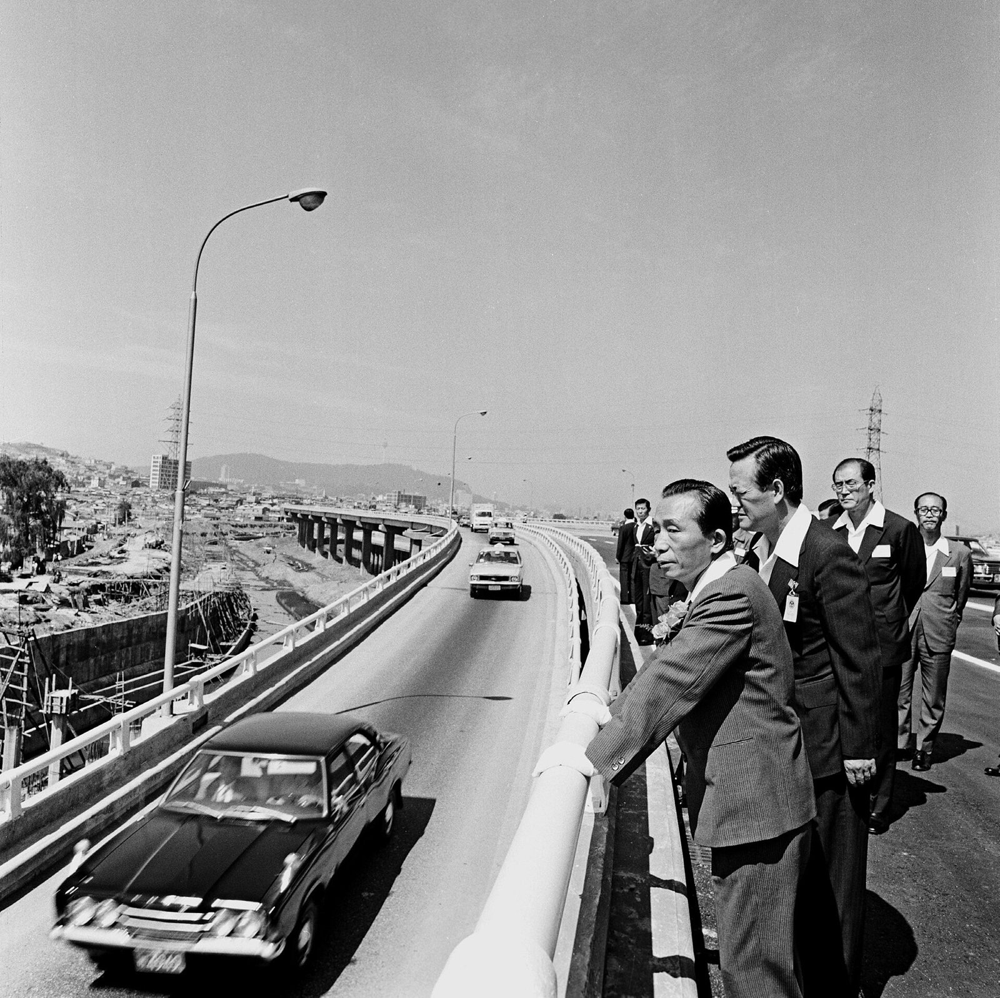
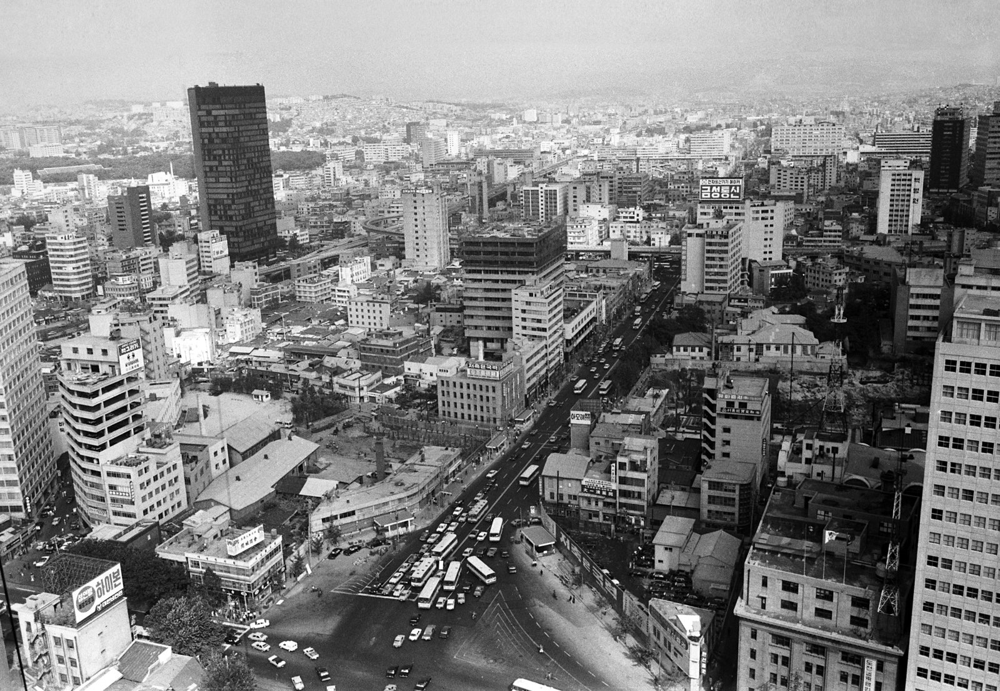
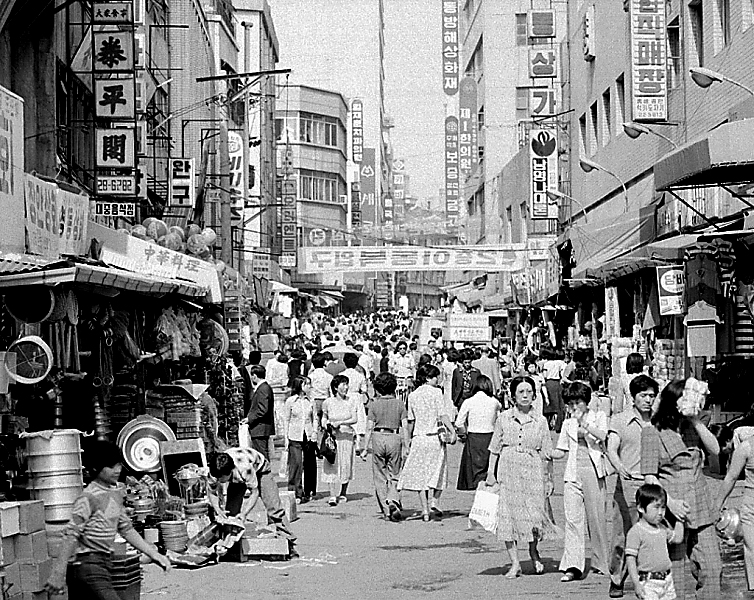

49년 전 오늘, 1977년 11월 5일. 제1회 육림의 날을 맞아 전국에서 대대적인 자연보호 궐기대회가 일제히 열렸습니다. 조국 근대화의 거센 물결 속에서 훼손되어 가던 푸른 산과 맑은 물을 우리 손으로 지켜내자는 다짐이 장충체육관을 가득 메웠습니다.

## 산업화의 그늘과 멍들어 가던 우리 강산

1970년대 대한민국은 눈부신 경제 성장과 산업화를 이루어 내고 있었습니다. 하지만 고속 성장의 이면에는 짙은 그늘도 드리워져 있었습니다. 공장 지대와 도시의 팽창으로 자연환경이 급격히 오염되었고, 이름난 명승지와 유원지는 무분별한 행락객들이 버린 쓰레기로 몸살을 앓았습니다. 산불과 불법 벌채로 인해 푸르러야 할 산등성이가 붉은 흙을 드러내는 일도 잦았습니다. 이제는 단순히 나무를 심는 식목 단계를 넘어, 이미 심은 숲을 정성껏 보살피고 자연 생태계를 지켜야 한다는 위기의식이 사회 전반에 퍼졌습니다.

## 1977년 11월 5일 오전 10시, 장충체육관의 함성

이러한 시대적 절박함 속에서 1977년 11월 5일, 첫 번째 '육림의 날'이 제정되었습니다. 이날 오전 10시를 기해 서울 장충체육관을 비롯한 전국 176개소에서 자연보호 범국민운동 궐기대회가 일제히 개최되었습니다. 서울 대회장인 장충체육관에는 3부 요인을 비롯해 정부 각 부처 관계자, 직장과 사회단체 회원, 학생과 일반 시민 등 8천 6백여 명이 자리를 가득 채웠습니다. 서울시자연보호협의회는 보고를 통해 서울 시내 15개 구와 3천 2백여 개 협의회가 결성되어 자연 사랑의 기수가 될 것을 선언했습니다.

*사건 당시 사진 아님 · 1976년 — 사진: 대한민국 정부 / Public domain*

## "자연을 가꾸는 것이 곧 나라를 사랑하는 길"

대회에 참석한 박정희 대통령은 치사를 통해 조상에게서 물려받은 아름다운 강산을 온전히 가꾸어 후손에게 전하는 것이야말로 산업혁명 시대를 사는 우리 세대의 의무이자 사명이라고 역설했습니다. 대통령은 우리 자연을 내 몸같이 아끼는 마음이 곧 국토를 지키고 나라를 사랑하는 애국심이라고 강조하며, 농촌과 도시, 남녀노소를 불문하고 전 국민이 자연보호 운동에 동참할 것을 제의했습니다. 특히 지각없는 행동으로 유원지의 경관을 해치고 오염을 유발하는 행태를 강하게 지적하며 자연 질서와 조화를 지키는 슬기를 가질 것을 당부했습니다.

*사건 당시 사진 아님 · 을지로 입구 사거리 — 사진: 서울역사박물관 / KOGL Type 1*

## 궐기대회 후 유원지로 향한 시민들의 손길

실내에서 열린 결의와 선언은 구호에만 머물지 않았습니다. 대회의 공식 행사가 끝나자마자 전국 1만 5천여 기관의 공직자와 시민, 학생들은 장갑과 포대를 들고 곧장 현장으로 발걸음을 옮겼습니다. 인근의 주요 산과 하천, 유원지와 관광지로 흩어진 참가자들은 오랫동안 방치되었던 쓰레기를 줍고 오물을 수거하는 대대적인 자연정화 캠페인을 벌였습니다. 쾌적한 국토 환경을 가꾸기 위한 시민들의 자발적인 실천이 전국 방방곡곡에서 직접 행동으로 옮겨진 순간이었습니다.

*사건 당시 사진 아님 · 남대문 시장 의 인파( 1977 ) — 사진: 서울역사박물관 / KOGL Type 1*

## 푸른 숲과 맑은 내, 오늘날에 남겨진 유산

1977년 11월 5일의 궐기는 대한민국 환경 보호사의 중요한 변곡점이 되었습니다. 동네 골목 청소부터 명산 정화 활동까지, 자연을 보호하자는 움직임은 국민들의 일상적인 생활 규범으로 자리 잡았습니다. 헐벗었던 산들이 울창한 녹음으로 뒤덮이고 세계적으로도 유례없는 산림 녹화 성공 사례를 일궈낸 밑바탕에는 이처럼 자연을 내 몸처럼 돌보려 했던 헌신적인 노력이 있었습니다. 오늘날 우리가 맑은 공기를 마시며 걷는 숲길 곳곳에는, 반세기 전 후손을 생각하며 쓰레기를 줍고 나무를 돌보던 정성 어린 손길이 고스란히 남아 있습니다.

### 참고 자료

- <https://newslibrary.naver.com/viewer/index.naver?articleId=1977110500329201003&editNo=2&printCount=1&publishDate=1977-11-05&officeId=00032&pageNo=1&printNo=9879&publishType=00020>
- <https://www.kogl.or.kr/recommend/recommendDivView.do?division=img&recommendIdx=72753>
- <https://commons.wikimedia.org/wiki/File:%EB%B0%95%EC%A0%95%ED%9D%AC_%EB%8C%80%ED%86%B5%EB%A0%B9_%EC%B2%9C%ED%98%B8%EB%8C%80%EA%B5%90_%EC%A4%80%EA%B3%B5%EC%8B%9D_%EC%B0%B8%EC%84%9D.jpg>
- <https://museum.seoul.go.kr/archive/archiveNew/NR_archiveView.do?ctgryId=CTGRY760&type=B&upperNodeId=CTGRY761&fileSn=300&fileId=H-TRNS-84110-761>
- <https://museum.seoul.go.kr/archive/archiveNew/NR_archiveView.do?ctgryId=CTGRY365&type=A&upperNodeId=CTGRY369&fileSn=300&fileId=H-TRNS-85323-369>
