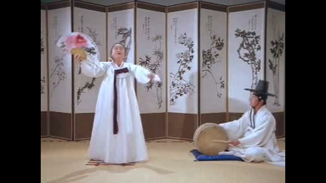
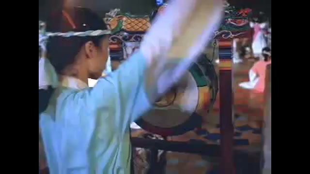

28년 전 오늘, 1998년 11월 5일 평양 윤이상음악당에서 남과 북의 예술인들이 함께 빚어낸 역사적인 합동 연주 소식이 전해졌습니다. 한겨레신문사와 한겨레통일문화재단, 북한의 윤이상음악연구소가 공동 주최한 제1회 윤이상통일음악회 둘째 날 무대에서 남북의 연주자들은 하나의 화음으로 뭉쳤습니다.

## 고향 땅을 그리워했던 거장, 윤이상을 기리다

작곡가 윤이상은 경남 통영 출신으로 서양 현대음악 기법에 동양적 사상과 전통 가락을 접목해 세계적인 명성을 얻은 현대음악의 거장이었습니다. 그러나 1967년 동백림 사건에 연루되어 큰 고초를 겪은 뒤 서독으로 망명해야 했습니다. 이후 그는 생을 마감할 때까지 끝내 고국 땅을 밟지 못하고 1995년 11월 3일 독일 베를린에서 별세했습니다.

그의 서거 3주기를 맞아 남쪽의 서울연주단이 평양을 방문하면서 남북 합동 추모 행사가 성사되었습니다. 이념과 정치의 장벽에 가로막혀 오랫동안 단절되었던 남북의 예술가들이 음악이라는 공통의 언어로 한자리에 모인 뜻깊은 만남이었습니다.

## ‘통일 오누이’가 빚어낸 환상의 라벨 협연

1998년 11월 4일 오후 3시, 평양 윤이상음악당에서 열린 둘째 날 공연의 하이라이트는 단연 남북 연주자의 듀오 무대였습니다. 남쪽의 바이올리니스트 김현미(38) 씨와 북쪽의 차세대 피아니스트 김근철(25) 씨가 무대에 올라 프랑스 작곡가 모리스 라벨의 바이올린 명곡 ‘치간’을 연주했습니다.

두 연주자가 사전에 손을 맞춰본 것은 평양에 도착한 뒤 사흘 동안 세 차례에 불과했습니다. 하지만 무대에 오른 두 사람은 마치 오랜 세월 함께 자란 오누이처럼 눈빛과 호흡을 나누며 눈부신 앙상블을 이끌어냈습니다. 연주가 끝나자 객석에서는 환호와 함께 기립 박수가 쏟아졌고, 관객들은 두 사람을 쉽게 무대 뒤로 보내주지 않았습니다.

*사건 당시 사진 아님 · 이미지 사진 — 사진: padrinan / Pixabay Content License*

## 평양 객석을 전율케 한 안숙선 명창의 판소리

이날 무대에서는 우리의 전통 소리도 북녘 동포들의 가슴을 깊게 울렸습니다. 남쪽의 안숙선 명창은 판소리 심청가 중 가장 극적인 대목인 ‘심봉사 눈 뜨는 대목’을 열창했습니다. 남쪽에서 고수를 동행하지 못해 사물놀이의 김덕수 씨가 직접 북채를 잡고 장단을 맞추었습니다.

당시 북한에서는 판소리가 인민들의 정서에 맞지 않는다는 이유로 널리 공연되지 않아 북녘 청중들에게는 다소 생소한 장르였습니다. 하지만 관객의 감정을 쥐었다 풀었다 하는 안숙선 명창의 독보적인 기량에 북녘 동포들은 연신 탄성을 터뜨리며 경탄을 감추지 못했습니다.

*판소리 ... 지정, 체계화된 방법으로 소리보급에 노력 (1991.00.00) 장면 2 — 사진: KTV 국민방송 e영상역사관 (문화영화) / KTV 공공저작물 — 영상 저작물 전면 개방(대통령실 2025-07-09), 출처 표시*

## 대성산 광법사 추모 제사와 학술 토론회

공연에 앞서 오전 10시 30분에는 평양 근교 대성산 광법사에서 남북 인사들이 참석한 가운데 ‘윤이상 선생 서거 3주기 추모 제사’가 엄수되었습니다. 고향을 그리며 베를린에서 영면한 고인의 넋을 기리기 위해 서울연주단 단원들이 정성을 다해 술잔을 올렸습니다.

같은 날 오전 인민문화궁전에서는 윤이상음악연구토론회가 열려 고인의 음악 세계를 학술적으로 조명했습니다. 남쪽 추진위원장인 노동은 교수가 ‘윤이상의 삶과 예술’을 주제로 발표하며 남북이 공유할 수 있는 문화적 자산으로서의 윤이상 음악을 깊이 있게 짚었습니다.

*만남과 화해의 큰마당 ... 북의 대합주 (1990.00.00) 장면 1 — 사진: KTV 국민방송 e영상역사관 (문화영화) / KTV 공공저작물 — 영상 저작물 전면 개방(대통령실 2025-07-09), 출처 표시*

## 선율로 남은 평화, 오늘날에 전하는 메시지

제1회 윤이상통일음악회는 분단이라는 험난한 현실 속에서도 예술을 매개로 마음을 나눌 수 있음을 입증한 귀중한 순간이었습니다. 남쪽 작곡가 이건용 씨가 북쪽의 윤이상관현악단을 지휘하고, 북쪽의 공훈예술가 김일진 씨가 지휘봉을 잡는 등 무대 위에서는 이미 통일이 이루어진 듯했습니다.

그날 평양 윤이상음악당을 가득 채웠던 화합의 선율은 오늘날에도 남북 문화교류의 소중한 역사로 기억되고 있습니다. 비록 남북 관계의 부침 속에 교류는 멈춰 섰지만, 서로의 눈을 바라보며 연주하던 두 음악가의 진심 어린 호흡은 여전히 우리에게 깊은 울림을 전해줍니다.

### 참고 자료

- <https://newslibrary.naver.com/viewer/index.naver?articleId=1998110500289101008&editNo=6&printCount=1&publishDate=1998-11-05&officeId=00028&pageNo=1&printNo=3340&publishType=00010>
- <https://pixabay.com/photos/music-player-record-player-7792956/>
- <https://pixabay.com/photos/music-recording-vinyl-retro-disk-5705801/>
- <https://www.ehistory.go.kr/view/movie?mediasrcgbn=KV&mediaid=1823&mediadtl=8642&mediagbn=MH#t=0.7>
- <https://www.ehistory.go.kr/view/movie?mediasrcgbn=KV&mediaid=1758&mediadtl=8555&mediagbn=MH#t=0.3>
