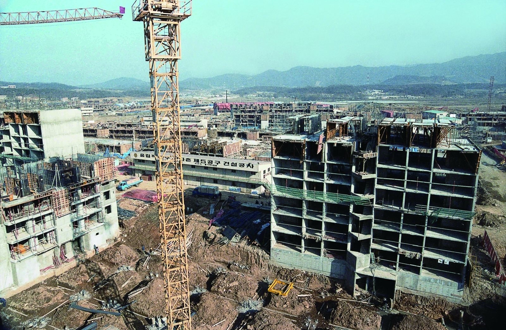
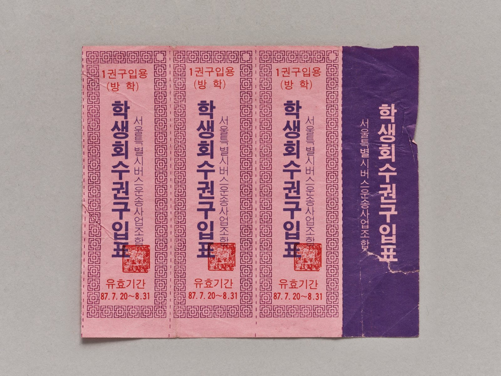

39년 전 오늘, 1987년 11월 6일. 원·달러 환율이 마침내 800원선 아래로 내려앉았습니다. 한국은행이 이날 고시한 미 달러화 환율은 전날보다 80전 떨어진 799원 60전을 기록하며 3년 반 만에 700원대 시대를 다시 열었습니다.

## 연말 마지노선 800원이 무너지다

1987년 11월 6일 아침, 한국은행이 발표한 집중기준율은 경제계 전체에 적지 않은 충격을 주었습니다. 1달러당 799원 60전이라는 수치는 지난 1984년 6월 19일 799원 70전을 기록한 이래 3년 5개월여 만에 처음 보는 700원대 환율이었습니다.

당초 정부는 1달러당 800원을 올해 말까지 기필코 지켜내야 할 최후의 '마지노선'으로 설정하고 환율 방어에 매달려 왔습니다. 그러나 연말을 채 두 달도 남겨두지 않은 시점에서 이 심리적 방어선이 허무하게 깨져버렸습니다.

## 거세진 미국의 압력과 달러화 폭락

환율이 800원선 아래로 곤두박질친 배경에는 거센 대외 압력이 자리 잡고 있었습니다. 당시 한국 경제는 이른바 3저 호황(저유가·저금리·저달러)을 바탕으로 사상 최대의 국제수지 흑자와 대미 무역흑자를 기록하고 있었습니다.

하지만 이는 곧바로 미국의 거센 반발을 불렀습니다. 막대한 무역적자에 시달리던 미국은 한국을 향해 원화 가치를 대폭 올리라는 절상 압력을 가중했습니다. 여기에 더해 1987년 10월 하순 이후 국제 외환시장에서 미국 달러화 가치가 연일 폭락하면서, 원화의 상대적 가치 상승 속도는 통제하기 어려울 정도로 가팔라졌습니다.

*사건 당시 사진 아님 · 올림픽 선수·기자촌 공사 현장 — 사진: 서울역사박물관 / KOGL Type 1*

## 1년 만에 7.7% 절상, 수출 전선의 비상

1987년 벽두만 해도 원·달러 환율은 1986년 말 기준 861원 40전에 머물러 있었습니다. 그러나 11월 6일 799원 60전까지 내려앉으면서 불과 열 달 남짓한 사이에 달러당 무려 61원 80전이 하락했습니다.

원화 절상률은 순식간에 7.72%에 달했습니다. 환율이 떨어진다는 것은 수출 기업이 달러를 벌어들여 원화로 바꿀 때 손에 쥐는 돈이 줄어든다는 뜻이었습니다. 가격 경쟁력으로 세계 시장을 공략하던 국내 신발, 섬유, 전자 등 수출 주력 기업들은 채산성이 급격히 악화되며 큰 타격을 입게 되었습니다.

*사건 당시 사진 아님 · 1987 년 버스 학생 회수권 — 사진: 서울역사박물관 / KOGL Type 1*

## 연말 780원 전망과 산업구조 개편의 고통

외환 당국과 경제 전문가들은 환율 하락세가 여기서 멈추지 않을 것으로 내다보았습니다. 연말에는 달러당 780원 안팎까지 떨어져 연간 절상폭이 10%를 웃돌 것이라는 암울한 관측이 잇따랐습니다. 심지어 이듬해인 1988년 연말에는 710원대까지 밀려날 수 있다는 우려도 제기되었습니다.

정부는 미 달러화와 특별인출권(SDR) 등 16개국 복합통화 바스켓 연동 시스템 속에서 절상폭을 최소화하려 애썼지만, 거대한 국제 금융 환경의 변화를 거스르기는 역부족이었습니다. 결국 정부는 환율 방어 대신 대규모 수입 개방을 추진해 미국의 통상 압력을 달래는 한편, 경쟁력을 잃은 한계 산업을 정리하고 고가품 수출로 산업 구조를 개편하는 험난한 과제를 떠안게 되었습니다.

## 치열했던 수출의 역사와 오늘

1987년 가을 신문 1면을 장식했던 '환율 700원대 진입'은 한국 경제가 중대한 변곡점을 지나고 있음을 보여주는 상징적인 사건이었습니다. 값싼 인건비와 고환율에 기대어 물건을 내다 팔던 시절이 끝나고, 기술 혁신과 고부가가치 산업으로 체질을 바꾸지 않으면 살아남을 수 없다는 경고장이기도 했습니다.

오늘날 수시로 출렁이는 글로벌 금융 시장을 바라볼 때면, 1달러당 800원이라는 선을 지키기 위해 공장마다 불을 밝히고 노심초사하던 1987년 그 시절의 치열했던 모습이 선명하게 떠오릅니다.

### 참고 자료

- <https://newslibrary.naver.com/viewer/index.naver?articleId=1987110600209201003&editNo=2&printCount=1&publishDate=1987-11-06&officeId=00020&pageNo=1&printNo=20337&publishType=00020>
- <https://museum.seoul.go.kr/archive/archiveNew/NR_archiveView.do?ctgryId=CTGRY772&type=B&upperNodeId=CTGRY777&fileSn=300&fileId=H-TRNS-101754-777>
- <https://museum.seoul.go.kr/archive/archiveNew/NR_archiveView.do?ctgryId=CTGRY772&type=B&upperNodeId=CTGRY777&fileSn=300&fileId=H-TRNS-101704-777>
- <https://museum.seoul.go.kr/archive/archiveNew/NR_archiveView.do?ctgryId=CTGRY1187&type=A&upperNodeId=CTGRY1193&fileSn=1672&fileId=3a3d6153-2b3f-48ca-bff9-501d7be28449>
