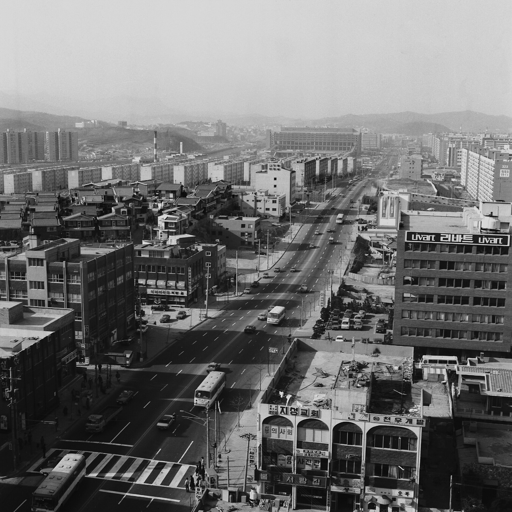
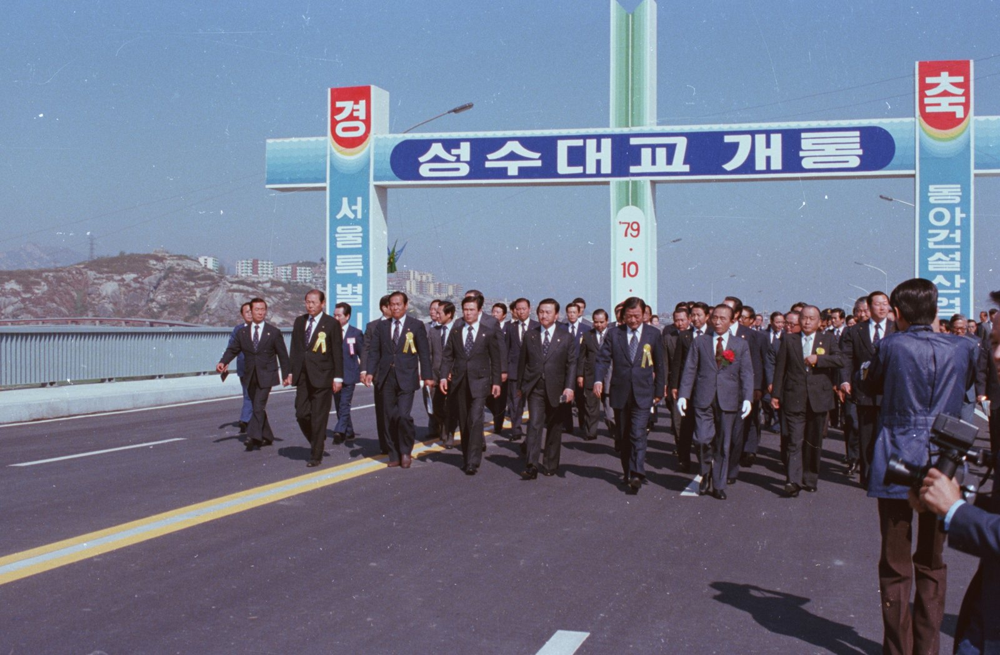
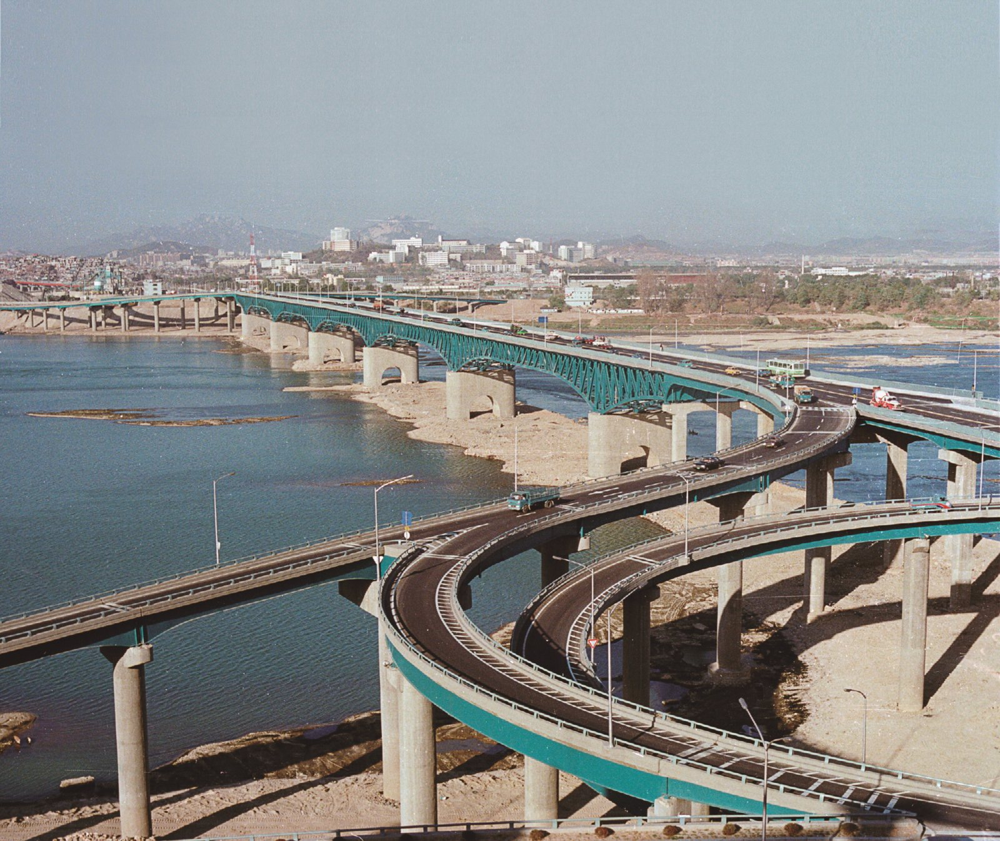

44년 전 오늘, 1982년 11월 6일. 정부가 아파트 투기 열풍이 불던 서울 강남 일대에 특별 세무조사반을 전격 투입했습니다. 잇단 억제 정책 발표에도 불구하고 신축 아파트 분양권에 거액의 웃돈이 붙는 투기 과열이 가라앉지 않자 단호한 조치에 나선 것입니다.

## 아파트 분양권 웃돈 4천만 원, 치솟는 강남 열풍

1970년대 후반부터 본격화된 강남 개발은 1980년대 들어 대규모 주공아파트와 민간 브랜드 아파트 건설로 이어졌습니다. 새로운 주거지로 떠오른 강남 일대에는 청약 당첨만 되면 막대한 시세 차익을 거둘 수 있다는 인식이 퍼지기 시작했습니다.

당시 개포동과 압구정동 등 일부 지역의 신축 분양 아파트는 프리미엄이 4천만 원까지 치솟았습니다. 무허가 복덕방과 전문 투기꾼, 이른바 복부인들이 대거 개입하면서 일반 서민들이 정상적으로 내 집을 마련하기는 갈수록 어려워졌습니다.

## 개포·압구정·서초·대치·잠실 등 5개 지역 특별단속

1982년 11월 6일, 정부는 과열 투기 현상이 심각한 서울 강남의 5개 지역을 대상으로 정밀 세무조사에 착수했습니다. 지정 대상은 개포동, 압구정동, 서초동, 대치동, 잠실동이었습니다.

국세청은 3인 1조로 구성된 20개의 전매행위조사특별반을 현장에 투입했습니다. 특히 투기가 가장 심했던 개포동과 압구정동을 중심으로 건설부와 서울시로부터 명단을 넘겨받아 실제 거주자와 분양자 명의를 대조하는 정밀 주소지 실지조사를 벌였습니다.

*사건 당시 사진 아님 · 1981년 — 사진: 서울특별시 / KOGL Type 1*

## 개포주공 1차 4천260가구 중 2천여 가구가 불법 전매

조사반이 착수한 중점 조사 대상은 개포동의 주공아파트, 우성, 경남, 선경아파트와 대치동 쌍용·미도아파트, 서초동 한양아파트, 잠실 우성아파트 등이었습니다. 모두 투기 바람이 본격화된 1981년 10월 이후 분양된 단지들이었습니다.

특히 개포주공 1차 분양 아파트 4천2백60가구 중 무려 2천여 가구가 상습 투기꾼과 복덕방 등에 의해 불법 전매된 정황이 드러났습니다. 게다가 개포동 지역 복덕방의 90퍼센트 이상이 등록도 하지 않은 무허가 영업 상태로 드러나 투기를 조장하고 있었습니다.

*성수대교 개통 — 사진: 서울역사박물관 / KOGL Type 1 (공공누리 제1유형, 출처표시)*

## 미등기 전매 차익 75% 양도세 부과와 특정지역 지정

정부는 이들 5개 지역을 부동산 투기 억제를 위한 '특정지역'으로 고시하기 위한 행정 절차를 밟았습니다. 특정지역으로 지정되면 국세청이 조사한 실제 거래가액을 기준으로 양도소득세가 엄격하게 부과되었습니다.

특히 소유권 등기도 하지 않은 채 분양권 상태로 웃돈을 얹어 파는 미등기 전매 행위에 대해서는 양도 차익의 75퍼센트를 양도소득세로 중과세하기로 했습니다. 거액의 차익을 노린 투기꾼뿐 아니라 불법 분양을 알선한 복덕방과 건설업체에 대해서도 사업소득세와 법인세를 무겁게 추징하는 방침이 세워졌습니다.

*성수대교와 입체교차로 — 사진: 서울역사박물관 / KOGL Type 1 (공공누리 제1유형, 출처표시)*

## 경제기획원과 관계장관회의의 강력한 종합대책

정부는 11월 8일 김준성 부총리 겸 경제기획원 장관 주재로 관계장관회의를 열어 2단계 투기 억제 종합대책을 논의하기로 했습니다. 내무부에는 복덕방 신고제의 보완을, 건설부에는 아파트 분양 방법의 전면 재검토를 요청했습니다.

투기 지역 복덕방에 대한 허가제 부분 실시와 관인계약서 사용 의무화, 매매 거래 중개 내역 노출 등 거래의 투명성을 높이기 위한 제도 개선이 뒤따랐습니다. 엄포에 그치지 않고 투기 억제를 반드시 달성하겠다는 정부의 강력한 의지가 표명된 날이었습니다.

## 오늘날까지 이어지는 부동산 시장의 기억

1982년 11월 6일의 조치는 한국 현대사에서 강남 개발과 함께 본격화된 아파트 투기 열풍을 억제하기 위한 정부의 상징적인 개입 사례였습니다.

40여 년이 흐른 지금도 개포, 대치, 압구정 등 강남의 핵심 아파트 단지들은 여전히 한국 부동산 정책과 시장 동향의 중심에 자리하고 있습니다. 1980년대 초반 신문 1면을 장식했던 '아파트 투기 세무조사' 기사는 오늘날의 시선에서도 낯설지 않은 풍경입니다.

### 참고 자료

- <https://newslibrary.naver.com/viewer/index.naver?articleId=1982110600329201004&editNo=2&printCount=1&publishDate=1982-11-06&officeId=00032&pageNo=1&printNo=11418&publishType=00020>
- <https://commons.wikimedia.org/wiki/File:Apgujeong-dong_1978-04-20.png>
- <https://commons.wikimedia.org/wiki/File:1981%EB%85%84_%EB%B0%98%ED%8F%AC%EC%99%80_%EB%85%BC%ED%98%84%EB%8F%99_%EC%9D%BC%EB%8C%80_%ED%95%AD%EA%B3%B5%EC%B4%AC%EC%98%81%EC%82%AC%EC%A7%84.jpg>
- <https://museum.seoul.go.kr/archive/archiveNew/NR_archiveView.do?ctgryId=CTGRY766&type=B&upperNodeId=CTGRY768&fileSn=300&fileId=H-TRNS-97953-768>
- <https://museum.seoul.go.kr/archive/archiveNew/NR_archiveView.do?ctgryId=CTGRY766&type=B&upperNodeId=CTGRY768&fileSn=300&fileId=H-TRNS-96059-768>
