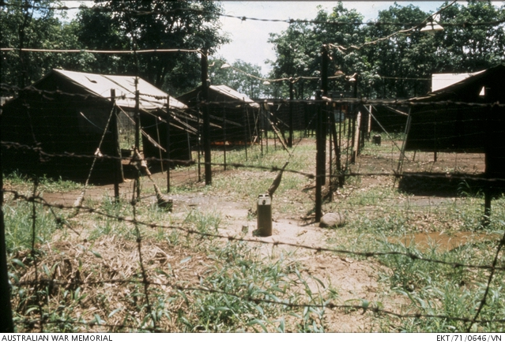
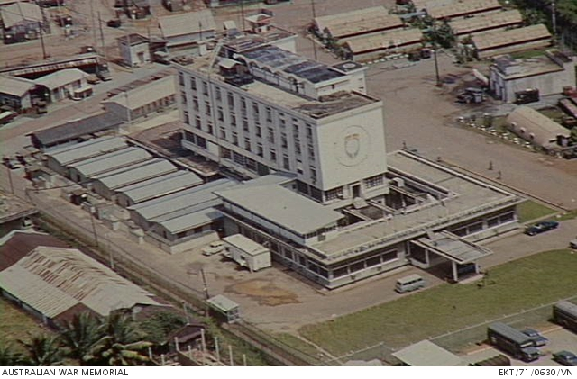
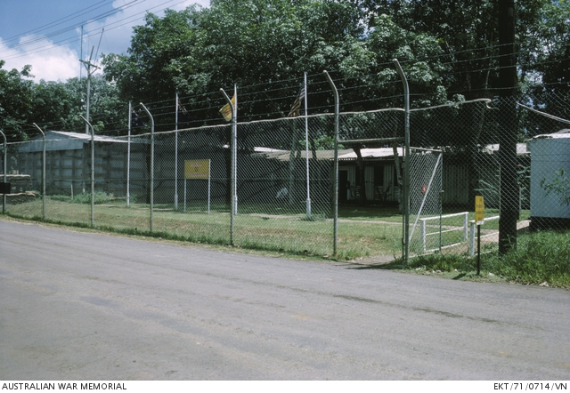

55년 전 오늘, 1971년 11월 6일. 베트남 전선에 파병됐던 주월한국군의 1차 철수 계획이 공식 발표됐습니다. 머나먼 열대 정글에서 땀과 눈물을 흘리던 장병들이 고국 품으로 돌아오는 첫걸음이 시작된 순간이었습니다.

## 서울과 사이곤에서 동시 발표된 1차 철군 계획

1971년 11월 6일 오전, 대한민국 정부와 월남 정부는 주월한국군의 1차 철수 계획을 양국 수도인 서울과 사이곤에서 동시에 공식 발표했습니다. 윤석헌 외무부 장관대리는 특별 기자회견을 자청해 전반적인 철군 계획의 1단계 조치를 세상에 알렸습니다.

발표에 따르면 철수는 오는 12월 1일부터 시작되어 1972년 6월 30일까지 단계적으로 진행될 예정이었습니다. 철수 대상 병력은 전투부대인 제2해병여단 청룡부대와 이들을 뒷받침하던 각종 지원 및 행정부대를 포함해 약 1만 명 규모였습니다.

## 단계적 철군 방침과 1만 명 귀환의 배경

이번 1차 철수 조치는 갑작스럽게 결정된 것이 아니었습니다. 정부는 지난 1월 박정희 대통령이 연두 기자회견에서 밝힌 주월한국군의 단계적 철수에 관한 기본 정책에 따라 미국과 월남 등 주요 연합국과 지속적인 사전 협의를 거쳐왔습니다.

정부는 현지의 월남화 계획이 순조롭게 진행되고 월남군의 독자적 전투 능력이 향상되었으며, 전반적인 전선 정세가 호전되었다는 판단 아래 첫 철군을 단행한다고 설명했습니다. 이미 수개월 전부터 면밀히 검토되어 온 전반적인 철수 구상이 본격적인 실행 단계로 들어선 셈이었습니다.

*1st Australian Task Force (1ATF) base POW compound at Nui Dat — 사진: Australian War Memorial / CC0*

## "지난 6년간의 용기와 우정에 감사" 월남 정부의 공식 성명

사이곤 현지 시간으로 같은 날 오전 10시, 월남 외무성 역시 한국군의 1단계 철수를 공식 발표하는 성명을 냈습니다. 월남 정부가 연합군의 철수에 관해 단독으로 공식 성명을 발표한 것은 이번이 처음이었습니다.

월남 정부는 성명을 통해 청룡부대를 포함한 1만 명의 철수를 확인하면서, 지난 6년 동안 자유와 평화를 지키기 위해 용기와 우정으로 월남을 도와준 한국군 장병들과 한국 국민들에게 깊은 감사의 뜻을 표했습니다. 현지에서는 이미 2개월 전부터 부대 병력 이동을 동결하고 장비를 보수하는 등 질서정연하게 귀환 준비가 진행 중이었습니다.

*Aerial view of Free World Military Forces headquarters, 1971 — 사진: Australian War Memorial / CC0*

## 박정희 대통령의 담화와 항구적 평화에 대한 염원

철수 발표 직후 박정희 대통령은 대국민 담화를 발표했습니다. 박 대통령은 담화에서 월남의 정세가 점차 안정되고 평정 계획이 순조롭게 나아감에 따라 주월한국군의 1차 철수를 결정할 수 있게 되었다고 밝혔습니다.

이어 월남 땅에도 평화의 여명이 밝아오는 것을 기쁘게 생각하며 아시아와 세계 곳곳에 항구적인 평화가 조속히 확립되기를 바란다고 강조했습니다. 또한 자유와 평화는 거저 주어지는 것이 아니라 고귀한 희생을 치러야 얻을 수 있다는 6.25 전란의 경험과 베트남 파병의 숭고한 교훈을 잊지 말아야 한다고 당부했습니다.

*1ATF headquarters buildings at Nui Dat — 사진: Australian War Memorial / CC0*

## 그 시절 가족들이 기억하는 귀환의 안도감

열대 우림의 낯선 전장에서 무더위와 포화를 견뎌내던 장병들의 철군 소식은 전국 방방곡곡의 가정에 커다란 안도감을 안겼습니다. 매일같이 조간신문과 라디오 뉴스를 확인하며 아들과 남편, 형제의 무탈함을 기도하던 이들에게는 더없이 벅찬 소식이었습니다.

1971년 11월 6일의 1차 철수 발표는 한국 현대사에서 거대한 발자취를 남긴 베트남 참전의 전환점이었습니다. 오랜 시간 국가의 부름을 받고 묵묵히 헌신했던 장병들의 땀방울은 오늘날까지도 수많은 이들의 기억 속에 생생히 남아 있습니다.

### 참고 자료

- <https://newslibrary.naver.com/viewer/index.naver?articleId=1971110600329201003&editNo=2&printCount=1&publishDate=1971-11-06&officeId=00032&pageNo=1&printNo=8031&publishType=00020>
- <https://commons.wikimedia.org/wiki/File:A-7B_Corsairs_VA-215_in_flight_in_1971.jpeg>
- <https://commons.wikimedia.org/wiki/File:1st_Australian_Task_Force_(1ATF)_base_POW_compound_at_Nui_Dat.jpg>
- <https://commons.wikimedia.org/wiki/File:Aerial_view_of_Free_World_Military_Forces_headquarters,_1971.jpg>
- <https://commons.wikimedia.org/wiki/File:1ATF_headquarters_buildings_at_Nui_Dat.jpg>
