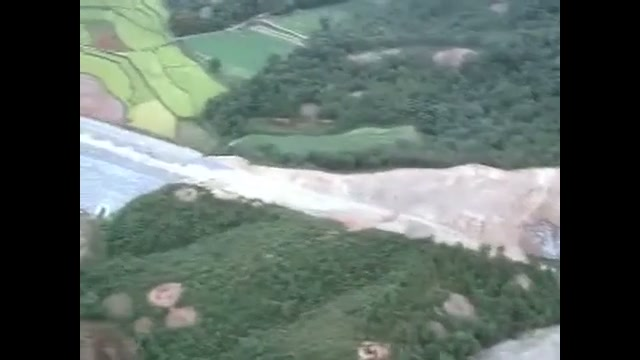

27년 전 오늘, 1999년 11월 6일 신문 1면에는 경부고속철도 상촌터널이 완전히 뚫렸다는 반가운 소식이 실렸습니다. 충북 영동과 경북 김천을 잇는 길이 9975미터의 터널로, 당시 국내에서 가장 긴 터널이 세상에 모습을 드러낸 순간이었습니다.

## 서울과 부산을 잇는 교통 대동맥의 과제

1990년대 한국에서 서울과 부산을 잇는 경부축은 전체 인구의 73퍼센트 이상이 거주하고, 여객의 66퍼센트와 화물의 70퍼센트를 감당하던 국가의 핵심 통로였습니다. 기존 경부고속도로와 경부선 철도는 이미 극심한 정체로 포화 상태에 이르렀습니다.

정부는 교통난 해소와 물류 혁신을 위해 시속 300킬로미터급 고속철도 건설을 결정했습니다. 1992년 6월 30일 첫 삽을 뜬 경부고속철도는 국토를 남북으로 관통하며 수많은 산과 강을 가로질러야 했습니다.

## 길이 9975미터, 10킬로미터에 이르는 대역사

충청북도 영동군 상촌면 유곡리와 경상북도 김천시 봉산면 태화리를 잇는 상촌터널은 경부고속철도 전 구간 가운데서도 손꼽히는 험난한 구간이었습니다. 산세가 험하고 깊어 터널 길이만 무려 9975미터에 달했습니다.

당시 국내에서 건설된 터널 가운데 최장 길이를 자랑하던 이 터널은 향후 고속열차가 멈춤 없이 질주할 수 있도록 정밀하고 완벽한 시공 능력이 요구되었습니다.

*경부 고속 전철 ... (1994.00.00) 장면 2 — 사진: KTV 국민방송 e영상역사관 (문화영화) / KTV 공공저작물 — 영상 저작물 전면 개방(대통령실 2025-07-09), 출처 표시*

## 32만 명의 땀방울과 덤프트럭 20만 대분의 토사

1996년 11월 굴착을 시작한 상촌터널 공사 현장은 그야말로 거대한 전쟁터를 방불케 했습니다. 공사 기간 동안 투입된 연인원만 32만여 명에 달했습니다.

터널을 뚫기 위해 점보드릴을 포함한 첨단 중장비 6만 8000대가 동원되었습니다. 발파와 굴착을 거치며 쏟아져 나온 토사와 암석의 양은 15톤 덤프트럭 20만 대 분량이라는 어마어마한 규모였습니다.

![[1972호] 경부 고속 철도 기공 경부 고속 철도 기공 (1993.08.25) 장면 1](../images/2026-11-06-06-3.jpg)
*[1972호] 경부 고속 철도 기공 경부 고속 철도 기공 (1993.08.25) 장면 1 — 사진: KTV 국민방송 e영상역사관 (미공개 대한뉴스) / KTV 공공저작물 — 영상 저작물 전면 개방(대통령실 2025-07-09), 출처 표시*

## 신공법 도입으로 공기를 5개월 앞당기다

단단한 암반과 복잡한 지질 구조 속에서도 공사는 쉼 없이 진행되었습니다. 한국고속철도건설공단은 안전성을 극대화하면서도 효율을 끌어올릴 수 있는 신공법을 현장에 적극적으로 적용했습니다.

그 결과 당초 예정되었던 공사 기간을 5개월이나 단축하며 착공 만 3년 만인 1999년 11월 5일 성공적으로 양방향을 관통시킬 수 있었습니다.

![[900호] 새마을 시찰 새마을 시찰(10.2) (1972.10.07) 장면 2](../images/2026-11-06-06-4.jpg)
*[900호] 새마을 시찰 새마을 시찰(10.2) (1972.10.07) 장면 2 — 사진: KTV 국민방송 e영상역사관 (미공개 대한뉴스) / KTV 공공저작물 — 영상 저작물 전면 개방(대통령실 2025-07-09), 출처 표시*

## 전국 반나절 생활권 시대를 연 주춧돌

상촌터널의 관통은 단순한 지하 통로 완성을 넘어 대한민국 교통 지형을 바꿀 고속철도 시대가 한 걸음 더 가까워졌음을 알리는 신호탄이었습니다. 이와 같은 난공사 구간들이 차례로 뚫리며 마침내 2004년 4월 1일 경부고속철도가 개통되었습니다.

어두운 지하 수백 미터 아래에서 거친 먼지를 마시며 길을 뚫어낸 수많은 기술자와 노동자들의 헌신 덕분에, 오늘날 우리는 전국을 반나절 생활권으로 누비며 편리하게 이동하고 있습니다.

### 참고 자료

- <https://newslibrary.naver.com/viewer/index.naver?articleId=1999110600209101002&editNo=45&printCount=1&publishDate=1999-11-06&officeId=00020&pageNo=1&printNo=24346&publishType=00010>
- <https://pixabay.com/photos/old-train-train-nostalgia-china-8110662/>
- <https://www.ehistory.go.kr/view/movie?mediasrcgbn=KV&mediaid=2363&mediadtl=9198&mediagbn=MH#t=0.7>
- <https://www.ehistory.go.kr/view/movie?mediasrcgbn=KV&mediaid=30000499&mediadtl=43869&mediagbn=DK#t=0.3>
- <https://www.ehistory.go.kr/view/movie?mediasrcgbn=KV&mediaid=20090000&mediadtl=35211&mediagbn=DK#t=0.7>
