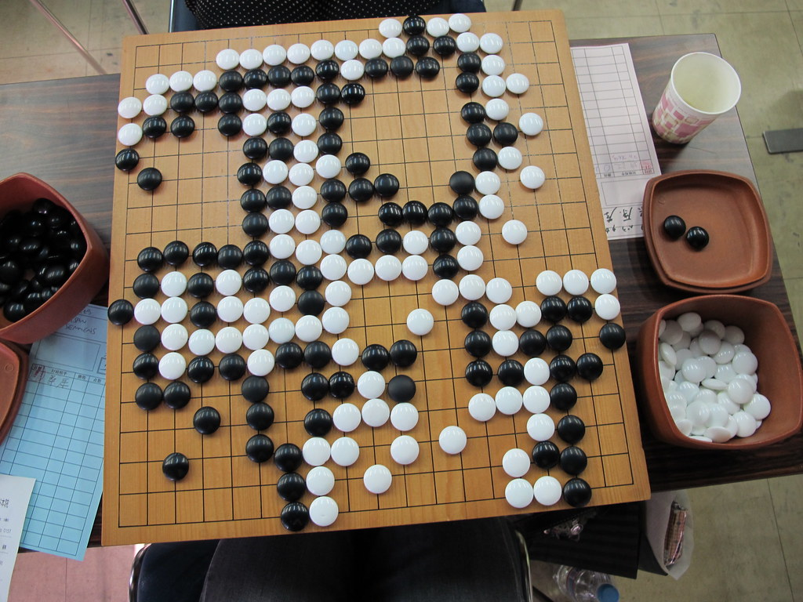
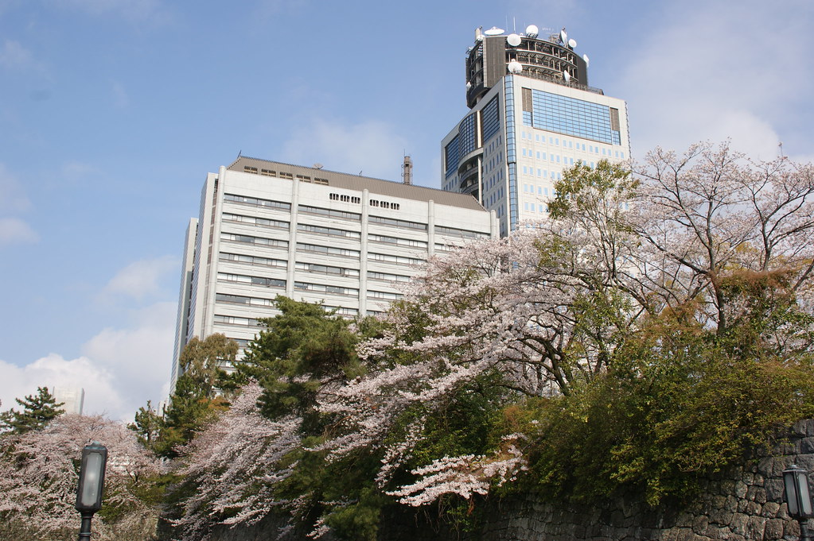
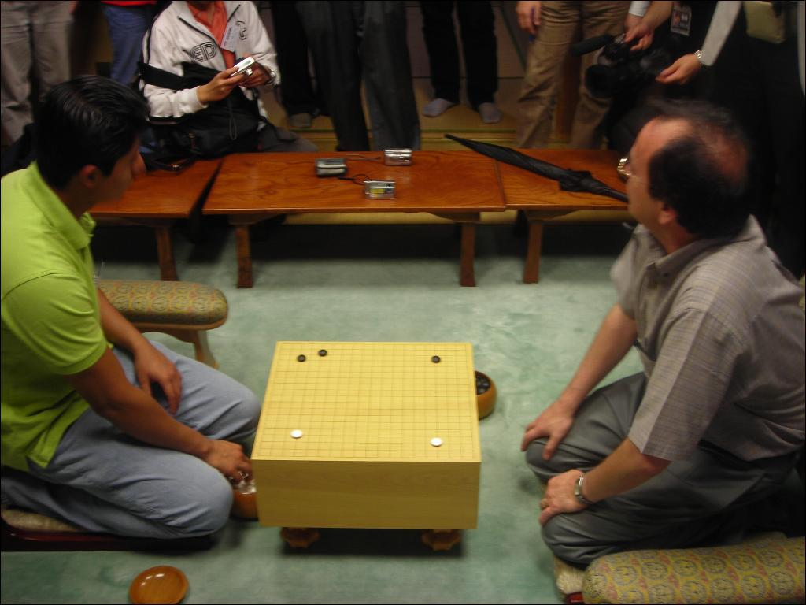

46년 전 오늘, 1980년 11월 7일. 스물네 살의 청년 기사 조치훈 8단이 일본 바둑계 최고 권위를 자랑하는 명인 타이틀을 거머쥐었다는 소식이 대대적으로 보도되었습니다. 여섯 살 나이에 바둑 유학을 떠난 지 18년 만에 일궈낸 값진 결실이었습니다.

## 여섯 살 소년, 현해탄을 건너다

부산에서 태어난 조치훈은 한국 현대 바둑의 개척자인 조남철 9단의 조카입니다. 어린 시절부터 남다른 바둑 재능을 보인 그는 1961년 12월, 불과 여섯 살의 나이에 일본으로 건너갔습니다. 당대 명문 도장이었던 기타니 미노루 9단의 문하에 들어가 혹독한 수련을 시작했습니다. 낯선 이국땅에서 소년은 묵묵히 바둑돌을 놓으며 실력을 갈고닦았습니다.

## 일본기원 최연소 입단 기록을 세우다

조치훈은 1968년 만 11세 8개월의 나이로 프로에 입단하며 일본기원 사상 최연소 입단 기록을 갈아치웠습니다. 같은 해 2단으로 승단한 뒤 무서운 기세로 승단을 거듭했고, 1975년에는 제12기 프로십걸전에서 우승하며 첫 대형 타이틀을 품에 안았습니다. 일본 바둑계는 천재 기사의 등장에 술렁였고, 그는 마침내 최고봉인 명인전 도전권을 따냈습니다.

*playing igo in the nihon ki-in — 사진: conskeptical / CC BY-SA 2.0*

## 16시간 30분의 반상 사투

제5기 명인전 도전 7번기는 시즈오카현 아타미의 아카네자키 샤토호텔 등에서 치러졌습니다. 상대는 쟁쟁한 명인 타이틀 보유자 오오타케 히데오 9단이었습니다. 시리즈 전적 3승 1무 1패로 앞선 조치훈 8단은 11월 5일과 6일 이틀에 걸쳐 열린 제6국에 나섰습니다. 무려 16시간 30분에 걸친 숨 막히는 장고 끝에, 6일 오후 7시 53분 조치훈은 1호반승을 거두며 4승 1무 1패로 최종 승리를 확정 지었습니다.

*Shizuoka Prefectural Government in April — 사진: kazuomatz_ / CC BY 2.0*

## 한국인 최초 명인 등극과 거액의 상금

외국인 기사로는 중국 출신 린하이펑에 이어 두 번째이자, 한국인으로는 사상 최초로 일본 바둑 정상에 오른 순간이었습니다. 당시 조치훈 8단은 우승 상금 1500만 엔과 도전자 대국료 400만 엔을 합쳐 1900만 엔을 받았으며, 각종 축하금과 광고 수입을 더해 약 1억 원에 달하는 거액을 손에 쥐었습니다. 사카타, 린하이펑, 이시다, 오오타케로 이어지던 일본 바둑 계보는 바야흐로 '조치훈 시대'로 접어들었습니다.

*Tour of the Nihon Ki-in — 사진: nachof / CC BY-SA 2.0*

## 불멸의 기록으로 남은 '목숨을 건 승부'

이후 조치훈은 명인전을 5연패하며 최초의 명예 명인 자격을 획득했고, 1983년에는 기성, 명인, 본인방을 동시에 석권하는 사상 첫 대삼관의 위업을 달성했습니다. 전치 25주의 큰 사고를 겪고도 휠체어를 타고 대국장에 나타나 남긴 "목숨을 걸고 바둑을 둔다"는 명언은 지금도 널리 회자됩니다. 일본 통산 최다 타이틀인 75회 우승과 통산 1500승을 달성한 그의 위대한 여정은 바로 이 명인위 등극에서 힘차게 출발했습니다.

### 참고 자료

- <https://newslibrary.naver.com/viewer/index.naver?articleId=1980110700329201017&editNo=2&printCount=1&publishDate=1980-11-07&officeId=00032&pageNo=1&printNo=10803&publishType=00020>
- <https://www.flickr.com/photos/91049143@N00/13753818793>
- <https://www.flickr.com/photos/32751486@N00/9880575875>
- <https://www.flickr.com/photos/32515432@N03/3409549279>
- <https://www.flickr.com/photos/8787851@N04/2760266869>
