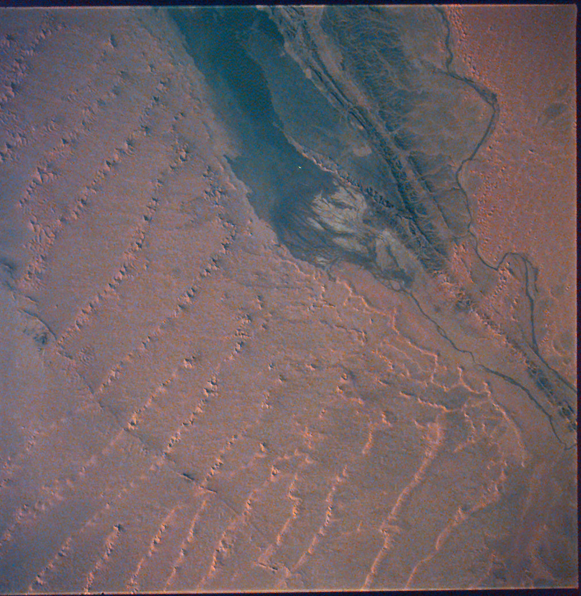
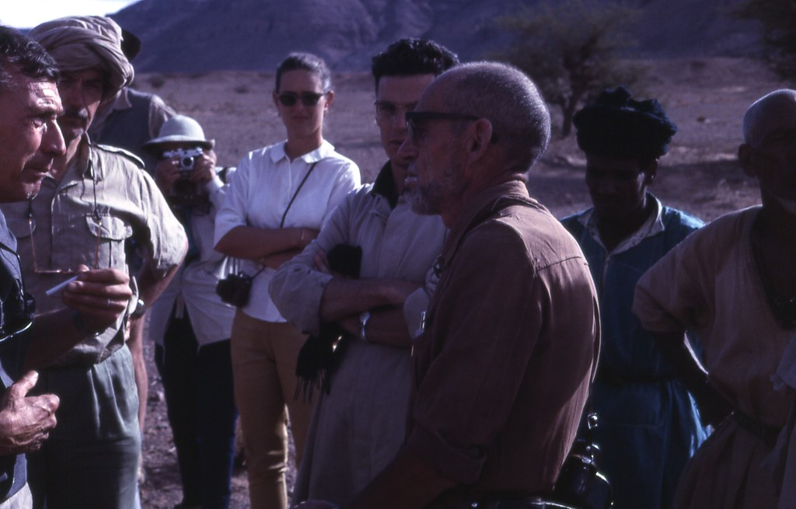
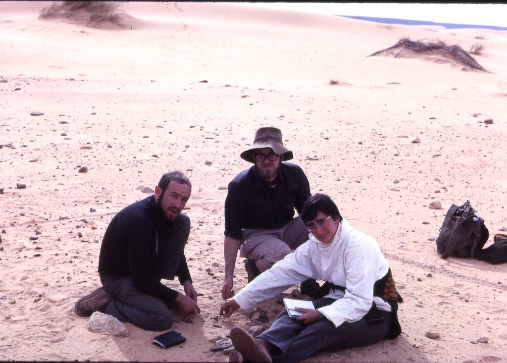

43년 전 오늘, 1983년 11월 7일. 한국 건설업계가 단일 토목공사 역사상 세계 최대 규모인 리비아 대수로 공사 계약을 공식 체결했습니다. 동아건설, 동아콘크리트, 대한통운 3개사로 구성된 동아그룹 컨소시엄이 따낸 수주 금액은 무려 32억 9,700만 달러에 달했습니다.

## 단일 공사 세계 최대, 33억 달러의 낭보

1983년 11월 7일 리비아 현지에서 동아건설그룹 최원석 회장과 발주처인 리비아 대수로공사사업위원회 모하메드 아메드 엘 망가시 위원장이 정식 공사 계약서에 서명했습니다. 조인식에는 김성배 건설부 장관 등 양국 정부 고위 관계자들이 배석해 계약 체결을 축하했습니다.

이번에 수주한 1단계 공사 금액은 32억 9,700만 달러, 당시 환율로 2조 6천억 원을 웃도는 천문학적인 금액이었습니다. 이는 단일 토목공사 수주액으로는 세계 최고 기록으로, 발표 직후 국내 언론의 1면 머리기사를 일제히 장식했습니다.

## 사막을 농지로 바꾸는 리비아의 '녹색혁명'

리비아 대수로 사업은 남부 사하라 사막 지하 깊은 곳에 갇혀 있던 지하수를 끌어올려 북부 지중해 연안 도시와 농경지로 보내는 거대한 관개 사업이었습니다. 1953년 석유를 탐사하는 과정에서 사하라 사막 지하 500미터 깊이에 축적된 막대한 고대 담수층이 발견된 것이 시발점이었습니다.

리비아 정부는 이를 정책 1호 사업인 '녹색혁명'의 핵심 축으로 삼았습니다. 동북부 시르트와 벵가지 지역의 사막 3억 6,300만 평을 농지로 탈바꿈시키고, 주민들에게 하루 400만 톤의 생활용수와 농업용수를 공급하겠다는 야심 찬 계획이었습니다.

*S65-63830 The Sahara Desert in Western Algeria on Earth — 사진: NASA / Public domain*

## 파격적 조건: 전액 현금과 물가보상제 채택

이번 계약은 수주 규모뿐 아니라 계약 조건 면에서도 파격적이었습니다. 당초 국제 원유 가격 변동으로 인해 공사 대금 일부를 원유로 받게 될지 모른다는 우려가 있었으나, 전액 현금 지급(미국 달러화 75%, 현지 리비아 디나르화 25%) 조건으로 성사되었습니다. 여기에 계약 선수금 7.5%도 보장받았습니다.

또한 해외 대형 토목공사에서는 극히 드물게 연 5% 범위 내에서 공사비를 올려주는 물가보상제가 채택되었습니다. 시멘트와 철재 등 주요 원자재 구입비 역시 시공자가 실제로 사들인 가격으로 정산해 주는 실비정산제가 적용되어 채산성을 크게 끌어올렸습니다.

*Theodore Monod talking with archaeologists in the Sahara Desert 1967 — 사진: gbaku / CC BY-SA 2.0*

## 사막을 가로지르는 1,895km의 인공 수로

수로 공사는 설계부터 자재 제작, 시공에 이르는 모든 과정을 일괄 도맡는 턴키 방식으로 진행되었습니다. 공사 기간은 계약일로부터 84개월(7년)이 책정되었습니다. 동아그룹은 리비아 브레가와 사릴 현지에 특수 송수관 생산 공장을 짓고, 타저보와 사릴에 대형 집수장을 마련하기로 했습니다.

공사에 투입되는 송수관의 규모는 상상을 초월했습니다. 직경 4미터, 길이 7.5미터, 무게 75톤에 이르는 대형 특수 콘크리트관 25만 3천 개를 사막 지하에 매설해야 했습니다. 타저보에서 벵가지까지 897km, 사릴에서 시르트까지 998km 등 매설되는 수로의 총연장만 1,895km에 달했고, 관을 운반하기 위해 사막에 새로 닦아야 하는 가설도로만 1,514km에 이르렀습니다.

*Archaeologists Glynn Isaac, Charles Keller and Maxine Kleindienst doing a surface collection of artifacts in the Sahara Desert in Mauritania 1967 — 사진: gbaku / CC BY-SA 2.0*

## 침체된 해외 건설 시장에 불어넣은 활력

1983년 당시 한국의 해외 건설 시장은 국제 유가 하락과 발주 축소, 중동 현지 미수금 증가로 큰 어려움을 겪고 있었습니다. 당초 정부는 연간 수주액이 90억 달러 안팎에 그칠 것으로 우려했으나, 이번 33억 달러 수주로 연간 목표 100억 달러 달성을 단숨에 눈앞에 두게 되었습니다.

건설부는 이 공사로 인해 연인원 1,200만 명의 고용 효과가 발생하고, 철근과 시멘트 등 국산 기자재 수출액만 6억 7,200만 달러에 달할 것이라고 발표했습니다. 사우디아라비아 등 기존 중동 현장에 묶여 있던 국내 중장비와 전문 인력을 효율적으로 전환 투입할 수 있어 국내 경제 전반에 큰 활력소가 되었습니다.

## 1991년 통수식, 사막에 흐른 기적의 물길

폭염과 모래폭풍이 몰아치는 열사의 사막에서 한국 노동자들은 묵묵히 흙을 파내고 거대한 관을 묻었습니다. 수많은 난관을 이겨낸 끝에 1단계 공사는 1991년 8월 마침내 통수식을 거행하며 성공적으로 마무리되었습니다. 메마른 사막을 건너 벵가지와 시르트로 쏟아져 나온 맑은 물길은 세계 토목 역사의 기적으로 불렸습니다.

북아프리카의 뜨거운 사막에 맑은 강을 놓았던 한국 기술진의 땀방울은 40여 년이 지난 지금도 한국 경제의 위대한 도약기로 기억되고 있습니다.

### 참고 자료

- <https://newslibrary.naver.com/viewer/index.naver?articleId=1983110700209201006&editNo=2&printCount=1&publishDate=1983-11-07&officeId=00020&pageNo=1&printNo=19106&publishType=00020>
- <https://commons.wikimedia.org/wiki/File:Sahara_Desert_AS09-21-3259-61.jpg>
- <https://commons.wikimedia.org/wiki/File:S65-63830_The_Sahara_Desert_in_Western_Algeria_on_Earth.jpg>
- <https://www.flickr.com/photos/72105154@N00/411552084>
- <https://www.flickr.com/photos/72105154@N00/445057394>
