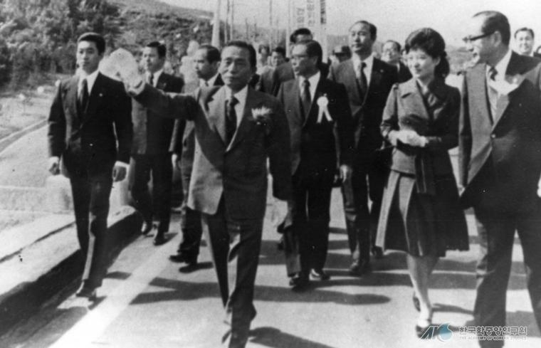
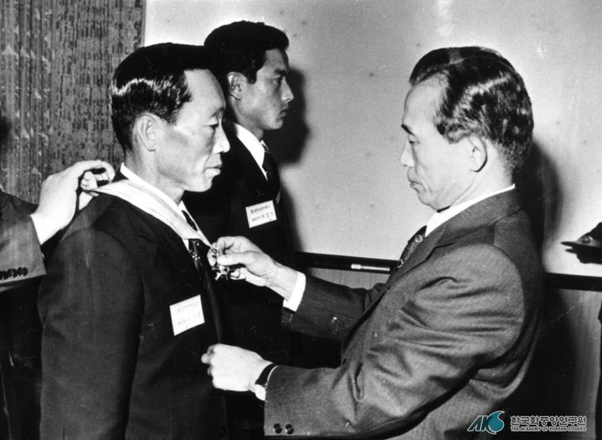
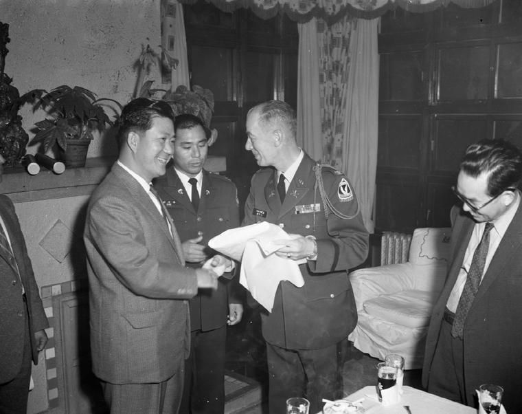

48년 전 오늘, 1978년 11월 7일. 한국군과 주한미군을 통합 지휘하는 한미연합군사령부(CFC)가 공식 출범했습니다. 주한미군 철수 논의로 한반도 안보 지형이 요동치던 시기, 양국 군사 협력의 새로운 전환점이 마련되었습니다.

## 미 지상군 철수라는 거센 안보 풍파 속에서

1970년대 후반 대한민국 안보는 중대한 시험대에 올랐습니다. 1977년 취임한 미국의 지미 카터 대통령이 주한 미 지상군의 단계적 철수를 대선 공약으로 내걸고 실제 이행에 들어갔기 때문입니다. 불과 열흘 전인 1978년 10월 27일에는 판문점 부근에서 제3땅굴이 발견되는 등 북한의 남침 위협은 여전히 현실이었습니다.

안보 공백을 우려하는 목소리가 높아지자 한미 양국은 미 지상군 철수에 따른 보완책 마련에 착수했습니다. 그 핵심 결과물이 바로 한국군과 미군을 하나로 묶어 강력한 억제력을 발휘할 단일 연합 지휘 기구, 즉 한미연합군사령부의 창설이었습니다.

## 용산 미8군 연병장에서 거행된 역사적 창설식

1978년 11월 7일 오후 2시, 서울 용산 미8군 본부 영내에 새로 지어진 사령부 청사 앞 연병장에서 창설식이 거행되었습니다. 현장에는 박정희 대통령을 비롯해 노재현 국방부 장관, 김종환 합동참모의장과 미국 측 해럴드 브라운 국방장관, 리처드 글라이스틴 주한 미국대사 등 양국의 최고위 인사들이 총출동했습니다.

창설식은 김종환 합참의장과 데이비드 존스 미국 합참의장을 대리한 존 베시 대장의 공동명의 창설 명령 낭독으로 시작되었습니다. 이어 박정희 대통령이 초대 연합사 사령관인 존 베시 대장에게 새 부대기를 직접 수여했습니다. 한국군 4성 장군인 유병현 대장이 초대 부사령관으로 공식 취임했습니다.

*사건 당시 사진 아님 — 사진: 한국학중앙연구원 / KOGL Type 1 attribution*

## 박정희 대통령의 유시와 친필 휘호 '평화수호의 보루'

박정희 대통령은 유시를 통해 북한에 대해서는 오직 막강한 힘과 공고한 결속만이 가장 효과적인 설득력이 될 수 있다고 강조했습니다. 이어 연합사가 추호의 허점도 보이지 않는 철통같은 방위 태세를 구축해 주길 바란다고 당부했습니다. 또한 지상군 일부 철수에도 불구하고 전쟁 재발을 막겠다는 양국의 결의가 이번 창설에 담겨 있다고 역설했습니다.

행사 직후 박 대통령과 브라운 장관은 새로 완공된 연합사 청사 준공 테이프를 끊었습니다. 본부 청사 현관에는 한글과 영문으로 적힌 사령부 현판과 함께 박 대통령이 직접 쓴 '평화수호의 보루(堡壘)'라는 친필 휘호가 제막되었습니다. 지상 2층에 지하 1층, 한국 전통 기와지붕 양식을 가미한 현대식 청사였습니다.

*사건 당시 사진 아님 — 사진: 한국학중앙연구원 / KOGL Type 1 attribution*

## 단독 지휘에서 동등한 동반자로의 전환

한미연합사의 창설은 군사 작전권 체계에 획기적인 변화를 가져왔습니다. 6·25전쟁 이후 지금까지 유엔군사령관이 단독으로 행사해 오던 한국군에 대한 작전지휘권이 한미연합사령부로 정식 이관된 것입니다.

양국 합참의장 등으로 구성된 군사위원회가 연합사에 전략 지침을 하달하는 상부 기구로 설치되었습니다. 연합사 참모진과 예하 지상·해상·공군 구성군사령부의 주요 직책에는 양국 장성이 동수로 보직되었습니다. 참모장이 한국군이면 차장은 미군, 부장이 미군이면 차장은 한국군이 맡는 균형 잡힌 구조를 통해 한국군이 작전 통제에 주도적으로 참여하는 길이 열렸습니다.

*사건 당시 사진 아님 · 1963년 — 사진: 충청남도 / KOGL Type 0 Public Domain*

## 방위산업 기술지원과 F-16 도입 협의

창설식 당일 오전 청와대에서는 박정희 대통령과 해럴드 브라운 미국 국방장관의 단독 요담도 열렸습니다. 1시간 동안 이어진 회담에서 브라운 장관은 미국의 확고한 방위 공약을 재확인하는 카터 대통령의 친서를 전달했습니다.

이 자리에서는 한국군의 전력 증강과 자주국방 추진을 위한 구체적인 지원 방안이 논의되었습니다. 정밀 무기 생산에 필요한 미국의 기술 지원을 비롯해 최신예 전투기 F-16의 도입 및 조립 생산 문제 등이 핵심 의제로 테이블에 올랐습니다. 연합사 창설은 단순한 부대 신설을 넘어 한국군의 현대화를 가속하는 디딤돌이 되었습니다.

## 용산에서 평택으로, 40여 년을 이어온 연합 방위

1978년 창설 이래 한미연합사는 60만 명이 넘는 상비군과 유사시 수백만 명의 증원 전력을 지휘하며 한반도에서 전쟁을 억지하는 가장 강력한 보루 역할을 해왔습니다. 평시 작전통제권은 1994년 한국군으로 환원되었지만, 전시에 작동하는 연합 방위 체제는 여전히 굳건하게 유지되고 있습니다.

서울 용산 미군기지 한가운데 기와지붕 청사로 익숙했던 연합사는 지난 2022년 11월 경기도 평택의 캠프 험프리스로 본부를 이전하며 새로운 평택 시대를 열었습니다. 미군 철수의 불안 속에서 출발해 반세기에 걸쳐 한반도의 평화를 지켜온 그날의 결단을 되돌아보게 됩니다.

### 참고 자료

- <https://newslibrary.naver.com/viewer/index.naver?articleId=1978110700329201003&editNo=2&printCount=1&publishDate=1978-11-07&officeId=00032&pageNo=1&printNo=10186&publishType=00020>
- <https://commons.wikimedia.org/wiki/File:USFK_photo_161107-A-PI620-004_Combined_Forces_Command%E2%80%99s_38th_Birthday.JPG>
- <https://www.kogl.or.kr/recommend/recommendDivView.do?division=img&recommendIdx=75035>
- <https://www.kogl.or.kr/recommend/recommendDivView.do?division=img&recommendIdx=72753>
- <https://www.kogl.or.kr/recommend/recommendDivView.do?division=img&recommendIdx=37697>
