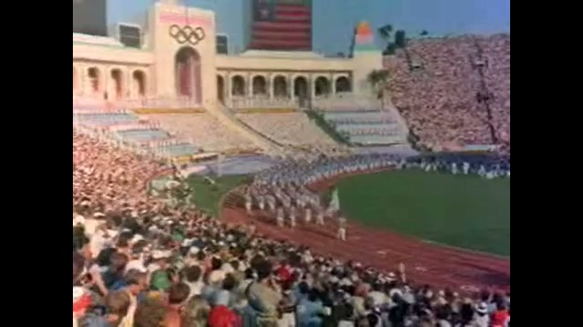
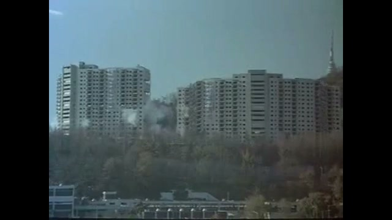

1998년 11월 7일, 2002년 월드컵 축구대회 주경기장이 서울 마포구 상암동 건설 부지에서 첫 삽을 떴다는 소식이 전해졌습니다. 전날 열린 기공식에는 김대중 대통령과 고건 서울시장 등 정관계와 체육계 인사 2000여 명이 참석해 역사적인 착공을 알렸습니다. 4년 앞으로 다가온 세계인의 축제를 치러낼 아시아 최대 전용경기장의 기틀이 마련된 날이었습니다.

## 뚝섬 돔구장에서 상암 전용구장까지의 우여곡절

1995년 월드컵 유치 신청 당시 대한민국은 국제축구연맹(FIFA)에 축구전용경기장 건설을 약속했습니다. 그러나 서울특별시는 막대한 재원을 정부가 상당 부분 부담해야 한다는 입장이었고, 잠실올림픽주경기장 개보수와 뚝섬 돔구장 건립을 추진했습니다. 서울시는 뚝섬 부지 3만 3천여 평을 민간 사업자로 선정된 LG그룹에 매각하기까지 했습니다. 하지만 1996년 6월 한일 공동개최가 확정되고 축구계의 전용구장 신축 요구가 거세지자 갈등이 불거졌고, 결국 뚝섬 돔구장 구상은 백지화되었습니다.

## 마곡과의 경합 끝에 낙점된 100% 시유지 상암

서울시는 전용경기장 건립으로 방향을 틀고 상암지구와 마곡지구, 보라매공원, 동대문공원 등 후보지를 검토했습니다. 1997년 10월 11일, 월드컵 주경기장 부지선정위원회는 상암지구와 마곡지구를 놓고 최종 투표를 진행한 끝에 만장일치로 상암지구를 선정했습니다. 상암동 부지는 100% 시유지로 토지 보상 기간을 대폭 절약할 수 있다는 점이 결정적인 장점이었습니다. 당시 경기장 건설비용은 약 2700억 원, 도로 개설 및 확충 등 간접비용은 1,800억 원으로 추산되었습니다.

![[1166호] 남서울 대운동장 기공 남서울 대운동장 착공공(잠실 대운동장) (1977.12.30) 장면 2](../images/2026-11-07-04-2.jpg)
*[1166호] 남서울 대운동장 기공 남서울 대운동장 착공공(잠실 대운동장) (1977.12.30) 장면 2 — 사진: KTV 국민방송 e영상역사관 (대한뉴스) / KTV 공공저작물 — 영상 저작물 전면 개방(대통령실 2025-07-09), 출처 표시*

## 외환위기의 거센 찬바람을 뚫고 확정된 신축

부지 선정 직후 한국 경제를 강타한 IMF 외환위기는 거대한 장벽이었습니다. 극심한 경제 불황 속에서 전용구장 신축을 백지화하고 기존의 잠실올림픽경기장이나 인천 문학경기장을 활용해야 한다는 주장이 강하게 제기되었습니다. 그러나 정부는 기존 구장의 안전성 문제와 간접시설 추가비용 등을 종합적으로 검토했습니다. 면밀한 분석 끝에 신축이 오히려 더 유리하다는 결론을 내렸고, 1998년 5월 6일 상암구장 신축 방안을 최종적으로 확정했습니다.

*1980년대 우리나라 ... 엄청난 인명, 재산피해 발생 (1998.00.00) 장면 1 — 사진: KTV 국민방송 e영상역사관 (문화영화) / KTV 공공저작물 — 영상 저작물 전면 개방(대통령실 2025-07-09), 출처 표시*

## 2000여 명이 지켜본 희망의 발파 스위치

실제 착공이 이뤄진 1998년 10월 20일에 이어, 11월 6일 오후 상암동 부지에서 성대한 기공식이 거행되었습니다. 김대중 대통령과 고건 서울시장을 비롯한 정관계와 체육계 인사 등 2000여 명이 현장에 모여 착공을 축하했습니다. 단상에 선 주요 인사들이 함께 발파 스위치를 누르자 힘찬 폭음과 함께 흙먼지가 피어올랐고, 참석자들은 뜨거운 박수를 보냈습니다. 시공을 맡은 삼성엔지니어링과 함께 3년여에 걸친 대공사가 본격적으로 닻을 올렸습니다.

*1990년대 우리나라 ... 개국 (1998.00.00) 장면 1 — 사진: KTV 국민방송 e영상역사관 (문화영화) / KTV 공공저작물 — 영상 저작물 전면 개방(대통령실 2025-07-09), 출처 표시*

## 2대 0의 완승으로 문을 연 아시아 최대 축구장

3년여의 공사를 거쳐 완공된 서울월드컵경기장은 2001년 11월 10일 크로아티아와의 국가대표 친선 경기로 문을 열었습니다. 이날 대한민국 축구 국가대표팀은 후반 19분 최태욱과 후반 21분 김남일의 연속골에 힘입어 2대 0 완승을 거두며 개장을 자축했습니다. 기존 66,806석 규모를 갖춘 경기장은 귀빈석 816석, 보도석 754석, 스카이박스 75실 등을 구비한 아시아 최대의 축구 전용 경기 시설로 위용을 드러냈습니다.

## 2002년 월드컵 개막전부터 4강 신화까지

서울월드컵경기장은 2002년 한일 월드컵의 화려한 개회식과 개막전이 열린 역사적인 장소였습니다. 그리고 그해 6월, 온 국민을 붉은 열기에 휩싸이게 했던 대한민국 대표팀의 독일전 4강 경기가 펼쳐진 격전지이기도 했습니다. 2004년부터는 K리그 FC 서울의 홈구장으로 사용되며 많은 명승부를 낳았고, 2012년에는 누적 관람객 1,000만 명을 돌파했습니다. 행정구역상 성산동 515번지이지만 상암구장이라는 친숙한 별칭으로 불리며, 지금도 서울 지하철 6호선 월드컵경기장역과 월드컵공원을 끼고 대한민국 축구의 중심지로 시민들과 함께하고 있습니다.

### 참고 자료

- <https://newslibrary.naver.com/viewer/index.naver?articleId=1998110700209101002&editNo=45&printCount=1&publishDate=1998-11-07&officeId=00020&pageNo=1&printNo=24033&publishType=00010>
- <https://www.ehistory.go.kr/view/movie?mediasrcgbn=KV&mediaid=10137&mediadtl=20766&mediagbn=DH#t=0.3>
- <https://www.ehistory.go.kr/view/movie?mediasrcgbn=KV&mediaid=10137&mediadtl=20766&mediagbn=DH#t=0.7>
- <https://www.ehistory.go.kr/view/movie?mediasrcgbn=KV&mediaid=2003&mediadtl=8857&mediagbn=MH#t=0.3>
- <https://www.ehistory.go.kr/view/movie?mediasrcgbn=KV&mediaid=2003&mediadtl=8858&mediagbn=MH#t=0.3>
