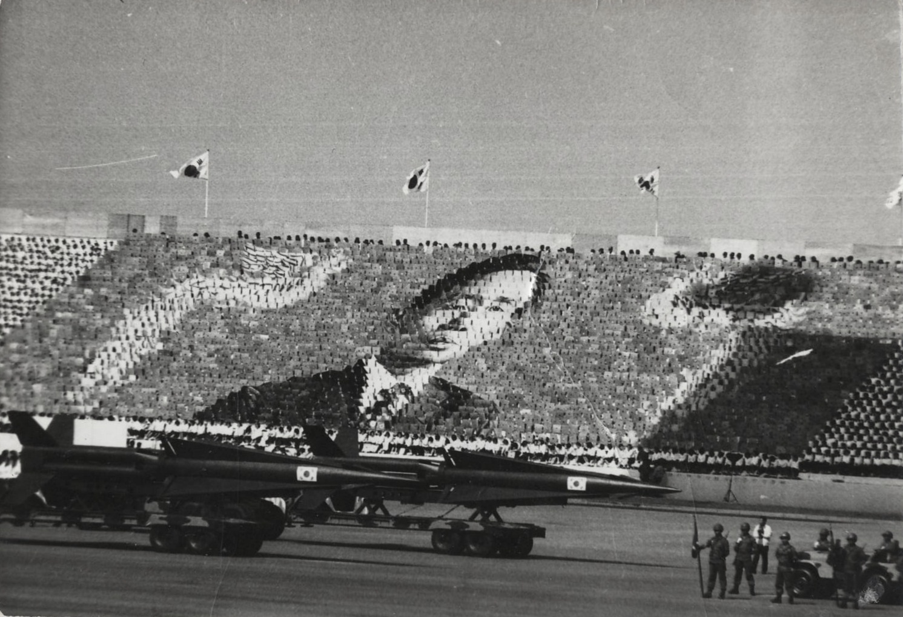
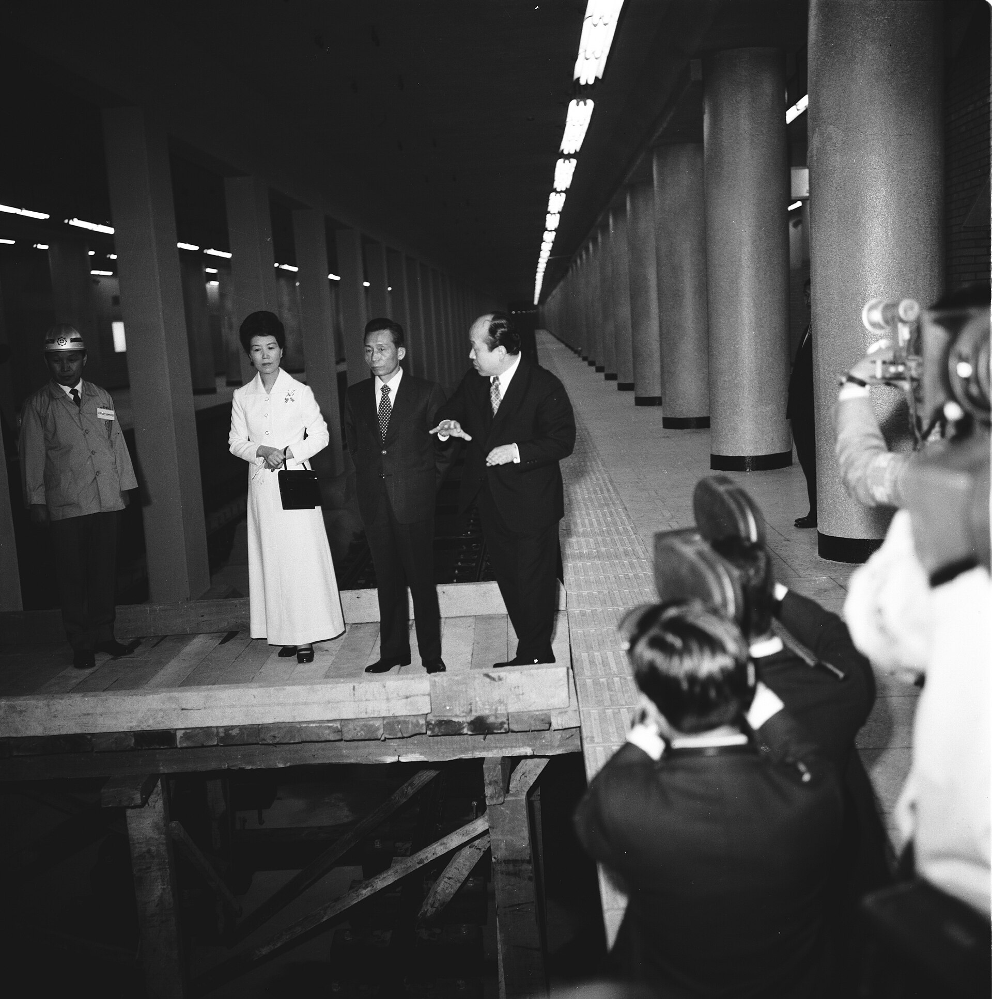
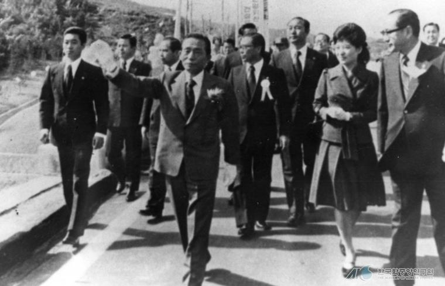

53년 전 오늘, 1973년 11월 7일. 정부가 오늘날 국민연금의 모태가 된 '국민복지연금법안'과 특별회계법안을 국무회의에서 공식 의결했습니다. 전 국민의 노후와 장해, 사망을 보장한다는 사회보장의 깃발을 내걸었지만, 그 이면에는 경제개발에 필요한 막대한 자금을 국민 저축으로 조달하려는 경제적 목표가 깊게 깔려 있었습니다.

## 경제개발 재원을 향한 구상, 국민복지연금의 탄생

1970년대 초 박정희 정부는 중화학공업 육성과 대규모 경제개발 계획을 추진하고 있었습니다. 하지만 당시 한국의 국민소득은 낮았고 민간 저축률 역시 턱없이 부족해 개발에 필요한 내자 조달이 심각한 과제였습니다. 외채나 차관에만 의존할 수 없었던 정부는 사회보장 제도를 통해 국민의 자금을 강제로 저축시켜 산업 자본으로 동원하는 방안을 구상했습니다. 정부가 법안을 기초하면서 사회보장 제도가 저축과 기업 생산비, 소득 재분배에 큰 영향을 미치므로 경제성장 정책과 맞물려 돌아가야 한다고 강조한 것은 이러한 배경 때문이었습니다.

## 9월 발표 후 쏟아진 반발과 6대 핵심 수정

정부는 1973년 9월 20일 국민복지연금제도 기본요강을 발표했으나 여론의 반응은 싸늘했습니다. 당장 먹고살기 빠듯한 서민들의 월급봉투에서 강제로 돈을 떼어간다는 소식에 노동계와 시민사회의 저항이 거셌고, 사회복지의 근본 취지와 어긋난다는 지적이 쏟아졌습니다. 이에 보건사회부는 14개 건의사항 중 큰 논란이 됐던 6개 핵심 조항을 대폭 수정한 끝에 전문 116조, 부칙 3조로 구성된 최종안을 마련해 11월 7일 국무회의에 상정했습니다.

*Card Stunt for Park Chung-hee — 사진: Baek, Jong-sik / CC BY-SA 2.5*

## 근로자 갹출률 3%로 인하와 세제 혜택 확대

의결된 수정안의 핵심은 근로자의 직접적인 부담을 줄여주는 것이었습니다. 회사가 내는 사용자 부담금은 당초대로 4퍼센트를 유지하되, 근로자가 부담하는 기여금 갹출률은 종전 4퍼센트에서 3퍼센트로 1퍼센트포인트 인하했습니다. 강제 가입 대상도 월보수 7천5백 원 이상에서 1만 5천 원을 초과하는 근로자로 기준을 올려 영세 저소득층의 강제 납부 부담을 덜어주었습니다. 또한 연금 급여에 부과하려던 소득세 50퍼센트 감면 방침을 전면 수정해 급여 전액에 대해 소득세를 100퍼센트 면세하기로 확정했습니다.

*박정희 대통령의 시청 앞 지하철역 공사현장 시찰 (1973.04.13) — 사진: 서울역사박물관 / KOGL Type 1*

## 여성 반환일시금 신설과 수급 자격 완화

여성과 유족에 대한 수급 조건도 현실에 맞게 조정되었습니다. 당초 안에서는 연금을 중도에 그만둔 여성의 경우 55세가 되어야만 원리금을 돌려받을 수 있었으나, 수정안에서는 나이와 상관없이 퇴직 후 1년이 지나면 본인 희망에 따라 원리금을 반환일시금으로 찾을 수 있게 바꿨습니다. 장해연금과 유족연금을 받을 수 있는 최소 불입 기간도 3년에서 1년으로 대폭 완화했고, 유족연금 가운데 유자녀와 폐질자에게 지급하는 기본연금액 비율을 30퍼센트에서 50퍼센트로 올렸습니다. 표준보수월액은 하한선 7천 원부터 상한선 20만 원까지 총 35등급으로 나누어 체계화했습니다.

*사건 당시 사진 아님 — 사진: 한국학중앙연구원 / KOGL Type 1 attribution*

## 석유 파동의 직격탄과 무기한 연기된 시행

정부는 법안이 국회를 통과하면 1974년 1월 1일부터 즉시 시행할 계획이었습니다. 30인 이상 사업장의 18세 이상 60세 미만 근로자를 시작으로 점차 범위를 넓혀간다는 청사진이었습니다. 그러나 복지연금의 출범은 뜻밖의 국제정세 급변으로 가로막혔습니다. 1973년 말 발발한 제4차 중동전쟁으로 전 세계를 덮친 1차 석유 파동이 한국 경제에 치명적인 타격을 입힌 것입니다. 물가가 폭등하고 기업과 가계가 극심한 위기에 직면하자 정부는 긴급조치를 통해 연금 시행을 미루었고, 결국 1975년 12월 시행령으로 시행일을 정할 때까지 제도를 무기한 연기하며 사실상 백지화했습니다.

## 오늘날 사회 안전망 국민연금으로 남은 발자취

비록 1973년의 국민복지연금은 경제 위기 속에서 좌절되었지만, 제도적 뼈대는 완전히 사라지지 않았습니다. 정부는 재형저축 등 다른 저축 장려책으로 경제개발 자금을 조달했고, 멈춰 섰던 연금법은 1986년 '국민연금법'으로 명칭을 바꾸며 전면 개정되었습니다. 경제 성장을 뒷받침하기 위한 강제 저축의 성격으로 첫발을 뗐던 국민복지연금법안은 우여곡절을 거치며 오늘날 전 국민의 노후를 책임지는 든든한 사회 안전망으로 발전해 왔습니다.

### 참고 자료

- <https://newslibrary.naver.com/viewer/index.naver?articleId=1973110700329201003&editNo=2&printCount=1&publishDate=1973-11-07&officeId=00032&pageNo=1&printNo=8651&publishType=00020>
- <https://commons.wikimedia.org/wiki/File:Armed_Forces_Day_of_South_Korea_(1973)_1.jpg>
- <https://commons.wikimedia.org/wiki/File:Card_Stunt_for_Park_Chung-hee.jpg>
- <https://commons.wikimedia.org/wiki/File:%EB%B0%95%EC%A0%95%ED%9D%AC_%EB%8C%80%ED%86%B5%EB%A0%B9%EC%9D%98_%EC%8B%9C%EC%B2%AD_%EC%95%9E_%EC%A7%80%ED%95%98%EC%B2%A0%EC%97%AD_%EA%B3%B5%EC%82%AC%ED%98%84%EC%9E%A5_%EC%8B%9C%EC%B0%B0_(1973.04.13).jpg>
- <https://www.kogl.or.kr/recommend/recommendDivView.do?division=img&recommendIdx=75035>
