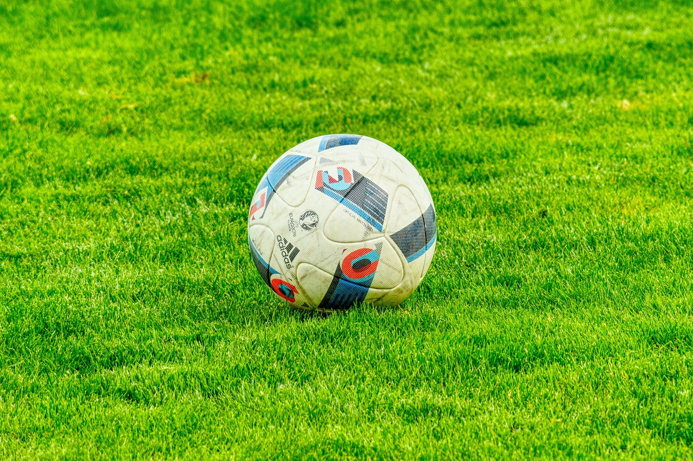
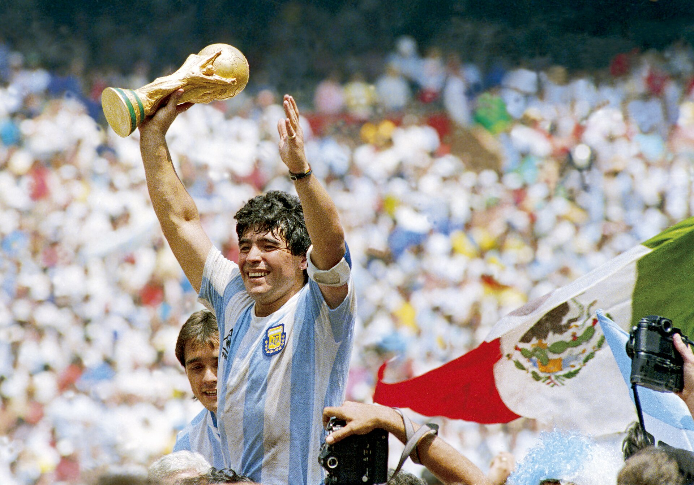
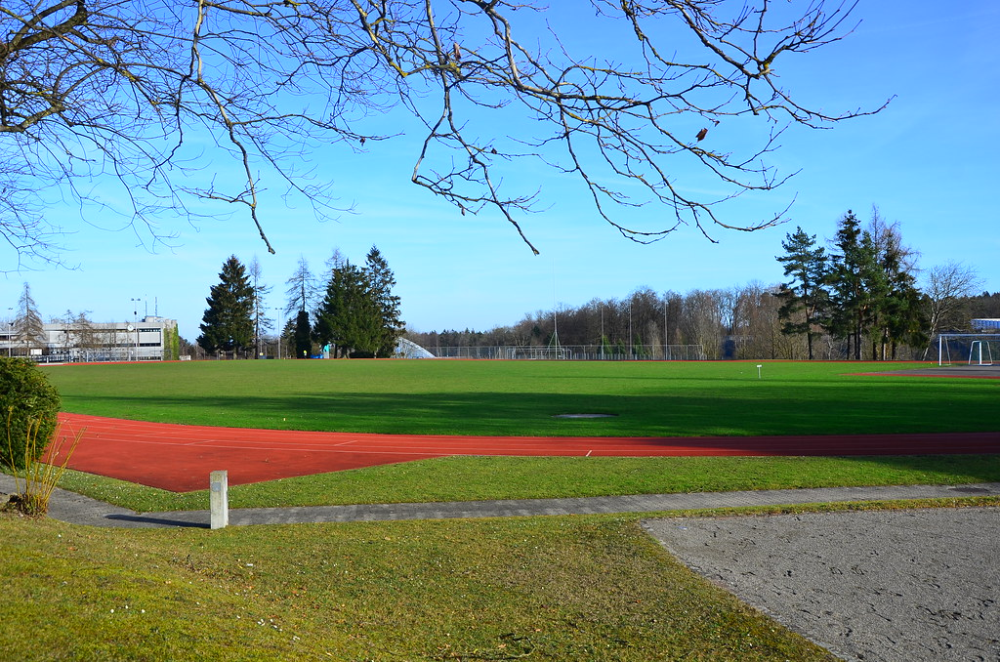

30년 전 오늘, 1996년 11월 8일 조간신문 1면은 온통 축구 소식으로 뒤덮였습니다. 스위스 취리히에서 날아온 낭보였습니다. 2002년 월드컵 축구 대회의 개막전은 한국에서, 결승전은 일본에서 열리기로 최종 합의됐다는 소식이었습니다.

## 사상 초유의 공동 개최, 배분을 둘러싼 신경전

1996년 5월 31일, 국제축구연맹(FIFA)은 2002년 월드컵 개최지로 한국과 일본을 동시에 선정했습니다. 월드컵 역사상 처음으로 성사된 복수 국가 공동 개최였습니다. 하지만 공동 개최가 결정된 뒤에도 풀어야 할 과제는 산더미였습니다. 대회의 시작을 알리는 개막전과 최고의 영예가 걸린 결승전을 어느 나라가 치를 것인가, 그리고 공식 대회 명칭에서 어느 나라 이름을 먼저 표기할 것인가를 두고 두 나라 사이의 보이지 않는 신경전이 팽팽했습니다.

## 취리히 피파 본부에서 열린 첫 실무위원회

합의의 물꼬를 튼 것은 1996년 11월 7일 새벽(한국 시간), 스위스 취리히 피파 본부에서 열린 2002년 월드컵 첫 실무위원회였습니다. 회의장에는 렌나르트 요한손 피파 부회장, 안토니오 마타레세 집행위원, 조셉 블라터 사무총장 등 피파 측 위원 5명이 참석했습니다. 여기에 정몽준 대한축구협회 회장을 비롯한 한국 대표단 5명과 나가누마 겐 일본축구협회 회장 등 일본 대표단 5명이 마주 앉아 마라톤협상을 벌였습니다.

*사건 당시 사진 아님 · 이미지 사진 — 사진: derJani / Pixabay Content License*

## 개막전은 한국, 결승전은 일본… 균등 배분의 원칙

피파 실무위원회는 양국에 대한 '균등 배분 원칙'을 제시했습니다. 한국이 개막전과 3·4위전을 치르고, 일본이 결승전을 치르는 절충안이었습니다. 준결승전은 두 나라가 1경기씩 나눠 맡기로 했습니다. 양국 대표단이 이 권고안을 수용하면서 가장 민감했던 경기 배분 문제가 매듭지어졌습니다. 본선 32개국 64개 경기 체제에서 두 나라는 각각 절반씩 경기를 나눠 치르게 됐으며, 개최국 자격으로 예선 없이 본선에 자동 진출하는 권리도 함께 확인받았습니다.

*Diego Maradona holding the FIFA World Cup trophy after beating West Germany in the final — 사진: Unknown authorUnknown author / Public domain*

## 공식 명칭 'KOREA-JAPAN' 확정과 주요 행사 유치

대회 공식 명칭 표기를 둘러싼 공방도 뜨거웠습니다. 당초 피파 측은 일본을 앞세운 '2002년 FIFA 월드컵 JAPAN-KOREA'를 제안했으나, 한국 대표단이 이에 강력히 반발했습니다. 치열한 논의 끝에 일본 측이 한국의 입장을 수용하면서, 공식 명칭은 한국이 앞선 '2002년 FIFA 월드컵 KOREA-JAPAN'으로 확정됐습니다. 또한 전 세계의 시선이 집중되는 본선 조 추첨식과 차기 피파 회장을 선출하는 피파 총회는 한국에서 열고, 대륙별 예선 조 추첨식과 국제방송센터(IBC) 기술조정센터는 일본에 두기로 합의했습니다.

*View over the grounds of the Fifa headquarters in Zurich — 사진: Ben Sutherland / CC BY 2.0*

## 12월 바르셀로나 집행위원회 최종 인준으로

취리히 실무위원회에서 도출된 이 합의안은 한 달 뒤인 1996년 12월 7일 스페인 바르셀로나에서 열리는 피파 집행위원회의 인준을 거쳐 최종 확정되는 절차를 밟았습니다. 두 나라는 별도의 조직위원회를 두고 대회를 준비해 나가기로 했습니다. 비록 결승전을 일본에 내주었지만, 개막전과 본선 조 추첨, 그리고 국명이 먼저 들어간 공식 명칭을 확보하며 한국 축구 외교는 큰 실리를 챙겼다는 평가를 받았습니다.

## 그날의 합의가 열어젖힌 2002년의 붉은 함성

이날의 실무 합의는 6년 뒤 한반도를 붉게 물들인 축제의 밑거름이 됐습니다. 2002년 5월 31일 서울월드컵경기장에서 화려한 개막식과 함께 막을 올린 대회에서, 대한민국 대표팀은 포르투갈, 이탈리아, 스페인을 차례로 꺾으며 아시아 최초 4강이라는 기적을 일궈냈습니다. 안방에서 개막전을 치르고 '코리아'의 이름을 당당히 앞세웠던 1996년 11월의 결단이 있었기에 가능한 역사였습니다.

### 참고 자료

- <https://newslibrary.naver.com/viewer/index.naver?articleId=1996110800209101002&editNo=45&printCount=1&publishDate=1996-11-08&officeId=00020&pageNo=1&printNo=23361&publishType=00010>
- <https://commons.wikimedia.org/wiki/File:Seoul_Olympic_Stadium_in_1994.jpg>
- <https://pixabay.com/photos/football-grass-ball-green-grass-2778583/>
- <https://commons.wikimedia.org/wiki/File:Diego_Maradona_holding_the_FIFA_World_Cup_trophy_after_beating_West_Germany_in_the_final.jpg>
- <https://www.flickr.com/photos/60179301@N00/23907405191>
