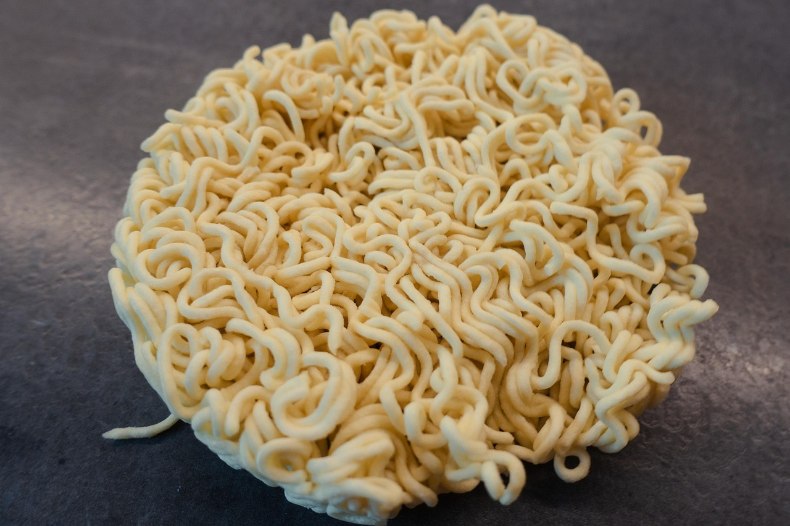
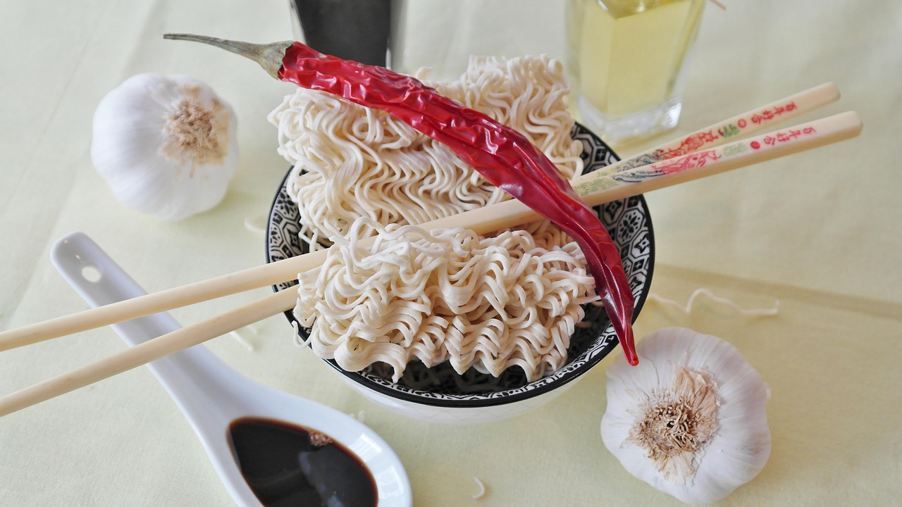
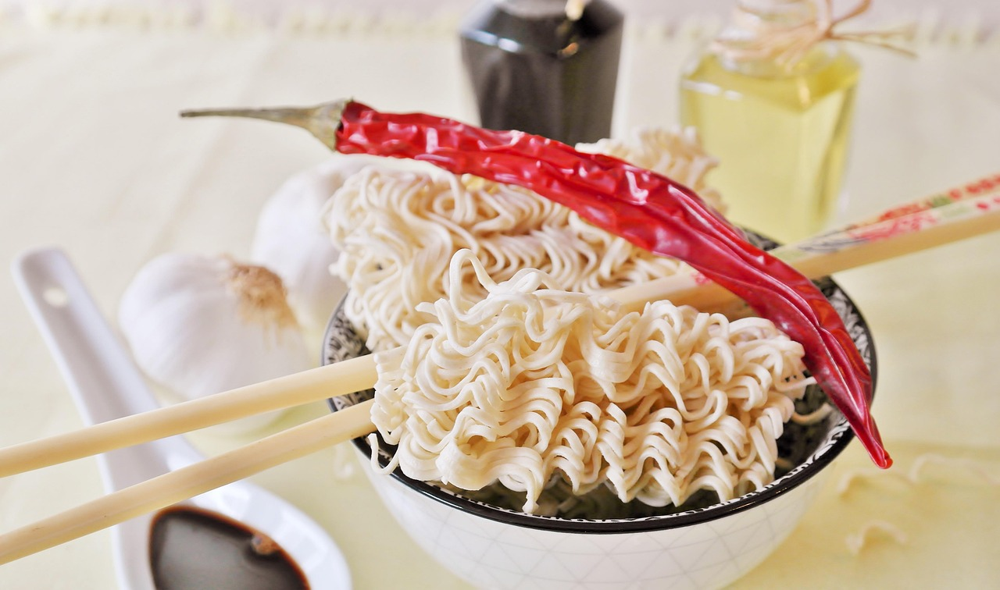

37년 전 오늘, 1989년 11월 8일. 온 국민의 먹거리 안전을 뒤흔든 '우지 파동'에 대해 정부가 전격적인 종합 대책을 내놓았습니다. 정부는 시중에 유통되고 있는 라면과 마가린 등 관련 가공식품을 전량 수거해 국립보건원에서 정밀 검사를 진행하고, 열흘 안에 인체 유해 여부를 발표하겠다고 선언했습니다.

## 식탁을 덮친 배신감, 공업용 우지 파동

1989년 11월 초, 검찰이 삼양식품공업 등 5개 식품업체가 미국산 비식용 쇠기름을 수입해 라면 등을 제조해왔다고 발표하면서 한국 사회는 거대한 충격에 휩싸였습니다. 당시 라면 한 봉지의 가격은 100원으로, 남녀노소 누구나 즐겨 찾는 대표적인 서민 음식이었습니다.

매일같이 끓여 먹던 국민 음식에 공업용 기름이 사용되었다는 보도가 이어지자 소비자들의 분노와 불안은 극에 달했습니다. 전국의 상점과 슈퍼마켓에서는 라면 반품 소동이 벌어졌고 식품 안전에 대한 불신은 걷잡을 수 없이 확산되었습니다.

## 국무총리 주재 긴급회의, 비식용 원료 위법 결론

사태가 걷잡을 수 없이 커지자 1989년 11월 8일 오전, 강영훈 국무총리 주재로 긴급 관계장관회의가 열렸습니다. 이 자리에는 허형구 법무부 장관과 김종인 보건사회부 장관, 최병렬 문화공보부 장관 등이 참석했습니다.

정부는 국내 일부 식품회사들이 미국에서 식용으로 분류되지 않은 원료를 들여와 가공식품을 만들어 유통한 행위는 명백한 식품위생법 위반이라고 결론을 내렸습니다. 김종인 보사부 장관은 해당 업체들이 식품공전의 일반 원료 기준과 우지 원료 기준을 모두 어겼다고 공식 보고했습니다.

*사건 당시 사진 아님 · 이미지 사진 — 사진: viarami / Pixabay Content License*

## 산가 0.4 검출과 미국 하인즈사의 이의 제기

회의 직후 최병렬 문공부 장관은 브리핑을 통해 국립보건연구원의 이전 검사에서는 유해 성분이 검출되지 않았으나, 검찰이 의뢰해 라면을 튀긴 기름을 검사한 결과 기름의 산화 정도를 나타내는 산가가 기준치 0.3을 초과한 0.4로 나타났다고 밝혔습니다.

한편 문제의 쇠기름을 공급한 미국의 하인즈사는 워싱턴 한국대사관 측에 공식적으로 문제를 제기했습니다. 하인즈사는 해당 기름이 식용과 비식용을 가르는 문제가 아니라, 미국 내 품질 분류상 2등급인 '톱 화이트(Top White)' 등급에 해당할 뿐이라며 억울함을 호소했습니다. 이에 정부는 하인즈사의 주장에 대해서도 면밀한 확인 절차를 거치기로 했습니다.

*사건 당시 사진 아님 · 이미지 사진 — 사진: RitaE / Pixabay Content License*

## 노태우 대통령의 특별 지시와 검찰의 엄정 수사

사안의 중대성을 감안해 노태우 대통령도 이날 내각과 사정 당국에 강력한 특별 지시를 내렸습니다. 노 대통령은 강영훈 총리와 조순 부총리, 김종인 보사부 장관, 김기춘 검찰총장 등에게 유해 식품 근절을 위한 즉각적이고 적극적인 대책을 주문했습니다.

노 대통령은 특히 교수와 전문가, 소비자대표가 고루 참여하는 신뢰할 수 있는 조사단을 꾸려 쇠기름의 인체 유해 여부를 객관적이고 조속하게 판정해 국민에게 명명백백히 밝히라고 강조했습니다. 아울러 유해 식품을 만들어 파는 불법 행위에 대해서는 검찰이 철저히 수사해 법에 따라 엄중히 처벌할 것을 당부했습니다.

*사건 당시 사진 아님 · 이미지 사진 — 사진: RitaE / Pixabay Content License*

## 공개 검사와 수입 기준의 대대적 개편

정부는 국민적 의혹을 해소하기 위해 국립보건원이 수행할 수 있는 모든 검사를 공개적으로 진행하기로 방침을 정했습니다. 이 검사에는 공정성을 담보하기 위해 소비자단체와 관련 업계, 검찰 관계자가 모두 입회하도록 했으며, 7일에서 10일 이내에 검사 결과를 국민 앞에 투명하게 공개하겠다고 약속했습니다.

동시에 재발 방지를 위한 제도 개선책도 내놓았습니다. 앞으로는 식용으로 공인된 1등급 원료 외에는 일체의 식품 원료 수입을 금지하고, 모든 식품 완제품 검사에 연구 인력을 총동원해 미국 식품의약국(FDA) 수준에 버금가는 철저한 안전 검사를 시행하기로 결정했습니다.

## 먹거리 불신이 남긴 깊은 상처

1980년대 100원이던 라면은 오랜 세월을 거치며 국민 곁을 지켜왔지만, 1989년 가을 불어닥친 우지 파동은 기업과 정부를 향한 소비자들의 신뢰를 한순간에 무너뜨린 뼈아픈 사건이었습니다.

공개 검사와 과학적 규명에 나섰던 1989년 11월 8일의 긴급 대책은 단순한 물가와 기호식품의 문제를 넘어, 국민의 생명과 직결된 먹거리 기준을 얼마나 엄격하게 세워야 하는지를 온 사회에 일깨워준 결정적 하루였습니다.

### 참고 자료

- <https://newslibrary.naver.com/viewer/index.naver?articleId=1989110800209201003&editNo=2&printCount=1&publishDate=1989-11-08&officeId=00020&pageNo=1&printNo=20955&publishType=00020>
- <https://pixabay.com/photos/food-ramen-noodles-cooking-japan-1216048/>
- <https://pixabay.com/photos/ramen-noodles-instant-noodles-cook-6806423/>
- <https://pixabay.com/photos/noodles-instant-noodles-instant-3201642/>
- <https://pixabay.com/photos/noodles-instant-noodles-instant-3201672/>
