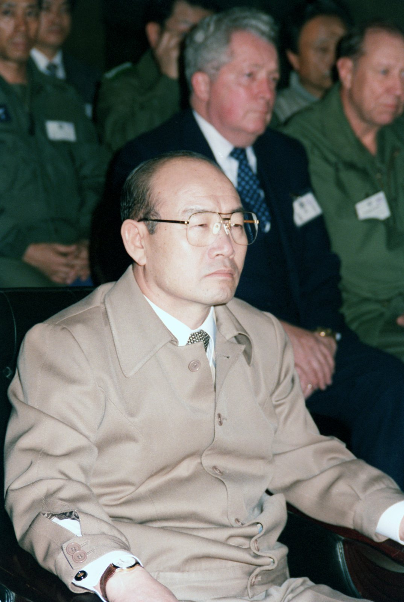
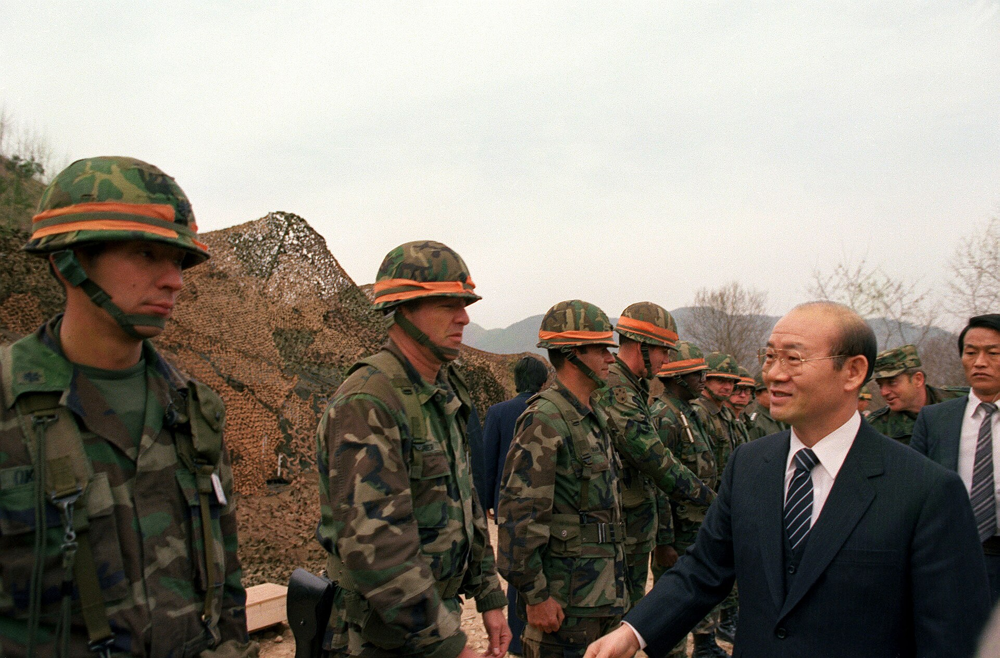
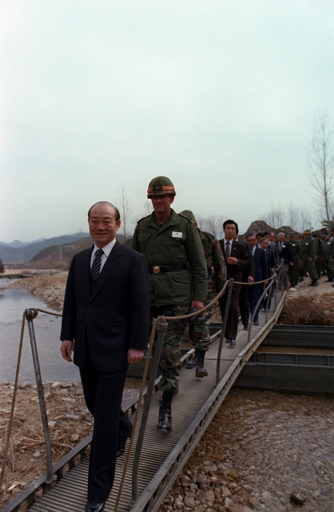

38년 전 오늘, 1988년 11월 8일. 국회 제5공화국 비리조사특별위원회 청문회장에서 제5공화국 최대 비리 의혹으로 꼽히던 일해재단 기금 모금의 강제성이 증인의 입을 통해 처음으로 인정되었습니다. 텔레비전 수상기 앞에 둘러앉은 온 국민은 청문회 생중계를 지켜보며 권력의 서슬 아래 감춰졌던 정경유착의 민낯을 마주했습니다.

## 추모 사업에서 거대 연구소로 탈바꿈한 일해재단

1983년 11월, 일해재단은 미얀마(당시 버마) 아웅산 묘소 폭파 테러로 순국한 외교 사절과 수행원 유가족을 돕는다는 명분으로 설립되었습니다. 당시 유가족을 위해 모금된 돈은 23억 원이었습니다. 그러나 재단은 유가족 지원에 그치지 않고 외교와 안보, 통일 문제를 다루는 거대 연구소로 급격히 방향을 틀었습니다.

대통령의 호인 '일해'를 딴 이 재단은 성남 부지에 대규모 시설을 짓고 기업들로부터 거액의 기금을 거두어들였습니다. 전두환 전 대통령이 퇴임 뒤에도 막후에서 권력을 행사하기 위한 사조직이 아니냐는 의혹이 끊임없이 제기되었고, 마침내 1988년 국회 청문회의 핵심 안건으로 올랐습니다.

## "자발적 기부" 주장했던 장세동의 버티기

청문회 첫날인 11월 7일에는 장세동 전 청와대 경호실장이 증언대에 섰습니다. 장 전 실장은 기금 모금이 기업인들의 자발적인 참여로 이루어졌다고 주장하며 청와대 측의 강요를 전면 부인했습니다. 전경련 회장단 등이 알아서 돈을 걷어 냈을 뿐 자신이나 청와대가 기업에 협조를 요청한 적은 없다는 입장을 고수했습니다.

그러나 장 전 실장은 경호실장 신분으로 재단 설립과 부지 매입을 주도한 점에 대해서는 직접적인 본분을 벗어났다고 시인했습니다. 야당 의원들은 어음까지 받아 가며 기금을 챙긴 정황을 따져 물었고, 강제성이 없었다는 장 전 실장의 주장은 거센 반발에 부딪혔습니다. 이날 신문은 자정 직전까지 이어졌습니다.

*사건 당시 사진 아님 · 1985년 — 사진: AL CHANG / Public domain*

## 안현태 전 실장의 입에서 나온 "거절하기 어려웠을 것"

다음 날인 11월 8일, 특위는 안현태 전 경호실장을 비롯해 최순달 초대 이사장, 양정모 전 국제그룹 회장, 이준용 대림산업 부회장 등 4명의 증인을 출석시켰습니다. 이날 첫 증인으로 나선 안현태 전 실장의 입에서 장세동 전 실장의 진술을 뒤엎는 결정적인 증언이 나왔습니다.

안 전 실장은 대통령이 사업가에게 재단 설립을 이유로 돈을 내라고 하면 당시에는 거절하기 어려웠을 것이라고 말했습니다. 사실상 청와대의 서슬 퍼런 권력 앞에서 기업들이 강압적인 분위기 속에 돈을 내놓을 수밖에 없었음을 인정한 셈이었습니다. 또한 전두환 전 대통령이 연구 과제와 사항을 지시하고 3차 모금 증액을 구체적으로 지시하는 등 재단 운영에 직접 개입했음을 털어놓았습니다.

*사건 당시 사진 아님 · 1983년 — 사진: AL CHANG / Public domain*

## 제2영빈관과 경호원 40여 명, 드러난 퇴임 후 구상

청문회에서는 일해재단이 단순한 공익 연구기관이 아니었음을 보여주는 구체적인 정황도 폭로되었습니다. 안현태 전 실장은 재단 내에 지어진 제2영빈관이 여러 사람을 위한 시설이라기보다 특정인의 전용 시설물로 오해받을 소지가 있다고 인정했습니다. 전 전 대통령이 퇴임 뒤 이곳을 사무실 등으로 이용하려 했다는 의혹을 사실상 시인한 것입니다.

재단 경비를 위해 청와대 경호실 출신 경호원 40여 명을 고용하고 군견 2마리까지 도입했던 사실도 확인되었습니다. 게다가 전 전 대통령으로부터 풍산금속과 고려합섬이 낸 익명 기부금 15억 원을 전달받아 재단에 넘겼다는 사실까지 밝혀지며, 재단의 관리와 운영이 청와대의 주도로 이루어졌음이 명백해졌습니다.

*사건 당시 사진 아님 · 1983년 — 사진: AL CHANG / Public domain*

## 텔레비전 생중계로 확인한 권력의 민낯

1988년 11월의 청문회는 대한민국 헌정사상 처음으로 전국에 텔레비전으로 생중계되었습니다. 국민들은 안방에서 증인들의 일거수일투족과 야당 의원들의 송곳 같은 질문을 지켜보며 숨을 죽였습니다. 권력의 눈치를 보며 거액을 내놓고 그 대가로 이권을 챙기거나, 반대로 정권의 눈 밖에 나 그룹이 해체되는 비극을 겪어야 했던 정경유착의 비리가 백일하에 드러났습니다.

일해재단은 결국 국민적 공분 속에 명칭을 세종연구소로 바꾸고 개편 절차를 밟게 되었습니다. 청문회 스타들의 등장과 함께 군사정권의 어두운 유산이 하나둘 청산되던 그 격동의 나날은 지금도 많은 이들의 기억 속에 생생하게 남아 있습니다.

### 참고 자료

- <https://newslibrary.naver.com/viewer/index.naver?articleId=1988110800329201003&editNo=3&printCount=1&publishDate=1988-11-08&officeId=00032&pageNo=1&printNo=13269&publishType=00020>
- <https://commons.wikimedia.org/wiki/File:Chun_Doo-hwan_and_Claude_M._Kicklighter,_Chung_ho-yong,_1985-Mar-22.jpg>
- <https://commons.wikimedia.org/wiki/File:Chun_Doo-hwan,_1985-Mar-22.jpg>
- <https://commons.wikimedia.org/wiki/File:Chun_Doo-hwan,_1983-March-11.jpg>
- <https://commons.wikimedia.org/wiki/File:Chun_Doo-hwan_1983-March-11-01.JPEG>
