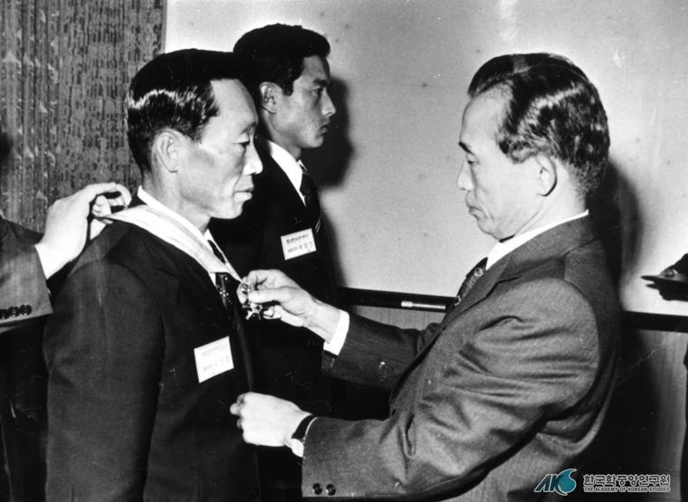
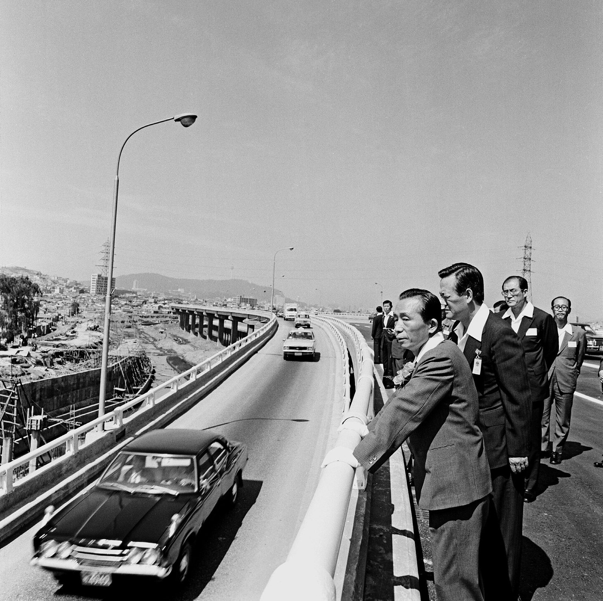
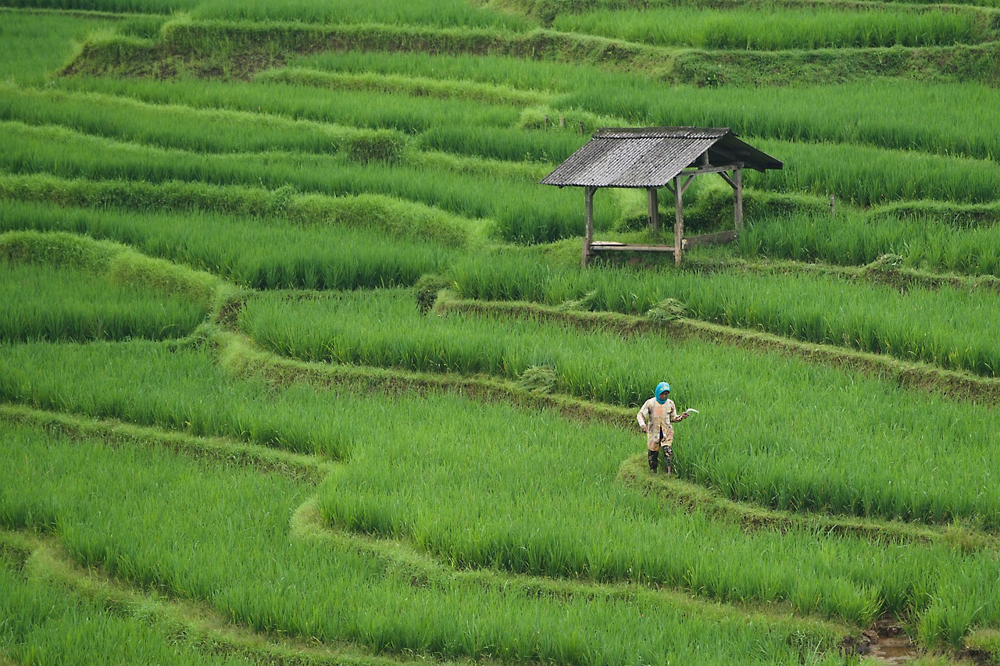

49년 전 오늘, 1977년 11월 8일. 정부가 14년 만에 쌀로 빚은 막걸리 생산을 다시 허용하기로 결정했습니다. 극심한 식량난으로 쌀로 술을 빚지 못하게 했던 오랜 금기가 풀리며, 전국의 애주가와 서민들이 크게 환호했습니다.

## 식량 부족으로 멈췄던 전통의 맛

막걸리는 삼국 시대 이전부터 한반도 농경 문화와 함께해 온 가장 오래된 전통술입니다. 하지만 해방 이후 계속된 식량난 속에서 쌀은 밥으로 지어 먹기에도 턱없이 부족했습니다. 정부는 1963년 양곡 소비를 줄이기 위해 찹쌀과 멥쌀로 술을 빚는 행위를 전면 금지했습니다. 농민과 노동자의 땀을 씻어 주던 쌀 막걸리가 양조장에서 자취를 감추게 된 배경이었습니다.

## 밀가루 80%와 옥수수 20%의 시절

쌀 사용이 금지된 뒤 양조장에서는 밀가루 80%에 옥수수 20%를 섞어 막걸리를 빚었습니다. 쌀로 빚은 술에 비해 텁텁하고 특유의 신맛이 강했지만, 서민들은 새참 시간이나 퇴근길 주막에서 이 밀가루 막걸리로 목을 축였습니다. 품질보다는 대량생산 위주로 돌아가며 전통 막걸리의 깊은 풍미는 점차 희미해져 갔지만, 여전히 서민의 가장 가까운 친구였습니다.

*사건 당시 사진 아님 — 사진: 한국학중앙연구원 / KOGL Type 1 attribution*

## 1977년 11월 7일 경제장관회의의 결단

상황이 바뀐 것은 1970년대 후반이었습니다. 농업 기술의 발전으로 쌀 수확량이 크게 늘어나면서 쌀이 남자, 정부는 쌀 소비를 촉진하고 외화를 들여 수입하던 밀가루 도입을 줄이기 위한 대책을 마련했습니다. 1977년 11월 7일 열린 경제장관회의에서 막걸리 원료로 쌀을 사용할 수 있도록 주세법 시행령 개정안이 의결되었습니다. 국세청은 곧바로 준비 작업에 들어가 이듬해인 1978년 1월부터 전국에 공급하겠다는 방침을 세웠습니다.

*사건 당시 사진 아님 · 1976년 — 사진: 대한민국 정부 / Public domain*

## 기존 밀가루 막걸리의 중단과 주류 시장의 긴장

정부 방침에 따라 새해부터 쌀 막걸리가 나오면 기존의 밀가루와 옥수수 막걸리는 생산이 전면 중단되기로 했습니다. 알코올 도수는 기존과 같은 6도를 유지하기로 했습니다. 이 소식이 전해지자 전주주조공사를 비롯한 전국 각지 양조장에는 출시 시기와 방식을 묻는 소비자들의 문의 전화가 빗발쳤습니다. 반면 소주 제조업계는 높은 세율의 소주 판매가 쌀 막걸리의 인기에 밀려 큰 타격을 입을까 긴장하기도 했습니다.

*사건 당시 사진 아님 · 이미지 사진 — 사진: ignartonosbg / Pixabay Content License*

## 고단한 시대를 위로하고 국가무형문화재가 되기까지

14년 만에 부활한 쌀 막걸리는 땀 흘려 일하던 서민들의 밥상과 주막을 다시 채우며 전통의 맥을 이었습니다. 이후 막걸리는 시대의 변화를 거치며 과일이나 다양한 재료와 어우러지는 현대적 변신을 거듭했고, 2021년에는 '막걸리 빚기'가 국가무형문화재로 지정되기에 이르렀습니다. 고된 일상 속에서 막걸리 한 사발을 나누며 희망을 찾던 그 시절의 정취는 오늘날에도 우리 가슴속에 깊이 남아 있습니다.

### 참고 자료

- <https://newslibrary.naver.com/viewer/index.naver?articleId=1977110800209201005&editNo=2&printCount=1&publishDate=1977-11-08&officeId=00020&pageNo=1&printNo=17261&publishType=00020>
- <https://www.kogl.or.kr/recommend/recommendDivView.do?division=img&recommendIdx=75035>
- <https://www.kogl.or.kr/recommend/recommendDivView.do?division=img&recommendIdx=72753>
- <https://commons.wikimedia.org/wiki/File:%EB%B0%95%EC%A0%95%ED%9D%AC_%EB%8C%80%ED%86%B5%EB%A0%B9_%EC%B2%9C%ED%98%B8%EB%8C%80%EA%B5%90_%EC%A4%80%EA%B3%B5%EC%8B%9D_%EC%B0%B8%EC%84%9D.jpg>
- <https://pixabay.com/photos/rice-field-paddy-field-agriculture-7890204/>
