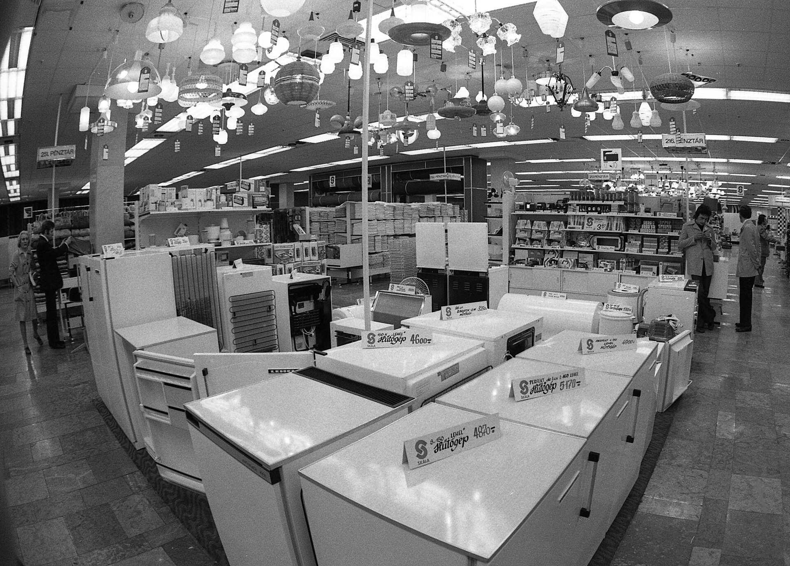
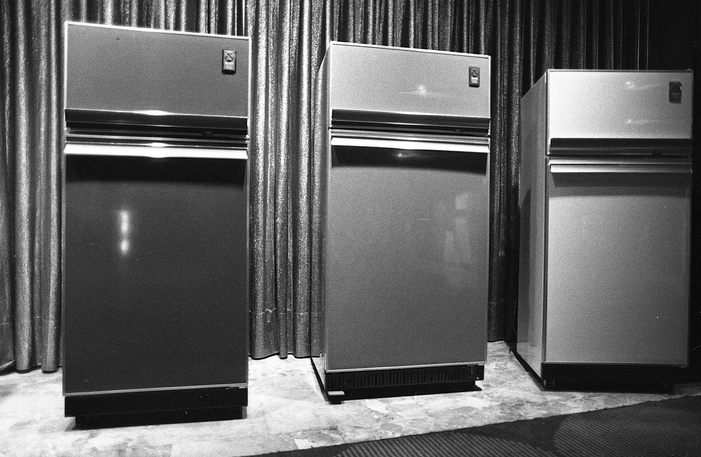
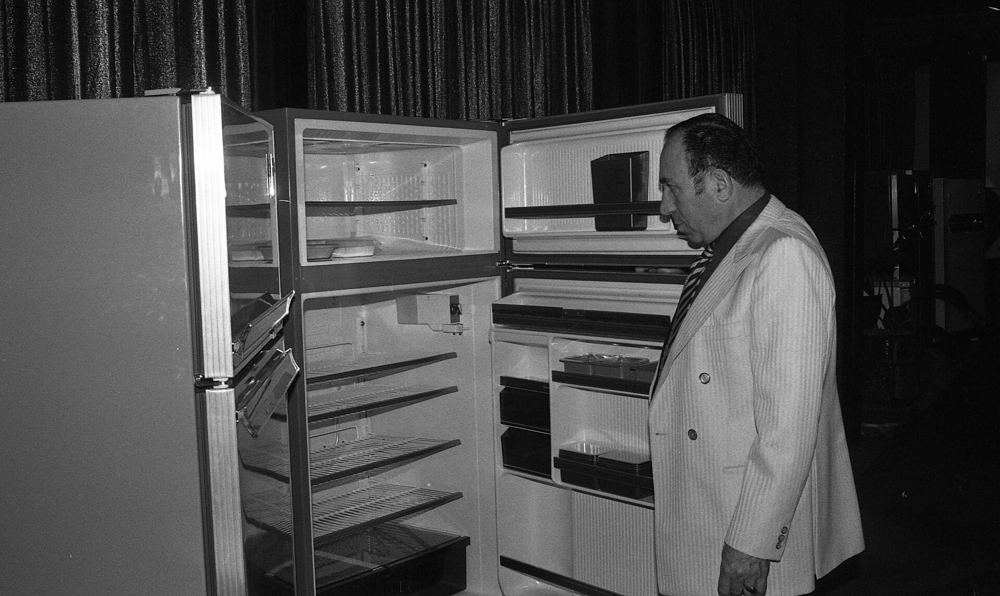

46년 전 오늘, 1980년 11월 8일. 정부가 극심하게 침체된 경기를 되살리기 위해 전격적인 경제활성화 대책을 발표했습니다. 장기 불황과 소비 위축으로 한계에 몰린 산업계를 구하기 위한 비상 처방이었습니다.

## 1980년 11월 8일, 긴급 발표된 경기부양책

1980년 11월 8일 오전, 정부는 경제난국을 타개하기 위해 금융과 재정을 아우르는 전면적인 경제활성화 대책을 확정해 발표했습니다. 이승윤 재무부 장관은 기자회견을 열고 금리 인하와 특별소비세 인하, 기업 자금 지원 확대를 골자로 하는 정책 패키지를 공식화했습니다. 당시 국내 경기는 2년 가까이 이어진 하강 국면 속에 깊은 침체에 빠져 있었습니다.

## 평소 2.5배 치솟은 재고와 벼랑 끝 기업들

당시 산업계가 처한 상황은 매우 심각했습니다. 제품이 팔리지 않아 공장에 쌓인 재고 수준은 평상시 수준인 17퍼센트의 2.5배에 달하는 42퍼센트까지 치솟았습니다. 여기에 추곡 감수로 농촌 소득과 구매력까지 떨어지면서 내수 부진이 장기화될 위험이 컸습니다. 기업들의 자체 지탱 능력은 바닥을 드러냈고, 과거 정상 경기에서 흑자를 내던 건전한 기업들마저 연쇄 도산 위기에 놓였습니다.

*사건 당시 사진 아님 · 1976년 — 사진: FOTO:Fortepan — ID 88697: Adományozó/Donor: Urbán Tamás. arc / CC BY-SA 3.0*

## 금리 전격 인하로 금융 비용 연간 3천억 원 절감

정부는 기업의 금융 부담을 덜어주기 위해 대출금리와 예금금리를 즉각 낮췄습니다. 일반 대출금리는 기존 연 22퍼센트에서 20퍼센트로 2.0퍼센트포인트 인하했고, 1년 만기 정기예금 금리는 연 21.9퍼센트에서 19.5퍼센트로 2.4퍼센트포인트 내렸습니다. 당시 기업들이 안고 있던 국내 금융 비용 부담은 한 해 3조 3천억 원에 달했는데, 이번 금리 인하를 통해 연간 약 3천억 원의 이자 부담을 덜 수 있게 되었습니다.

*사건 당시 사진 아님 · 1980년 — 사진: IPPA photographer / CC BY 4.0*

## 컬러TV·냉장고·승용차 특소세 30% 파격 인하

얼어붙은 소비 심리를 되살리기 위한 세제 혜택도 함께 내놓았습니다. 탄력세율 조항을 활용해 냉장고와 컬러 텔레비전, 전열기구의 특별소비세율을 기존 40퍼센트에서 28퍼센트로 세액 기준 30퍼센트 인하했습니다. 소형 승용차는 15퍼센트에서 10.5퍼센트로, 흑백 텔레비전은 30퍼센트에서 21퍼센트로 각각 내렸습니다. 이 특소세 인하 조치는 6개월 시한부로 적용되어 공장에 쌓인 내구 소비재의 재고를 털어내고 전후방 부품 산업을 살리는 불씨가 되었습니다.

*사건 당시 사진 아님 · 1980년 — 사진: IPPA photographer / CC BY 4.0*

## 도산 위기 건전기업에 1천억 원 긴급 수혈

일시적 자금난에 빠진 유망 기업들을 살리기 위한 금융 지원도 마련되었습니다. 정부는 금융기관 대표자 회의를 거쳐 건전한 기업에 총 1천억 원의 긴급 신규 자금을 은행 여신 한도 외로 지원하기로 했습니다. 기존 대출금 상환을 연기해주고 회사채 지급보증을 우선 지원하는 조치도 포함되었습니다. 또한 토지개발공사가 채권을 발행해 기업의 비업무용 부동산을 사들임으로써 기업들이 은행 빚을 갚을 수 있도록 재무구조 개선을 도왔습니다.

## 위기의 1980년을 버텨낸 경제의 분수령

1980년의 경제활성화 대책은 대외 여건 악화와 정국 불안 속에서 휘청이던 한국 제조업과 금융 시장에 숨통을 틔워준 중요한 전기였습니다. 극단적인 소비 절벽과 자금 경색을 막기 위해 금리와 세금을 동시에 내리고 정책 자금을 투입했던 그 시절의 결단은, 우리 경제가 불황의 깊은 터널을 지나 다시 일어서는 밑거름이 되었습니다.

### 참고 자료

- <https://newslibrary.naver.com/viewer/index.naver?articleId=1980110800329201005&editNo=2&printCount=1&publishDate=1980-11-08&officeId=00032&pageNo=1&printNo=10804&publishType=00020>
- <https://commons.wikimedia.org/wiki/File:%EB%AF%B8%EC%8A%A4%EC%9C%A0%EB%8B%88%EB%B2%84%EC%8A%A4_%EC%8B%9C%EA%B0%80%ED%96%89%EC%A7%84_(1980%EB%85%84_6%EC%9B%9429%EC%9D%BC_%EA%B4%91%ED%99%94%EB%AC%B8).jpg>
- <https://commons.wikimedia.org/wiki/File:Okt%C3%B3ber_huszonharmadika_(Sch%C3%B6nherz_Zolt%C3%A1n)_utca,_Sk%C3%A1la_Budapest_Sz%C3%B6vetkezeti_Nagy%C3%A1ruh%C3%A1z,_a_felv%C3%A9tel_a_megnyit%C3%A1skor_k%C3%A9sz%C3%BClt._Fortepan_88697.jpg>
- <https://commons.wikimedia.org/wiki/File:Shimon_Peres_holding_a_press_conference_(FL62973372).jpg>
- <https://commons.wikimedia.org/wiki/File:Shimon_Peres_holding_a_press_conference_(FL62973559).jpg>
