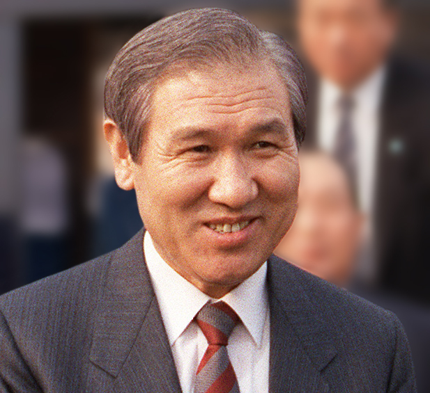

31년 전 오늘, 1995년 11월 8일. 대검찰청 중앙수사부는 노태우 전 대통령 비자금 사건 수사를 위해 대기업 총수 6명을 일제히 소환했습니다. 대한민국 경제를 좌우하던 굴지의 재벌 총수들이 한꺼번에 검찰에 불려 나온 것은 헌정사상 초유의 일이었습니다.

## 사상 초유의 6대 재벌 총수 일제 소환

1995년 11월 7일 대검찰청 중앙수사부(안강민 검사장)는 현대그룹 정주영 명예회장, 삼성그룹 이건희 회장, LG그룹 구자경 명예회장, 대우그룹 김우중 회장, 롯데그룹 신격호 회장, 동아그룹 최원석 회장 등 대기업 총수 6명을 8일 오전 소환해 조사하기로 했다고 공식 발표했습니다.

검찰이 공개적으로 4대 재벌을 포함한 대기업 총수들을 일제히 소환해 조사하는 것은 대한민국 역사상 처음 있는 일이었습니다. 아침 신문 1면마다 총수들의 얼굴과 함께 검찰 출두 소식이 대서특필되었고, 국민들은 충격과 당혹감 속에 뉴스를 지켜보았습니다.

## 노태우 전 대통령 비자금의 꼬리를 밟다

검찰이 이들을 전격 소환한 이유는 제6공화국 당시 노태우 전 대통령에게 건네진 거액의 비자금 때문이었습니다. 검찰은 이들 재벌그룹이 노 전 대통령 재임 시절 수백억 원대의 자금을 건넨 사실을 확인하고, 자금을 제공하게 된 구체적인 경위와 대가성 여부를 집중 추궁할 방침을 세웠습니다.

이날 소환된 기업들은 노 전 대통령에게 수백억 원 이상의 비자금을 건넨 다액 제공 기업군으로 분류되었습니다. 한보와 한양에 이어 주요 재벌 총수들이 줄줄이 수사선상에 오르면서 사건은 걷잡을 수 없이 확대되었습니다.

![[1461호] 대통령 동정 서울시청 순시 (1983.11.05) 장면 1](../images/2026-11-08-06-2.jpg)
*[1461호] 대통령 동정 서울시청 순시 (1983.11.05) 장면 1 — 사진: KTV 국민방송 e영상역사관 (대한뉴스) / KTV 공공저작물 — 영상 저작물 전면 개방(대통령실 2025-07-09), 출처 표시*

## 해외 체류와 출두 거부, 긴박했던 수사선상

소환 통보가 내려졌을 당시 대우 김우중 회장은 폴란드에, 롯데 신격호 회장은 일본에 각각 머물고 있었습니다. 검찰은 각 그룹 측으로부터 연락을 취해 출두하도록 하겠다는 답변을 받고 이들이 귀국하는 대로 즉시 소환하기로 했습니다.

한편 동부그룹 김준기 회장은 검찰의 소환 요구에 응하지 않아 법무부를 통해 출국금지 조치가 내려졌습니다. 미국에 머물고 있던 한일그룹 김중원 회장 측은 부회장이 대신 출두하겠다는 입장을 검찰에 전달했으나, 검찰은 반드시 총수 본인이 출두해야 한다며 이를 거부하고 조속한 귀국을 요구했습니다.

![[1461호] 대통령 동정 서울시청 순시 (1983.11.05) 장면 2](../images/2026-11-08-06-3.jpg)
*[1461호] 대통령 동정 서울시청 순시 (1983.11.05) 장면 2 — 사진: KTV 국민방송 e영상역사관 (대한뉴스) / KTV 공공저작물 — 영상 저작물 전면 개방(대통령실 2025-07-09), 출처 표시*

## 수사팀 보강과 전방위 계좌 추적

검찰은 소환 대상 기업인이 모두 50여 명에 달한다고 밝히며, 매일 5명에서 6명씩 차례로 불러 조사하겠다는 계획을 내놓았습니다. 본격적인 기업인 조사를 위해 검찰은 서울지검 특수3부 김성호 부장검사와 검사 2명을 대검 중수부 수사팀에 추가로 투입했습니다.

앞서 11월 7일에는 진로그룹 장진호 회장이 검찰에 출두해 밤늦게까지 조사를 받았습니다. 또한 1993년 9월 금융실명제 실시 직후 노 전 대통령의 부탁으로 거액의 비자금을 실명 전환하도록 한보그룹 등에 알선한 혐의를 받던 금진호 의원도 소환 조사를 받았습니다.

*Roh Tae-woo - cropped, 1989-Mar-13 (cropped) — 사진: CHERIE A. THURLBY / Public domain*

## 정경유착의 그늘과 우리 사회가 남긴 교훈

권력의 정점에 있던 전직 대통령과 국가 경제를 이끌던 거대 재벌 총수들이 주고받은 검은돈의 실체는 사회 전반에 씻을 수 없는 큰 상처와 충격을 안겼습니다. 기업의 성패가 기술이나 경영 능력이 아닌 권력자와의 검은 유착에 좌우되던 어두운 관행이 낱낱이 드러난 순간이었습니다.

서초동 대검찰청사 앞에 수많은 취재진이 몰려들고 굴지의 총수들이 고개를 숙인 채 들어서던 그날의 모습은 한국 현대사에서 잊을 수 없는 한 장면으로 남았습니다. 투명하고 공정한 경제 질서를 향한 뼈아픈 진통의 출발점이기도 했습니다.

### 참고 자료

- <https://newslibrary.naver.com/viewer/index.naver?articleId=1995110800209101001&editNo=45&printCount=1&publishDate=1995-11-08&officeId=00020&pageNo=1&printNo=23020&publishType=00010>
- <https://commons.wikimedia.org/wiki/File:Roh_Tae-woo_-_cropped,_1990-Mar-13.jpg>
- <https://www.ehistory.go.kr/view/movie?mediasrcgbn=KV&mediaid=10923&mediadtl=23679&mediagbn=DH#t=0.3>
- <https://www.ehistory.go.kr/view/movie?mediasrcgbn=KV&mediaid=10923&mediadtl=23679&mediagbn=DH#t=0.7>
- <https://commons.wikimedia.org/wiki/File:Roh_Tae-woo_-_cropped,_1989-Mar-13_(cropped).jpg>
