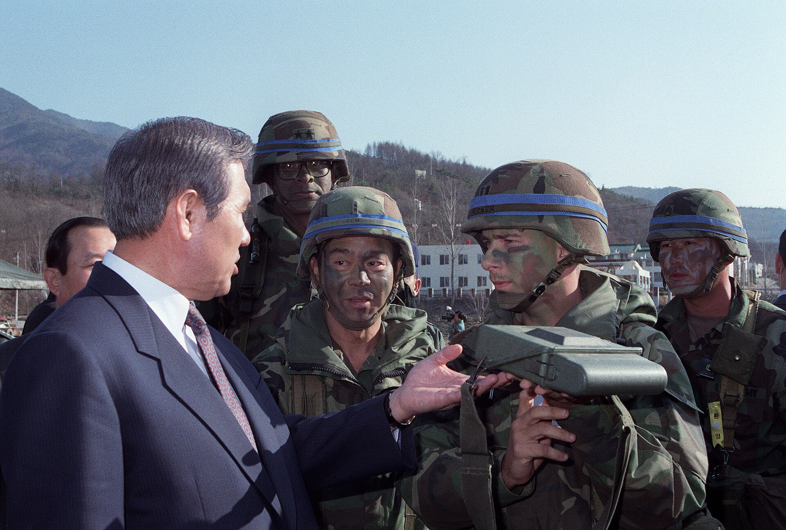
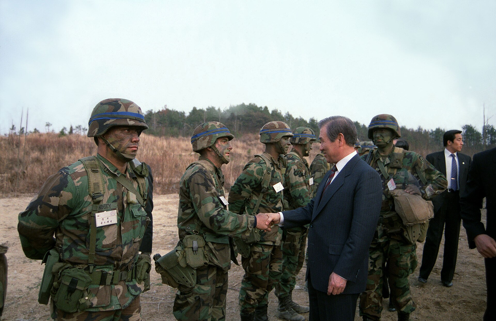
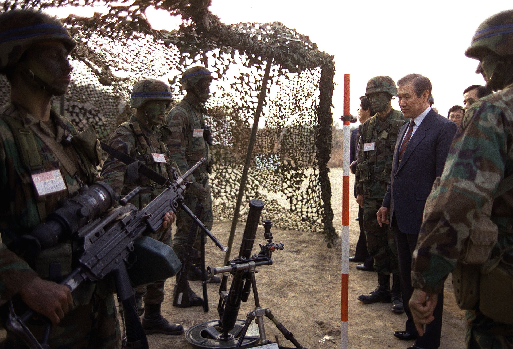

35년 전 오늘, 1991년 11월 9일. 노태우 대통령의 전격적인 선언에 따라 남한 내 핵무기를 전면 철수하고 한반도를 핵 없는 땅으로 만들기 위한 정부 차원의 후속 조치가 일제히 보도됐습니다. 오랜 냉전의 대립 구도 속에서 한반도 평화 정착을 위한 중대한 분기점이 열린 순간이었습니다.

## 베일에 싸여 있던 주한미군 핵무기와 냉전의 그늘

수십 년간 한반도는 동서 냉전의 최전선이었습니다. 주한미군이 핵무기를 배치해 두고 있다는 사실은 공공연한 비밀처럼 여겨졌지만, 미국 정부는 공식적으로 이를 확인해주지도 부인하지도 않는 이른바 ‘시인도 부인도 않는 원칙’(NCND)을 고수해 왔습니다. 남북 대치 상황 속에서 한반도 내 핵무기 문제는 늘 무거운 긴장감과 공포의 대상이었습니다.

그러나 1990년대 초 전 세계적으로 동서 냉전이 해체되는 대격변이 일어났습니다. 미국과 소련의 군축 분위기 속에서 한반도 역시 전쟁의 위협을 걷어내고 항구적인 평화를 모색해야 한다는 시대적 요구에 직면했습니다. 특히 북한의 핵개발 의혹이 점차 수면 위로 떠오르면서, 남북 간의 군비 경쟁을 막을 전격적인 해법이 절실했습니다.

## 청와대 춘추관에서 발표된 ‘비핵 5원칙’

1991년 11월 8일 오전, 노태우 대통령은 청와대 춘추관에서 텔레비전과 라디오 생중계를 통해 ‘한반도의 비핵화와 평화구축을 위한 선언’을 발표했습니다. 노 대통령은 한국이 핵에너지를 오직 평화적 목적으로만 사용할 것이며, 핵무기를 제조하거나 보유하지 않고, 저장이나 배비, 사용도 하지 않겠다는 확고한 ‘비핵 5원칙’을 대내외에 천명했습니다.

이와 함께 핵확산방지조약(NPT)과 국제원자력기구(IAEA)의 핵안전조치협정을 철저히 준수할 것임을 밝혔습니다. 한국 내 모든 핵시설과 핵물질에 대해 국제사찰을 수용하고, 핵연료 재처리 및 핵농축 시설을 일체 보유하지 않겠다는 파격적인 조치였습니다. 나아가 무차별 살상무기인 화학생물무기 제거를 위한 국제적 노력에도 적극 동참하겠다고 덧붙였습니다.

*1990년 자료 — 사진: CHERIE A. THURLBY / Public domain*

## 남한에 핵이 없음을 밝히는 ‘핵부재증명’ 협의

선언 이튿날인 11월 9일, 정부는 선언을 실제 행동으로 옮기기 위한 구체적 방안을 발표했습니다. 가장 핵심적인 쟁점은 주한미군 핵무기 철수 후 남한 땅에 핵이 존재하지 않는다는 사실을 입증하는 ‘핵부재증명’이었습니다. 정부 당국자는 비핵화 선언을 최단 시일 내 구현하기 위해 주한미군의 전술핵 철수 작업이 연내에 시작될 것이라고 밝혔습니다.

정부는 핵부재를 공인하기 위한 다각적인 방식을 미국과 협의하기 시작했습니다. 미국 의회 청문회를 통해 미 정부 관계자들이 이를 간접 증언하거나, 방한이 예상되던 조지 부시 미국 대통령의 연설을 통해 공식 표명하는 방식 등이 유력하게 검토됐습니다. 다만 북한군이 주한미군 기지를 직접 수색하는 방식의 남북 동시사찰은 법적·기술적 이유로 수용하기 어렵다는 선을 그었습니다.

*1989년 자료 — 사진: CHERIE A. THURLBY / Public domain*

## 사상 최초로 중국에 사전 통보된 대한민국 주요 정책

이번 비핵화 선언은 동북아시아 주변 4강 외교 무대에서도 전례 없는 파장을 낳았습니다. 정부는 비핵화 선언 발표에 앞서 미국은 물론이고 일본과 소련, 그리고 당시 공식 수교 전이었던 중국에까지 내용을 사전 통보했습니다.

우리나라의 중대한 국가 정책을 발표 전에 중국 정부에 미리 알린 것은 헌정사상 처음 있는 일이었습니다. 정부는 소련과 중국에 선언 내용을 전하며, 북한이 핵개발을 포기하고 상응하는 비핵화 조치에 나서도록 적극적인 영향력을 행사해 달라고 요청했습니다. 이는 탈냉전 흐름을 적극 활용해 북방외교의 지평을 넓히고 북한을 대화의 장으로 끌어내려는 고도의 외교적 승부수였습니다.

*1989년 자료 — 사진: CHERIE A. THURLBY / Public domain*

## 오늘날까지 이어지는 비핵과 평화의 무거운 질문

1991년 11월의 비핵화 선언은 주한미군 전술핵 철수를 본격화시켰고, 한반도에서 핵전쟁의 위협을 덜어내기 위한 담대한 출발점이었습니다. 정부는 확고한 안보 역량을 유지하는 토대 위에서 국제사회와 협력해 평화의 기틀을 다지고자 했습니다.

비록 그 이후 한반도를 둘러싼 정세는 숱한 부침을 겪었지만, 1991년 선언이 던진 평화의 메시지는 30여 년이 흐른 지금까지도 지워지지 않는 역사의 이정표로 남아 있습니다. 1991년 늦가을, TV 화면을 통해 전해지던 비핵화 선언의 결연한 목소리를 여러분은 어떤 기억으로 간직하고 계십니까.

### 참고 자료

- <https://newslibrary.naver.com/viewer/index.naver?articleId=1991110900209201001&editNo=1&printCount=1&publishDate=1991-11-09&officeId=00020&pageNo=1&printNo=21645&publishType=00020>
- <https://commons.wikimedia.org/wiki/File:Roh_Tae-woo_-_cropped,_1989-Mar-13.jpg>
- <https://commons.wikimedia.org/wiki/File:Roh_Tae-woo_-_cropped,_1990-Mar-13.jpg>
- <https://commons.wikimedia.org/wiki/File:Roh_Tae-woo_-_in_Seoul,_1989-Mar-13.jpg>
- <https://commons.wikimedia.org/wiki/File:Roh_Tae-woo_-_cropped,_1989-Mar-13_02.jpg>
