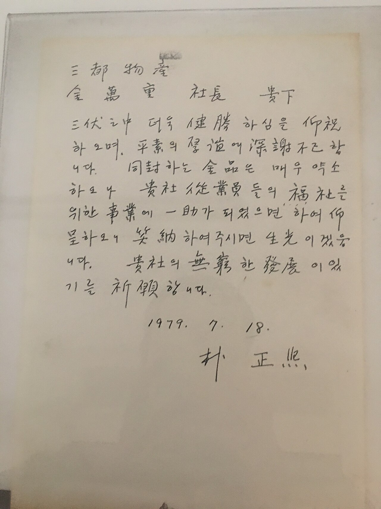
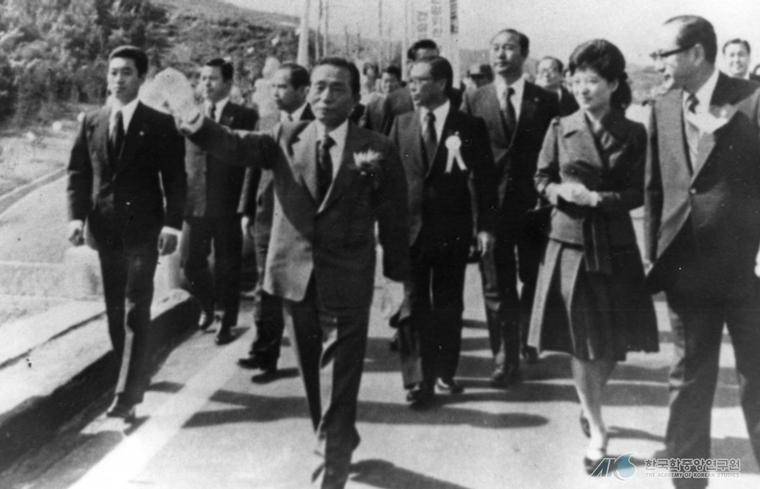
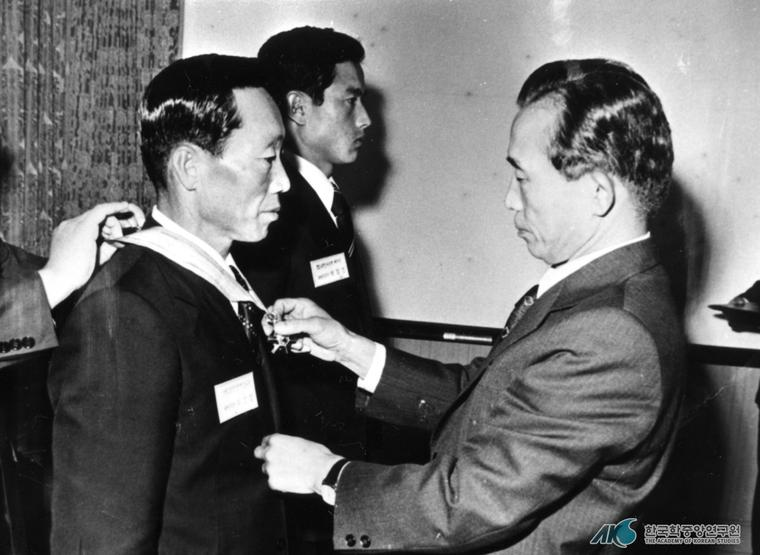

47년 전 오늘, 1979년 11월 9일. 대한민국을 충격에 빠뜨렸던 10·26 사건의 현장이 사건 발생 12일 만에 세상에 공개됐습니다. 계엄사령부 합동수사본부가 지난 11월 7일 서울 종로구 궁정동 중앙정보부 식당에서 실시한 현장검증 내용과 사진이 이날 아침 신문들을 통해 일제히 보도된 것입니다.

## 사건 발생 12일 만에 열린 비극의 무대

1979년 10월 26일 저녁 궁정동 안가에서 울려 퍼진 총성은 박정희 전 대통령의 18년 통치를 단숨에 끝내며 대한민국을 혼란에 몰아넣었습니다. 사건 직후 엄격히 통제되며 굳게 닫혀 있던 서울 종로구 궁정동 중앙정보부 식당은 사건 발생 12일 만인 11월 7일 오전에야 비로소 보도진에게 문을 열었습니다.

이날 현장검증은 오전 7시 7분 범인들과 참고인들이 도착하면서 시작되어 낮 12시 무렵까지 이어졌습니다. 기자들에게는 오전 7시 50분부터 10시 15분까지 식당 안방에서 김재규 전 중앙정보부장이 대통령을 저격하는 순간과 박선호 등 일행이 주방의 경호원들을 사살하는 장면 등이 공개됐습니다.

## 피와 탄흔으로 시간이 멈춘 만찬장

공개된 만찬장의 모습은 비참했던 사건 당일의 순간을 고스란히 멈춰 세운 듯했습니다. 십장생도 8폭 병풍 앞, 박정희 대통령이 앉아 있던 의자 왼쪽과 방석, 방바닥 곳곳에는 검게 엉겨 붙은 핏자국이 그대로 말라붙어 있었습니다.

식탁 위에는 먹다 남은 안주와 술이 어지럽게 놓여 있었고, 차지철 전 경호실장이 김재규의 두 번째 저격을 피하기 위해 붙잡았던 사방탁자는 쓰러진 채 방치되어 있었습니다. 곳곳에 낭자한 혈흔과 벽에 박힌 탄흔, 흩어진 가재도구들은 총성이 멎은 뒤 시간의 흐름마저 멈춰 버린 듯 처절했던 악몽의 밤을 웅변하고 있었습니다.

*1979년 자료 — 사진: Kim J / CC BY-SA 4.0*

## 담담했던 김재규와 고개 떨군 김계원

현장에 나타난 인물들의 대조적인 모습도 큰 충격을 주었습니다. 군작업복 차림에 흰 고무신을 신고 포승에 묶인 채 들어선 김재규 전 중앙정보부장은 초췌한 기색이었으며 간헐적으로 안면 근육에 경련을 일으키기도 했습니다. 그러나 전반적으로는 체념한 듯 비교적 담담하고 태연한 표정으로 검증에 응했습니다.

심지어 김재규는 수사관들에게 현장 재연 중 잘못된 부분을 직접 시정해주고, 박 대통령 대역으로 나온 사람의 동작이 틀리자 이를 직접 바로잡아주는 기이한 모습을 보이기도 했습니다. 반면 함께 참석한 김계원 전 청와대 비서실장은 극도로 겁에 질린 표정으로 시종 고개를 푹 떨군 채 입을 열지 못했습니다.

*사건 당시 사진 아님 — 사진: 한국학중앙연구원 / KOGL Type 1 attribution*

## 그날 밤 7시 40분의 총성이 재연되다

현장검증에서는 10월 26일 밤 7시 40분 궁정동 안방에서 벌어졌던 참극이 분초 단위로 재연됐습니다. 김재규는 만찬 도중 자신의 오른쪽 허리춤에서 권총을 뽑아 들고, 맞은편과 왼쪽에 앉아 있던 차지철 경호실장과 박 대통령을 향해 첫발을 쏘는 장면을 차례로 연출했습니다.

차지철 실장을 쏜 뒤 총이 불발되자 방 밖으로 뛰어나가 박선호로부터 다른 권총을 건네받고, 화장실로 피했다가 나오던 차 실장을 다시 저격한 뒤 박 대통령에게 다가가 확인 사살을 가하던 치명적인 순간까지 그대로 재연됐습니다. 같은 시각 대기실과 주방에서 총성을 신호로 경호원들을 향해 기습 사격을 가했던 박선호, 박흥주, 이기주, 유성옥, 김태원 등도 담담하게 범행을 재연했습니다.

*사건 당시 사진 아님 — 사진: 한국학중앙연구원 / KOGL Type 1 attribution*

## 충격과 공포 속에 다가온 역사의 분수령

11월 9일 조간신문 1면과 화보를 가득 채운 궁정동 현장 사진과 기사는 국민들에게 말로 다할 수 없는 충격을 안겼습니다. 철통같은 보안 속에 가려져 있던 권력의 최심부에서 벌어진 믿기 힘든 유혈극의 전모가 피 묻은 방바닥과 깨진 식기들을 통해 적나라하게 드러났기 때문입니다.

대통령 양옆에 동석했던 증인들과 주방 관계자들이 지켜보는 가운데 치러진 이 현장검증은 18년 동안 이어진 유신 정권이 얼마나 갑작스럽고 비극적으로 막을 내렸는지를 시각적으로 각인시켰습니다. 1979년 11월 9일, 궁정동 만찬장의 핏자국을 신문 지면으로 마주했던 당시 국민들의 가슴속에는 거대한 충격과 함께 앞으로 다가올 미래에 대한 깊은 불안이 교차하고 있었습니다.

### 참고 자료

- <https://newslibrary.naver.com/viewer/index.naver?articleId=1979110900329201004&editNo=2&printCount=1&publishDate=1979-11-09&officeId=00032&pageNo=1&printNo=10496&publishType=00020>
- <https://commons.wikimedia.org/wiki/File:Reporting_on_a_rooftop_1979-11-03.png>
- <https://commons.wikimedia.org/wiki/File:SamdoPresidentPark.jpg>
- <https://www.kogl.or.kr/recommend/recommendDivView.do?division=img&recommendIdx=75035>
- <https://www.kogl.or.kr/recommend/recommendDivView.do?division=img&recommendIdx=72753>
