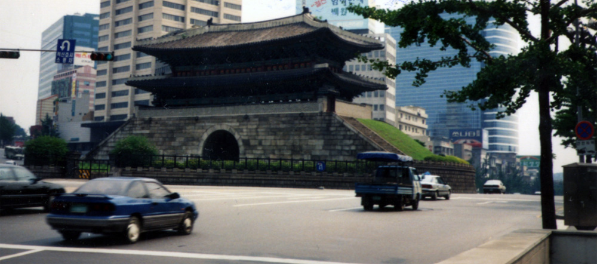
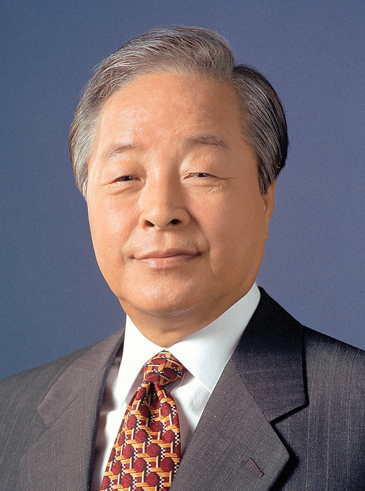

32년 전 오늘, 1994년 11월 9일. 남북 분단 이후 굳게 닫혀 있던 판문점을 통해 남북 기업인이 왕래할 수 있는 길이 열렸습니다. 정부가 통일관계장관회의를 거쳐 남북경협 활성화 방안을 공식 확정하고 대북 직접투자와 북한 근로자 고용을 허용하기로 발표한 날입니다.

## 17개 부처가 모인 통일관계장관회의

1994년 11월 8일 오후 3시, 통일원 회의실에서 경제기획원과 외무부 등 17개 정부 기관이 참석한 통일관계장관회의가 열렸습니다. 회의를 주재한 이홍구 부총리 겸 통일원 장관은 멈춰 서 있던 남북 경제협력을 다시 가동하기 위한 포괄적인 활성화 방안을 논의했습니다. 냉전 종식 이후 긴장과 해빙이 엇갈리던 정세 속에서, 정부는 경제 교류를 통해 남북 관계의 돌파구를 마련하고자 했습니다.

## 판문점 통한 기업인 방북과 북한 사무소 설치

이날 확정된 방안의 핵심 가운데 하나는 기업인의 판문점 통과 허용이었습니다. 그동안 제3국을 거쳐야 했던 남북 왕래의 통로를 판문점으로 넓히고, 북한 측의 호응에 맞춰 판문점 연락사무소 등을 통해 구체적 협의를 추진하기로 했습니다. 아울러 국내 민간 기업이 북한 지역에 사무소를 설치하는 것을 허용하고, 계약 체결과 대금 결제 등 제한적인 영리 업무를 볼 수 있도록 제도적 기반을 열었습니다.

*Southern Gate 숭례문 崇禮門 (5678277441) — 사진: InSapphoWeTrust from Los Angeles, California, USA / CC BY-SA 2.0*

## 라면부터 의류까지, 생필품과 제조업 시범 사업

정부는 초기 경협의 혼란을 막기 위해 시범 협력 사업 업종을 구체적으로 정했습니다. 북한 주민의 생활 수준 향상에 직접 기여할 수 있는 라면, 국수, 된장, 고추장, 조미료, 설탕, 식용유, 비누, 치약, 칫솔 등 식·음료 및 생활용품 분야가 우선 대상이었습니다. 또한 봉제의류, 완구, 양말, 가방, 신발, 피혁, 전자부품 등 단기간에 협력 효과를 거둘 수 있는 소규모 제조업 분야도 포함됐습니다.

*사건 당시 사진 아님 · 1993년 — 사진: 대한민국 국가기록원 / KOGL Type 1*

## 해외 현장 북한 노동력 고용과 경수로기획단

대북 직접투자와 함께 제3국에서의 협력도 함께 추진됐습니다. 외국에 진출한 한국 기업이 건설 및 자원개발 현장에서 북한 노동인력을 시범적으로 고용할 수 있도록 길을 텄습니다. 또 위탁가공 활성화를 위해 기술자 방북과 설비 반출을 허용했습니다. 정부는 대북 경수로 지원 사업을 체계적으로 다루기 위해 통일관계장관회의 산하에 '경수로기획단'을 설치하고 정책 조정과 재원 조달, 건설 기술 지원을 총괄하도록 했습니다.

![[2033호] 이런 일 저런 일 ... 남서울 산업대학교 (1994.10.26) 장면 1](../images/2026-11-09-03-4.jpg)
*[2033호] 이런 일 저런 일 ... 남서울 산업대학교 (1994.10.26) 장면 1 — 사진: KTV 국민방송 e영상역사관 (대한뉴스) / KTV 공공저작물 — 영상 저작물 전면 개방(대통령실 2025-07-09), 출처 표시*

## 대화 재개 촉구와 남북 경제 협력의 기억

발표 당일 송영대 통일원 차관은 기자회견을 통해 이번 조치가 북한의 호응으로 이어져 남북 관계 진전의 계기가 되기를 바란다며 당국 간 대화 재개를 촉구했습니다. 정부는 이후 남북교류협력추진협의회를 열어 세부 투자 지침을 마련해 나갔습니다. 분단의 장벽을 경제와 생필품 교류로 풀어내려 했던 1994년 11월의 시도는 우리 현대사에서 남북 경협의 전환점으로 기록되어 있습니다.

### 참고 자료

- <https://newslibrary.naver.com/viewer/index.naver?articleId=1994110900329101001&editNo=20&printCount=1&publishDate=1994-11-09&officeId=00032&pageNo=1&printNo=15250&publishType=00010>
- <https://commons.wikimedia.org/wiki/File:Kim_Young-sam_and_Takashi_Yonezawa_in_1994.jpg>
- <https://commons.wikimedia.org/wiki/File:Southern_Gate_%EC%88%AD%EB%A1%80%EB%AC%B8_%E5%B4%87%E7%A6%AE%E9%96%80_(5678277441).jpg>
- <https://commons.wikimedia.org/wiki/File:Kim_Young-sam_presidential_portrait_(cropped).jpg>
- <https://www.ehistory.go.kr/view/movie?mediasrcgbn=KV&mediaid=11526&mediadtl=25893&mediagbn=DH#t=0.3>
