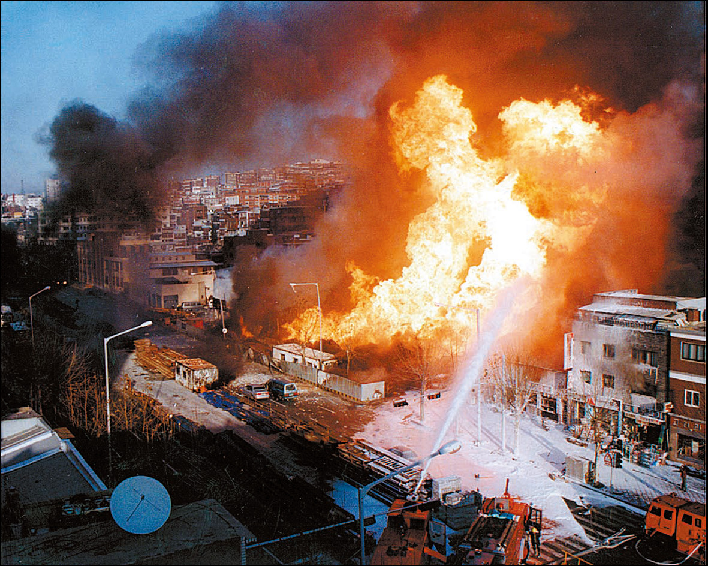
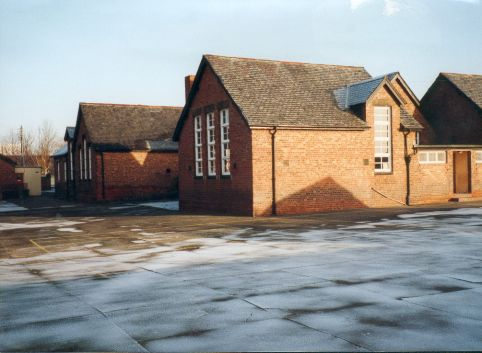

30년 전 오늘, 1996년 11월 9일. 서울 시내 초등학교에서 학기말시험과 성적표의 '수·우·미·양·가'가 전면 폐지된다는 파격적인 소식이 조간신문 1면을 장식했습니다. 오랜 세월 아이들의 학업을 줄 세우던 일제고사식 평가가 역사의 뒤안길로 물러나는 순간이었습니다.

## 골목을 울고 웃게 했던 '수·우·미·양·가'의 추억

1990년대 중반까지만 해도 초등학교 교실의 풍경은 지금과 사뭇 달랐습니다. 3학년부터 6학년까지 학생들은 학기말마다 전 과목 시험을 치러야 했습니다. 시험이 끝나고 통지표가 나오는 날이면 아이들의 가슴은 콩닥거렸습니다.

성적표 칸에는 '수·우·미·양·가' 다섯 글자가 찍혀 나왔습니다. '수'가 가득한 통지표를 든 아이는 의기양양하게 집으로 향했고, 그렇지 못한 아이는 골목길 어귀에서 발걸음을 멈추기 일쑤였습니다. 점수 하나에 등수가 갈리고 서열이 매겨지던 이 획일적인 방식은 교실과 가정 모두에 큰 부담이었습니다.

## 지식 주입 대신 인성으로, 서울시교육청의 결단

1996년 11월 8일, 서울시교육청은 기존 교육의 틀을 깨는 '초등교육 혁신안'을 공식 발표했습니다. 핵심은 암기 위주의 지식주입식 교육에서 벗어나 학생 개개인의 창의성과 인성을 기르는 교육으로 바꾸겠다는 것이었습니다.

유인종 서울시교육감은 발표 당시 "기존의 획일화되고 정형화된 초등학교 교육방법으로는 다가오는 미래 사회에 적응하는 인간을 길러내는 데 한계가 있다"며 혁신안의 취지를 분명히 밝혔습니다. 어린 학생들을 점수로 한 줄 세우는 평가를 멈추겠다는 공식 선언이었습니다.

*1996년 12월 7일 아현동 도시가스 폭발 사고 ahyun gas 01 — 사진: 서울특별시 소방재난본부(Seoul Metropolitan Fire &amp; Disaster Headquar / CC BY-SA 4.0*

## 시험 폐지와 담임 2년 연장제, 무엇이 바뀌었나

혁신안의 내용은 당시 기준으로 매우 파격적이었습니다. 우선 3학년부터 6학년까지 치르던 학기말시험을 완전히 없애고, 일부 학교에서 서열을 매기던 5단계 평가방식을 전면 폐지하기로 했습니다. 대신 담임교사가 실험, 견학, 과제 수행 등을 관찰해 학업성취도와 행동발달을 문장으로 종합 기록하도록 했습니다.

교사와 학생의 유대감을 높이기 위한 조치도 포함되었습니다. 1년으로 끝나던 담임제를 2년 이상 연장할 수 있도록 하여, 1997년부터 전체 학급의 3분의 1에서 시범 실시하기로 했습니다. 학생 개개인을 오랜 시간 깊이 관찰하고 수준에 맞는 지도를 하겠다는 취지였습니다.

*1996년 12월 7일 아현동 도시가스 폭발 사고 bbuheng201212032027100 — 사진: 서울특별시 소방재난본부(Seoul Metropolitan Fire &amp; Disaster Headquar / CC BY-SA 4.0*

## 교실 밖 세상으로 열린 체험학습의 길

혁신안은 교실 안의 변화에만 머물지 않았습니다. 서울 학생들이 전학 절차 없이 1년 이내 범위에서 농촌이나 다른 지역 학교로 가 수업을 듣는 도·농 교류학습 제도가 마련되었습니다.

또한 부모와 함께하는 국내외 여행을 기간 제한 없이 자유롭게 갈 수 있도록 길을 열었습니다. 직계 가족이 아닌 먼 친척이나 이웃의 경조사에 참석하더라도 결석으로 처리하지 않기로 했습니다. 학교 밖 세상에서 겪는 다양한 경험을 정규 수업 못지않은 교육으로 인정한 획기적인 발걸음이었습니다.

*1996년 자료 — 사진: Bill Henderson / CC BY-SA 2.0*

## 국민학교에서 초등학교로, 시대가 바뀌던 1996년

1996년은 한국 교육사에서 상징적인 해였습니다. 일제강점기 황국신민화 정책에서 비롯된 '국민학교'라는 명칭을 버리고, 민족정기 회복 차원에서 '초등학교'라는 이름을 되찾은 바로 그해였기 때문입니다.

교문 명판이 바뀌고 교과서 표지가 바뀌던 해에 전해진 시험 폐지 소식은, 우리 초등교육이 식민지 시대와 개발연대의 묵은 잔재를 벗어던지고 새로운 시대로 나아가는 또 하나의 중요한 신호탄이었습니다.

## 그 시절 개혁이 오늘날 교실에 남긴 흔적

서울시교육청의 혁신안은 시범 실시를 거쳐 점차 전국 시·도 교육청으로 퍼져나갔습니다. 중간고사와 기말고사로 불리던 일제고사는 점차 사라졌고, 오늘날 초등학교 교실에서는 과정 중심 평가와 체험학습이 당연한 일상으로 자리 잡았습니다.

기초학력 부진 학생을 위한 방과후 특별지도와 정보화에 맞춘 멀티미디어 자료 도입 등 당시 발표된 대책들은 지금도 학교 현장의 기본 제도로 이어지고 있습니다. 손때 묻은 옛 성적표 속 '수·우·미·양·가'는 이제 아련한 추억이 되었지만, 아이들을 경쟁의 굴레에서 벗어나게 하려던 그날의 고민은 오늘날에도 여전히 유효한 질문을 던지고 있습니다.

### 참고 자료

- <https://newslibrary.naver.com/viewer/index.naver?articleId=1996110900329101001&editNo=45&printCount=1&publishDate=1996-11-09&officeId=00032&pageNo=1&printNo=15932&publishType=00010>
- <https://commons.wikimedia.org/wiki/File:1996%EB%85%84_12%EC%9B%94_7%EC%9D%BC_%EC%95%84%ED%98%84%EB%8F%99_%EB%8F%84%EC%8B%9C%EA%B0%80%EC%8A%A4_%ED%8F%AD%EB%B0%9C_%EC%82%AC%EA%B3%A0_19941207000012.jpg>
- <https://commons.wikimedia.org/wiki/File:1996%EB%85%84_12%EC%9B%94_7%EC%9D%BC_%EC%95%84%ED%98%84%EB%8F%99_%EB%8F%84%EC%8B%9C%EA%B0%80%EC%8A%A4_%ED%8F%AD%EB%B0%9C_%EC%82%AC%EA%B3%A0_ahyun_gas_01.jpg>
- <https://commons.wikimedia.org/wiki/File:1996%EB%85%84_12%EC%9B%94_7%EC%9D%BC_%EC%95%84%ED%98%84%EB%8F%99_%EB%8F%84%EC%8B%9C%EA%B0%80%EC%8A%A4_%ED%8F%AD%EB%B0%9C_%EC%82%AC%EA%B3%A0_bbuheng201212032027100.jpg>
- <https://commons.wikimedia.org/wiki/File:Westmoor_County_Primary_School._-_geograph.org.uk_-_259332.jpg>
