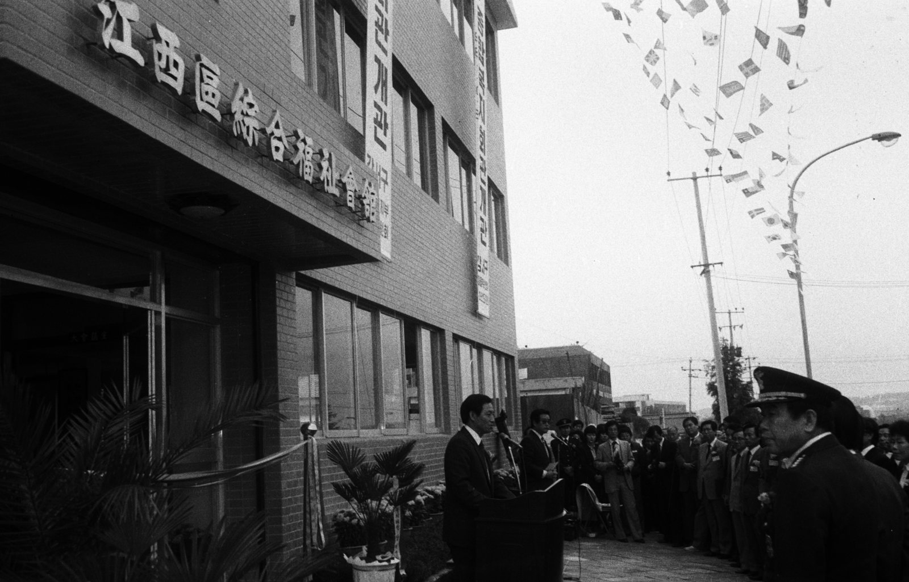

43년 전 오늘, 1983년 11월 9일. 결혼식에서 하객에게 음식 대접이나 답례품을 건넬 수 있게 해 달라는 국민 여론조사 결과가 국회에 제출되며 큰 화제를 모았습니다. 국가가 법으로 혼례 때 밥 한 끼 대접하는 것까지 가로막던 시절이었습니다.

## 국민 85% "간단한 식사나 답례품은 허용해야"

1983년 11월 9일, 보건사회부가 국회에 제출한 가정의례 여론조사 결과는 당시 서민들의 솔직한 속내를 고스란히 보여주었습니다. 보사부가 1982년과 1983년 두 차례에 걸쳐 지역 주민과 사회 각계 인사 2천6백 명을 대상으로 조사한 결과, 전체 응답자의 85%가 혼례 때 하객에게 간단한 음식물을 접대하거나 답례품을 주는 것을 허용해야 한다고 응답했습니다.

구체적으로 살펴보면 대중음식점에서 일반 음식을 접대하는 것만은 허용해야 한다는 의견이 34%로 가장 높았고, 답례품만 허용해야 한다는 의견이 28%, 혼례를 치르는 집안의 선택에 따라 둘 다 허용해야 한다는 의견도 23%에 달했습니다. 반면 당시 법률대로 둘 다 엄격히 금지해야 한다는 의견은 15%에 그쳤습니다.

## 허례허식 없앤다던 가정의례법의 그림자

당시 대한민국에는 건전한 의례 문화를 정착시키고 허례허식을 줄인다는 명목으로 제정된 '가정의례에 관한 법률'이 시행 중이었습니다. 이 법에는 혼례 시 하객에 대한 음식물 접대와 답례품 증여 금지를 포함해 모두 7가지 법정 금지 행위가 명시되어 있었습니다.

그러나 멀리서 찾아와 축하해 준 하객에게 점심 한 끼 대접하지 못하게 하는 것은 우리 전통 미풍양속과 너무나 동떨어져 있다는 비판이 끊이지 않았습니다. 보사부 역시 이러한 여론을 수렴해 관련 법 개정을 검토하고자 여론조사를 벌였습니다. 하지만 사회 지도급 인사들로 구성된 가정의례심의위원회에서 찬반 논쟁이 팽팽히 맞서자, 정부는 결국 법 개정 검토를 전격 백지화해 버렸습니다.

*강서구 종합복지관 개관 — 사진: 서울역사박물관 / KOGL Type 1 (공공누리 제1유형, 출처표시)*

## 법 개정 대신 들이닥친 '식당 일제 단속'

정부는 법을 현실에 맞게 고치는 대신 오히려 단속의 칼을 빼 들었습니다. 1983년 11월 1일부터 7대 법정 금지 사항에 대해 대대적인 일제 단속을 선언한 것입니다.

특히 가장 큰 논란거리였던 간단한 음식 접대를 막기 위해, 정부는 잔치를 치르는 가정을 직접 단속하기보다 대중음식점이 결혼 하객 단체 손님을 아예 받지 못하게 압박하는 방식을 썼습니다. 식당 문을 걸어 잠그게 만들어 하객들이 밥을 먹지 못하도록 강제하겠다는 뜻이었습니다.

![[104호] 상이반공애국청년 (1957.02.28) 장면 2](../images/2026-11-09-05-3.jpg)
*[104호] 상이반공애국청년 (1957.02.28) 장면 2 — 사진: KTV 국민방송 e영상역사관 (대한뉴스) / KTV 공공저작물 — 영상 저작물 전면 개방(대통령실 2025-07-09), 출처 표시*

## 첫딸 시집보낸 아버지의 한숨과 '게릴라 식사'

단속령이 발표된 후 첫 주말이었던 1983년 11월 5일과 6일, 전국의 혼례 가정과 예식장 주변은 일대 혼란에 빠졌습니다. 첫딸을 결혼시킨 50세 박 모 씨는 신문과의 인터뷰에서 대중음식점이 하객 단체 손님을 일절 거절하는 바람에 어쩔 수 없이 집에서 손님을 치렀다고 털어놓았습니다. 박 씨는 식당에서 갈비탕 한 그릇씩 대접했으면 간단했을 일을, 집에서 대접하느라 술과 떡, 부침개 등을 장만하느라 큰일을 치렀고 비용도 훨씬 더 많이 들었다며 허탈해했습니다.

단속의 눈을 피하기 위한 기상천외한 방법들도 등장했습니다. 일부 지방에서는 하객들을 대여섯 명씩 조를 짜서 예식장 주변의 여러 식당으로 흩어 보내 식사를 하게 하거나, 식사 대접 대신 하객들에게 점심값 명목으로 봉투를 개별적으로 쥐여주는 웃지 못할 풍경이 벌어지기도 했습니다.

![[1012호] 따뜻한 세모 ... 영세민들에게 일자리를 마련해줌. 경남 진주시와 진양군에 사는 36쌍의 합동결혼식. (1974.12.07) 장면 1](../images/2026-11-09-05-4.jpg)
*[1012호] 따뜻한 세모 ... 영세민들에게 일자리를 마련해줌. 경남 진주시와 진양군에 사는 36쌍의 합동결혼식. (1974.12.07) 장면 1 — 사진: KTV 국민방송 e영상역사관 (대한뉴스) / KTV 공공저작물 — 영상 저작물 전면 개방(대통령실 2025-07-09), 출처 표시*

## 따뜻한 밥 한 끼가 전하는 정을 되새기며

당시 여론조사에서도 나타났듯, 부유층이 과시용으로 돌리는 값비싼 답례품은 국민 간 위화감을 조성할 수 있어 규제가 필요하다는 시각이 있었지만, 정성을 담아 따뜻한 국밥 한 그릇을 대접하는 일까지 법으로 가로막는 것은 서민들의 상식과 맞지 않았습니다.

세월이 흘러 오늘날 결혼식에서는 축하하러 와 준 고마운 분들에게 뷔페나 정갈한 한 상 차림으로 넉넉하게 대접하는 문화가 완전히 자리를 잡았습니다. 멀리서 온 손님에게 갈비탕 한 그릇조차 마음 편히 대접하지 못해 식당으로 조를 나누어 보내야 했던 1980년대 초의 혼례 풍경은, 시대를 지나온 어르신들의 기억 속에 여전히 아련하고 씁쓸한 추억으로 남아 있습니다.

### 참고 자료

- <https://newslibrary.naver.com/viewer/index.naver?articleId=1983110900209201005&editNo=2&printCount=1&publishDate=1983-11-09&officeId=00020&pageNo=1&printNo=19108&publishType=00020>
- <https://commons.wikimedia.org/wiki/File:Vladimir_Putin_wedding-2.jpg>
- <https://museum.seoul.go.kr/archive/archiveNew/NR_archiveView.do?ctgryId=CTGRY766&type=B&upperNodeId=CTGRY770&fileSn=300&fileId=H-TRNS-97402-770>
- <https://www.ehistory.go.kr/view/movie?mediasrcgbn=KV&mediaid=666&mediadtl=2563&mediagbn=DH#t=0.7>
- <https://www.ehistory.go.kr/view/movie?mediasrcgbn=KV&mediaid=930&mediadtl=6184&mediagbn=DH#t=0.3>
