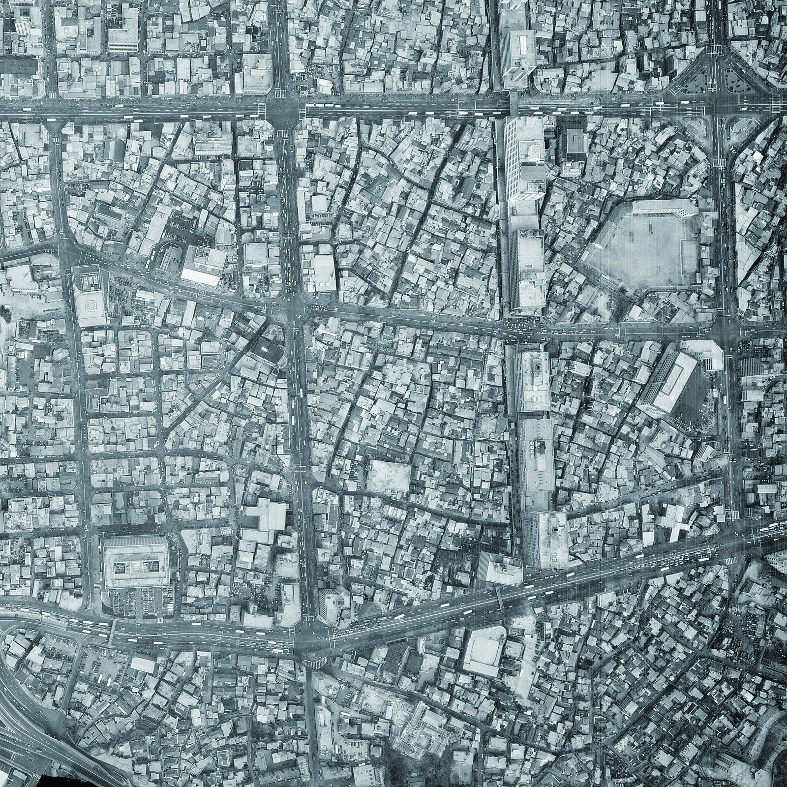

27년 전 오늘, 1999년 11월 9일. 56명의 목숨을 앗아간 인천 인현동 상가 화재 참사의 발화 원인이 공식적으로 번복되었습니다. 당초 경찰이 발표했던 '깨진 전구의 전기 스파크'가 아니라, 청소 중 벌어진 어처구니없는 라이터 불장난이 참혹한 비극의 시작이었습니다.

## 1999년 10월 30일 저녁, 인천 인현동의 비극

1999년 10월 30일 토요일 저녁 7시경, 인천광역시 중구 인현동에 위치한 4층 상가 건물에서 검은 연기와 불길이 치솟았습니다. 이날 인천 시내 10여 개 고등학교에서 가을 축제가 열렸고, 축제를 마친 청소년들이 건물 2층 라이브 생맥주집과 3층 당구장 등에 모여 있었습니다.

지하에서 번져온 불길과 유독가스는 순식간에 계단을 타고 위층으로 번졌습니다. 학생들은 있지도 않은 비상구와 계단을 찾아 헤매다 쓰러졌고, 56명이 숨지고 78명이 부상을 입는 참담한 결과로 이어졌습니다. 불과 4개월 전인 6월 30일 씨랜드 청소년수련원 화재 참사를 겪었던 국민들은 또다시 터진 비극에 엄청난 충격을 받았습니다.

## 당초 발표된 발화 원인은 '깨진 전구 스파크'

사고 직후 경찰은 화재 원인을 전기적 요인으로 잠정 결론지었습니다. 불이 난 다음 날인 10월 31일, 경찰은 지하 1층 히트노래방에서 내부 수리공사 뒷정리를 하던 아르바이트생들의 진술을 토대로 수사 결과를 발표했습니다.

당시 발표는 청소 중 바닥에 놓여 있던 깨진 공사용 전구에서 스파크가 튀었고, 그 불꽃이 옆에 있던 얇은 종이에 옮겨붙은 뒤 시너통으로 번졌다는 내용이었습니다. 그러나 발화 지점과 현장 훼손 상태 등을 둘러싸고 여러 의문이 제기되고 있었습니다.

![[760호] 불조심 불조심. 반도 조선아케이트 화재. (1970.01.24) 장면 2](../images/2026-11-09-07-2.jpg)
*[760호] 불조심 불조심. 반도 조선아케이트 화재. (1970.01.24) 장면 2 — 사진: KTV 국민방송 e영상역사관 (대한뉴스) / KTV 공공저작물 — 영상 저작물 전면 개방(대통령실 2025-07-09), 출처 표시*

## 11월 9일 뒤집힌 진실, 시너에 붙인 라이터 불

사건 발생 열흘째인 1999년 11월 9일 새벽, 인천지방경찰청 수사본부는 기존 발표를 완전히 뒤집는 공식 수사 결과를 내놓았습니다. 국립과학수사연구소의 1차 정밀 감식 결과 발화 지점은 깨진 전구가 있던 자리가 아닌 11번 룸 앞 복도 바닥으로 확인되었습니다.

구속 수감 중이던 14세 아르바이트생 임 모 군은 기자 면회와 경찰 재조사에서 사실을 털어놓았습니다. 숨진 동료와 함께 청소를 하던 중 '시너와 일반 석유 중 어느 쪽에 불이 더 잘 붙을까' 이야기를 나누다, 바닥에 시너를 조금 붓고 라이터로 불을 댕겼다는 자백이었습니다. 불길은 순식간에 근처 시너통으로 옮겨붙으며 통제 불능 상태로 번졌습니다.

*근면, 검소하게 살아가는 이용환씨 ... 본 용환 (1997.00.00) 장면 1 — 사진: KTV 국민방송 e영상역사관 (문화영화) / KTV 공공저작물 — 영상 저작물 전면 개방(대통령실 2025-07-09), 출처 표시*

## 부실 수사 비판과 겹겹이 쌓인 인재

경찰은 숨진 동료를 감싸려 했던 10대 아르바이트생의 거짓 진술에만 의존해 초동 수사에서 허점을 드러냈다는 거센 비난을 받았습니다. 그러나 화재의 발화 원인 못지않게 더 큰 분노를 자아낸 것은 건물의 불법 구조와 어른들의 무책임이었습니다.

50여 평에 불과한 2층 호프집에는 무려 120명이 빽빽하게 들어차 있었고, 통로는 한 사람이 겨우 지나갈 만큼 좁았습니다. 비상계단은커녕 창문마저 통유리와 베니어판으로 막혀 있었으며, 지하 노래방 천장의 확산소화기는 공사에 방해된다는 이유로 떼어낸 상태였습니다. 심지어 화재 발생 당시 호프집 매니저는 피신하려는 학생들에게 돈을 내라며 고함을 치다 자신만 아는 통로로 빠져나간 사실이 알려졌습니다.

*완공된 세운상가군 1980년 항공사진 — 사진: 서울역사박물관 / KOGL Type 1 (공공누리 제1유형, 출처표시)*

## 위령비에 남은 이름들, 우리가 기억해야 할 교훈

희생된 학생들은 인천여자상업고등학교 8명을 비롯해 인근 여러 고등학교의 학생들이었습니다. 적발을 피하며 배를 불린 업주와 유착된 단속망, 청소년을 위한 안전한 공간조차 허락하지 않았던 사회의 총체적 부실이 56명의 아까운 생명을 앗아갔습니다.

2004년 사고 현장 인근 인천광역시학생교육문화회관 앞마당에 희생자들을 기리는 추모석과 위령비가 세워졌습니다. 어처구니없는 불장난에서 시작되었으나 안전 불감증과 구조적 모순이 키워낸 인현동 참사는, 수십 년이 지난 오늘날에도 우리 사회에 무거운 질문을 던지고 있습니다.

### 참고 자료

- <https://newslibrary.naver.com/viewer/index.naver?articleId=1999110900289101005&editNo=6&printCount=1&publishDate=1999-11-09&officeId=00028&pageNo=1&printNo=3654&publishType=00010>
- <https://www.ehistory.go.kr/view/movie?mediasrcgbn=KV&mediaid=2625&mediadtl=9557&mediagbn=DH#t=0.3>
- <https://www.ehistory.go.kr/view/movie?mediasrcgbn=KV&mediaid=2625&mediadtl=9557&mediagbn=DH#t=0.7>
- <https://www.ehistory.go.kr/view/movie?mediasrcgbn=KV&mediaid=1196&mediadtl=7264&mediagbn=MH#t=0.3>
- <https://museum.seoul.go.kr/archive/archiveNew/NR_archiveView.do?ctgryId=CTGRY333&type=A&upperNodeId=CTGRY336&fileSn=300&fileId=H-TRNS-71230-336>
