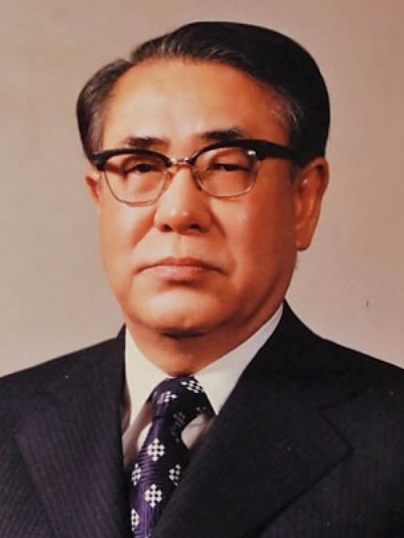
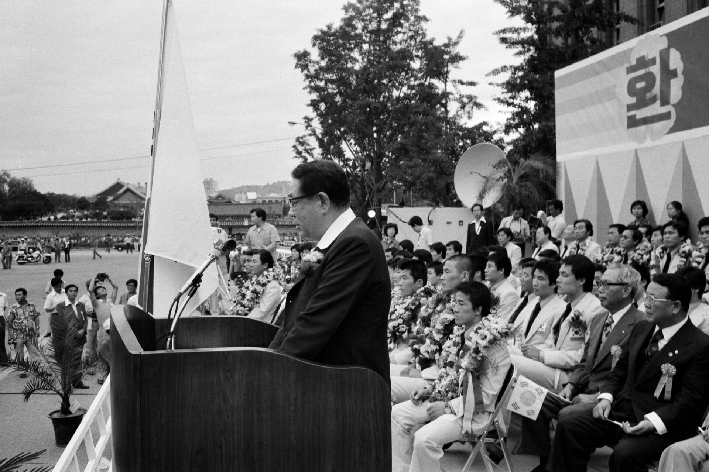
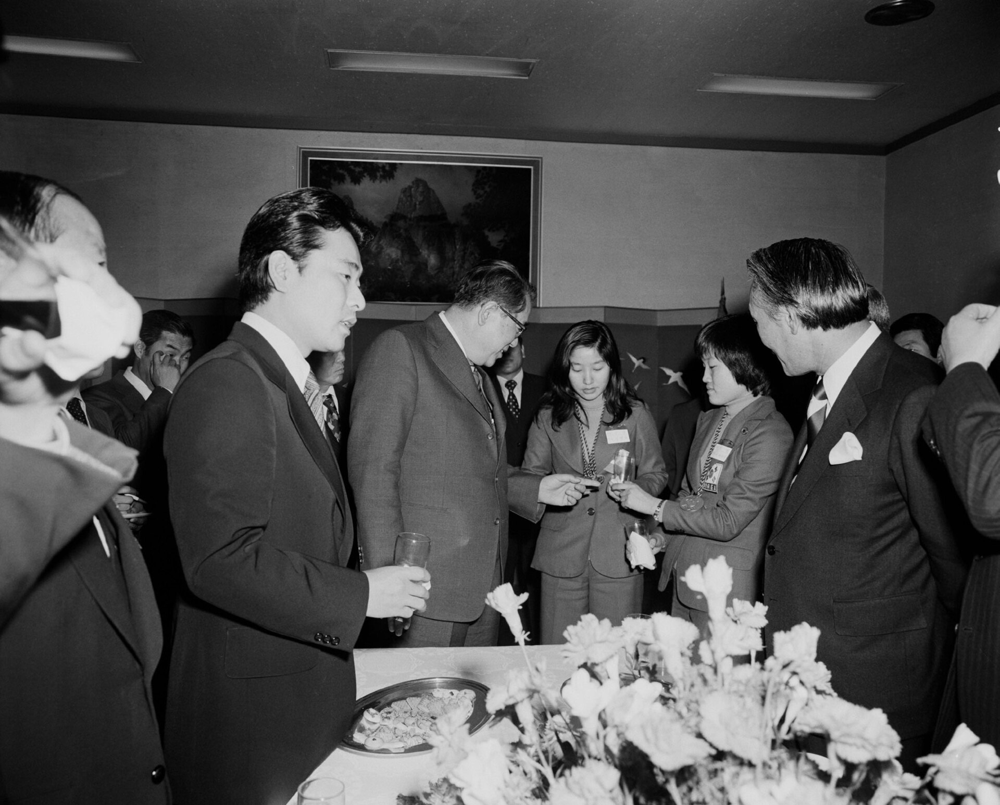

47년 전 오늘, 1979년 11월 10일. 최규하 대통령 권한대행이 헌법을 개정해 새 정부에 넘기겠다는 시국특별담화를 발표했습니다. 박정희 대통령 서거 이후 짙게 드리웠던 국가적 혼란과 불안 속에서 과도정부의 향후 정치 일정이 마침내 세상에 공개된 순간이었습니다.

## 거대한 권력 공백과 극도의 긴장감

1979년 10월 26일, 궁정동에서 울린 총성으로 박정희 대통령이 서거했습니다. 18년간 이어져 온 장기 집권 체제가 하룻밤 사이에 무너지면서 대한민국은 전례 없는 권력 공백 상태를 맞이했습니다. 헌법 제48조에 따라 국무총리였던 최규하가 즉시 대통령 권한대행을 맡았으나, 사회 전반에는 팽팽한 긴장감이 감돌았습니다.

당시 유신체제 아래에서는 대통령에 대한 비판은 물론 개헌을 요구하는 행위 자체가 긴급조치 제9호로 금지되어 있었습니다. 국민들은 정국이 어떤 방향으로 흘러갈지, 군부나 권력 내부에서 어떤 일이 벌어질지 예측하지 못한 채 숨을 죽이고 있었습니다.

## 중앙청 제1회의실에서 울려 퍼진 시국담화

박정희 대통령의 국장이 끝난 지 일주일 만인 11월 10일 오전 9시 30분, 서울 세종로 중앙청 제1회의실에 전 국무위원이 배석했습니다. 문화방송(MBC)을 비롯한 전국 텔레비전과 라디오 방송망을 통해 「시국에 관한 대통령 권한대행의 특별담화」가 전국에 생중계되었습니다.

최규하 권한대행은 엄숙한 표정으로 단상에 올라 준비된 담화문을 읽어 내려갔습니다. 그는 "헌법에 규정된 시일 내에 국법이 정하는 절차에 따라 대통령 선거를 실시하여 새로 선출되는 대통령에게 정부를 이양한다는 것을 정부 방침으로 확정했다"고 밝혔습니다.

*1979년 자료 — 사진: Korea.net / Korean Culture and Information Service / CC BY-SA 2.0*

## "잔여 임기 5년 2개월을 채우지 않겠다"

담화의 핵심은 새 대통령의 임기와 헌법 개정이었습니다. 현행 유신헌법 제45조 제2항에 따르면 대통령 궐위 시 3개월 이내에 통일주체국민회의에서 후임 대통령을 선출해야 했습니다. 법정 시한은 박 대통령 서거일로부터 석 달째가 되는 1980년 1월 25일까지였습니다.

그러나 최 권한대행은 통일주체국민회의에서 뽑힐 제10대 대통령이 오는 1984년 12월 26일까지의 잔여 임기 5년 2개월을 다 채우지 않을 것이라고 선언했습니다. 현실적으로 가능한 빠른 기간 안에 각계각층의 의견을 광범위하게 수렴해 헌법을 개정하고, 그 새 헌법에 따라 선거를 치러 새 대통령에게 정권을 넘기겠다는 과도정부의 방침을 공식 천명한 것입니다.

*1976년 자료 — 사진: 대한민국 정부 / Public domain*

## '헌법 심의'에서 '헌법 개정'으로 낙착된 배경

이 담화에서 가장 큰 파장을 일으킨 대목은 '헌법 개정'이라는 직접적인 단어였습니다. 당초 정부 내부 초안에서는 유신체제 옹호 세력의 반발을 우려해 '헌법 심의'라는 모호한 표현을 쓰려 했던 것으로 알려졌습니다.

하지만 발표 전날 밤샘 논의 끝에 결국 '헌법 개정'이라는 명확한 표현으로 낙착되었습니다. 긴급조치 제9호가 여전히 시퍼렇게 살아있던 상황이었지만, 국민 대다수가 경제와 사회 발전에 부응하는 정치적 발전을 간절히 원하고 있다는 민심을 정부 역시 외면하기 어려웠기 때문이었습니다.

*1976년 자료 — 사진: 대한민국 정부 / Public domain*

## 국가 안보와 사회 안정에 대한 간곡한 당부

최 권한대행은 정치적 발전과 더불어 국가 안보와 사회 질서 유지의 중요성도 거듭 강조했습니다. 국방 태세를 확고히 다져 북한의 남침 위협을 막고 치안을 확보해 국민들이 생업에 안심하고 종사할 수 있도록 하겠다고 다짐했습니다.

아울러 사회 혼란이 일어날 경우 북한 공산주의자들의 오판을 자초할 수 있다며 국민들에게 매사에 상호 자제해 줄 것을 간곡히 호소했습니다. 기존 우방과의 유대 강화는 물론, 이념이 다른 국가에 대해서도 상호주의에 따라 문호를 개방하겠다는 외교적 기조도 함께 발표되었습니다.

## 서울의 봄을 향한 첫걸음, 그리고 닥쳐온 역사의 굴곡

이날의 담화는 1970년대를 짓누르던 정치적 부재를 끝내고 새로운 민주 질서로 나아가는 신호탄으로 평가받았습니다. 실제로 최규하 권한대행은 12월 6일 통일주체국민회의에서 제10대 대통령으로 단독 선출되며 새 헌법 개정 작업을 준비하기 시작했습니다.

그러나 불과 며칠 뒤인 12월 12일, 전두환을 중심으로 한 신군부가 군사반란을 일으키면서 대한민국 헌정사는 다시금 짙은 어둠 속으로 빠져들게 되었습니다. 비록 그 결말은 비극적인 시련으로 이어졌지만, 1979년 11월 10일의 시국담화는 유신체제의 종말을 알리고 개헌이라는 거스를 수 없는 도도한 역사의 흐름을 국민 앞에 약속했던 중대한 하루였습니다.

### 참고 자료

- <https://newslibrary.naver.com/viewer/index.naver?articleId=1979111000329201005&editNo=2&printCount=1&publishDate=1979-11-10&officeId=00032&pageNo=1&printNo=10497&publishType=00020>
- <https://commons.wikimedia.org/wiki/File:Reporting_on_a_rooftop_1979-11-03.png>
- <https://commons.wikimedia.org/wiki/File:Choi_Kyu-hah_(cropped).jpg>
- <https://commons.wikimedia.org/wiki/File:%EC%84%9C%EC%9A%B8%EC%8B%9C%EC%B2%AD_%EC%95%9E_%EA%B4%91%EC%9E%A5%EC%97%90%EC%84%9C_%EC%97%B4%EB%A6%AC%EA%B3%A0_%EC%9E%88%EB%8A%94_%EB%AA%AC%ED%8A%B8%EB%A6%AC%EC%98%AC%EC%98%AC%EB%A6%BC%ED%94%BD_%EC%84%A0%EC%88%98%EB%8B%A8_%EA%B0%9C%EC%84%A0_%ED%99%98%EC%98%81%EB%8C%80%ED%9A%8C2.jpg>
- <https://commons.wikimedia.org/wiki/File:%EC%84%9C%EB%8F%85_%EA%B5%AD%EC%A0%9C%EC%98%A4%ED%94%88%ED%83%81%EA%B5%AC%EB%8C%80%ED%9A%8C_%EC%9A%B0%EC%8A%B9_%EC%9D%B4%EC%97%90%EB%A6%AC%EC%82%AC-%EC%A0%95%ED%98%84%EC%88%99_%EC%84%A0%EC%88%98_%EC%8B%9C%EB%AF%BC%ED%99%98%EC%98%81%EB%8C%80%ED%9A%8C_%EB%B0%8F_%EC%B5%9C%EA%B7%9C%ED%95%98_%EA%B5%AD%EB%AC%B4%EC%B4%9D%EB%A6%AC_%EC%84%A0%EC%88%98%EB%8B%A8_%EA%B2%A9%EB%A0%A4_2.jpg>
