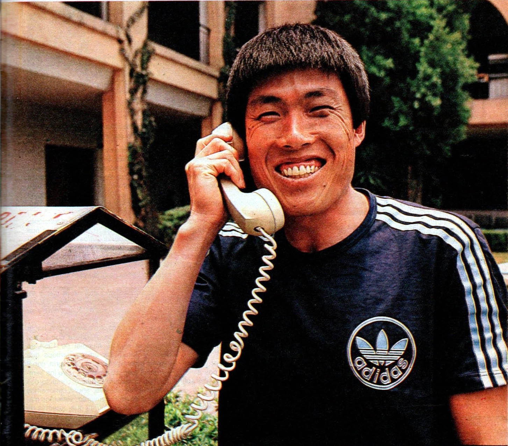
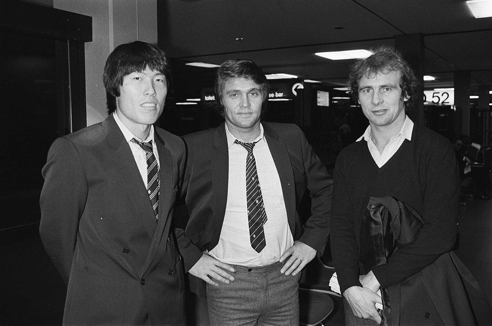
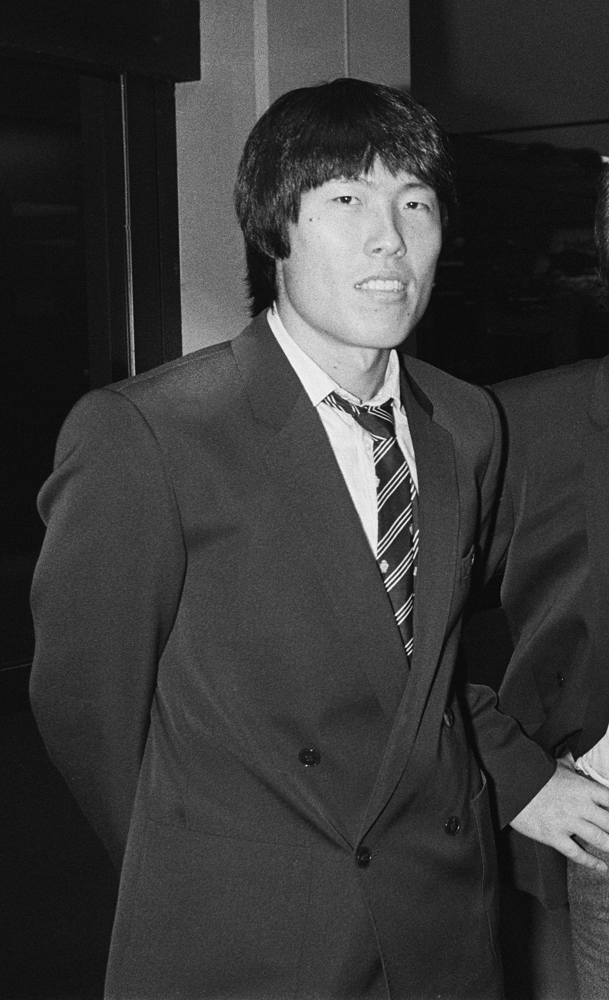

29년 전 오늘, 1997년 11월 10일. 조간신문 1면에는 태극전사들이 차범근 감독을 번쩍 들어 올려 헹가래를 치는 환희의 사진이 일제히 실렸습니다. 한국 축구 국가대표팀이 아랍에미리트(UAE)와의 원정 최종전에서 3대 1 완승을 거두며 월드컵 예선 대장정을 화려하게 매듭지은 순간이었습니다.

## 프랑스로 가는 마지막 관문, 아시아 최종예선

1997년 가을, 대한민국은 축구 열기로 가득 차 있었습니다. 1998 프랑스 월드컵 본선 티켓을 놓고 펼쳐진 아시아지역 최종예선 B조에서 한국은 연일 통쾌한 승리를 거두며 승승장구했습니다. 당시 대표팀을 이끌던 차범근 감독의 지휘 아래 대표팀은 특유의 빠른 공격 축구를 선보였습니다.

한국은 카자흐스탄, 우즈베키스탄, 일본, 아랍에미리트와 한 조에 묶여 치열한 홈 앤드 어웨이 레이스를 펼쳤습니다. 최종전을 앞두고 이미 본선 직행 티켓을 손에 쥐었지만, 대표팀에 방심이란 없었습니다.

## 아부다비 원정, 물러섬 없는 태극전사들

1997년 11월 9일, 아랍에미리트 아부다비에서 최종 8차전이 열렸습니다. 원정길의 무더위와 텃세 속에서도 태극전사들은 경기 초반부터 상대를 거세게 압박했습니다. 비겨도 조 1위가 확정되는 유리한 상황이었지만, 선수들은 승리로 자존심을 증명하고자 했습니다.

선제골은 전반 이른 시간에 터졌습니다. 측면을 파고들던 이상윤 선수가 통쾌한 첫 골을 꽂아 넣으며 기선을 완전히 제압했습니다. 경기장 분위기는 단숨에 한국 쪽으로 기울었습니다.

*Cha bum kun elgrafico — 사진: Unknown authorUnknown author / Public domain*

## 김도훈의 연속 2골, 승부의 쐐기를 박다

기세가 오른 대표팀의 공격은 멈추지 않았습니다. 최전방 스트라이커 김도훈 선수가 결정적인 순간마다 상대 골망을 흔들었습니다. 김도훈은 탁월한 위치 선정과 날카로운 골 결정력으로 혼자서 두 골을 몰아넣으며 상대의 추격 의지를 꺾었습니다.

아랍에미리트가 한 골을 만회하며 반격에 나섰지만, 대표팀의 탄탄한 수비벽을 더 이상 뚫지 못했습니다. 주심의 종료 휘슬이 울렸을 때 전광판의 점수는 3대 1이었습니다. 적지에서 거둔 완벽한 승리였습니다.

*Aankomst van het voetbalelftal van Eintracht Frankfurt op Schiphol i.v.m. de UEF, Bestanddeelnr 930-5808 — 사진: Koen Suyk / Anefo / CC0*

## 그라운드에 수놓아진 헹가래, 압도적인 성적표

경기가 끝나자마자 선수들은 일제히 벤치로 달려가 차범근 감독을 번쩍 들어 올렸습니다. 사막의 밤하늘 높이 던져 올려진 차 감독과 얼싸안고 포효하는 태극전사들의 모습은 승리의 하이라이트였습니다.

이날 승리로 한국은 최종 성적 8전 6승 1무 1패, 승점 19점을 기록했습니다. 2위 그룹을 여유 있게 따돌리며 B조 1위를 확고히 지킨 채 본선 무대로 직행했습니다. 말 그대로 '멋진 매듭'이자 유종의 미였습니다.

*Cha Bum Kun — 사진: Nationaal Archief, Den Haag, Rijksfotoarchief: Fotocollectie / CC BY-SA 3.0 nl*

## 외환위기 문턱에서 전해진 국민적 희망

1997년 11월은 나라 전체가 경제 위기의 그림자로 불안해하던 시기였습니다. 힘겨운 일상 속에서도 주말마다 텔레비전 앞에 모여 붉은 유니폼을 입은 선수들의 질주를 응원하던 순간만큼은 온 국민이 하나 되어 시름을 잊을 수 있었습니다.

적지 아부다비에서 날아든 3대 1 승전보와 감독을 높이 헹가래치던 청년들의 환호는 국민들에게 큰 위로와 용기를 주었습니다. 아시아 최강의 위용을 과시하며 프랑스행 티켓을 품에 안았던 1997년 그 뜨거웠던 가을밤을 많은 이들이 여전히 생생하게 기억하고 있습니다.

### 참고 자료

- <https://newslibrary.naver.com/viewer/index.naver?articleId=1997111000289101003&editNo=7&printCount=1&publishDate=1997-11-10&officeId=00028&pageNo=1&printNo=3032&publishType=00010>
- <https://commons.wikimedia.org/wiki/File:Malaysia_v._South_Korea,_1972_Summer_Olympics_qualification.jpg>
- <https://commons.wikimedia.org/wiki/File:Cha_bum_kun_elgrafico.jpg>
- <https://commons.wikimedia.org/wiki/File:Aankomst_van_het_voetbalelftal_van_Eintracht_Frankfurt_op_Schiphol_i.v.m._de_UEF,_Bestanddeelnr_930-5808.jpg>
- <https://commons.wikimedia.org/wiki/File:Cha_Bum_Kun.jpg>
