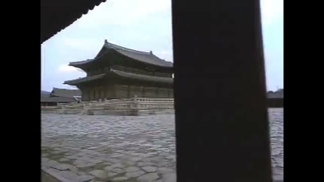

30년 전 오늘, 1996년 11월 10일. 경복궁 앞을 가로막고 있던 옛 조선총독부 건물의 중앙 부분이 철거 완료되면서 광화문로에서도 근정전의 모습이 시원하게 트였습니다. 회색 콘크리트 벽에 갇혀 있던 조선 왕조의 법궁이 마침내 온전한 하늘과 함께 시민들의 시야 앞에 다시 펼쳐졌습니다.

## 조선 왕조의 법궁, 경복궁의 시작

경복궁은 1392년 조선을 건국한 태조 이성계가 1394년 한양 천도를 단행하며 짓기 시작한 법궁입니다. 태조 4년인 1395년 9월에 1차로 완성되었으며, 정도전이 《시경》의 구절인 '이미 술에 취하고 덕에 배부르니 군자 만년에 큰 복을 누리리라'에서 두 글자를 따 경복궁이라 이름 붙였습니다.

근정전과 사정전, 강녕전을 비롯한 주요 전각들이 차례로 자리 잡았고, 세종 대에 이르러 집현전을 비롯한 여러 관청과 간의대 같은 과학 시설이 들어서며 온전한 국가 경영의 중심지로 발전했습니다.

## 임진왜란의 수난과 흥선대원군의 중건

하지만 1592년 임진왜란이 발발하면서 경복궁은 큰 불길에 휩싸여 잿더미가 되었습니다. 전란 이후 막대한 재정 부담 때문에 역대 국왕들은 창덕궁에 머물렀고, 경복궁 터는 270여 년 동안 폐허로 방치되어 문인들이 쑥국을 끓여 먹거나 백로가 날아드는 빈터로 남았습니다.

폐허였던 궁궐이 다시 일어선 것은 1865년 흥선대원군의 주도로 중건 공사가 시작되면서부터였습니다. 7년여에 걸친 대공사 끝에 웅장한 궁궐의 면모를 되찾았으나, 1895년 명성황후 시해 사건과 이듬해 고종의 아관파천을 겪으며 경복궁은 다시 왕궁으로서의 역할을 마감하게 되었습니다.

![[1439호] 중앙청이 박물관으로 ... 건물의 35년 역사 소개 (1983.06.03) 장면 2](../images/2026-11-10-03-2.jpg)
*[1439호] 중앙청이 박물관으로 ... 건물의 35년 역사 소개 (1983.06.03) 장면 2 — 사진: KTV 국민방송 e영상역사관 (대한뉴스) / KTV 공공저작물 — 영상 저작물 전면 개방(대통령실 2025-07-09), 출처 표시*

## 일제강점기 훼손과 조선총독부 청사의 등장

1910년 한일합병 이후 일제는 경복궁의 수많은 전각을 헐어 민간에 매각하거나 다른 용도로 개조했습니다. 1915년에는 시정 5년 기념 조선물산공진회를 열기 위해 흥례문과 행각을 철거하고 박람회장을 꾸몄습니다.

이어 1916년부터 궁궐 정면 한가운데에 거대한 서양식 석조 건물인 조선총독부 청사를 짓기 시작해 1926년 완공했습니다. 이 과정에서 정문인 광화문마저 동쪽 건춘문 북쪽으로 강제로 옮겨졌고, 근정전은 거대한 청사 뒤편에 가려져 도심에서는 전혀 보이지 않게 되었습니다.

![[1971호] 일재 잔재 청산 총독부 관련 건물 해체 (1993.08.18) 장면 1](../images/2026-11-10-03-3.jpg)
*[1971호] 일재 잔재 청산 총독부 관련 건물 해체 (1993.08.18) 장면 1 — 사진: KTV 국민방송 e영상역사관 (대한뉴스) / KTV 공공저작물 — 영상 저작물 전면 개방(대통령실 2025-07-09), 출처 표시*

## 벽체가 허물어지고 마침내 열린 시야

광복 이후에도 옛 총독부 건물은 중앙청과 국립중앙박물관 등으로 쓰이며 오랫동안 경복궁 앞을 가로막고 있었습니다. 1995년 광복 50주년을 맞아 식민 통치의 상징을 없애고 역사적 정의를 바로세우기 위한 철거 작업이 본격적으로 시작되었습니다.

1996년 11월 9일, 총독부 건물의 중앙 부분 철거가 끝나면서 마침내 건물 양쪽 벽체 사이로 커다란 공간이 뚫렸습니다. 광화문 사거리에서 북쪽을 올려다보았을 때 가로막힘 없이 근정전의 웅장한 지붕과 새로 복원된 강녕전의 단정한 전각들이 선명하게 시야에 들어왔습니다.

*경복궁 의 아름다움 경복궁 의 여러 건물들을 소개 (1994.00.00) 장면 1 — 사진: KTV 국민방송 e영상역사관 (문화영화) / KTV 공공저작물 — 영상 저작물 전면 개방(대통령실 2025-07-09), 출처 표시*

## 온전한 제 모습을 향해 이어지는 복원

총독부 건물 철거가 완료된 경복궁 터에서는 훼손되었던 궁궐의 본래 얼개를 되살리는 대규모 복원 사업이 잇따라 진행되었습니다. 2001년에는 총독부 자리에 흥례문 권역이 복원되었고, 2010년에는 제자리를 찾은 광화문이 목조 건물로 온전히 중건되었습니다.

2023년 광화문 월대 복원에 이르기까지 경복궁은 백악산을 뒤로하고 남북 축을 잇는 본래의 당당한 위용을 회복해가고 있습니다. 1996년 가을, 70년 동안 닫혀 있던 궁궐의 문이 다시 열리던 그 시원한 풍경은 오늘날 우리가 누리는 역사적 자긍심의 소중한 첫걸음이었습니다.

### 참고 자료

- <https://newslibrary.naver.com/viewer/index.naver?articleId=1996111000209101008&editNo=45&printCount=1&publishDate=1996-11-10&officeId=00020&pageNo=1&printNo=23363&publishType=00010>
- <https://www.ehistory.go.kr/view/movie?mediasrcgbn=KV&mediaid=10826&mediadtl=23340&mediagbn=DH#t=0.3>
- <https://www.ehistory.go.kr/view/movie?mediasrcgbn=KV&mediaid=10826&mediadtl=23340&mediagbn=DH#t=0.7>
- <https://www.ehistory.go.kr/view/movie?mediasrcgbn=KV&mediaid=11272&mediadtl=25273&mediagbn=DH#t=0.3>
- <https://www.ehistory.go.kr/view/movie?mediasrcgbn=KV&mediaid=1134&mediadtl=7409&mediagbn=MH#t=0.3>
