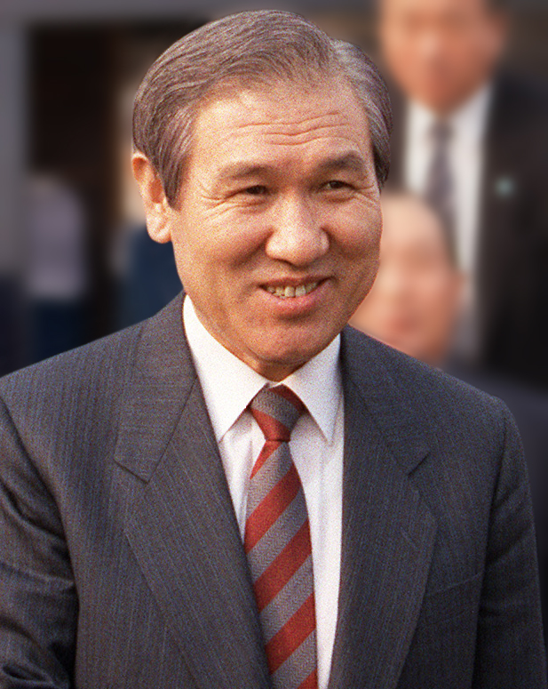

36년 전 오늘, 1990년 11월 10일. 충남 태안군 안면도에 핵폐기물 처리장 건설을 둘러싼 거센 반대 시위가 이어지면서 대규모 경찰 병력이 투입되었습니다. 정부가 계획을 유보하겠다고 밝혔지만 주민들의 반발은 쉽게 가라앉지 않았습니다.

## 평화로운 섬마을을 뒤흔든 핵폐기장 계획

1990년 11월, 충남 태안군 안면도 일대는 거대한 혼란에 휩싸였습니다. 정부가 서해과학연구단지라는 이름 아래 핵폐기물 처분장 설치를 추진해 온 사실이 알려지면서 지역 주민들의 분노가 폭발했습니다. 주민들은 삶의 터전이 오염될 수 있다는 극심한 불안 속에 거리로 뛰쳐나왔습니다. 안면도 주민들뿐 아니라 인근 태안, 서산, 보령, 홍성 등 충남 지역 주민들까지 시위에 동참하며 반대 목소리는 급격히 커졌습니다.

## 정부의 유보 발표와 주민들의 불신

사태가 심각해지자 정부는 11월 8일 밤 관계장관회의를 열고 처분장 설치 계획을 일단 유보하기로 방침을 정했습니다. 하지만 주민들은 이를 믿지 않았습니다. 노병돈 위원장이 이끄는 핵폐기물 처분장 설치반대추진위원회는 정부가 공식 문서로 백지화를 약속하지 않는다면 시위를 가라앉히기 위한 기만책에 불과하다고 맞섰습니다. 주민 5백여 명은 가랑비가 내리는 궂은 날씨 속에서도 닷새째 농성을 이어가며 완전 백지화를 촉구했습니다.

*사건 당시 사진 아님 · 1989년 — 사진: CHERIE A. THURLBY / Public domain*

## 경찰 3천5백 명 투입과 대규모 연행

11월 9일 오전 6시, 정부는 시위에 강경하게 대처하기로 하고 대규모 공권력을 투입했습니다. 서울과 전북 등지에서 차출된 23개 중대, 3천5백여 명의 경찰 병력이 안면도 일대로 진입했습니다. 경찰은 시위 가담자 검거에 나섰고, 안면고 3학년 학생을 비롯한 중고생 29명을 포함해 총 75명이 연행되었습니다. 강영훈 국무총리는 내무부 장관에게 법질서 파괴 행위에 단호히 대처하라고 지시했고, 검경은 주동자를 전원 구속하겠다는 방침을 밝혔습니다.

![[1823호] 노태우 대통령 국민과의 대화 ... 역량을 집중 투입하겠다고 밝혔음. (1990.10.17) 장면 1](../images/2026-11-10-04-3.jpg)
*[1823호] 노태우 대통령 국민과의 대화 ... 역량을 집중 투입하겠다고 밝혔음. (1990.10.17) 장면 1 — 사진: KTV 국민방송 e영상역사관 (대한뉴스) / KTV 공공저작물 — 영상 저작물 전면 개방(대통령실 2025-07-09), 출처 표시*

## 과기처 장관의 전격 문책 경질

사태가 걷잡을 수 없이 악화하자 청와대도 긴급 진화에 나섰습니다. 노태우 대통령은 11월 9일 오후 정근모 과학기술처 장관의 사표를 수리하고 후임으로 김진현 동아일보 논설주간을 임명했습니다. 또한 충남도경국장을 직위해제했습니다. 청와대는 관계기관 사전 협조가 부족했고 현지 여론 수렴을 소홀히 한 책임을 물어 문책 인사를 단행했다고 밝혔습니다.

![[1823호] 노태우 대통령 국민과의 대화 ... 역량을 집중 투입하겠다고 밝혔음. (1990.10.17) 장면 2](../images/2026-11-10-04-4.jpg)
*[1823호] 노태우 대통령 국민과의 대화 ... 역량을 집중 투입하겠다고 밝혔음. (1990.10.17) 장면 2 — 사진: KTV 국민방송 e영상역사관 (대한뉴스) / KTV 공공저작물 — 영상 저작물 전면 개방(대통령실 2025-07-09), 출처 표시*

## 격렬함을 식힌 안면도의 첫눈

11월 10일 아침, 불길과 최루탄 연기로 뒤덮였던 안면도에 때이른 첫눈이 수북이 내려앉았습니다. 수습대책위원회의 설득으로 등교 거부를 이어가던 학생들도 눈 덮인 고갯길을 넘어 학교로 발걸음을 옮겼습니다. 격렬했던 대치와 혼란이 잦아들며 차분한 정적이 찾아왔지만, 밀실 행정과 주민 불신이 남긴 상처는 깊었습니다.

### 참고 자료

- <https://newslibrary.naver.com/viewer/index.naver?articleId=1990111000289101001&editNo=4&printCount=1&publishDate=1990-11-10&officeId=00028&pageNo=1&printNo=771&publishType=00010>
- <https://commons.wikimedia.org/wiki/File:Roh_Tae-woo_-_cropped,_1990-Mar-13.jpg>
- <https://commons.wikimedia.org/wiki/File:Roh_Tae-woo_-_cropped,_1989-Mar-13.jpg>
- <https://www.ehistory.go.kr/view/movie?mediasrcgbn=KV&mediaid=12199&mediadtl=28426&mediagbn=DH#t=0.3>
- <https://www.ehistory.go.kr/view/movie?mediasrcgbn=KV&mediaid=12199&mediadtl=28426&mediagbn=DH#t=0.7>
