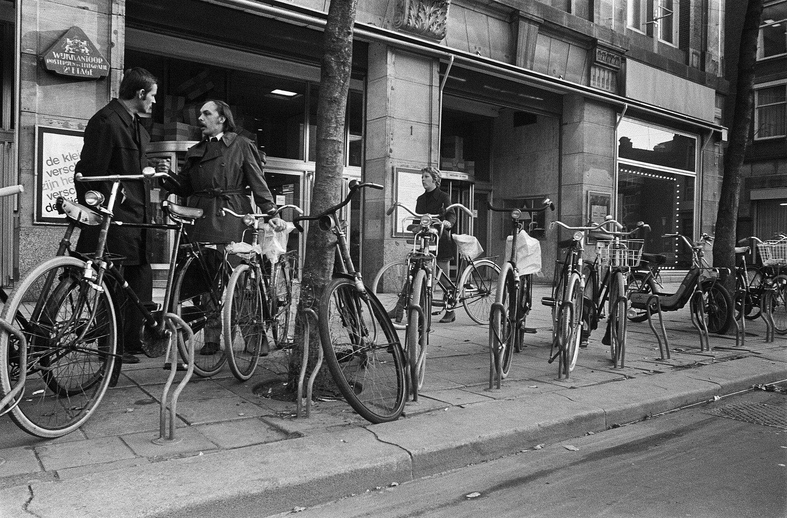

53년 전 오늘, 1973년 11월 10일. 정부가 국내 석유류 제품 공급량을 5% 줄이는 긴급 비상대책을 마련했습니다. 제4차 중동전쟁 여파로 아랍 산유국들이 감산에 들어가며 닥친 제1차 오일쇼크 속에서, 한국 역시 원유 공급 감축 대상에 오르자 내놓은 긴급 조치였습니다.

## 중동에서 불어닥친 원유 감산의 충격

1973년 10월 발발한 중동전쟁 이후, 아랍 산유국들은 원유 생산을 줄이고 수출을 통제하는 자원 무기화에 나섰습니다. 이로 인해 전 세계는 유례없는 석유 파동, 이른바 제1차 오일쇼크에 직면했습니다. 원유를 전량 해외 수입에 의존하고 있던 한국 경제에도 곧바로 빨간불이 켜졌습니다.

한국에 원유를 공급하던 걸프, 칼텍스, 유니온 등 미국의 주요 3대 석유회사로부터 감량 통고가 임박했다는 소식이 전해졌습니다. 원유 도입량이 줄어들면 공장이 멈추고 운송이 마비될 수 있는 심각한 국가적 위기였습니다.

## 정부의 긴급 지시와 5% 공급 감량

1973년 11월 9일 오후, 심의환 상공부 차관은 기자회견을 열고 원유 감량에 대비한 정부의 긴급 대책을 발표했습니다. 상공부는 이미 11월 7일부터 유공, 호남정유, 경인에너지 등 국내 3개 정유회사에 석유류 제품 공급량을 5% 감축하도록 지시했습니다. 이는 주유소와 중간 판매상으로 나가는 물량을 줄여 비축량을 최대한 확보하기 위한 조치였습니다.

당시 미국을 방문 중이던 이낙선 상공부 장관도 현지 원유 공급사 대표들을 직접 만나 한국에 대한 공급 감량 규모를 최소화해 달라고 특별 배려를 요청하고 있었습니다.

*Huurfietsen worden aangeboden, Bestanddeelnr 926-7972 — 사진: Anefo / CC0*

## 배급제 검토와 단계별 비상 소비 억제책

정부는 원유 공급 감소율이 10%를 넘거나 20% 이상으로 확대될 경우를 대비한 단계별 비상 계획도 마련했습니다. 심의환 차관은 원유 감량 폭이 커지면 기존의 범국민 에너지 소비 절약 운동만으로는 극복하기 어렵다며 배급제 실시가 불가피하다고 설명했습니다.

검토된 대책에는 배급 시 특수용, 기간산업용, 운수용, 병원과 학교 등 공공시설에 최우선 순위를 두고 일반 소비는 최소한으로 줄이는 방안이 포함되었습니다. 또한 자가용 승용차에 대한 주유소의 휘발유 판매를 제한하고, 유원지의 공인주차장을 폐쇄하며, 연간 석유 생산량의 14.6%에 달하는 석유제품 수출을 전면 중지하는 고강도 방안들이 망라되었습니다.

![[957호] 이런일 저런일 ... 첫 선을 보임. (1973.11.10) 장면 1](../images/2026-11-10-06-3.jpg)
*[957호] 이런일 저런일 ... 첫 선을 보임. (1973.11.10) 장면 1 — 사진: KTV 국민방송 e영상역사관 (대한뉴스) / KTV 공공저작물 — 영상 저작물 전면 개방(대통령실 2025-07-09), 출처 표시*

## 매점매석 단속과 에너지 절약 총력전

정부는 석유류의 공급 부족에 편승한 일시적인 가수요나 매점 행위를 소방법 등을 동원해 철저히 단속하겠다는 방침을 정했습니다. 석유제품은 장기 보관이 어렵고 시설 한계가 있어 대규모 사재기는 어려울 것으로 보았으나, 시장 혼란을 사전에 차단하기 위한 엄격한 규제가 예고되었습니다.

이와 함께 정부 각 부처가 유보해 두었던 에너지 절약 관련 13개 세부 과제를 즉시 발전시켜 시행하기로 했습니다. 연료를 기준 이상으로 과다하게 사용하는 곳에는 무거운 세금을 물리거나 법적 제재를 가하는 방안까지 검토되었습니다.

![[957호] 이런일 저런일 ... 첫 선을 보임. (1973.11.10) 장면 2](../images/2026-11-10-06-4.jpg)
*[957호] 이런일 저런일 ... 첫 선을 보임. (1973.11.10) 장면 2 — 사진: KTV 국민방송 e영상역사관 (대한뉴스) / KTV 공공저작물 — 영상 저작물 전면 개방(대통령실 2025-07-09), 출처 표시*

## 오일쇼크가 남긴 절약의 기억

1973년의 유류 비상대책은 에너지 자립도가 취약했던 한국 사회에 큰 경종을 울렸습니다. 네온사인이 일제히 꺼지고 난방을 줄이며, 관공서와 기업의 차량 운행을 업무용으로 엄격히 제한하는 풍경이 일상이 되었습니다.

온 나라가 기름 한 방울을 아끼기 위해 긴장 속에 허리띠를 졸라맸던 그 시절의 경험은 한국의 에너지 정책과 산업 구조를 돌아보게 만든 중대한 분기점이었습니다.

### 참고 자료

- <https://newslibrary.naver.com/viewer/index.naver?articleId=1973111000329201003&editNo=2&printCount=1&publishDate=1973-11-10&officeId=00032&pageNo=1&printNo=8654&publishType=00020>
- <https://commons.wikimedia.org/wiki/File:Libyan_Oil_Facility_-_Flickr_-_The_Central_Intelligence_Agency.jpg>
- <https://commons.wikimedia.org/wiki/File:Huurfietsen_worden_aangeboden,_Bestanddeelnr_926-7972.jpg>
- <https://www.ehistory.go.kr/view/movie?mediasrcgbn=KV&mediaid=881&mediadtl=5932&mediagbn=DH#t=0.3>
- <https://www.ehistory.go.kr/view/movie?mediasrcgbn=KV&mediaid=881&mediadtl=5932&mediagbn=DH#t=0.7>
