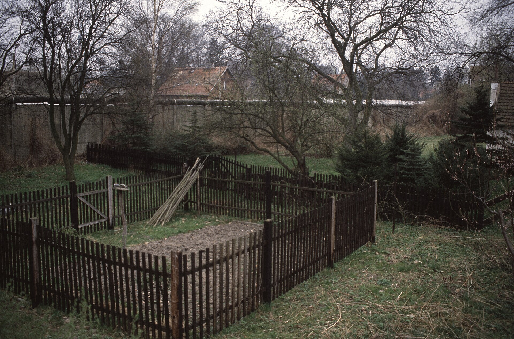
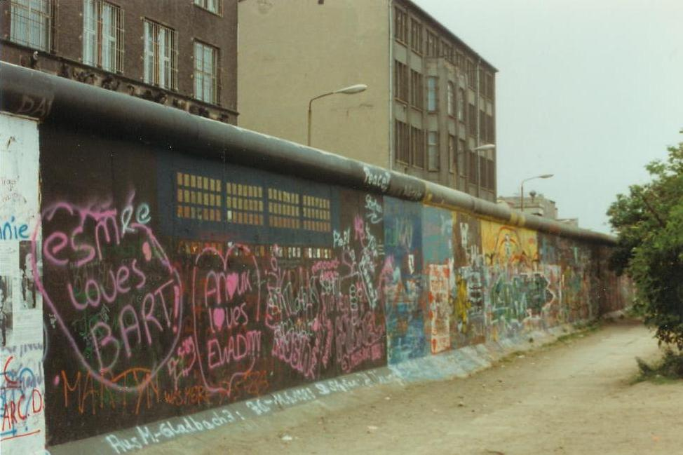
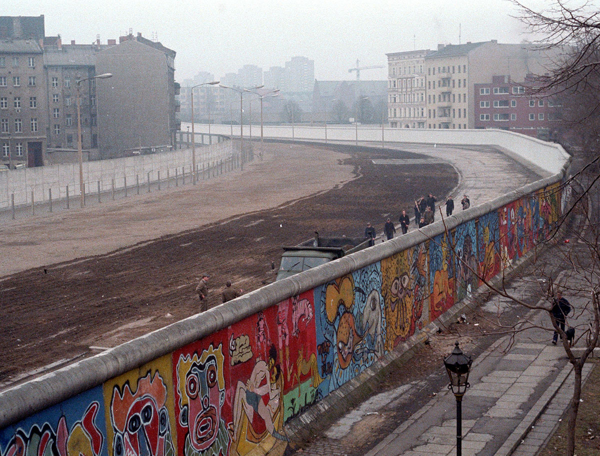

37년 전 오늘, 1989년 11월 11일. 전 세계는 동서 냉전의 가장 두터운 상징이었던 베를린 장벽이 무너져 내리는 역사적 장면을 숨죽여 지켜보았습니다. 수십 년간 가족과 이웃을 갈라놓았던 거대한 콘크리트 벽이 시민들의 손에 의해 허물어지기 시작했습니다.

## 28년 동안 도시를 갈라놓은 거대한 장벽

베를린 장벽은 1961년 8월 동독 정부에 의해 기습적으로 세워졌습니다. 서베를린을 둘러싼 장벽의 길이는 155킬로미터에 달했고, 높이 3.6미터의 두 겹 콘크리트 벽과 302개의 감시탑, 순찰로와 철조망이 촘촘히 설치되었습니다.

동독을 탈출하려던 수많은 주민이 경비대의 총격에 목숨을 잃으며 '수치의 장벽'이라 불렸던 이곳은, 28년이라는 긴 세월 동안 넘을 수 없는 철의 장막으로 군림했습니다.

## 말 한마디로 시작된 전격적인 국경 개방

변화의 바람은 갑작스럽게 불어닥쳤습니다. 1989년 11월 9일, 동독 공산당 선전담당 서기 귄터 샤보브스키는 긴급 기자회견을 열고 모든 국민에게 서방 국가를 포함한 해외여행을 자유롭게 허용하며 국경을 즉시 개방한다고 밝혔습니다.

발표 직후 수십 명의 동독인이 장벽 검문소로 향했고, 이 소식은 순식간에 방송을 타고 퍼져나갔습니다. 굳게 닫혀 있던 검문소 문이 열리자 기적 같은 이동이 시작되었습니다.

*0477 1989 BERLIN Steinstucken (april) (14307995024) — 사진: Aad van der Drift / CC BY 2.0*

## 찰리 검문소와 브란덴부르크 문 앞의 환호

11월 10일, 서베를린으로 향하는 찰리 검문소와 브란덴부르크 문 일대는 거대한 축제의 장으로 변했습니다. 낡은 동독제 트라반트와 라다 자동차들이 끝없이 줄을 지어 넘어왔고, 검문소는 몰려든 인파로 검사조차 진행할 수 없는 상태가 되었습니다.

거리로 쏟아져 나온 서독 시민들은 넘어오는 동포들의 머리 위로 맥주와 샴페인을 쏟아붓고 꽃을 안겨주었습니다. 프리드리히가에서 꽃집을 하던 한 상인은 가게 문을 닫고 꽃을 들고 나와 사람들에게 나눠주었고, 어린 소년은 돼지저금통을 깨서 산 서베를린 지도를 동독인들에게 건네기도 했습니다.

*1989년 자료 — 사진: No machine-readable author provided. Angr assumed (based on  / Public domain*

## 끌과 망치로 부순 분단의 상징

청년들은 주저 없이 장벽 위로 올라갔습니다. 그들은 손에 끌과 망치를 쥐고 28년 동안 서 있던 단단한 콘크리트 벽을 직접 두드려 깨뜨렸습니다.

폴란드 방문 일정을 단축하고 급히 귀국한 서독의 헬무트 콜 총리는 서베를린 시청 청사 밖에서 수천 명의 시민 앞에 섰습니다. 그는 우리는 한 국가이고 앞으로도 한 국가로 계속 남아있을 것이라며 한 걸음씩 공동의 미래로 나아가자고 역설했습니다.

*1986년 자료 — 사진: Noir / CC BY-SA 3.0*

## 한국인들에게 전해진 남다른 울림

지구 반대편에서 전해진 베를린 장벽 붕괴 소식은 한국인들에게도 깊은 충격과 감동을 안겨주었습니다. 세계 유일의 분단국가로 휴전선을 마주하고 살아가던 국민들에게 독일인들이 얼싸안는 장면은 남의 일 같지 않았습니다.

언젠가는 한반도의 철조망도 저 콘크리트 장벽처럼 평화롭게 걷힐 수 있을 것이라는 희망이 전국을 가득 채웠습니다. 베를린 거리에서 울려 퍼진 환호성은 한국인들의 가슴속 통일 염원을 다시금 뜨겁게 지폈습니다.

## 장벽이 남긴 역사와 교훈

베를린 장벽의 붕괴는 단순한 구조물의 철거를 넘어 동서 냉전 질서의 종식을 알리는 신호탄이었습니다. 동독 공산당 중앙위원회는 자유선거와 대대적인 개혁을 약속했고, 독일은 이듬해인 1990년 마침내 완전한 통일을 이루어냈습니다.

오늘날 베를린 도시 곳곳에는 당시 장벽이 서 있던 자리가 바닥의 표시선과 기념물로 남아 있습니다. 굳건했던 벽도 자유와 평화를 향한 사람들의 열망 앞에서는 버틸 수 없음을 역사는 잊지 않고 증명하고 있습니다.

### 참고 자료

- <https://newslibrary.naver.com/viewer/index.naver?articleId=1989111100209201003&editNo=2&printCount=1&publishDate=1989-11-11&officeId=00020&pageNo=1&printNo=20958&publishType=00020>
- <https://commons.wikimedia.org/wiki/File:19891217a_Treptower_Br%C3%BCcke.jpg>
- <https://commons.wikimedia.org/wiki/File:0477_1989_BERLIN_Steinstucken_(april)_(14307995024).jpg>
- <https://commons.wikimedia.org/wiki/File:Berlin_Wall_(June_1989).jpg>
- <https://commons.wikimedia.org/wiki/File:Berlinermauer.jpg>
