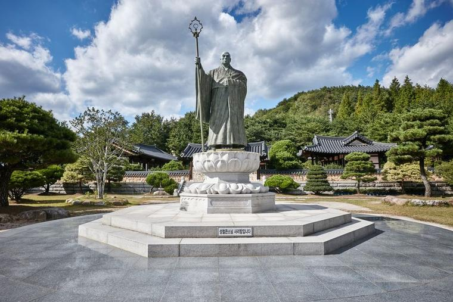
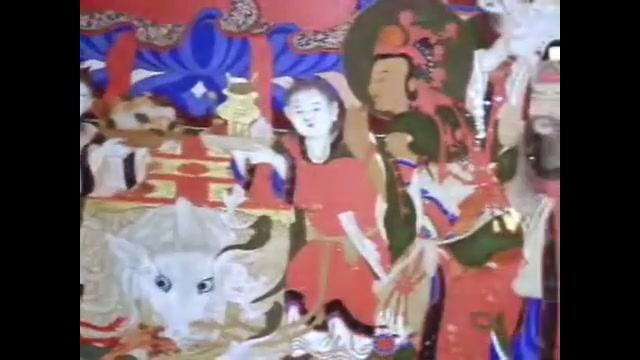
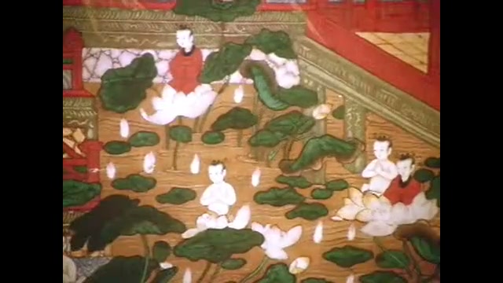

33년 전 오늘, 1993년 11월 11일 조간 신문들은 일제히 조계종 종정 성철 스님의 다비식 소식을 1면에 전했습니다. 1993년 11월 4일 입적한 성철 스님의 영결식과 다비식이 전날인 11월 10일 합천 해인사에서 10만여 인파가 모인 가운데 엄수되었습니다.

## 무소유와 철저한 수행의 삶

성철 스님은 1912년 태어나 1937년 해인사에서 출가한 이래 현대 한국 불교를 대표하는 선승으로 꼽혔습니다. 8년 동안 자리에 눕지 않고 참선하는 '장좌불와'를 실천했으며, 깁고 기운 누더기 옷 한 벌로 평생을 살았습니다. 소금기마저 피하는 담박한 식생활을 지키며 오직 참선과 깨달음에만 매진한 청빈의 표상이었습니다.

## 전국 1만2천 사찰의 타종과 영결식

입적 7일째인 1993년 11월 10일 오전 11시, 해인사 대적광전 앞뜰에서 성철 스님의 영결식이 전통 불교의식으로 거행되었습니다. 조계종 산하 1만2천여 본·말사에서 일제히 다섯 차례 명종이 울리며 시작되었습니다. 영결식장에는 원로 스님과 문도 3천여 명, 정관계 인사, 주한 외교사절을 비롯해 10만여 신도가 운집해 스님의 숭고한 뜻을 기렸습니다.

*사건 당시 사진 아님 — 사진: 한국관광공사 / KOGL Type 1 attribution*

## 연화대에서 피어오른 불길

영결식을 마친 뒤 스님의 법구는 오후 1시경 3킬로미터 떨어진 다비장으로 운구되었습니다. 참나무로 높이 쌓아 올린 연화대에 법구가 모셔진 후 하화 의식이 진행되자 연화대는 거센 불길에 휩싸였습니다. 다비장을 가득 메운 수만 명의 신도들은 합장한 채 눈물을 흘리며 '나무아미타불' 염불을 외웠습니다.

*토속신앙과 결부된 불화 우리나라 전통 토속신앙과 결부된 불화 (1990.00.00) 장면 1 — 사진: KTV 국민방송 e영상역사관 (문화영화) / KTV 공공저작물 — 영상 저작물 전면 개방(대통령실 2025-07-09), 출처 표시*

## 밤샘 다비와 사리 수습

다비식은 수천 명의 스님과 신도들이 밤새 자리를 지키며 엄숙하게 이어졌습니다. 불길이 잦아든 11월 11일 오전 6시경부터 사리 수습이 시작되었습니다. 수습된 사리는 도자기함에 담겨 49재 때까지 대적광전에 안치된 뒤 해인사 입구의 부도에 봉안되었습니다.

*토속신앙과 결부된 불화 우리나라 전통 토속신앙과 결부된 불화 (1990.00.00) 장면 2 — 사진: KTV 국민방송 e영상역사관 (문화영화) / KTV 공공저작물 — 영상 저작물 전면 개방(대통령실 2025-07-09), 출처 표시*

## 오늘날까지 남은 큰 가르침

성철 스님이 남긴 청빈과 무소유, 그리고 치열했던 수행의 정신은 종교의 벽을 넘어 수많은 사람들에게 깊은 울림을 주었습니다. 화려한 겉치레를 멀리하고 본래의 마음에 집중하라는 큰스님의 가르침은 오늘날에도 우리 사회를 돌아보게 하는 소중한 나침반으로 남아 있습니다.

### 참고 자료

- <https://newslibrary.naver.com/viewer/index.naver?articleId=1993111100329101003&editNo=15&printCount=1&publishDate=1993-11-11&officeId=00032&pageNo=1&printNo=14914&publishType=00010>
- <https://www.kogl.or.kr/recommend/recommendDivView.do?division=img&recommendIdx=2746>
- <https://www.ehistory.go.kr/view/movie?mediasrcgbn=KV&mediaid=1852&mediadtl=8671&mediagbn=MH#t=0.3>
- <https://www.ehistory.go.kr/view/movie?mediasrcgbn=KV&mediaid=1852&mediadtl=8671&mediagbn=MH#t=0.7>
