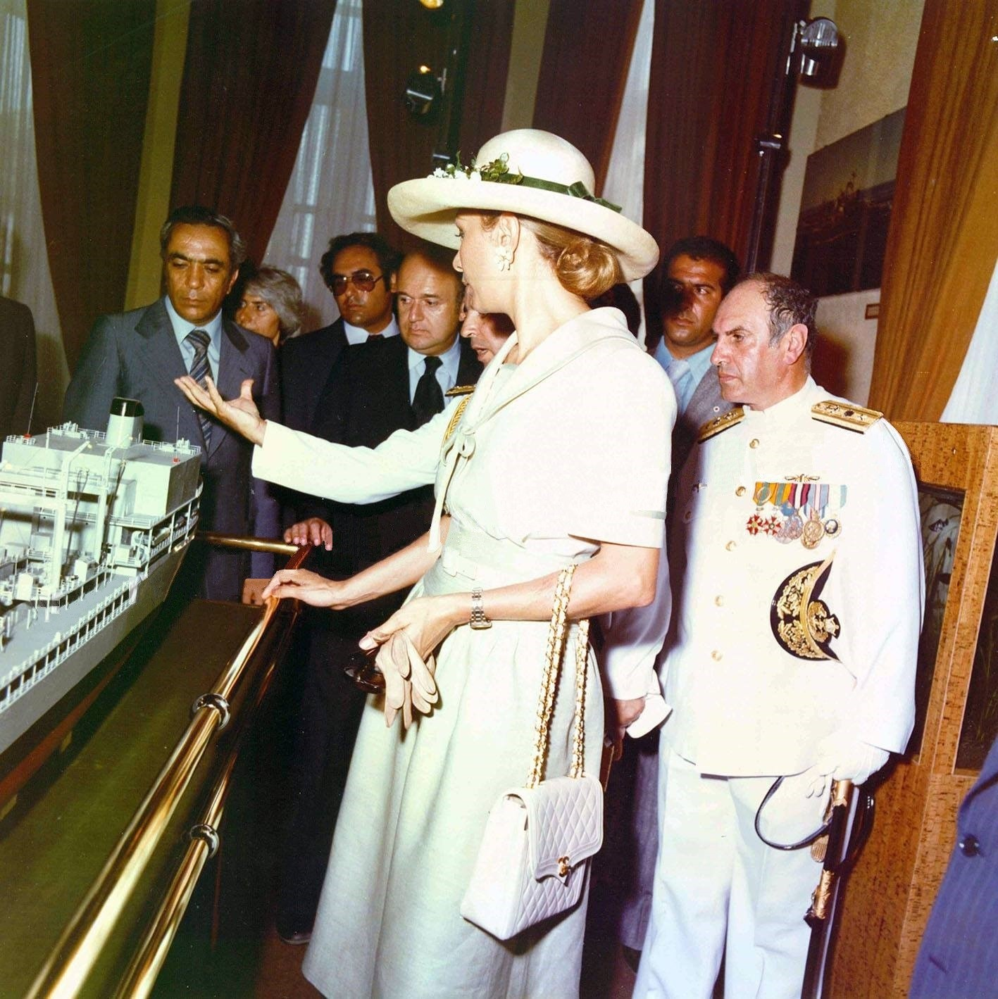
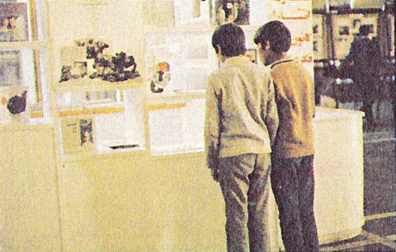

48년 전 오늘, 1978년 11월 11일. 이란의 정국 혼란이 걷잡을 수 없이 커지자 대한민국 정부는 현지 주재 공관원과 상사 직원 가족들에게 즉각적인 철수령을 내렸습니다. 중동 붐의 중심지였던 이란에서 1만 명이 넘는 한국인이 일하던 시절, 고국에 전해진 긴급 철수 소식은 온 나라를 긴장시켰습니다.

## 소요 사태의 격화와 정부의 긴급 결정

1978년 11월 10일, 정부는 이란 정정이 최악의 사태로 번질 가능성에 대비해 현지 공관원 및 상사 직원 가족 1백20여 명(초기 추산 2백여 명)을 즉각 철수시키라는 긴급 훈령을 현지 공관에 내렸습니다. 외무부는 노재원 아중동국장을 반장으로 하는 '이란사태 대책반'을 외무부 내에 긴급 설치하고 사태 파악에 돌입했습니다. 정부 당국자는 군정 성립 이후 다소 안정을 되찾고 있다고 보면서도, 만일의 사태에 대비한 선제적 예방 조치로 가족 소개령을 내렸다고 밝혔습니다.

## 닫혀버린 하늘길과 1,300킬로미터 산악로

철수령이 내려졌지만 현지 상황은 극도로 위태로웠습니다. 수도 테헤란 공항이 전격 폐쇄되면서 비행기를 통한 신속한 이동이 가로막혔기 때문입니다. 정부는 두 가지 탈출 경로를 검토했습니다. 하나는 중동 해역에 나가 있는 한국 상선과 어선을 이란 남부 호람샤항으로 집결시키는 방안이었습니다. 그러나 호람샤항은 교민들이 주로 거주하던 수도 테헤란에서 험준한 산악을 넘어 1천3백 킬로미터나 떨어져 있어 차량 이동이 사실상 불가능에 가까웠습니다. 결국 바레인과 쿠웨이트 등 인근 노선에 취항하던 대한항공(KAL) 여객기를 공항 폐쇄 해제 즉시 테헤란으로 급파하는 방안이 유일한 대안으로 떠올랐습니다.

*Zan-e Rooz cover, Issue 705 - 11 November 1978 — 사진: Zan-e Rooz / Public domain*

## 이란 전역에 흩어진 1만 1천여 명의 한국인

당시 이란은 한국 건설업계와 무역 상사들의 주요 활동 무대였습니다. 공관원과 16개 상사 주재원, 건설업체 근로자를 모두 합쳐 무려 1만 1천6백47명의 한국인이 이란 땅에 머물고 있었습니다. 이들은 남부 아와즈에 2천4백 명, 가즈빈에 2천44명, 시라즈에 1천8백 명, 수도 테헤란에 1천6백 명 등 4~6개 주요 도시에 분산되어 굵은 땀방울을 흘리고 있었습니다. 공항이 다시 열리더라도 각국 외국인들의 귀국 행렬이 한꺼번에 몰려 극심한 혼잡이 빚어질 것이 뻔한 상황이었습니다.

*ShahbanouNavyMuseum27Khordad2537Shahanshahi5 — 사진: Dmdldmdoke / CC BY 4.0*

## 교민 안전 당부와 긴장된 국내 가족들

외무부 대책반은 현지 교민과 주재원들에게 이란 정부를 자극할 수 있는 일체의 언행을 삼가고 불필요한 외출을 자제하도록 지시했습니다. 또한 사태가 안정된 지역으로 가족들을 우선 분산 이동시킨 뒤 귀국 편을 기다리도록 조치했습니다. 당시 한국 경제의 중요한 축을 담당하던 중동 파견 인력들이 위험에 처했다는 소식에, 국내에서 이들을 기다리던 수많은 가족과 국민들은 텔레비전과 신문 뉴스에서 눈을 떼지 못하며 뜬눈으로 밤을 지새웠습니다.

*Kanunairport — 사진: Unknown authorUnknown author / Public domain*

## 중동 개척의 험로를 돌아보며

1978년 11월의 이란 사태는 열사의 땅에서 피땀 흘려 나라 경제를 일구던 우리 파견 인력들이 마주해야 했던 냉혹한 국제정세의 한 단면이었습니다. 낯선 이국땅에서 급변하는 정치적 소용돌이를 겪으며 가슴을 졸였던 교민들과 그들을 걱정하던 고국의 애타는 마음은 대한민국 현대사의 잊을 수 없는 한 페이지로 남아 있습니다.

### 참고 자료

- <https://newslibrary.naver.com/viewer/index.naver?articleId=1978111100209201014&editNo=2&printCount=1&publishDate=1978-11-11&officeId=00020&pageNo=1&printNo=17570&publishType=00020>
- <https://commons.wikimedia.org/wiki/File:Zan-e_Rooz_cover,_Issue_698_-_23_September_1978.jpg>
- <https://commons.wikimedia.org/wiki/File:Zan-e_Rooz_cover,_Issue_705_-_11_November_1978.jpg>
- <https://commons.wikimedia.org/wiki/File:ShahbanouNavyMuseum27Khordad2537Shahanshahi5.jpg>
- <https://commons.wikimedia.org/wiki/File:Kanunairport.jpg>
