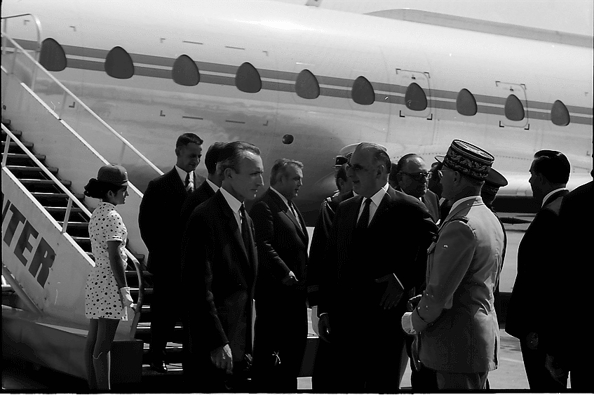
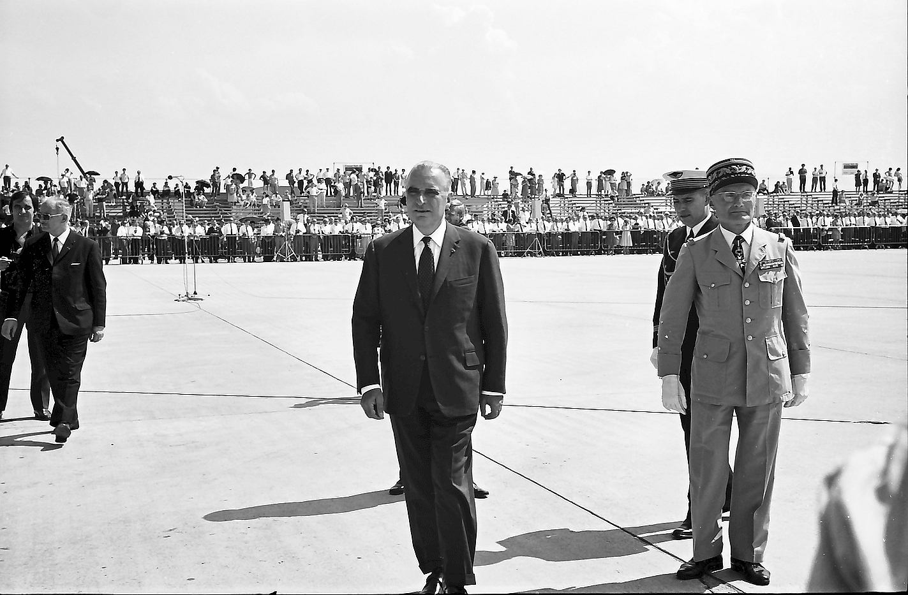
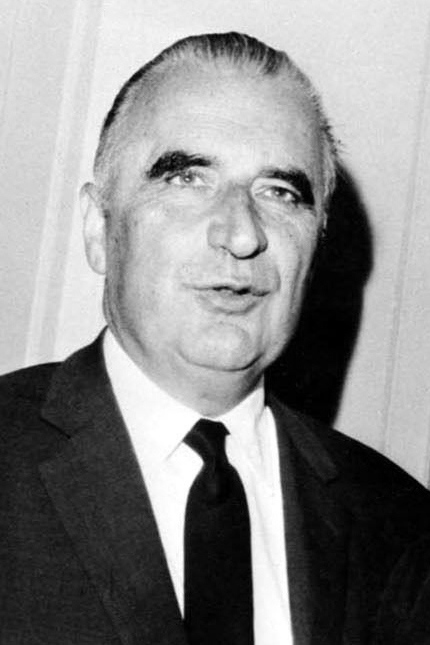

56년 전 오늘, 1970년 11월 11일. 현대 프랑스사와 국제정치계의 거목이었던 샤를 드골 전 프랑스 대통령의 갑작스러운 서거 소식이 국내 신문 1면을 일제히 장식했습니다. 1969년 정계에서 은퇴한 뒤 조용한 시골 마을에서 회고록을 집필하던 노 지도자는 80세 생일을 불과 열흘 남짓 앞두고 세상을 떠났습니다.

## 평화로운 시골 저택에서 맞이한 마지막 순간

샤를 드골 전 대통령은 1970년 11월 9일 오후 7시 30분(한국 시간 10일 오전 3시 30분), 프랑스 동부 샹파뉴 지방의 작은 마을 콜롱베 레 뒤제글리제에 위치한 자택 라 보외세리에서 숨을 거두었습니다. 향년 79세였습니다. 이날도 낮 동안 산책을 하고 회고록 집필을 이어갔던 드골은 저녁 무렵 거실 안락의자에 앉아 저녁 텔레비전 뉴스를 기다리며 카드놀이를 하고 있었습니다.

그 순간 드골은 갑작스러운 심장 통증을 느끼며 쓰러졌습니다. 거실에 단둘이 머물고 있던 부인 이본 여사가 다급히 마을의 가톨릭 신부와 의사를 불렀으나, 의료진이 도착했을 때 장군은 이미 손을 쓸 수 없는 상태였습니다. 그는 쓰러진 지 불과 15분 만에 조용히 눈을 감았습니다.

## 위기 때마다 나라를 구한 '불사의 영웅'

드골의 갑작스러운 죽음은 프랑스 국민들에게 형언할 수 없는 충격을 안겼습니다. 그는 제2차 세계대전 당시 나치 독일에 맞서 망명 정부인 '자유 프랑스'를 결성하고 대독 항전을 이끌며 조국을 해방으로 인도한 민족적 영웅이었습니다. 전후 1958년 알제리 위기로 조국이 내란 위기에 직면했을 때도 다시 정계에 복귀해 프랑스 제5공화국 헌법을 세우고 강력한 대통령제를 구축했습니다.

프랑스 시민들은 위기의 순간마다 분연히 일어나 나라를 구해냈던 드골을 마치 영원히 스러지지 않을 존재처럼 여기고 있었습니다. 그러나 1968년 68운동이라는 거대한 사회적 격변을 겪은 뒤, 1969년 4월 지방제도 개혁을 위한 국민투표가 부결되자 그는 스스로 약속한 대로 미련 없이 권좌에서 물러나 고향으로 내려갔습니다.

*Basel (CH) - Mulhouse (F)- Ankunft von Staatspräsident Pompidou - LABW - Staatsarchiv Freiburg W 134 Nr. 029718 — 사진: Willy Pragher / CC BY 4.0*

## "프랑스는 이제 외로운 미망인이 되었다"

드골 전 대통령의 서거 소식은 철저한 보안 속에 유지되다가 이튿날 새벽 사위인 알렝 데 보아시외 장군을 통해 엘리제궁의 조르주 퐁피두 대통령에게 전해졌습니다. 과거 드골 밑에서 총리를 지냈던 퐁피두 대통령은 11월 10일 오후 긴급 각의를 소집한 뒤 전국에 중계된 라디오와 텔레비전 방송을 통해 부음을 공식 발표했습니다.

퐁피두 대통령은 성명에서 "드골 장군은 이제 유명을 달리했다. 그가 그처럼 끔찍이 사랑하던 프랑스는 이제 외로운 미망인이 되었다"고 발표하며 비통함을 감추지 못했습니다. 파리 시민들은 너무나 뜻밖의 소식에 말을 잇지 못하고 침통한 표정으로 거리를 메웠으며, 프랑스 정부는 그의 장례일인 11월 12일을 전국적인 '국조일'로 공식 선포했습니다.

*Basel (CH) - Mulhouse (F)- Staatspräsident Pompidou begrüßt Formationen - LABW - Staatsarchiv Freiburg W 134 Nr. 029719b — 사진: Willy Pragher / CC BY 4.0*

## 유언에 따른 소박한 안식, 그리고 노트르담의 침묵

국가적인 영웅이었음에도 불구하고 장례 절차는 고인의 엄격한 생전 유언에 따라 지극히 간소하게 치러졌습니다. 드골은 거창한 국장을 사양하고 오직 가까운 친지와 마을 주민들만 참석한 가운데 고향 콜롱베 레 뒤제글리제의 작은 성당에서 조용히 영면에 들기를 원했습니다. 유해는 제2차 세계대전 직후 결핵으로 먼저 세상을 떠난 셋째 딸 안 드골의 묘소 곁에 나란히 안장되었습니다.

같은 시각 파리의 유서 깊은 노트르담 대성당에서는 정부 관료들과 세계 각국에서 찾아온 외교 사절들이 참석한 가운데 추모 미사가 엄수되었습니다. 하지만 이 거대한 종교의식에서도 고인의 뜻에 따라 정치적인 조사나 거창한 연설은 일절 낭독되지 않았습니다. 장엄한 침묵만이 한 세대를 풍미한 거인의 마지막 길을 배웅했습니다.

*Georges Pompidou 1969 (cropped) — 사진: Farabola / Public domain*

## 미완으로 남은 회고록과 20세기의 퇴장

하야 후 콜롱베에서 은둔 생활을 이어가던 드골은 생애 마지막 날까지 회고록 제2부인 『희망회고록』 집필에 몰두하고 있었습니다. 첫 권인 『재생』을 출간한 지 얼마 지나지 않아 심장마비로 쓰러지면서 그의 방대한 기록은 미완성으로 남게 되었습니다.

강력한 서유럽의 자주성과 주권 국가들의 연대를 역설하며 전후 국제정치의 독자적인 축을 구축했던 샤를 드골. 안락의자 위에서 텔레비전 뉴스를 기다리다 홀연히 떠난 그의 마지막 순간은, 격동과 혼란의 20세기를 헤쳐 온 한 거목이 마침내 역사의 뒤안길로 완전히 걸어 들어갔음을 알리는 장엄한 신호였습니다.

### 참고 자료

- <https://newslibrary.naver.com/viewer/index.naver?articleId=1970111100329201009&editNo=2&printCount=1&publishDate=1970-11-11&officeId=00032&pageNo=1&printNo=7725&publishType=00020>
- <https://commons.wikimedia.org/wiki/File:FrancoDeGaulle.png>
- <https://commons.wikimedia.org/wiki/File:Basel_(CH)_-_Mulhouse_(F)-_Ankunft_von_Staatspr%C3%A4sident_Pompidou_-_LABW_-_Staatsarchiv_Freiburg_W_134_Nr._029718.jpeg>
- <https://commons.wikimedia.org/wiki/File:Basel_(CH)_-_Mulhouse_(F)-_Staatspr%C3%A4sident_Pompidou_begr%C3%BC%C3%9Ft_Formationen_-_LABW_-_Staatsarchiv_Freiburg_W_134_Nr._029719b.jpeg>
- <https://commons.wikimedia.org/wiki/File:Georges_Pompidou_1969_(cropped).jpg>
