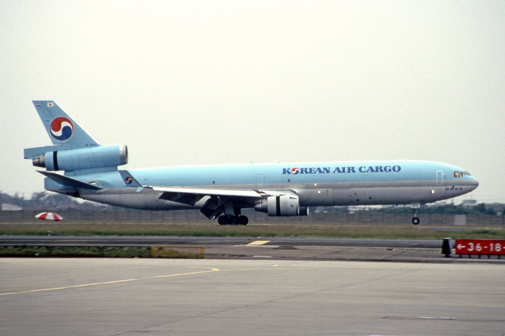
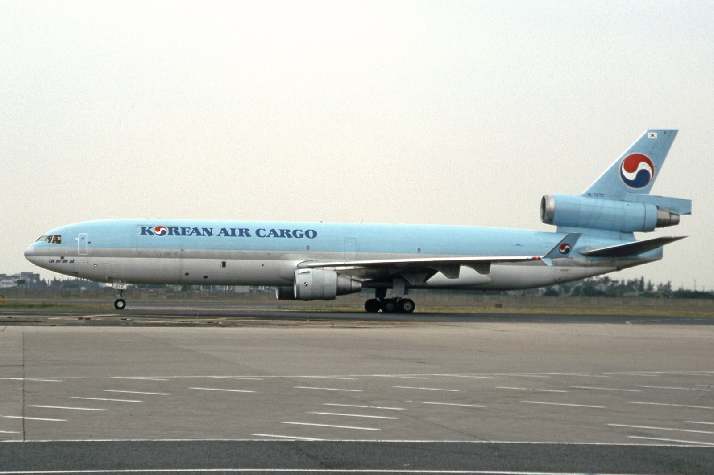
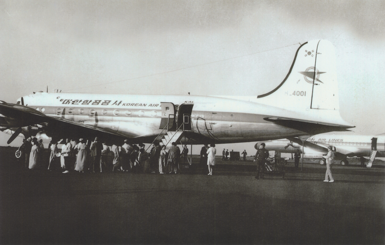

27년 전 오늘, 1999년 11월 11일. 대검찰청 중앙수사부가 조양호 대한항공 회장에 대해 특정범죄가중처벌법 위반(조세포탈) 및 특정경제범죄가중처벌법 위반(횡령) 혐의로 구속영장을 청구하기로 결정했습니다. 국내 최대 민간 항공사를 이끌던 총수 일가가 나란히 검찰청에 소환되면서 대한민국 재계와 사회 전반에 엄청난 파장이 일었습니다.

## 2,301억 원 유출과 673억 원 세금 포탈

1999년 가을을 뜨겁게 달군 한진그룹 탈세 수사는 국세청의 고발에서 시작되었습니다. 대검찰청 반부패특별수사본부와 중앙수사부(본부장 신광옥 검사장, 주임검사 김윤성)가 밝혀낸 혐의 액수는 당시 기준으로도 천문학적이었습니다. 검찰 조사 결과, 조양호 회장은 회사 자금 2,301억 원을 빼돌려 673억 원에 이르는 세금을 포탈한 혐의를 받았습니다.

수사의 핵심에는 항공기 도입 과정에서 발생한 리베이트가 자리 잡고 있었습니다. 검찰은 대한항공이 엔진 구매 리베이트와 항공기 도입 선급금 등 2억 4,400만 달러와 매각 대금을 포함해 총 4억 3,400만 달러를 아일랜드에 위치한 자회사 KALF사로 이전한 경위를 집중 추적했습니다. 거액의 자금이 해외 조세회피처로 흘러 들어간 정황이 속속 드러나며 국민적 공분이 일었습니다.

## 지팡이 짚은 79세 창업주, 부자가 함께 받은 대검 조사

1999년 11월 10일 오전 10시, 서울 서초동 대검찰청 청사 앞에는 수많은 취재진이 몰려들었습니다. 심장병과 당뇨로 입원 치료를 받던 한진그룹 창업주 조중훈 회장이 지팡이를 짚은 채 차에서 내려 청사 안으로 들어섰습니다. 일흔아홉 살 고령의 창업주가 검찰 조사를 받기 위해 출두하는 모습은 그 자체로 충격적인 장면이었습니다.

대검 청사 안에서는 이미 지난 8일 출두한 삼남 조수호 한진해운 사장과 9일 출두한 장남 조양호 대한항공 회장이 조사를 받고 있었습니다. 한진그룹을 일군 아버지와 두 아들이 대검 청사에서 동시에 조사를 받는 초유의 광경이 벌어졌습니다. 조중훈 회장은 다음 날 새벽까지 이어진 강도 높은 밤샘 조사를 받았습니다.

*1999년 자료 — 사진: Peter Garwood / CC BY 4.0*

## 조양호 회장 구속영장 청구와 사법 처리 방침

밤샘 조사를 마친 검찰은 11월 11일 오전, 사법 처리 방향을 공식 발표했습니다. 검찰은 거액의 회사 자금을 유출하고 조세를 포탈한 혐의가 대부분 인정된 조양호 회장에 대해 구속영장을 청구하기로 방침을 세웠습니다. 조양호 회장은 일부 자금 유출 혐의를 부인했으나 국세청 고발 사실 대부분을 시인한 상태였습니다.

반면 10일 오후 조사를 마치고 귀가한 조수호 사장에 대해서는 유용 금액의 규모와 가족관계, 기업 경영에 미칠 영향 등을 참작해 불구속 기소하기로 했습니다. 조중훈 회장 역시 일흔아홉이라는 고령과 심장병 등 지병, 과거 국가 경제 발전에 기여한 점 등을 종합적으로 감안해 구속하지 않고 불구속 기소하기로 결론지었습니다.

*1999년 자료 — 사진: Peter Garwood / CC BY 4.0*

## 건교부 간부 5천만 원 뇌물과 정관계 로비 의혹

검찰의 칼날은 단순히 탈세에만 머물지 않고 정관계 로비 의혹으로 빠르게 번졌습니다. 검찰은 계좌 추적을 통해 1996년과 1997년 건설교통부 전·현직 간부 3명에게 5천만 원씩의 돈이 전달된 사실을 확인했습니다. 건교부 항공국 등 노선 배정과 운항 허가권을 쥔 핵심 부서 간부들에게 건네진 뇌물이었습니다.

로비 창구로 지목된 한진중공업 기획관리담당 김영호 상무는 검찰 소환 조사에서 '노선 배정 등 각종 인허가권을 가진 부서에 성의 표시로 돈을 전달했다'며 금품 제공 사실을 일부 시인했습니다. 여기에 1998년 괌 추락사고 이후 국회의 감편 제재 조치를 무마하기 위해 황창학 한진 부회장이 국회 건설교통위원회 소속 의원들을 상대로 벌인 로비 의혹까지 불거지며 사건은 걷잡을 수 없이 커졌습니다.

*사건 당시 사진 아님 — 사진: 제주특별자치도 / KOGL Type 0 Public Domain*

## 대기업 투명 경영의 뼈아픈 시험대

1999년 11월 11일 단행된 조양호 회장에 대한 구속영장 청구는 한국 재벌 기업사에 큰 획을 그은 사건이었습니다. 기간산업인 항공과 해운을 이끌며 국가 경제의 한 축을 담당했던 대기업 집단도 불투명한 자금 운용과 정관계 로비 의혹 앞에서는 사법의 잣대를 피할 수 없음을 명확히 보여주었습니다.

이 사건을 계기로 해외 조세회피처를 이용한 비자금 조성 수법과 항공기 도입 리베이트 관행이 사회적 문제로 대두되었고, 기업 회계의 투명성을 강화해야 한다는 제도 개혁의 목소리가 한층 힘을 얻게 되었습니다. 수십 년간 고도성장의 그늘 속에 가려져 있던 총수 일가의 비정상적 자금 흐름이 대명천지에 드러난 역사적인 하루였습니다.

### 참고 자료

- <https://newslibrary.naver.com/viewer/index.naver?articleId=1999111100289101001&editNo=6&printCount=1&publishDate=1999-11-11&officeId=00028&pageNo=1&printNo=3656&publishType=00010>
- <https://commons.wikimedia.org/wiki/File:Korean_Air_747-300_HL7470,_Beijing,_Oct99.jpg>
- <https://commons.wikimedia.org/wiki/File:Korean_Air_Cargo_MD-11_HL7372,_Shanghai,_Oct99_(52040286333).jpg>
- <https://commons.wikimedia.org/wiki/File:Korean_Air_Cargo_MD-11_HL7372,_Shanghai,_Oct99_(52040235801).jpg>
- <https://www.kogl.or.kr/recommend/recommendDivView.do?division=img&recommendIdx=38838>
