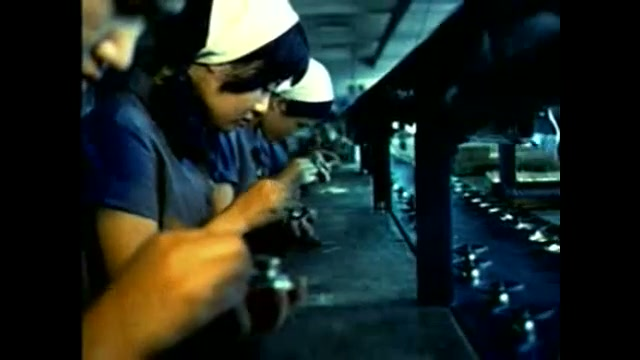

49년 전 오늘, 1977년 11월 12일. 전북 이리역에서 터진 사상 초유의 화약 폭발 참사 소식이 조간신문 1면을 뒤덮으며 온 나라를 깊은 충격에 빠뜨렸습니다. 전날 늦은 밤 평온하던 도시 한복판에서 수십 톤의 다이너마이트가 터지며 이리시 전체가 순식간에 폐허로 변해버렸습니다.

## 평온한 금요일 밤을 뒤흔든 거대한 폭음

1977년 11월 11일 밤 9시 15분경, 전라북도 이리시(현 전북특별자치도 익산시) 창인동의 이리역 구내에서 귀를 찢는 굉음과 함께 거대한 버섯구름 모양의 불기둥이 솟구쳤습니다. 인천을 출발해 광주로 향하던 한국화약의 화물열차에 실려 있던 다이너마이트와 전기뇌관 등 약 40톤의 고성능 폭발물이 일제히 폭발한 것입니다.

당시 많은 시민들은 안방에서 이란 테헤란에서 열린 월드컵 축구 대표팀의 예선 2차전 중계방송을 시청하고 있었습니다. 예고도 없이 터진 엄청난 굉음과 진동에 도시 전체의 전깃불이 한꺼번에 꺼졌고, 창문과 지붕이 박살 나며 거리는 지진이나 전쟁이 일어난 듯한 공포에 휩싸였습니다.

## 반경 500미터 완파, 10미터 깊이의 거대한 분화구

폭발의 위력은 상상을 초월했습니다. 폭발이 일어난 이리역 4번 선로 지점에는 지름 30미터, 깊이 10미터에 달하는 거대한 웅덩이가 파였습니다. 철로와 화차는 엿가락처럼 휘어지거나 흔적도 없이 사라졌고, 파편은 2킬로미터 밖까지 날아갔습니다.

역 주변 반경 500미터 이내의 건물들은 뼈대만 남긴 채 완파되었습니다. 이리 시내 1만 3천여 채의 가옥 중 9천5백여 동이 전파되거나 부서졌고, 공식 집계 결과 59명이 목숨을 잃었으며 1천3백여 명이 중경상을 입었습니다. 하루아침에 삶의 터전을 잃은 이재민만도 1만 명에 육박했습니다.

*한국의 전자공업 ... 우리나라에 적합함. 전자기기의 생성 현장 (1974.00.00) 장면 1 — 사진: KTV 국민방송 e영상역사관 (문화영화) / KTV 공공저작물 — 영상 저작물 전면 개방(대통령실 2025-07-09), 출처 표시*

## 무너진 삼남극장과 긴박했던 현장

이리역 인근에 있던 삼남극장에서는 비극 속에서도 잊을 수 없는 일화가 남았습니다. 당시 극장에서는 하춘화 리사이틀 공연이 열려 6백여 명의 관객이 쇼를 관람하던 중이었는데, 폭발 진동으로 극장 천장이 순식간에 내려앉았습니다.

이 사고로 극장 안에 있던 관객 여러 명이 숨지는 참사가 벌어졌습니다. 당시 무대 사회를 보던 무명의 코미디언 고(故) 이주일 씨는 두개골이 함몰되는 중상을 입었음에도 불구하고 가수 하춘화 씨를 구출해 업고 병원으로 뛰었습니다. 한편 군산과 김제 등 수십 킬로미터 떨어진 인근 지역 병원까지 부상자들이 분산 이송되는 등 수라장이 이어졌습니다.

![[1160호] 폭발사고 이리 폭발사고 (1977.11.24) 장면 1](../images/2026-11-12-01-3.jpg)
*[1160호] 폭발사고 이리 폭발사고 (1977.11.24) 장면 1 — 사진: KTV 국민방송 e영상역사관 (대한뉴스) / KTV 공공저작물 — 영상 저작물 전면 개방(대통령실 2025-07-09), 출처 표시*

## 안전 불감증과 그릇된 관행이 부른 인재

수사 결과 드러난 폭발의 원인은 어처구니없는 인재였습니다. 원칙상 폭약과 같은 고위험 화물은 역 구내에 머무르지 않고 여객열차보다 우선 통과시켜야 했지만, 당시 철도 현장에는 돈을 내야 통과를 빠르게 해주는 소위 '급행료' 관행이 만연해 있었습니다.

급행료를 내지 못해 이리역 선로에 24시간 넘게 발이 묶여 있던 화물열차 안에서, 한국화약 소속 호송원은 술을 마신 뒤 추위를 피하려 촛불을 켜둔 채 잠이 들었습니다. 이 촛불이 침구와 화약 상자로 옮겨붙으면서 걷잡을 수 없는 연쇄 폭발로 이어진 것으로 밝혀져 국민적 공분을 샀습니다.

![[1160호] 폭발사고 이리 폭발사고 (1977.11.24) 장면 2](../images/2026-11-12-01-4.jpg)
*[1160호] 폭발사고 이리 폭발사고 (1977.11.24) 장면 2 — 사진: KTV 국민방송 e영상역사관 (대한뉴스) / KTV 공공저작물 — 영상 저작물 전면 개방(대통령실 2025-07-09), 출처 표시*

## 폐허를 딛고 일어선 도시, 익산역에 남은 교훈

정부는 비상동원령을 선포하고 군과 경찰, 의료진을 총동원해 사태 수습에 나섰습니다. 집을 잃은 이재민들을 위해 이리시 최초의 대단지 아파트인 모현주공아파트가 지어졌으며, 도시 구조 전반이 새로 재편되었습니다.

이후 1995년 이리시와 익산군이 통합되면서 도시는 익산시로 거듭났고, 이리역 역시 익산역으로 개칭되었습니다. 평온했던 주말 밤을 앗아간 1977년 11월의 뼈아픈 참사는 반세기가 흐른 오늘날에도 철도 안전과 위험물 취급의 중요성을 일깨우는 잊지 못할 역사로 남아 있습니다.

### 참고 자료

- <https://newslibrary.naver.com/viewer/index.naver?articleId=1977111200329201004&editNo=2&printCount=1&publishDate=1977-11-12&officeId=00032&pageNo=1&printNo=9885&publishType=00020>
- <https://pixabay.com/photos/old-train-train-nostalgia-china-8110662/>
- <https://www.ehistory.go.kr/view/movie?mediasrcgbn=KV&mediaid=11375&mediadtl=25527&mediagbn=MH#t=0.3>
- <https://www.ehistory.go.kr/view/movie?mediasrcgbn=KV&mediaid=10115&mediadtl=20662&mediagbn=DH#t=0.3>
- <https://www.ehistory.go.kr/view/movie?mediasrcgbn=KV&mediaid=10115&mediadtl=20662&mediagbn=DH#t=0.7>
