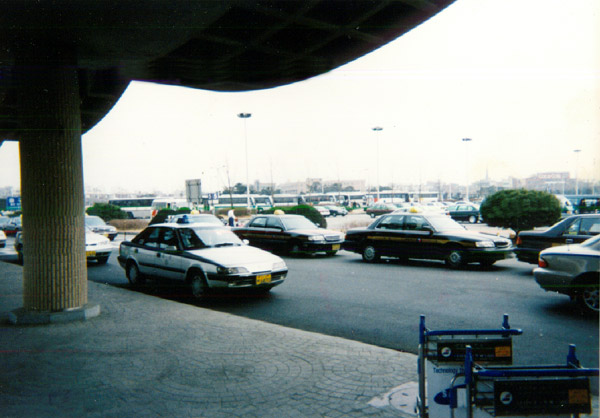
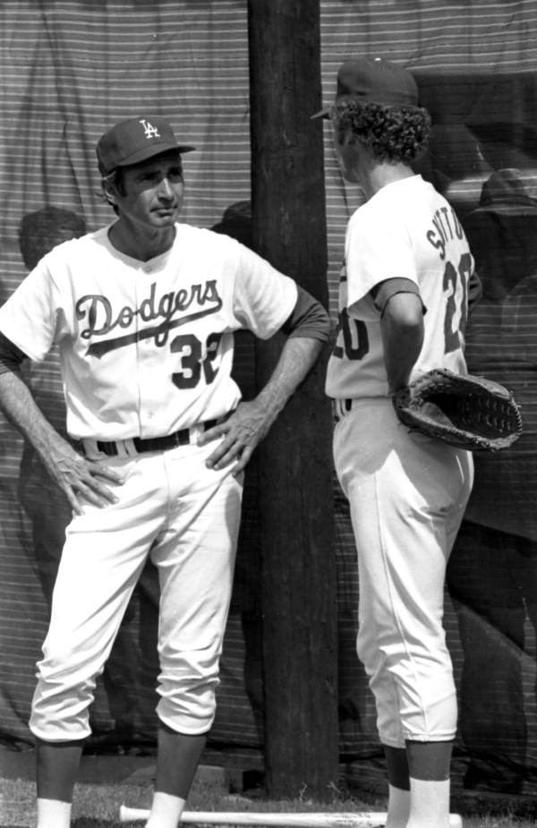

29년 전 오늘, 1997년 11월 12일 조간신문 1면에는 활짝 웃으며 손을 흔드는 한 청년의 사진이 대대적으로 실렸습니다. 미국 프로야구 메이저리그 로스앤젤레스 다저스에서 14승을 거두며 당당히 에이스로 우뚝 선 '코리안 특급' 박찬호 선수가 11개월 만에 고국 땅을 밟은 소식이었습니다.

## 한국인 최초 메이저리거의 험난했던 출발

충청남도 공주 출신으로 한양대학교에 재학 중이던 박찬호는 1994년 1월 한국인 최초로 메이저리그 로스앤젤레스 다저스와 계약을 맺었습니다. 당시 마이너리그를 거치지 않고 메이저리그 25인 로스터에 직행한 역대 17번째 선수가 될 정도로 큰 기대를 모았습니다.

하지만 메이저리그의 벽은 높았습니다. 1994년 4월 8일 애틀랜타 브레이브스전에서 구원 등판하며 데뷔전을 치렀으나, 데뷔 17일 만에 더블A 팀인 샌안토니오 미션스로 내려가야 했습니다. 박찬호는 낯선 타국에서 언어와 문화적 차이, 그리고 마이너리그의 열악한 환경 속에서 이를 악물고 투구 폼과 제구력을 가다듬었습니다.

## 마이너리그의 눈물과 1996년 첫 승

1995년 트리플A 팀인 앨버커키 듀크스에서 뛴 박찬호는 해발 1,500미터 고지대에서 살아남기 위해 강속구를 연마했습니다. 그해 퍼시픽 코스트 리그에서 101탈삼진을 기록하며 9이닝당 8.26개의 탈삼진율로 리그 최고 기록을 세웠고, 9월 메이저리그로 다시 호출되었습니다.

각고의 노력 끝에 1996년 4월 7일 시카고 컵스전에서 기회가 찾아왔습니다. 선발투수 라몬 마르티네스의 갑작스러운 부상으로 2회 말 구원 등판한 박찬호는 4이닝 동안 삼진 7개를 솎아내며 무실점으로 역투했고, 한국인 투수 최초의 메이저리그 승리 투수가 되었습니다. 닷새 뒤 플로리다 말린스전에서는 첫 선발승까지 따내며 시즌 5승 5패, 평균자책 3.64로 풀타임 메이저리거의 입지를 다졌습니다.

*사건 당시 사진 아님 · 1996년 — 사진: No machine-readable author provided. Yanagi774 at Japanese W / Public domain*

## 1997년, 14승을 거두며 다저스의 에이스로

1997년 스프링캠프에서 치열한 5선발 경쟁을 뚫고 로테이션에 합류한 박찬호는 폭발적인 기량을 선보였습니다. 시속 99마일에 육박하는 묵직한 강속구와 위력적인 슬러브, 파워 커브를 앞세워 타자들을 제압해 나갔습니다.

8월 11일 시카고 컵스전과 9월 24일 샌디에이고 파드리스전에서 완투승을 거두는 등 거침없는 활약을 펼쳤습니다. 1997년 시즌 최종 성적은 32경기 등판, 14승 8패, 평균자책 3.38이었습니다. 이는 일본인 특급 투수로 활약하던 팀 동료 노모 히데오의 14승 12패, 평균자책 4.25를 넘어서는 팀 내 최고 성적이었습니다.

*L.A. Dodgers players Sandy Koufax and Don Sutton during spring training in Florida — 사진: Donald Greory "Donn" Dughi / Public domain*

## 11개월 만의 귀국, 김포공항에 쏟아진 환호

시즌을 성공적으로 마친 박찬호는 1997년 11월 11일 저녁 김포공항을 통해 고국으로 돌아왔습니다. 전년도 12월 출국한 이후 11개월 만의 귀국이었습니다. 공항 입국장은 그를 보기 위해 몰려든 가족과 수백 명의 팬, 수많은 취재진으로 인산인해를 이루었습니다.

스물네 살의 당당한 청년이 된 박찬호는 환영 나온 팬들에게 환한 미소와 함께 손을 번쩍 들어 인사했습니다. 태평양 건너 메이저리그 마운드에서 세계 최고의 타자들을 힘으로 윽박지르며 삼진을 잡아내던 그의 모습은 TV 화면을 지켜보던 온 국민에게 가슴 벅찬 자부심과 용기를 주었습니다.

*전두환 대통령 특별 담화 ... .13전두환 대통령 특별담화 (1987.00.00) 장면 1 — 사진: KTV 국민방송 e영상역사관 (대통령기록영상) / KTV 공공저작물 — 영상 저작물 전면 개방(대통령실 2025-07-09), 출처 표시*

## 아시아 최다승 124승의 전설로 남은 이름

1997년의 14승은 위대한 전설의 시작에 불과했습니다. 박찬호는 이듬해인 1998년 방콕 아시안 게임에서 국가대표 에이스로 출전해 금메달을 이끌었고, 2000년에는 18승 10패, 평균자책 3.27이라는 개인 최고 기록을 달성했습니다.

텍사스 레인저스를 거쳐 필라델피아 필리스, 피츠버그 파이리츠 등 메이저리그 여러 팀에서 활약한 그는 2010년 통산 124승을 달성하며 노모 히데오를 제치고 메이저리그 아시아 투수 최다승이라는 대기록을 완성했습니다. 1997년 11월, 김포공항 로비에서 활짝 웃던 청년 투수의 발걸음은 한국 야구사를 영원히 바꾸어 놓은 신화의 이정표였습니다.

### 참고 자료

- <https://newslibrary.naver.com/viewer/index.naver?articleId=1997111200209101002&editNo=45&printCount=1&publishDate=1997-11-12&officeId=00020&pageNo=1&printNo=23706&publishType=00010>
- <https://commons.wikimedia.org/wiki/File:Los_Angeles_Dodgers_spring_training_at_Holman_Stadium,_Dodgertown,_1994.jpg>
- <https://commons.wikimedia.org/wiki/File:Kimpo-noriba.jpg>
- <https://commons.wikimedia.org/wiki/File:L.A._Dodgers_players_Sandy_Koufax_and_Don_Sutton_during_spring_training_in_Florida.jpg>
- <https://www.ehistory.go.kr/view/movie?mediasrcgbn=KV&mediaid=2283&mediadtl=9140&mediagbn=DT#t=0.3>
